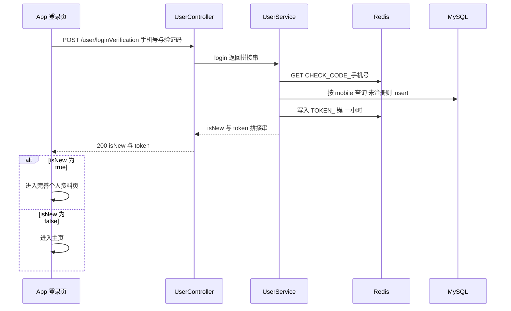

# 登录逻辑 UserController：login 接口的组装、返回结构与 App 端联调

服务层已经能把登录做成 `isNew|token` 的拼接串，但它距离前端可用的 HTTP 接口还差一层翻译：拆串、组响应、定状态码，以及登录失败时给 App 一个能识别的错误对象。这一节补完 `UserController` 的 `login` 方法，并用 Debug 断点与模拟器 App 把整条登录链路真实跑通，重点看清 `isNew` 这个字段如何决定用户登录后的去向。

## 先给结论

- 接口路径为 `POST /user/loginVerification`，参数是 JSON 里的 `phone` 与 `verificationCode`，契约响应体为 `isNew`（布尔）与 `token`（JWT 字符串）两个字段。
- 成功返回 200 加结果 Map；token 为空与抛异常统一走 500 加 `ErrorResult`，错误码 `000001`、提示语「登录失败」。
- 拆分用 `StringUtils.split(token, "|")`，它按字面字符拆分；若改用 `String.split` 则要写 `\\|`，竖杠在正则里是特殊字符。
- `ResponseEntity.ok()` 返回的是 `BodyBuilder`，必须再 `.body(result)` 才是响应对象，直接 return 编译不过，这是本节现场真实出现过的一次报错。
- App 端以 `isNew` 分流：true 进完善个人资料页，false 进主页；每次登录都会签发全新 token。

## 一、接口组装：从拼接串到契约响应

```java
package com.study.tanhua.sso.controller;

import com.study.tanhua.sso.service.UserService;
import com.study.tanhua.sso.vo.ErrorResult;
import org.apache.commons.lang3.StringUtils;
import org.springframework.http.HttpStatus;
import org.springframework.http.ResponseEntity;
import org.springframework.web.bind.annotation.*;
import java.util.HashMap;
import java.util.Map;

@RequestMapping("user")
@RestController
public class UserController {

    @Autowired
    private UserService userService;

    /**
     * 用户登录：校验验证码并签发 token
     */
    @PostMapping("loginVerification")
    public ResponseEntity<Object> login(@RequestBody Map<String, String> param) {
        String phone = param.get("phone");
        String verificationCode = param.get("verificationCode");
        try {
            String token = this.userService.login(phone, verificationCode);
            if (StringUtils.isNotEmpty(token)) {
                // 登录成功，按契约拆分出 isNew 与 token
                String[] ss = StringUtils.split(token, "|");
                Boolean isNew = Boolean.valueOf(ss[0]);
                String tokenStr = ss[1];
                Map<String, Object> result = new HashMap<>(2);
                result.put("isNew", isNew);
                result.put("token", tokenStr);
                return ResponseEntity.ok(result);
            }
        } catch (Exception e) {
            e.printStackTrace();
        }
        // 登录失败，统一返回 500 与错误对象
        ErrorResult.ErrorResultBuilder builder = ErrorResult.builder()
                .errCode("000001")
                .errMsg("登录失败");
        return ResponseEntity.status(HttpStatus.INTERNAL_SERVER_ERROR).body(builder.build());
    }
}
```

类上 `@RequestMapping("user")` 与方法上 `@PostMapping("loginVerification")` 拼出契约地址，方法名长就直接对照 mock 文档拷贝，路径是前后端共享的标识。参数用 `@RequestBody Map<String, String>` 接，键名 phone 与 verificationCode 来自契约文档，与服务层方法参数按位置对应。

成功的分支只做一件事：拆串组装。`ss[0]` 是布尔串经 `Boolean.valueOf` 转成真正的 Boolean，`ss[1]` 才是 JWT 原文，两者装进 Map 返回。try-catch 把服务层调用整体包住，任何异常与「token 为空」一样，最终都收敛到同一个 500 出口，App 端不需要理解多种失败形态，这正是上一节发码接口定下的失败表达方式的延续。

整条链路与页面分流画出来是这样：



图上的 alt 分支就是 `isNew` 存在的全部意义：同一个登录接口，新老用户在 App 端走向不同页面，服务端只负责把事实说清楚。

## 二、两个真实踩到的编译与正则细节

**第一，`ResponseEntity.ok()` 不是响应对象。** 组装返回值时先写了 `return ResponseEntity.ok();`，IDE 立刻报错 `Incompatible types. Required: ResponseEntity. Found: ResponseEntity.BodyBuilder`。`ok()` 无参重载返回的是 BodyBuilder，还欠一个响应体；`ok(result)` 传入 body 才生成完整的 `ResponseEntity`。错误信息把两个类型名都写明白了，读编译器提示比背 API 更快。

**第二，拆分竖杠时两种 split 行为不同。** commons-lang3 的 `StringUtils.split(token, "|")` 把竖杠当普通字符处理，直接可写；JDK 自带的 `String.split` 按正则解析，竖杠是「或」的含义，必须写成 `split("\\|")` 才能得到两段。两种 API 混用场景里记错行为，轻则数组越界，重则拆出错误内容，本节代码统一用前者规避转义问题。

失败响应里的 `ErrorResult` 复用发码接口建好的 vo 类，`@Builder` 链式构造出 `errCode` 为 `000001` 的错误对象。与发码失败的区别只在提示语：这里是「登录失败」。错误码沿用 `000001` 表达业务级失败，App 端按 errCode 做提示样式分支，不依赖文案判断。

## 三、Debug 走查：一次登录在断点下的完整路径

服务以 Debug 模式重启，在 `UserController.login` 与 `UserService.login` 各打一个断点，用 REST 工具先验证：

```bash
curl -X POST http://127.0.0.1:18080/user/loginVerification \
  -H "Content-Type: application/json" \
  -d "{\"phone\":\"17602189189\",\"verificationCode\":\"113421\"}"
```

直接请求会走失败分支：Redis 里没有有效验证码，服务层第一个判断就返回 null，响应 500 与「登录失败」错误对象。先按契约调一次发码接口拿到验证码 813436，再提交登录，断点逐段展示完整路径：验证码比对通过；按手机号查库得到 null，进入注册分支，new User、设默认密码、insert；随后 token 签发完成，一串点号分隔的 JWT 出现在变量窗口；写入 Redis 键 `TOKEN_` 加 token 成功；MQ 消息发送无异常；最终返回拼接串，Controller 组装出 200 响应，`isNew` 为 true，token 即签发的 JWT。

此时打开 Navicat 查本机 `mytanhua` 库的 `tb_user` 表，能看到刚才插入的新用户一行。资料包 `mytanhua.sql` 里预置的用户 17602189189 就是调试顺手的对象，预置数据的结构与代码行为互为印证。

同一个请求再发一次：验证码比对依旧通过，这次查库命中了刚插入的用户，注册分支被跳过，`isNew` 变成 false，token 则是一串全新的字符。两次响应对照得出两条结论：`isNew` 只反映「本次登录时库里有没有这个手机号」；token 每次登录都重新签发，Redis 里旧键仍在、新键并存，互不干扰。

## 四、App 端联调：isNew 决定用户去向

服务端自测通过后换模拟器里的完整版 App。打开 App 先确认服务地址指向开发机，进入「登录注册」页输入手机号，点击获取验证码，收到短信后先故意输错一位再点登录，App 弹出「登录失败」，对应服务端的 500 错误对象，请求与响应都对得上。

把验证码改对再登录，App 直接进入主页。这次登录用的是先前调试时已注册的手机号，`isNew` 为 false，App 拿到 false 就走主页分支，不会把老用户再拽去填资料。换另一个从未登录过的手机号重复流程，收码登录后 App 进入的是「完善个人资料」页面，对应 `isNew` 为 true 的新用户路径，这个页面的内容完善属于后续课程的功能，资料包移动端原型里的「首次登录信息完善」页就是它的设计稿。至此登录功能在真实 App 上闭环：接口、数据库、Redis、App 页面四处行为完全一致。

## 常见误区

- **把 `ResponseEntity.ok()` 当返回值。** 错例：`return ResponseEntity.ok();` 编译报类型不匹配。正解：无参 ok 返回 BodyBuilder，携带响应体要用 `ok(body)` 或 `ok().body(body)`。
- **用 `String.split` 拆竖杠却忘转义。** 错例：`token.split("|")` 得到逐字符数组。正解：正则里的竖杠写 `\\|`，或统一改用 `StringUtils.split` 按字面字符拆分。
- **isNew 用字符串返回。** 错例：Map 里塞 `"true"` 字符串，前端拿到后要再做字符串比较。正解：契约定义为布尔类型，`Boolean.valueOf` 转换后放入响应，类型在传输层就定死。
- **把 isNew 与登录成败混为一谈。** 错例：老用户登录后 `isNew` 为 false，误判成登录失败去排查。正解：isNew 描述的是账号是否本次新建，成败看 HTTP 状态码与 token 是否存在，两者语义正交。

## 面试可能被问到的问题

1. 面试官追问：「为什么每次登录都签发新 token，旧的怎么办？」
   答：每次签发保证 token 与本次登录会话绑定，Redis 里以 token 为键互不覆盖。旧 token 在各自有效期内仍可用，这是可接受的取舍；若要求单设备登录，签发新 token 时删除该用户旧 token 的键即可。
2. 面试官追问：「Controller 里 try-catch 兜底和全局异常处理器是什么关系？」
   答：本课用局部 try-catch 把异常收敛成统一的 500 错误对象，直观但每个方法都要写。工程量上来后应换成 @ControllerAdvice 加 @ExceptionHandler 的全局处理，按异常类型统一组装 ErrorResult，Controller 只写正常路径。两者是演进关系，不是二选一。
3. 面试官追问：「isNew 的判定时机在并发下可靠吗？」
   答：判定发生在查库之后，两个并发请求可能都查到 null 而同时认为自己是新用户。对页面分流而言问题不大，真正的风险在重复插入，靠 mobile 唯一索引兜底，应用层捕获冲突后按已注册继续。isNew 应视为展示语义而非业务强一致字段。
4. 面试官追问：「登录失败为什么返回 500 加错误对象，而不是 200 加业务码？」
   答：与发码接口的契约保持一致，前后端用同一套失败表达方式，App 端一套错误处理逻辑复用两个接口。错误对象里的 errCode 区分业务场景，errMsg 直接可提示。风格本身可讨论，关键是全项目统一且写进契约文档。
5. 面试官追问：「服务层返回拼接串，Controller 负责拆分，这个设计你怎么评价？」
   答：它让服务层少建一个返回类，但把内部格式暴露成了层间契约，分隔符冲突与可读性都是隐患。更稳妥的做法是服务层返回包含 token 与 isNew 的领域对象，Controller 只做序列化。课程示例为了聚焦逻辑可以接受，生产代码建议显式 DTO。

## 配套资料

- 数据库：`materials/code/07/day01 探花交友-项目搭建以及登录完善个人信息/day01/代码/mytanhua.sql`，含 `tb_user` 表结构与预置用户数据，调试登录可直接使用预置手机号。
- 原型：`materials/code/07/day01 探花交友-项目搭建以及登录完善个人信息/day01/资料/` 下的移动端原型包，含「登录页」「首次登录信息完善」等页面，App 端登录与分流后的界面以此为准。
- 学习目标：`materials/code/07/day01 探花交友-项目搭建以及登录完善个人信息/day01/学习目标.md`，独立完成登录的功能是 day01 的核心目标项。
- 说明：day01 资料包无工程源码，`UserController` 按课程画面整理，返回体键名以契约与实际响应为准；包名统一为 `com.study.tanhua`，示例请求中的验证码为调试现场值。
