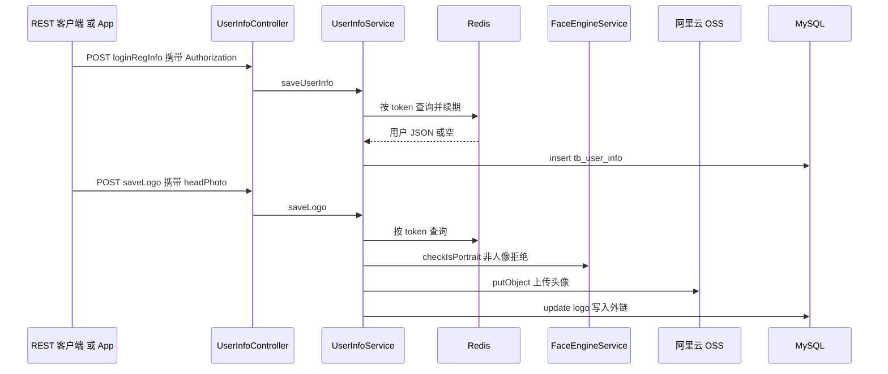

# 完善个人信息落地：两个接口串起 token 校验、人像识别与头像落库

素材齐了：token 能签发能校验，OSS 能传图，人脸引擎能辨人像。完善个人信息是把这三块能力串成一条业务链的两个接口：一个接收性别、昵称、生日、城市的 JSON 存进 `tb_user_info`，一个接收头像图片，先验人像再传 OSS，最后把外链写回资料表。这一节写完 Service 与 Controller，再用 REST 客户端和 Android 客户端各走一遍完整流程。

## 先给结论

- 接口契约有两个：`POST /user/loginRegInfo` 提交 `gender、nickname、birthday、city` 的 JSON；头像上传是 multipart 表单，文件字段名 `headPhoto`。
- 两个接口的 token 都放在 `Authorization` 请求头里，Controller 用 `@RequestHeader` 取出后传给 Service。
- 校验规则全局统一：除发送验证码和登录两个入口外，其余接口一律先按 token 查用户，查不到直接失败。
- `saveUserInfo` 走「token 查用户、组装 UserInfo、insert」三步；`saveLogo` 走「token 查用户、人像校验、OSS 上传、更新 logo」四步，非人像直接拒绝。
- 联调顺序必须是发验证码、登录拿 token、再带 token 调业务接口，token 失效是联调时最常见的第一个报错。

## 接口契约：从文档定义到工程分工

接口定义在课程配套的 Mock 平台文档里：完善个人信息接口的请求头是 `Content-Type: application/json`，请求体四个字段；上传头像接口则是表单文件加认证头。Mock 文档只给契约，实现全在自己。落到 sso 工程里是四层：

- `UserInfoMapper` 继承 MyBatis-Plus 的 `BaseMapper`，零 SQL 拿到增删改查；
- `UserInfoService` 编排 token 校验、人像校验、上传、落库；
- `UserInfoController` 暴露两个 HTTP 入口；
- 复用的 `FaceEngineService` 与 `PicUploadService` 保持原样，被注入调用。

Mapper 本身没有内容，全部能力来自继承：

```java
package com.study.tanhua.sso.mapper;

import com.baomidou.mybatisplus.core.mapper.BaseMapper;
import com.study.tanhua.sso.pojo.UserInfo;

public interface UserInfoMapper extends BaseMapper<UserInfo> {
}
```

性别字段是典型的有限取值场景，建表时约定 1 男、2 女、3 未知，用枚举承接，MyBatis-Plus 按全局配置扫描枚举包，`@EnumValue` 标记的成员就是写库的值（枚举类为按本课写法补全的示例）：

```java
public enum SexEnum {
    MAN(1), WOMAN(2), UNKNOWN(3);

    @EnumValue
    private final int value;

    SexEnum(int value) {
        this.value = value;
    }
}
```

## Service：token 是一切的前置

两个业务方法都从同一个动作开始：按 token 查用户。这个方法在打通登录时已经写好，逻辑是拿 token 拼 key 去 Redis 查，查到就续期并反序列化，查不到返回 null：

```java
public User queryUserByToken(String token) {
    try {
        String redisTokenKey = "TOKEN_" + token;
        String cacheData = this.redisTemplate.opsForValue().get(redisTokenKey);
        if (StringUtils.isEmpty(cacheData)) {
            // Redis 里查不到，token 已失效
            return null;
        }
        // 查到即续期，活跃用户不会被登出
        this.redisTemplate.expire(redisTokenKey, 1, TimeUnit.HOURS);
        return MAPPER.readValue(cacheData, User.class);
    } catch (Exception e) {
        e.printStackTrace();
    }
    return null;
}
```

`saveUserInfo` 拿到用户后组装资料对象入库；用户为空说明 token 无效，直接返回 false：

```java
@Service
public class UserInfoService {
    private static final Logger LOGGER = LoggerFactory.getLogger(UserInfoService.class);

    @Autowired
    private UserInfoMapper userInfoMapper;
    @Autowired
    private UserService userService;
    @Autowired
    private FaceEngineService faceEngineService;
    @Autowired
    private PicUploadService picUploadService;

    // 完善个人信息
    public Boolean saveUserInfo(Map<String, String> param, String token) {
        User user = this.userService.queryUserByToken(token);
        if (user == null) {
            return false;
        }
        UserInfo userInfo = new UserInfo();
        userInfo.setUserId(user.getId());
        userInfo.setSex(StringUtils.equals(param.get("gender"), "man") ? SexEnum.MAN : SexEnum.WOMAN);
        userInfo.setNickname(param.get("nickname"));
        userInfo.setBirthday(param.get("birthday"));
        userInfo.setCity(param.get("city"));
        // 保存UserInfo数据到数据库
        this.userInfoMapper.insert(userInfo);
        return true;
    }
}
```

注意映射细节：前端传的 `gender` 是字符串 `man`，落到实体上是 `SexEnum.MAN`，写库时由枚举机制变成数值 1。新增走 `insert`，此刻资料行还没有头像。

`saveLogo` 把已封装的两个人脸与上传能力接进来，多一步把表单文件转成临时文件的动作（画面未展开，按主流写法补全）：

```java
public Boolean saveLogo(MultipartFile file, String token) {
    User user = this.userService.queryUserByToken(token);
    if (null == user) {
        return false;
    }
    try {
        // 判断头像是否为人脸，非人像直接拒绝
        boolean isPortrait = this.faceEngineService.checkIsPortrait(toTempFile(file));
        if (!isPortrait) {
            return false;
        }
    } catch (Exception e) {
        LOGGER.error("检测人像图片出错！", e);
        return false;
    }
    // 图片上传到阿里云OSS
    PicUploadResult uploadResult = this.picUploadService.upload(file);
    if ("error".equals(uploadResult.getStatus())) {
        return false;
    }
    // 外链写回 tb_user_info.logo
    UserInfo userInfo = new UserInfo();
    userInfo.setLogo(uploadResult.getName());
    UpdateWrapper<UserInfo> updateWrapper = new UpdateWrapper<>();
    updateWrapper.eq("user_id", user.getId()).set("logo", userInfo.getLogo());
    this.userInfoMapper.update(null, updateWrapper);
    return true;
}
```

顺序有讲究：人像校验在前，OSS 上传在后，不合法的图片一张都不会浪费存储；更新走 `UpdateWrapper` 按 `user_id` 定位资料行，因为完善信息时那行已经 insert 过了。

## Controller：从请求头里取 token

JWT 规范把 token 放在请求头，所以两个接口都用 `@RequestHeader("Authorization")` 接收，再下传 Service 校验：

```java
@RestController
@RequestMapping("user")
public class UserInfoController {

    @Autowired
    private UserInfoService userInfoService;

    /*
     * 完善个人信息
     */
    @PostMapping("/loginRegInfo")
    public ResponseEntity<Object> saveUserInfo(@RequestBody Map<String, String> param,
                                               @RequestHeader("Authorization") String token) {
        Boolean bool = this.userInfoService.saveUserInfo(param, token);
        return ResponseEntity.ok(bool);
    }

    /*
     * 上传头像
     */
    @PostMapping("saveLogo")
    public ResponseEntity<Object> saveLogo(@RequestParam("headPhoto") MultipartFile file,
                                           @RequestHeader("Authorization") String token) {
        try {
            Boolean bool = this.userInfoService.saveLogo(file, token);
            if (bool) {
                return ResponseEntity.ok(null);
            }
        } catch (Exception e) {
            e.printStackTrace();
        }
        // 非人像或上传异常，统一返回引导重传的错误
        ErrorResult errorResult = ErrorResult.builder()
                .errCode("000000").errMsg("图片非人像，请重新上传").build();
        return ResponseEntity.status(HttpStatus.INTERNAL_SERVER_ERROR).body(errorResult);
    }
}
```

上传接口的返回值得停下来看：成功返回 200 空体；返回 false 或抛异常，都汇成 500 加一个 `ErrorResult` 结构，错误信息就是客户端弹窗用的那句「图片非人像，请重新上传」。`ErrorResult` 是 `errCode` 与 `errMsg` 两个字段的构建器类（按本课写法补全的示例）。



这张图把两个接口并排摆开：前半段是资料落库，后半段是头像校验与上传，共同的起点都是 Redis 里的 token 查询，这条线断了后面全部不执行。

## 联调测试：REST 客户端先通，App 端再走全流程

REST 客户端里按历史脚本测试。第一个报错来得很有教育意义：直接调 `loginRegInfo`，断点跟进去发现 Redis 里始终查不到 token，返回失败。原因是服务重启过，旧 token 早已失效。于是按真实顺序重来：先发验证码，再登录拿到新 token，把它放进 `Authorization` 头重新提交，接口返回 true。此时查库，`tb_user_info` 已经多了一条记录，但 `logo` 还是空，因为头像还没传。

上传头像的请求换 multipart：字段名 `headPhoto` 与 Controller 参数一致，`Authorization` 头带上 token，选一张人像图片发送。第一次执行明显偏慢，人脸引擎在启动后的首次检测要完成预热，属于正常现象。返回 true 后查库，`logo` 字段出现了 OSS 外链，浏览器打开正是刚上传的图片。

App 端验证走真流程：模拟器里把旧数据清空，当全新用户从获取验证码开始，填性别、昵称、生日、城市，点设置头像。这里有个环境坑：模拟器相机没配置时会提示无法连接相机，把模拟器重启并配好相机即可。继续流程，对着手机随手拍一张没有人的照片提交，客户端出现扫描动画，后台在上传并做校验，几秒后提示「图片非人像，请重新上传」；换一张自拍提交，审核通过，点击开始交友进入主页。回到数据库，`logo` 里是这次自拍的 OSS 外链。至此完善信息功能从接口到端上全部跑通。

## 常见误区

- **token 放请求体或查询参数。** 错例：把 token 拼在 body 里，`@RequestHeader` 注入的值是 null，接口直接失败。正解：token 统一放 `Authorization` 请求头，工具类登录后的请求都带上这个头。
- **业务接口忘记校验 token。** 错例：新接口直接操作数据库，任何人都能调。正解：除发送验证码与登录外，所有接口第一步都是按 token 查用户，查不到立即失败。
- **非人像图片已经传到 OSS 才提示。** 错例：先上传后校验，垃圾图片照样占存储。正解：人像校验在前、上传在后，校验不通过直接短路返回。
- **首图上传误判超时。** 错例：第一次上传等待几秒就判定接口卡死，反复重试。正解：引擎启动后的首次检测含预热开销，属正常现象，联调时耐心等首响应。

## 面试可能被问到的问题

1. 面试官追问：「token 校验放在 Controller 还是 Service？」
   答：校验动作依赖 token 与用户状态，放在 Service 意味着每个业务方法都要重复这一步且容易遗漏；本课的写法是 Service 内统一调用 queryUserByToken 作为第一步，Controller 只负责从请求头取 token。工程上更彻底的做法是拦截器统一校验后把用户放进上下文。
2. 面试官追问：「@RequestHeader 注入的请求头不存在会怎样？」
   答：默认 required 为 true，缺失时抛出 MissingRequestHeaderException，请求返回 400。如果允许缺失可设置 required 为 false 并给默认值，但对认证头而言，快速失败正是想要的行为。
3. 面试官追问：「完善信息 insert 一次、上传头像又 update 一次，为什么不一次做完？」
   答：两个接口对应客户端的两个独立步骤，用户可能只完善资料不立即上传头像，拆开各自幂等更合理；资料行先建立，头像到货后按 user_id 更新 logo 即可，两次操作互不阻塞。
4. 面试官追问：「queryUserByToken 里查到就 expire 续期，为什么这么做？」
   答：这是滑动过期策略，token 有效期从最后一次活跃时间重新计时。固定过期会把持续活跃的用户中途登出，体验差；续期让空闲超时的 token 自然失效，兼顾安全与体验。
5. 面试官追问：「MultipartFile 怎么交给需要 File 的识别方法？」
   答：上传的文件在容器临时目录或内存中，不能直接当 java.io.File 用。常规做法是 transferTo 写到临时文件，用完删除，或者封装成字节流接口；临时文件方案对需要路径与重复读取的本地库最省事。

## 配套资料

- 数据库：`materials/code/07/day01 探花交友-项目搭建以及登录完善个人信息/day01/代码/mytanhua.sql`，`tb_user_info` 的建表脚本，`logo` 字段存头像外链。
- 原型：`materials/code/07/day01 探花交友-项目搭建以及登录完善个人信息/day01/资料/探花交友移动端原型V1.2/首次登录信息完善.html`，性别、昵称、生日、城市与设置头像的界面契约。
- 学习目标：`materials/code/07/day01 探花交友-项目搭建以及登录完善个人信息/day01/学习目标.md`，列有「独立完成完善个人信息功能」。
- 说明：day01 资料包无工程源码，`SexEnum`、`ErrorResult`、临时文件转换与 `UpdateWrapper` 更新段为按课程写法补全的示例；包名按规范改写为 `com.study.tanhua`。
