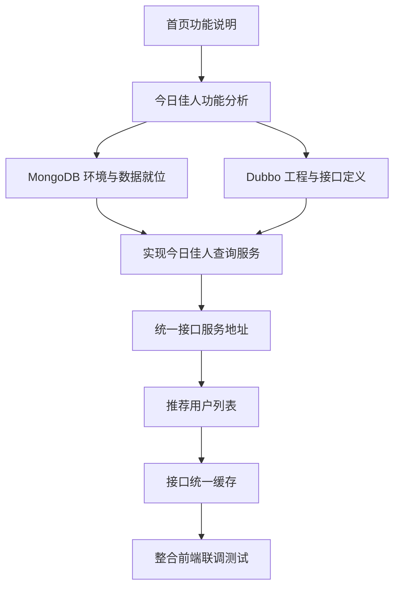

# day02 课程说明：首页功能的六个任务与两样新技术

day02 的课程说明看似只是过一遍目录，实际交代了任务之间的依赖：没有 MongoDB 就没有推荐结果可查，没有 Dubbo 工程就没有服务可调，顺序错了会当场卡住。开工前把这六个任务和两样新技术盘清楚，写代码时才知道每一步在整体里处在什么位置。

## 先给结论

- day02 六个任务依次是：首页功能说明、实现今日佳人、统一接口服务地址、实现推荐用户列表、接口统一增加缓存、整合前端联调测试，全部围绕首页一屏展开。
- 今日佳人的本质是从推荐结果中挑出缘分值最高的用户展示，推荐结果数据存 MongoDB，这是 MongoDB 在项目里第一次真正进场。
- 服务间调用引入 Apache Dubbo：接口服务与推荐查询拆成两个工程，跨进程取数走 RPC。
- 缓存统一加：不逐接口手写缓存逻辑，而是收敛成一处统一处理，新接口零成本获得缓存能力。
- 学习目标里「独立完成 Dubbo 服务的开发」「掌握缓存的添加逻辑」两条，正对应 day02 的两项技术准备。

## 六个任务的依赖关系

课程说明里六个任务是按顺序报出来的，但真正的约束是依赖：今日佳人要查推荐结果，结果数据躺在 MongoDB 里，查询动作又要通过 Dubbo 跨工程完成；统一接口服务地址在推荐列表之前收敛，因为客户端此后不再改访问地址；缓存与联调压轴，对前面所有接口做整体加固与验收。



图中今日佳人横跨两条准备线：数据线与环境线在「查询服务」这一步汇合。也就是说，业务代码开工之前，环境、数据、服务骨架三件事必须全部就位，这也解释了为什么正式写业务前有那么多准备小节。

## 为什么偏偏是 MongoDB 与 Dubbo

**MongoDB 负责装推荐结果。** 推荐结果是典型的文档型数据：一个文档描述「推荐给谁、推荐谁、缘分值多少」，字段松散、按用户批量写入、读多写少，不需要多表关联也不需要事务。用文档库存这类数据，比硬塞进关系表自然得多。工程侧只需一个 starter，day01 的父工程 pom 里其实已经预埋：

```xml
<dependency>
    <groupId>org.springframework.boot</groupId>
    <artifactId>spring-boot-starter-data-mongodb</artifactId>
</dependency>
```

**Dubbo 负责把两段工程连起来。** 接口服务直接面对客户端，推荐查询独立成一个服务，两者通过 Dubbo 的 RPC 调用取数。拆开的收益有两个：推荐逻辑迭代频繁，独立部署互不影响；团队边界清晰，后端与数据侧各管一段。依赖按主流写法示意，版本统一交给父工程管理：

```xml
<dependency>
    <groupId>org.apache.dubbo</groupId>
    <artifactId>dubbo-spring-boot-starter</artifactId>
</dependency>
```

两样技术合在一起还隐含了一条分工假设：推荐算法由数据侧团队负责，后端只消费算好的结果。这也是工程上常见的协作形态，接口层与算法层用一份数据契约对接，互不阻塞。

## 统一接口服务地址要解决什么

到 day02 为止，客户端要面对两个访问地址：day01 的单点登录系统负责验证码与登录，day02 新起的接口服务负责首页业务。前端通常只能配置一个地址，两个地址意味着切换要发版、域名与证书成本翻倍、鉴权逻辑分散在多处。

课程给出的方向是收敛：对外提供一个统一的接口服务入口，请求进来之后再分发到背后的系统。收敛的具体做法放到后面的实现小节展开，这里先把问题记牢：**入口不统一，前端的每一次调整都是一次发布。**

## 统一缓存：一次写好处处生效

逐接口加缓存有三个痛点：代码重复，每个方法里都是相似的 get、set 与序列化；key 不规范，各写各的容易冲突；容易漏加，新接口上线忘了缓存就是性能隐患。

统一做法的思路是把缓存动作挪到业务方法之外：进入方法前按规则生成 key 并查缓存，命中直接返回，未命中放行、回填再返回。按主流写法补一个骨架示意（具体实现以本阶段后续小节为准）：

```java
@Around("@annotation(apiCache)")
public Object cacheAround(ProceedingJoinPoint pjp, ApiCache apiCache) throws Throwable {
    String key = buildKey(pjp, apiCache);          // 按接口标识与参数生成缓存 key
    String cached = redisTemplate.opsForValue().get(key);
    if (!StringUtils.isEmpty(cached)) {
        return MAPPER.readValue(cached, Object.class);   // 命中直接返回
    }
    Object result = pjp.proceed();                 // 放行业务方法
    redisTemplate.opsForValue().set(key, MAPPER.writeValueAsString(result),
            1, TimeUnit.HOURS);                    // 回填并设置过期时间
    return result;
}
```

骨架里有两个设计点值得提前记住：key 的生成规则必须把接口与参数都编码进去，缓存才有唯一性；过期时间不能无限长，社交场景的推荐数据几小时不刷新就已经失真。

## 整合联调压轴

最后一个任务是把 Android 客户端连上真实服务做全链路测试。客户端此刻访问的不再是 mock 数据，字段对不上、token 过期、缓存脏读这类问题都会在这一步集中暴露。联调的意义就在于此：它验证的不是某个接口，而是环境、数据、服务、缓存四个层面的组合状态。

## 常见误区

- **课程说明当过场跳过。** 错例：从任务清单里直接挑「写代码」的小节看，MongoDB 没部署、Dubbo 工程没搭，业务代码无从落地。正解：按依赖顺序推进，环境与数据先行。
- **缓存逐接口手写。** 错例：每个方法里复制粘贴 Redis 读写。正解：收敛到统一入口，行为一致，调整过期策略只改一处。
- **把今日佳人与推荐列表混为一谈。** 错例：设计成一个接口加个类型参数。正解：一个是单对象、一个是分页列表，缓存粒度与失效策略都不同，分开设计。
- **把 Dubbo 当 HTTP 用。** 错例：在 Dubbo 服务里堆面向外部的接口语义。正解：Dubbo 面向内部 RPC，对外 HTTP 仍由接口服务承担，两边各司其职。

## 面试可能被问到的问题

1. 面试官追问：「为什么推荐结果存 MongoDB 而不是 MySQL？」
   答：推荐结果是按用户批量写入的文档数据，字段松散、读多写少，不需要事务和多表关联。MongoDB 的文档模型天然匹配，扩展字段也不用改表；MySQL 更适合强一致的事务型数据。
2. 面试官追问：「Dubbo 和 REST 调用怎么选？」
   答：内部服务之间追求高性能与治理能力时用 Dubbo，长连接、二进制序列化、负载均衡与容错开箱即用；对外部系统或跨语言场景用 REST，通用性更好。
3. 面试官追问：「统一缓存的 key 应该怎么设计？」
   答：key 要包含接口标识与全部业务参数，参数做规范化序列化保证顺序稳定，再拼上统一的业务前缀便于批量清理。同时必须设计过期时间与主动失效策略，否则脏数据清不掉。
4. 面试官追问：「接口服务与单点登录为什么要拆成两个系统？」
   答：职责不同，一个管身份认证，一个管业务数据。拆开后各自独立部署与扩容，认证能力还能复用给多个业务端，业务系统的迭代也不会波及登录链路。
5. 面试官追问：「整合联调前要准备什么？」
   答：契约对齐，前端按 mock 文档开发，后端按同一契约实现；环境就位，MongoDB、Dubbo、Redis 全部可用；备好测试账号与预置数据；明确 token 的有效期与续期策略。

## 配套资料

- 学习目标：`materials/code/07/day02 探花交友-实现首页功能/day02/学习目标.md`，其中「独立完成今日佳人的功能」「独立完成接口入口的统一」「掌握缓存的添加逻辑」与上述任务一一对应。
- 说明：day02 资料包无工程源码，Maven 依赖与缓存骨架为按本课写法补全的示例，包名规范为 `com.study.tanhua`。
