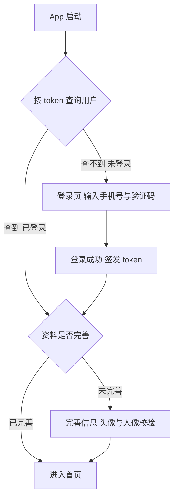

# 登录之后的第一屏：探花交友首页的信息流拆解

用户登录成功的那一刻，首页必须立刻回答两个问题：今天最值得认识谁，还有哪些人值得继续看。这一屏在客户端只是一次跳转的目的地，在后端却是两路接口数据加一整套跳转规则的组合。把首页拆清楚，day02 后面的每个实现小节才有着力点。

## 先给结论

- 进入首页有两条路径：首次注册先完善个人信息再到首页，老用户登录成功直达首页；客户端用 day01 的 token 查询接口先判登录态。
- 首页功能地图由四宫格加信息流组成：探花、搜附近、桃花传音、测灵魂四个功能入口，加今日佳人与推荐列表两路数据。
- 今日佳人是单张卡片：头像、昵称、年龄、性别、标签、缘分值，与接口文档字段一一对应。
- 推荐列表是多张同类卡片组成的信息流，与今日佳人同源不同形。
- day02 只实现今日佳人与推荐两路数据，四个功能入口按后续天次渐进交付。

## 从登录到首页的跳转规则

首页不是随便进的，前面的链路决定了用户带着什么状态抵达：



这张图的分歧点有两个：登录态由 token 查询接口的结果决定，资料完整度由服务端画像数据决定。首次注册的用户在完善信息完成后跳转首页，再次登录的用户资料已齐、直接进首页。day01 做的登录态检查接口在这条规则里就是第一道闸门。

## 首页功能地图

首页上半部分是四个功能入口，各自定位一句话说清：探花负责滑卡匹配，右滑左滑之间完成互相选择；搜附近按地理位置找人；桃花传音以语音互动破冰；测灵魂用趣味问卷做性格匹配。下半部分是信息流：顶部一张今日佳人卡片，下面接推荐用户列表。

四个入口在 day02 都不动，只实现今日佳人与推荐两路。这个取舍不随意：对刚注册的用户来说，首屏价值最高的是「认识谁」，滑卡、语音、问卷都是认识之后的事，先做信息流符合功能优先级。

## 今日佳人卡片的信息构成

画面线里的今日佳人是一张竖版卡片，昵称与年龄直接印在头像下方，课程画面里 26 岁这个数字被特意高亮。卡片上的每一个视觉元素都有对应的接口字段，mock 文档已经把契约定死：

- `id`：用户唯一标识；
- `avatar`：头像地址，即完善信息时传到 OSS 的 `logo`；
- `nickname`：昵称；
- `gender`：性别；
- `age`：年龄；
- `tags`：标签数组，mock 校验还要求元素互异；
- `fateValue`：缘分值，这张卡片被称为「今日佳人」的依据。

字段全部来自 day01 落库的 `tb_user_info` 画像数据与推荐结果里的分值，前端拿到什么就渲染什么，不需要二次拼装。

## 推荐列表与页面交互

底部导航有五个入口：交友、圈子、小视频、消息、我的，与原型目录里的页面一一对应。首页属于交友 tab，推荐列表在这个 tab 内纵向滚动，每张卡片与今日佳人字段一致，多出一个分页维度。

交互层面记住三点：导航切换不重新登录，登录态在 token 里；列表数据完全由接口驱动，换一个账号看到的列表不同；今日佳人每次进入都可能变化，它本质是一份按用户个性化计算的推荐结果，这一点在下一篇功能分析里展开。

## 接口视角：契约先行

今日佳人接口在 mock 文档里的定义是 `GET /tanhua/todayBest`，请求头 `Content-Type: application/json`，`Authorization` 携带登录 token。返回体示例如下（字段按 mock 文档，取值为占位数据）：

```json
{
  "id": 2,
  "avatar": "https://example.com/avatar/2.jpg",
  "nickname": "示例昵称",
  "gender": "woman",
  "age": 26,
  "tags": ["本科", "26岁"],
  "fateValue": 88
}
```

推荐列表接口的返回是同样的卡片对象组成数组，外加分页信息，实现放在后续小节。契约先行的价值在这里体现得很直白：前端拿着 mock 文档就能开工，后端照着契约实现，双方不用互相等待，联调时只对字段不吵需求。

## 常见误区

- **把首页当静态页面。** 错例：卡片数据写死在前端代码里。正解：所有卡片数据来自接口，且每个用户看到的推荐结果都不同。
- **今日佳人与推荐列表共用一个接口。** 错例：一个接口加个类型参数返回不同结构。正解：单对象与分页列表语义不同、缓存策略不同，分开设计。
- **忽略未登录与资料未完善两个前置状态。** 错例：首页接口默认用户已登录且已完善资料。正解：未登录引导去登录，未完善引导去完善页，状态约定写进契约。
- **mock 通过就当功能完成。** 错例：前端联调 mock 数据成功即认为后端交付。正解：mock 只锁定契约，真实查询、缓存与兜底逻辑还在后面。

## 面试可能被问到的问题

1. 面试官追问：「首页首屏的接口你会怎么设计？」
   答：拆成今日佳人与推荐列表两路，单对象走轻量 GET，列表走分页；两边共用一套卡片 DTO 降低前端适配成本；缓存按用户粒度隔离，过期时间与推荐数据的时效匹配。
2. 面试官追问：「今日佳人和推荐列表为什么分成两个接口？」
   答：数据形状不同，一个是单对象一个是分页数组；刷新时机与缓存 key 也不同。合并会让参数与缓存设计互相牵制，分开后各自演进互不影响。
3. 面试官追问：「推荐数据为空时首页怎么兜底？」
   答：接口层做兜底，候选为空时按城市与性别随机挑选或返回运营位内容，前端配合骨架屏，避免白屏与报错。
4. 面试官追问：「tags 字段为什么设计成数组且要求元素互异？」
   答：数组便于前端直接按顺序渲染标签；互异性避免重复标签带来的脏展示，也方便后续按标签做筛选与统计。
5. 面试官追问：「首页请求携带 token 的位置为什么重要？」
   答：token 放 `Authorization` 请求头是统一约定，拦截器可以直接读取；放路径或查询参数会随日志扩散，泄露面更大。

## 配套资料

- 原型：`materials/code/07/day01 探花交友-项目搭建以及登录完善个人信息/day01/资料/探花交友移动端原型V1.2/交友.html`，首页（交友 tab）界面原型，今日佳人与推荐卡片的布局出处。
- 原型：同目录 `首次登录信息完善.html`，首次注册跳转完善信息的界面原型。
- 说明：day02 资料包无工程源码，接口契约按课程 mock 文档画面整理，示例昵称、头像地址与数值均为占位数据，包名规范为 `com.study.tanhua`。
