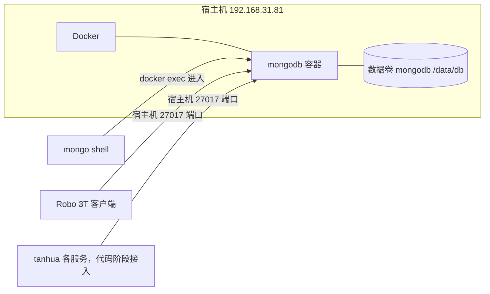

# 部署 MongoDB：今日佳人的推荐结果数据要有地方放

day2 的目标页上是「今日佳人」：打开 APP 首页，卡片里那位缘分值最高的推荐用户就来自它。做这个功能之前，环境上还缺一件东西。推荐系统算出的结果数据要落库，服务端要按条件把它查出来，这类结构灵活、以读为主的结果数据，课程选的存储是 MongoDB。day1 把 MySQL、Redis 集群、RocketMQ 都安顿好了，这一课补上最后一块，顺带把客户端工具连上，为下一课的建库造数据铺路。

## 先给结论

- MongoDB 用 Docker 部署，镜像版本 `mongo:4.0.3`，容器名就叫 `mongodb`。
- 关键参数三项：`--restart=always` 让容器随宿主机开机自启，`-p 27017:27017` 映射默认端口，`-v mongodb:/data/db` 用数据卷保住数据。
- 验证方式是进容器跑 `mongo` 客户端，`show dbs` 能看到 admin、config、local 三个默认库即部署成功。
- 图形客户端 Robo 3T 新建连接指向宿主机 27017 端口，后面的建库、插数据、看文档都靠它或命令行。
- Spring Boot 侧的集成依赖 `spring-boot-starter-data-mongodb` 在代码阶段引入，本课先把服务端立起来。

## 一、为什么今日佳人要靠 MongoDB

推荐系统的产出是一批「给谁推荐了谁、缘分值多少」的结果数据，写入 MongoDB；今日佳人的查询链路则从这些结果里捞数据。存储选型没有跟风成分：结果数据的结构以文档为单位，一个文档就是一条推荐记录，字段少且以后可能增减；查询模式高度固定，永远按目标用户加得分两个维度来捞。文档型数据库一条记录自成一个 BSON 文档，不用先定义表结构就能存，扩字段不用改表，正对这类数据的胃口。MySQL 在这个项目里继续管用户、用户资料这类强结构的业务表，两者分工，不互相替代。

MongoDB 的库、集合、文档三层概念，以及与 MySQL 的库名、表名、行名的对应关系，阶段五的 MongoDB 快速入门里已经交代过，这里直接进入部署。

## 二、四条命令起一个 MongoDB

部署沿用 day1 的路数，整套中间件都跑在这台 Ubuntu 主机上，继续用 Docker。命令一共四条，来自课程画面：

```bash
# 拉取镜像
docker pull mongo:4.0.3

# 创建容器
docker create --name mongodb --restart=always -p 27017:27017 -v mongodb:/data/db mongo:4.0.3

# 启动容器
docker start mongodb

# 进入容器
docker exec -it mongodb /bin/bash
```

`docker pull mongo:4.0.3` 里的 4.0.3 是课程锁定的版本。镜像本地已经拉过的话，这条命令只会确认存在，不会重新下载；没拉过就走一遍下载。版本写死而不是用 latest，是为了让服务端与后续代码里 MongoDB 驱动的版本对应关系可控，这是部署中间件的老规矩。

`docker create` 这条值得逐项拆开。`--name mongodb` 给容器起名，后面 start、exec 都用这个名字指代它；`--restart=always` 把重启策略设为总是，宿主机重启之后容器会自己跟着起来，课程服务器是虚拟机，重启是常事，这个参数能省掉每次手动起服务的麻烦；`-p 27017:27017` 把容器的 27017 端口映射到宿主机的 27017，MongoDB 监听的默认端口就是它，外部访问一律走宿主机端口；`-v mongodb:/data/db` 是数据卷挂载，冒号前是数据卷名，冒号后是容器内的数据目录，MongoDB 的所有库文件都写在 `/data/db` 下，挂了卷之后，哪怕容器删掉重建，数据还在卷里，不挂卷的容器删一次丢一次数据，这是 Docker 跑有状态服务的第一铁律。

创建之后容器还没有运行，`docker start mongodb` 把它拉起来，再用 `docker exec -it mongodb /bin/bash` 进到容器内部。`-it` 分配一个交互式终端，进去之后就是容器里的 Linux 环境。

## 三、mongo shell 验证：show dbs 见到三个默认库

进容器只是进了操作系统，还要连上数据库进程。容器里敲 `mongo` 命令，这是 MongoDB 自带的命令行客户端，连上本机的 mongod 服务后进入 shell，提示符变成 `>`，可以敲数据库命令了：

```bash
# 使用 MongoDB 客户端进行操作
mongo
> show dbs   # 查询所有的数据库
admin   0.000GB
config  0.000GB
local   0.000GB
```

`show dbs` 列出当前实例上所有的库。刚装好的实例只有三个默认库：admin 是管理库，.root 与角色信息将来放这里；config 记录分片与副本集的配置信息；local 存放本地运行期数据，不参与复制。看到这三个名字，就说明 mongod 进程在正常跑、客户端链路是通的，部署这一步可以画勾。

启动日志里还有几行 WARNING 值得看一眼，课程画面里反复出现这一条：

```text
** WARNING: Access control is not enabled for the database.
** Read and write access to data and configuration is unrestricted.
```

意思是鉴权没有开启，任何能连上 27017 端口的客户端都拥有完整读写权限。课程环境是内网虚拟机，按画面线保持默认不启用，连 MongoDB 时不带账号密码。要认这条警告的含义：生产环境把 MongoDB 裸奔在公网上等于数据库开门，必须配用户与 `--auth` 启动参数。

## 四、Robo 3T 客户端连上去

命令行能做的事，图形客户端做起来更顺手。课程用的客户端是 Robo 3T，本机已安装。打开后是连接管理界面，新建一个连接，地址填宿主机 IP 192.168.31.81，端口 27017，保存后连接。连上之后左侧树里能看到 server information，以及 admin、config 这几个默认库，与命令行里 `show dbs` 的结果一一对应。



这张图把三条访问路径画在了一起：mongo shell 走的是容器内部路径，Robo 3T 与将来的应用服务走的是宿主机映射端口。两条外部路径都指向同一个 mongod 进程，所以命令行里写入的数据，客户端里立刻能看到，反过来也一样。

到这里 MongoDB 的部署与验证就完成了。后面的操作，建库、构造数据、建索引、查文档，命令行与 Robo 3T 两条路都通，用哪个看个人习惯，课程里两边来回切换着演示。Spring Boot 应用侧的接入靠 `spring-boot-starter-data-mongodb` 这个 starter，自动配置会按 `spring.data.mongodb` 前缀的配置项装配连接，具体代码在编写服务实现时展开。

## 常见误区

- **不挂数据卷。** 错例：`docker run` 起容器时省掉 `-v mongodb:/data/db`，用一段时间后容器重建，所有库全部消失。正解：有状态容器必须挂卷，卷名与容器内路径要写对，数据在卷里而不是容器层里。
- **以为 show dbs 应该看到业务库。** 错例：部署完就找 tanhua 库，找不到以为部署失败。正解：新实例只有 admin、config、local 三个默认库，业务库在第一次写入数据时才创建。
- **端口映射漏写或写反。** 错例：`-p 27017` 少写一侧，或者宿主机端口与容器端口搞反，Robo 3T 连不上。正解：`-p 宿主机端口:容器端口`，外部访问用冒号前那个。
- **把鉴权警告当部署失败。** 错例：看到 WARNING 里 access control 字样以为服务有问题反复重启。正解：这只是提示未开启认证，内网课程环境按默认即可，生产环境再补用户与 `--auth`。

## 面试可能被问到的问题

1. 面试官追问：「推荐结果数据为什么存 MongoDB 而不存 MySQL？」
   答：推荐结果是文档型的结果数据，一条记录就是一个自包含文档，字段可能随算法版本增减，MongoDB 无需预先定表结构，扩字段不用动表；查询模式固定为按用户与得分两个维度，文档库的查询与索引能力完全覆盖。MySQL 继续承担强结构的用户与资料表，两者按数据特点分工。
2. 面试官追问：「`-v mongodb:/data/db` 这条参数做了什么？不加会怎样？」
   答：它创建了名为 mongodb 的数据卷并挂载到容器的 /data/db 目录，MongoDB 的持久化文件都落在这个卷里。不加的话数据写在容器可写层，容器被删除重建时数据随之丢失，重启不丢但删除就没了。
3. 面试官追问：「Access control is not enabled 这个警告意味着什么？生产上怎么处理？」
   答：意味着实例未开启鉴权，任何能连到端口的客户端都有完全的读写权限。生产上要创建管理员与业务账号、按角色分配权限，并以 --auth 参数启动，同时配合网络隔离，不把 27017 暴露在公网。
4. 面试官追问：「docker create 和 docker run 有什么区别？」
   答：docker run 是创建并立即启动，docker create 只创建容器不启动，之后用 docker start 拉起。拆成两步的好处是创建参数与启动动作分离，方便确认容器配置无误后再启动；对结果而言两种方式起的容器没有差别。
5. 面试官追问：「--restart=always 的重启策略是什么语义？」
   答：容器无论因何种原因退出都自动重启，包括宿主机重启后随 Docker 服务一并拉起，只有手动 docker stop 的情况例外。适合 MongoDB 这类要求常驻的基础服务；若希望失败重试但次数有限，可选 on-failure 并配最大重试次数。

## 配套资料

- 学习目标：`materials/code/07/day02 探花交友-实现首页功能/day02/学习目标.md`，对应「独立完成今日佳人的功能」前置的环境准备部分。
- 说明：day02 资料包未含部署脚本，Docker 命令按课程画面逐条整理；MongoDB 库、集合、文档等基础概念可对照阶段五 MongoDB 相关篇章，课程环境连接 MongoDB 未启用鉴权，按画面线如实记录。
