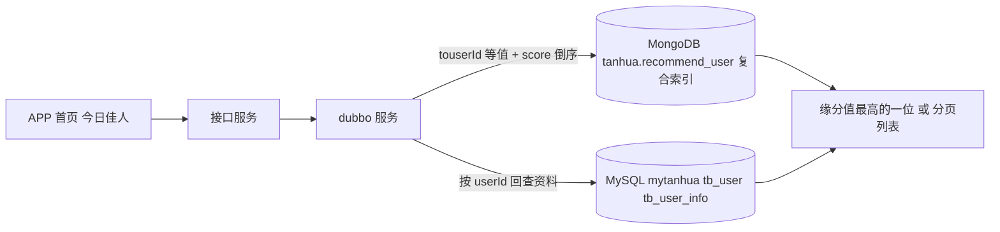

# 今日佳人的数据地基：recommend_user 集合设计与测试数据构造

> 🔒 安全提示：文中示例的口令/密钥均为课程教学环境演示口径，生产环境的安全要求见《安全与合规须知》。

MongoDB 服务起来了，还不能写代码：库里没有集合、没有索引、没有数据，查询链路无从验证。今日佳人要展示「缘分值最高的那个人」，这个查询横跨两套存储，推荐结果在 MongoDB，用户资料在 MySQL，两边都得先把结构与数据备齐。这一课的全部内容就是这两件事：设计 recommend_user 集合并造出推荐数据，给 MySQL 的用户表造出配套的测试用户。

## 先给结论

- 推荐结果集合只存 ID 不存全量资料：一个文档四个业务字段，`userId` 推荐进来的用户、`toUserId` 给谁推荐、`score` 推荐得分即缘分值、`date` 推荐日期，用户详情按需回 MySQL 查。
- 库名 `tanhua`，集合名 `recommend_user`，数据用 Java 测试用例批量生成插入脚本再执行，构造 99 条。
- 索引按查询模式定：`toUserId` 正序、`score` 倒序，撑起「查某人缘分值最高的推荐」与分页列表两条查询。
- MySQL 侧 `tb_user` 与 `tb_user_info` 同样用程序生成 SQL，固定两条加随机批量，共 99 条，与 MongoDB 数据按 id 对齐。
- 现场翻车一例：`cover_pic` 字段长度 50 装不下图片地址，导入报错后改成 100。

## 一、存 ID 还是存全量：一个设计取舍

推荐结果文档的结构先摆出来：

```json
{
  "userId": 1001,
  "touserId": 1002,
  "score": 90,
  "date": "2019/1/1"
}
```

四个字段的含义要掰扯清楚，尤其是两个 ID 的方向。`userId` 是「被推荐的那个人」：给张三推荐了一个李四，`userId` 就是李四的 ID；`toUserId` 是「推荐给了谁」，也就是张三的 ID。方向一旦记反，查询条件就全错了。`score` 是推荐得分，业务上叫缘分值，今日佳人取的就是它最高的一位。`date` 记录这次推荐的日期。

存储粒度有两种做法。第一种把被推荐用户的全量资料都塞进文档，昵称、头像、年龄一并存；第二种只存用户 ID，展示时按 ID 回 MySQL 查资料。课程选第二种，理由是更新成本。用户资料是活的，改昵称、换头像是常态操作，如果资料在推荐集合里存了一份全量，每次资料更新都要同步去改 MongoDB 里所有相关文档，写路径凭空多出一倍，还容易改漏造成两边不一致。只存 ID 的话，推荐结果只描述「谁被推荐给了谁、缘分值多少」这个事实本身，事实不变就不更新，资料永远以 MySQL 为唯一权威来源，查询时多一次按主键回查，换来的是写入路径的干净。

顺带一提画面的细节：示意图里键名写作 `touserId`，最终实体类按驼峰定成 `toUserId`，MongoDB 的键名区分大小写，造数据与实体映射必须用同一套拼写，这一点放在误区里展开。

## 二、造 99 条推荐数据：脚本生成加批量执行

手工写 99 条插入语句不现实，课程的做法是写一个 Java 测试用例，让它把插入脚本打印出来：

```java
// 生成 recommend_user 的插入脚本
@Test
public void testMongoDBData() {
    for (int i = 2; i < 100; i++) {
        int score = RandomUtils.nextInt(10, 99);
        System.out.println("db.recommend_user.insert({\"userId\": " + i
                + ", \"touserId\":1, \"score\": " + score
                + ", \"date\":\"2019/1/1\"})");
    }
}
```

循环从 2 走到 99，每轮随机出一个分数，拼一条 `insert` 语句打印到控制台。得分区间按画面代码是 10 到 99，日期统一写死。所有文档的 `touserId` 都是 1，也就是后面所有查询都围绕「给用户 1 的推荐」来做，1 号用户就是测试时的登录用户。把控制台输出整体拷贝出来，就是一份现成的初始化脚本。

执行前先建库。MongoDB 的库不需要预先 create，`use` 一下再写入数据，库和集合会自动出现：

```bash
use tanhua
db.recommend_user.insert({"userId": 2, "touserId": 1, "score": 66, "date": "2019/1/1"})
show tables
db.recommend_user.find({})
```

`use tanhua` 切到 tanhua 库，批量执行生成的 insert 脚本后，`show tables` 能看到 `recommend_user` 集合已经存在，`find({})` 无条件查询确认文档都写进去了。Robo 3T 里刷新，左侧树出现 tanhua 库，双击集合能看到一条条文档，与命令行查到的完全一致。数一下是 99 条，2 号到 99 号用户各一条，1 号自己不给自己推荐。

## 三、索引跟着查询走

集合建好只是能存，查询要快得靠索引。给 `recommend_user` 建什么索引，取决于它会被怎么查。今日佳人的两条查询路径都是「给定登录用户 ID，找推荐给他的记录」：查缘分值最高的一位，要按 `toUserId` 等值过滤再按 `score` 倒序取第一条；查推荐列表分页，同样是 `toUserId` 等值过滤加 `score` 倒序排序。条件字段与排序字段就是索引字段：

```bash
db.recommend_user.createIndex({"touserId": 1, "score": -1})
```

这是一个复合索引，`toUserId` 升序配 `score` 降序。`toUserId` 在前做等值定位，`score` 在后让排序直接沿着索引顺序走，省掉内存排序这一步。1 与 -1 分别代表升序与降序，方向对单字段索引影响不大，对复合索引里的排序字段则是必需的：查询要求 score 从大到小，索引就按从大到小建。



这张图是今日佳人查询的完整路径：MongoDB 出推荐关系与缘分值，MySQL 出展示资料，两条线在服务层拼装。索引建在左下那条线上，回查走 MySQL 的主键与 `user_id` 索引，两边都不慢。

## 四、MySQL 侧的用户与资料测试数据

推荐数据有了，展示还要有「人」。如果 MySQL 里没有这些被推荐用户，今日佳人卡片上就没有昵称头像可显示。课程同样用测试用例生成 SQL，先固定两条，再批量随机：

```java
// 生成 tb_user 的插入语句，id 2 为固定数据
System.out.println("INSERT INTO tb_user (id, mobile, password, created, updated) VALUES ('2', '13800074175', 'e10adc3949ba59abbe56e057f204c373', '2019-08-02 16:43:46', '2019-08-02 16:43:46');");
for (int i = 3; i < 100; i++) {
    String mobile = "13" + RandomStringUtils.randomNumeric(9);
    System.out.println("INSERT INTO tb_user (id, mobile, password, created, updated) VALUES ('" + i + "', '" + mobile + "', 'e10adc3949ba59abbe56e057f204c373', '2019-08-02 16:43:46', '2019-08-02 16:43:46');");
}
// 生成 tb_user_info 的插入语句，昵称与图片地址已做中性占位改写
for (int i = 3; i < 100; i++) {
    String logo = "https://example.com/images/logo/" + RandomUtils.nextInt(1, 20) + ".jpg";
    System.out.println("INSERT INTO tb_user_info (id, user_id, nick_name, logo, tags, sex, age, edu, city, birthday, cover_pic, industry, income, marriage, created, updated) VALUES ('" + i + "', '" + i + "', 'tanhua', '" + logo + "', '身高,本科,年龄相仿', '1', '30', '本科', '北京市-北京城区-东城区', '2019-08-01', '" + logo + "', '计算机行业', '30', '已婚', '2019-08-02 16:44:23', '2019-08-02 16:44:23');");
}
```

几个生成细节值得留意。手机号用 `13` 加 9 位随机数字拼出来，够 11 位但可能撞号，测试数据无妨；密码统一是同一个 32 位 MD5 摘要值，即 123456 加密后的形态，验证码登录链路里它只是占位；`tb_user_info` 的 `user_id` 与主键 id 用同一个值，保证与 `tb_user` 一一对应；头像地址在 1 到 20 张素材图里随机取，`logo` 与 `cover_pic` 用同一张，这些素材图课程资料包里提供了。

执行前有个动作：day01 导入的种子数据与这套测试数据可能撞 id，先把 `mytanhua` 库两张表里已有的记录清掉，再执行新脚本。执行中途现场报错了，`tb_user_info` 的 `cover_pic` 建表时定的是 varchar(50)，而素材图片的完整地址超过 50 个字符，插入被截断报错。处理方式是把该字段长度改成 100。这也是用真实长度数据造数的价值：字段够不够长，纸面上看不出来，一跑就现形。改完重跑，`tb_user` 与 `tb_user_info` 各 99 条落库。随手抽验一条 MongoDB 文档，`userId` 是 22，就去 MySQL 查 id 为 22 的用户资料，能对上，两套数据才算真正咬合。

## 常见误区

- **两个 ID 方向记反。** 错例：把登录用户的 ID 存进 `userId`，查询时拿它当条件，结果永远查不到数据。正解：`userId` 是被推荐的人，`toUserId` 是推荐的目标，即登录用户，建索引与查询条件都用 `toUserId`。
- **键名拼写与实体不一致。** 错例：文档里存的是示意图上的 `touserId`，实体类字段却是 `toUserId`，Spring Data 按实体字段名读写，旧文档永远匹配不上。正解：生成脚本、实体字段、索引定义三处用同一套大小写。
- **score 存成字符串。** 错例：生成脚本里分数带引号存成字符串，倒序排序按字典序走，99 排在 100 后面。正解：分数用数值类型存，实体里对应 Double，索引排序才是数值序。
- **字段长度照抄建表脚本。** 错例：`cover_pic` 沿用 varchar(50)，真实图片地址超长，导入中途报错。正解：造数前用最长的真实值核一遍字段长度，不够就调。

## 面试可能被问到的问题

1. 面试官追问：「推荐结果里为什么不冗余一份用户资料，反而要回查 MySQL？」
   答：资料是高频变更数据，冗余存储意味着每次资料更新都要同步修改推荐集合里的相关文档，写放大且容易不一致。只存 ID 让推荐结果退化为不变的事实记录，资料以 MySQL 为唯一来源，查询时按主键回查，用一次额外查询换取写入路径的简单与数据一致。
2. 面试官追问：「这个复合索引为什么是 toUserId 正序加 score 倒序？」
   答：查询模式固定为按 toUserId 等值过滤、按 score 降序取最高或分页。复合索引把等值条件列放前面做精确定位，排序列放后面且方向与查询排序一致，排序可以直接沿索引进行，避免 Top N 场景下的内存排序。
3. 面试官追问：「MongoDB 没有跨库 join，推荐关系和用户资料怎么拼起来？」
   答：应用层两次查询。先按索引从 recommend_user 拿到推荐用户 ID 与缘分值，再把 ID 集合发往 MySQL 按主键批量查资料，最后在服务层组装。ID 集合回查是等值 IN 查询，走主键很快，这也是存 ID 方案成立的代价上限。
4. 面试官追问：「测试数据为什么要写代码生成而不是手写 SQL？」
   答：手写几十条重复语句易错且不可复现，程序生成把随机规则、数量、字段对应关系固化成代码，数量要扩就调循环参数，重新生成即可。生成的是标准 insert 语句，执行与排查都和手工脚本一样透明。
5. 面试官追问：「导入测试数据时报字段过长错误，暴露了什么问题？」
   答：表结构设计时用假想长度定字段，没有用真实数据校验。图片地址这类外链字段的长度应以实际资源地址的最长形态为准，评审表结构时拿最长的真实样本核一遍，比上线后报错再改字段成本低得多。

## 配套资料

- 数据库：`materials/code/07/day01 探花交友-项目搭建以及登录完善个人信息/day01/代码/mytanhua.sql`，`tb_user` 与 `tb_user_info` 的真实建表脚本，MySQL 测试数据导入前照它核对字段长度。
- 学习目标：`materials/code/07/day02 探花交友-实现首页功能/day02/学习目标.md`。
- 说明：day02 资料包未含造数脚本，Java 生成代码与插入语句按课程画面整理；生成代码中的昵称统一改为 `tanhua`、图片地址改为 example.com 占位，原素材图与头像图片在课程资料内，`cover_pic` 长度调整以课程现场操作为准。
