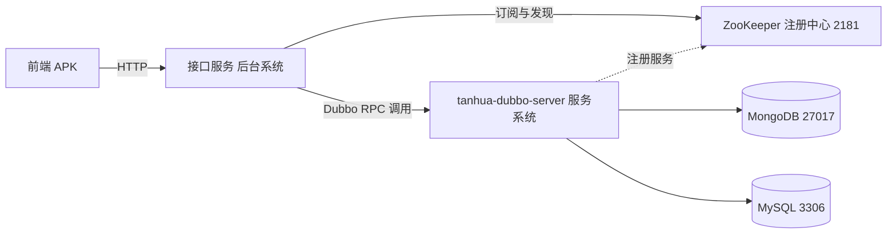

# 拆出服务系统：tanhua-dubbo 工程的模块划分与依赖配置

数据就绪，进入写代码阶段。动手之前先把架构摊开看：今日佳人这条链路上，前端是安卓 APP 的 apk 包，它访问的是后台系统；后台系统里若把所有业务逻辑都堆进去，工程会随着功能增加不断膨胀，所以课程把核心业务功能下沉到一个独立的「服务系统」，用 Dubbo 来构建，后台系统通过 RPC 调用它，服务系统再去访问 MongoDB 与 MySQL。这一课做的就是服务系统这个工程的骨架：三个 Maven 模块怎么嵌套、每个模块依赖什么、为什么这么拆。

## 先给结论

- 服务层拆成父子三模块：聚合模块 `my-tanhua-dubbo` 往下挂 `my-tanhua-dubbo-interface`（契约）与 `my-tanhua-dubbo-server`（实现）。
- interface 模块只放接口、pojo 与 vo，provider 和 consumer 共同依赖它；它要引 Lombok 与 MongoDB 相关依赖，因为 pojo 里用到 `ObjectId` 与索引注解。
- server 模块是 Dubbo 的提供方：依赖 interface，再加 `dubbo-spring-boot-starter` 0.2.0、`dubbo` 2.6.4、ZooKeeper 3.4.13 与 zkclient、MongoDB starter。
- 注册中心用 ZooKeeper，地址是 day1 部署好的那台机器 2181 端口。
- 依赖策略是按需引入、缺了再补，不一次拖全量。

## 一、业务为什么下沉一层

先把三个角色的分工说清。前端 APP 只认 HTTP 接口，负责界面与交互；后台系统（接口服务）对 APP 提供 REST 接口，做协议适配、登录态校验、参数整理与结果组装；服务系统承载真正的核心业务逻辑，比如推荐查询、缘分值计算结果的读取。后台系统不直接操作存储，而是通过 Dubbo 调用服务系统。

Dubbo 是一款 RPC 框架，一句话说就是让调用远程服务的方法像调用本地方法一样写：接口在编译期就可见，调用处看起来是普通方法调用，框架在背后完成服务发现、网络传输、序列化反序列化。业务下沉一层换来的好处有三个：核心逻辑只有一份，多个后台应用都能复用；服务系统可以独立部署、独立扩容，推荐查询压力大时只加这一层的机器；接口契约固化在 interface 模块里，前后端的边界由编译器替人盯着。



这张图是 day2 后续所有功能共用的骨架：箭头方向就是依赖方向，接口服务依赖注册中心找地址、依赖服务系统拿数据；服务系统向上注册自己，向下只面对存储。ZooKeeper 在 day1 已经部署，这里只是把它用起来。

## 二、父子三模块的搭建顺序

工程建在父工程 `my-tanhua` 之下，先建聚合模块，再在它下面挂两个子模块。聚合模块本身不含代码，pom 里声明子模块与公共配置：

```xml
<parent>
    <artifactId>my-tanhua</artifactId>
    <groupId>com.study.tanhua</groupId>
    <version>1.0-SNAPSHOT</version>
</parent>
<modelVersion>4.0.0</modelVersion>
<artifactId>my-tanhua-dubbo</artifactId>
<packaging>pom</packaging>
```

interface 子模块的坐标顺着聚合模块往下挂：

```xml
<parent>
    <artifactId>my-tanhua-dubbo</artifactId>
    <groupId>com.study.tanhua</groupId>
    <version>1.0-SNAPSHOT</version>
</parent>
<modelVersion>4.0.0</modelVersion>
<artifactId>my-tanhua-dubbo-interface</artifactId>
```

server 子模块同样以 `my-tanhua-dubbo` 为 parent，artifactId 取 `my-tanhua-dubbo-server`。IDE 里连续三次 New Module 就能完成这套嵌套，parent 一栏选上级模块即可。建完刷新 Maven，聚合模块下自动出现两个子模块，与 Dubbo 开发约定俗成的两件套对应：一个 interface 工程放契约，一个 service 工程放实现。

两个模块必须分开，不能合并成一个，原因在消费方：接口服务的工程只需要依赖接口定义，如果接口和实现混在一个包里，它就会把服务端的全部实现与依赖也拖进自己的 classpath，边界形同虚设。契约独立成 jar，provider 实现它，consumer 依赖它，双向都干净。

## 三、interface 模块：契约包里放什么依赖

interface 模块里将来只有三类东西：API 接口、pojo 实体、vo 视图对象。依赖也最少，两项：

```xml
<dependencies>
    <dependency>
        <groupId>org.projectlombok</groupId>
        <artifactId>lombok</artifactId>
    </dependency>
    <dependency>
        <groupId>org.springframework.boot</groupId>
        <artifactId>spring-boot-starter-data-mongodb</artifactId>
    </dependency>
</dependencies>
```

Lombok 好理解，pojo 与 vo 的 getter、setter、构造器全靠注解生成。MongoDB 依赖出现在接口工程里初看奇怪，接口里又不查库，为什么引它？原因在 pojo：实体类要与 MongoDB 集合做映射，主键用 `org.bson.types.ObjectId`，字段上还要挂 `@Indexed` 这类来自 Spring Data MongoDB 的注解，这些类型都在这个 starter 的传递依赖里，不引就编译不过。接口工程引依赖只为「让契约类型能编译」，不是为访问数据库，这条线要拎清。

画面里这套 pom 还能看到几个工具依赖：`mongodb-driver-sync` 3.9.1、`commons-lang3`、`joda-time` 2.9.9、`netty-all` 4.1.32.Final，属于随写随补的类型，日期处理与工具方法用到时再加，这里一并记入清单。

## 四、server 模块：提供方的完整依赖清单

server 模块是真正跑业务的地方，依赖明显多一层：

```xml
<dependencies>
    <!-- 接口工程：契约在此，实现它 -->
    <dependency>
        <groupId>com.study.tanhua</groupId>
        <artifactId>my-tanhua-dubbo-interface</artifactId>
        <version>1.0-SNAPSHOT</version>
    </dependency>
    <dependency>
        <groupId>org.springframework.boot</groupId>
        <artifactId>spring-boot-starter-test</artifactId>
        <scope>test</scope>
    </dependency>
    <!-- dubbo 对 spring boot 的支持 -->
    <dependency>
        <groupId>com.alibaba.boot</groupId>
        <artifactId>dubbo-spring-boot-starter</artifactId>
        <version>0.2.0</version>
    </dependency>
    <!-- dubbo 核心 -->
    <dependency>
        <groupId>com.alibaba</groupId>
        <artifactId>dubbo</artifactId>
        <version>2.6.4</version>
    </dependency>
    <!-- zookeeper 与客户端 -->
    <dependency>
        <groupId>org.apache.zookeeper</groupId>
        <artifactId>zookeeper</artifactId>
        <version>3.4.13</version>
    </dependency>
    <dependency>
        <groupId>com.github.sgroschupf</groupId>
        <artifactId>zkclient</artifactId>
        <version>0.1</version>
    </dependency>
    <!-- mongodb -->
    <dependency>
        <groupId>org.springframework.boot</groupId>
        <artifactId>spring-boot-starter-data-mongodb</artifactId>
    </dependency>
</dependencies>
```

按用途分四组看。第一组是 interface 本身，实现方依赖契约，这是整个拆分里最关键的一条边，没有它实现类无从谈起。第二组是 Dubbo 本体，`dubbo-spring-boot-starter` 负责把 Dubbo 接进 Spring Boot 的自动配置与注解体系，`dubbo` 2.6.4 是核心框架，两者的版本要配套，starter 0.2.0 对应 Dubbo 2.6.x 这条线。第三组是注册中心客户端，服务注册与发现走 ZooKeeper，`zookeeper` 是官方客户端库，`zkclient` 是在其上的老牌封装，把会话重连、节点监听这些繁琐细节包了一层。第四组是 MongoDB starter，服务系统直接读写 recommend_user 集合。

版本匹配是这里最容易埋雷的地方。ZooKeeper 服务端 3.4.x 的线，客户端库也用 3.4.13，跨大版本混用会出现会话建立失败之类的诡异问题；Dubbo 2.6.4 与 starter 0.2.0 是一套，换成 Dubbo 2.7 之后 starter 的 groupId 与注解包名都会变，这一点在下一课定义接口时会再碰到。依赖先引到能跑通本课为止，后面课程用到 Redis、消息等能力时再往里加，工程依赖不必一步到位。

## 常见误区

- **把 pojo 写进 server 模块。** 错例：实体类图省事放在实现工程里，接口方法签名引用它，consumer 依赖 interface 后运行时报 ClassNotFoundException。正解：接口签名中出现的一切类型都必须在 interface 模块里。
- **interface 模块反向依赖实现。** 错例：为了「方便」让接口工程依赖 server，形成循环依赖。正解：依赖箭头只能从 server 指向 interface，契约不感知实现。
- **ZooKeeper 客户端版本与服务端混搭。** 错例：服务端 3.4.x，客户端引了 3.5+ 或 3.6+ 的库，注册时报协议或会话异常。正解：客户端大版本与服务端对齐，课程环境锁定 3.4.13。
- **依赖一次拖全量。** 错例：把资料里所有 starter 全部贴进 pom，启动时一半自动配置空转报错。正解：按需引入，缺什么补什么，依赖清单跟着功能走。

## 面试可能被问到的问题

1. 面试官追问：「Dubbo 为什么要拆 interface 和实现两个工程？」
   答：接口工程是消费方与提供方共享的契约 jar，只含接口与传输对象，消费方依赖它而不必引入服务端实现与全部依赖，编译期即约束双方；实现工程独立部署、独立扩容。合并会让消费方被动拖入实现细节，边界与安全性都变差。
2. 面试官追问：「注册中心在 Dubbo 体系里起什么作用？挂了会怎样？」
   答：提供方启动时向注册中心注册自己的地址，消费方订阅以发现提供方列表并感知上下线。注册中心不可用时，已建立的调用凭本地缓存的服务者列表仍能继续，新服务的发现与新节点的通知会失效，所以它影响的是动态性，不是存量调用的可用性。
3. 面试官追问：「dubbo-spring-boot-starter 和 dubbo 核心包是什么关系？」
   答：核心包是 RPC 框架本体，提供协议、注册、代理、容错等能力；starter 是适配层，把核心接入 Spring Boot 的自动配置，让用注解暴露与引用服务、用配置文件设置注册中心地址成为可能。两者版本要配套，Alibaba 系 starter 0.2.0 对应 Dubbo 2.6.x。
4. 面试官追问：「ZooKeeper 做注册中心，服务地址存在哪个节点路径下？」
   答：以 /dubbo 为根，按服务接口全限定名建子节点，providers、consumers、routers、configurators 四类子目录分别存提供者地址、消费者、路由与动态配置。服务上下线体现为 providers 下临时节点的创建与消失，会话断开后临时节点自动清理。
5. 面试官追问：「接口工程的 pojo 为什么还要引 MongoDB 的依赖？」
   答：pojo 承担与集合的映射职责，主键类型是 org.bson.types.ObjectId，字段上有 Spring Data MongoDB 的 @Indexed 等注解，这些类型来自该 starter 的依赖。引入只为契约类型可编译，接口工程本身不连接数据库，这也是契约模块依赖最小化的边界。

## 配套资料

- 工具：`materials/code/07/day02 探花交友-实现首页功能/day02/资料/ZooInspector/`，ZooKeeper 的图形化查看工具源码，注册服务后可用它观察 /dubbo 下的节点变化。
- 学习目标：`materials/code/07/day02 探花交友-实现首页功能/day02/学习目标.md`，其中「独立完成 dubbo 服务的开发」对应这一课与后续两课。
- 说明：day02 资料包未含工程源码，模块结构与依赖清单按课程画面逐项整理；groupId 与包名按规范改写为 `com.study.tanhua` 系；工具类依赖（joda-time、netty-all 等）为画面中出现、后续课程逐步用到的部分。
