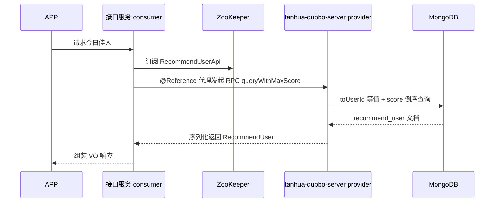

# 定义服务契约：RecommendUser 实体、PageInfo 分页对象与 RecommendUserApi 接口

工程骨架立好，写实现之前先把契约定下来，这是 Dubbo 开发的固定次序：接口和传输对象先行，双方照着契约各干各的。今日佳人需要两个查询能力：首页卡片上缘分值最高的那一位，以及往下翻的推荐用户分页列表。这一课把与 `recommend_user` 集合映射的实体、承载分页结果的 vo、暴露这两个能力的 API 接口逐一写出来，再给出提供方的实现骨架与配置。

## 先给结论

- 实体 `RecommendUser` 与集合 `recommend_user` 一一映射：`@Document` 指定集合名，`@Id` 的 `ObjectId` 做主键，`userId` 与 `toUserId` 挂 `@Indexed`，`score` 用 Double，`date` 用 String。
- 实体必须实现 `Serializable` 并生成 `serialVersionUID`，因为它要在 Dubbo 的 RPC 传输中走序列化。
- vo 与 pojo 分包：`PageInfo` 是面向传输的极简分页对象，四个字段 total、pageNum、pageSize、records。
- 接口 `RecommendUserApi` 两个方法：`queryWithMaxScore` 查缘分值最高的一位，`queryPageInfo` 分页查列表，排序口径为 `score` 倒序，讲义注释里「按时间倒序」的说法已在课上修正。
- 提供方用 Alibaba 系的 `@Service` 注解暴露实现，消费方用 `@Reference` 注入；Dubbo 2.7 起这对注解更名为 `@DubboService` 与 `@DubboReference`。

## 一、先写实体：与集合结构咬合

上一课已把 `recommend_user` 集合的数据造好，实体类照着文档结构写：

```java
package com.study.tanhua.dubbo.server.pojo;

import lombok.AllArgsConstructor;
import lombok.Data;
import lombok.NoArgsConstructor;
import org.bson.types.ObjectId;
import org.springframework.data.annotation.Id;
import org.springframework.data.mongodb.core.index.Indexed;
import org.springframework.data.mongodb.core.mapping.Document;

import java.io.Serializable;

@Data
@NoArgsConstructor
@AllArgsConstructor
@Document(collection = "recommend_user")
public class RecommendUser implements Serializable {

    private static final long serialVersionUID = 5874126832504390567L;

    @Id
    private ObjectId id;        // 主键 id
    @Indexed
    private Long userId;        // 推荐的用户 id，被推荐的那个人
    @Indexed
    private Long toUserId;      // 用户 id，推荐给了谁
    private Double score;       // 推荐得分，即缘分值
    private String date;        // 推荐日期
}
```

注解一层层看。`@Document(collection = "recommend_user")` 建立类与集合的映射，Spring Data 的 MongoTemplate 读写时按它定位集合。`@Id` 标在 `ObjectId` 类型的主键上，MongoDB 自动生成的 `_id` 由它承接；课程讲义里这个主键字段一度被注释掉，画面里是先打开状态，后续实现遇到具体问题再调整，实体字段与上一课的造数脚本保持同一套拼写是硬要求。`@Indexed` 挂在 `userId` 与 `toUserId` 上，让框架层面也声明索引意图；导入时要认准 `org.springframework.data.mongodb.core.index.Indexed`，类库里同名类不止一个，导错包在编译期就会暴露。Lombok 三个注解生成读写器与两个构造器，`Serializable` 加 `serialVersionUID` 是 Dubbo 传输对象的标配，接口方法签名里出现的一切类型都要能过网络。

## 二、PageInfo：自己动手的分页 vo

推荐列表注定要分页，Dubbo 服务返回的分页结果自己定义，放在 vo 包里：

```java
package com.study.tanhua.dubbo.server.vo;

import lombok.Data;

import java.io.Serializable;
import java.util.Collections;
import java.util.List;

@Data
public class PageInfo<T> implements Serializable {

    private static final long serialVersionUID = -2105385689859184204L;

    private Integer total;      // 总条数
    private Integer pageNum;    // 当前页
    private Integer pageSize;   // 一页显示的大小
    private List<T> records = Collections.emptyList();   // 数据列表
}
```

四个字段足够覆盖前端分页组件的全部需要：total 决定页码条，pageNum 与 pageSize 回显当前状态，records 是本页数据，默认给一个空集合避免空指针。泛型 T 让它可复用，后面推荐列表装 `RecommendUser`，其他列表装各自的实体。不直接用 MyBatis-Plus 的 Page 对象，是因为 Dubbo 序列化对传输对象有要求，自己定义的 vo 字段干净、可控、天然实现 Serializable，同时让契约不依赖任何 ORM 框架的类型。vo 与 pojo 分包的意义也在这里：pojo 对着数据库结构，vo 对着传输需要，两副面孔不该混在一个包里。

## 三、接口即契约：RecommendUserApi

api 包下定义服务接口，方法签名决定消费方能调到什么：

```java
package com.study.tanhua.dubbo.server.api;

import com.study.tanhua.dubbo.server.pojo.RecommendUser;
import com.study.tanhua.dubbo.server.vo.PageInfo;

public interface RecommendUserApi {

    /**
     * 查询一位缘分值最高的推荐用户
     * @param userId 登录用户 id
     * @return 缘分值最高的推荐用户
     */
    RecommendUser queryWithMaxScore(Long userId);

    /**
     * 分页查询推荐用户列表，按 score 倒序
     * @param userId 登录用户 id
     * @param pageNum 当前页码
     * @param pageSize 每页条数
     * @return 分页结果
     */
    PageInfo<RecommendUser> queryPageInfo(Long userId, Integer pageNum, Integer pageSize);
}
```

`queryWithMaxScore` 对应今日佳人卡片：给张三的推荐有很多条，取 score 最高的那条。`queryPageInfo` 对应推荐用户列表：给一个用户的推荐不止一个，必然要分页，所以参数除 `userId` 外还有 `pageNum` 与 `pageSize`。接口注释里有个现场修正：讲义初稿在分页方法上写的是按时间倒序，从业务看排序依据应是缘分值，课上把它改成了 `score` 倒序，实现与注释都按修正后的口径来。画面初版里分页方法的返回值出现过 `List` 的写法，随后补上 `PageInfo` 才是完成态，分页除了数据本身，调用方还需要 total 才能渲染页码，裸 List 丢掉了这层信息。

## 四、提供方骨架与消费方引用

契约定了，server 模块里给出实现类骨架，真正的查询逻辑在下一课填充：

```java
package com.study.tanhua.dubbo.server.api;

import com.alibaba.dubbo.config.annotation.Service;
import com.study.tanhua.dubbo.server.pojo.RecommendUser;
import com.study.tanhua.dubbo.server.vo.PageInfo;
import org.springframework.beans.factory.annotation.Autowired;
import org.springframework.data.mongodb.core.MongoTemplate;

// 注意 import：这是 com.alibaba.dubbo.config.annotation.Service，
// 把实现类暴露为 Dubbo 服务，与 Spring 的 @Service 组件注解不是一回事
@Service
public class RecommendUserApiImpl implements RecommendUserApi {

    @Autowired
    private MongoTemplate mongoTemplate;

    @Override
    public RecommendUser queryWithMaxScore(Long userId) {
        // 按 toUserId 过滤、score 倒序取第一条，下一课展开
        return null;
    }

    @Override
    public PageInfo<RecommendUser> queryPageInfo(Long userId, Integer pageNum, Integer pageSize) {
        // 按 toUserId 过滤、score 倒序分页查询，下一课展开
        return null;
    }
}
```

让这个注解生效，还需要 server 模块的配置文件，Dubbo 相关的键集中一段：

```properties
# Spring boot application
spring.application.name = tanhua-dubbo-server
dubbo.scan.basePackages = com.study.tanhua.dubbo.server
dubbo.application.name = tanhua-dubbo-provider
dubbo.protocol.name = dubbo
dubbo.protocol.port = 20880
dubbo.registry.address = zookeeper://192.168.31.81:2181
```

`dubbo.scan.basePackages` 指定注解扫描范围，`@Service` 标注的实现类必须落在这个包及其子包下才会被暴露，扫错了范围服务就凭空消失；协议用默认的 dubbo 协议，端口 20880；注册中心地址指向 day1 部署的 ZooKeeper，服务启动后把自己的地址注册上去。

消费方一侧的用法是镜像的，接口服务工程（后续搭建）里用 `@Reference` 拿到代理对象：

```java
import com.alibaba.dubbo.config.annotation.Reference;

@Reference
private RecommendUserApi recommendUserApi;
```

`@Reference` 让框架生成接口的远程代理，调用方法时框架从注册中心拿提供方地址、发起 RPC、把结果反序列化回来，写法上与注入一个本地 Bean 没有区别。版本口径提醒一句：课程用的 Dubbo 2.6.x 里这对注解叫 `@Service` 与 `@Reference`，Apache Dubbo 2.7 之后官方把提供方注解更名为 `@DubboService`、消费方更名为 `@DubboReference`，为的是与 Spring 的 `@Service` 彻底撇清，读别的资料时按版本对号入座。



这张时序图把契约两头都串了起来：接口在左半段是消费方的调用目标，在右半段是提供方的实现承诺，中间的注册中心只负责把两者牵上头。

## 五、day2 阶段小结

到这一课为止，今日佳人的准备工作全部就位：MongoDB 部署并连上客户端；`recommend_user` 集合设计完成，99 条推荐数据与 MySQL 侧 99 个测试用户按 ID 咬合，复合索引建在 `toUserId` 加 `score` 上；Dubbo 服务工程拆成 interface 与 server 两模块，依赖配齐；服务契约 `RecommendUserApi` 与传输对象定义完毕，提供方骨架就绪。剩下的实现按查询路径推进：先写按缘分值取最高一位的查询，补齐今日佳人接口，再做分页列表与缓存。链路上每一环都已在前面两三课里单独验证过，实现阶段就是把这些验证过的积木按契约拼起来。

## 常见误区

- **传输对象忘实现 Serializable。** 错例：实体或 vo 没实现序列化接口，调用时直接抛序列化异常。正解：接口签名涉及的类型一律实现 Serializable 并显式声明 serialVersionUID。
- **@Indexed 导错包。** 错例：IDE 自动导入时选了别的同名注解，索引声明不生效。正解：认准 `org.springframework.data.mongodb.core.index.Indexed`，主键的 `@Id` 用 `org.springframework.data.annotation.Id`。
- **Alibaba 的 @Service 与 Spring 的 @Service 混淆。** 错例：import 手滑选了 Spring 的组件注解，类只成了普通 Bean，消费方报找不到提供者。正解：看 import 是否为 `com.alibaba.dubbo.config.annotation.Service`，Dubbo 2.7+ 直接改用 `@DubboService` 规避歧义。
- **扫描包范围写窄或写漏。** 错例：`dubbo.scan.basePackages` 只扫到 api 的上级包之外，或写错包名，服务不暴露。正解：扫描范围覆盖实现类所在包，启动后到注册中心确认服务已注册。

## 面试可能被问到的问题

1. 面试官追问：「Dubbo 服务接口的设计要注意什么？」
   答：接口要小而稳定，方法按业务能力切分；参数与返回值只用可序列化类型，传输对象不要带框架类型；接口一旦发布就是契约，加方法兼容、改签名破坏兼容，要靠版本号演进；注释把排序、过滤等语义写清，避免双方理解偏差，本课把按时间倒序修正为按缘分值倒序就是一例。
2. 面试官追问：「Dubbo 的 @Service 和 Spring 的 @Service 有什么区别？」
   答：前者来自 com.alibaba.dubbo.config.annotation 包，作用是把实现类暴露为 Dubbo 服务并注册到注册中心；后者是 Spring 的组件注解，只把类交由容器管理。Dubbo 2.7 起官方更名为 @DubboService，就是为了消除同名歧义，2.6 时代只能靠 import 区分。
3. 面试官追问：「@Reference 注入的接口，调用时发生了什么？」
   答：容器启动时为该接口生成远程代理并从注册中心订阅提供者列表；调用方法时代理按负载均衡选一个提供者，把参数序列化后经 Dubbo 协议发出，提供方执行后把结果序列化返回，代理反序列化后交回调用方，全过程对业务代码透明。
4. 面试官追问：「分页结果为什么要自定义 PageInfo 而不用框架的分页对象？」
   答：框架分页对象常绑定具体 ORM，字段多且未必可序列化，放进 Dubbo 契约会把实现细节传染给消费方。自定义 vo 字段最小、可控、实现 Serializable，泛型设计还能跨业务复用，契约层保持对任何持久层框架的中立。
5. 面试官追问：「dubbo.scan.basePackages 配置的职责是什么？不配会怎样？」
   答：它是注解扫描的根，决定哪些包下的 @Service 与 @Reference 生效。不配或配错范围，提供者的服务不会注册，消费方引用时无地址可订阅，报找不到提供者；配置必须覆盖实现类所在包，启动后可用注册中心或管理端确认服务可见。
6. 面试官追问：「serialVersionUID 不写行不行？」
   答：不写时 JVM 按类结构自动计算一个，类字段一旦增减，反序列化旧数据会因版本不一致抛异常。显式声明一个固定值，配合按需增删字段，序列化兼容性由自己掌控，对需要跨服务长期传输的对象是必要的工程习惯。

## 配套资料

- 学习目标：`materials/code/07/day02 探花交友-实现首页功能/day02/学习目标.md`，「独立完成 dubbo 服务的开发」对应的契约部分。
- 数据库：`materials/code/07/day01 探花交友-项目搭建以及登录完善个人信息/day01/代码/mytanhua.sql`，实体与 vo 的字段口径可回溯到其中的表结构。
- 说明：day02 资料包未含工程源码，实体、vo、接口与配置均按课程画面逐行整理，实现类骨架为按本课写法补全的示例（查询逻辑在下一课展开）；包名按规范改写为 `com.study.tanhua` 系，排序口径与主键字段的现场调整已按声音线记录。
