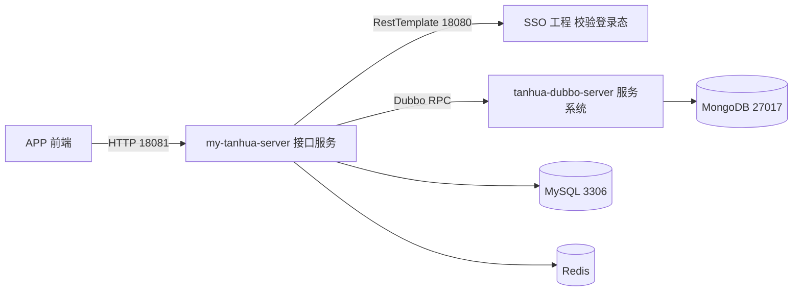

# 搭建接口服务工程：my-tanhua-server 承接 APP 的 HTTP 入口

> 🔒 安全提示：文中示例的口令/密钥均为课程教学环境演示口径，生产环境的安全要求见《安全与合规须知》。

Dubbo 服务端能查数了，但 APP 只认 HTTP，中间还缺一个把 HTTP 请求翻译成 RPC 调用的角色。这一课把这个角色立起来：在父工程 `my-tanhua` 下新建接口服务模块 `my-tanhua-server`，后续所有面向前端系统的接口都统一收在这个工程里管理，今日佳人只是它接的第一个功能。

## 先给结论

- 新模块挂在 `my-tanhua` 之下，包名 `com.study.tanhua.server`，它与 `my-tanhua-dubbo-server` 是两个角色：前者对 APP 出 HTTP 接口，后者对内出 Dubbo 服务。
- 依赖 interface 模块时要排除 `spring-boot-starter-data-mongodb`，这个工程不连 MongoDB，排除能避免启动时自动建连报错。
- 端口定在 18081，与 SSO 工程的 18080 区分开，两个服务同机部署端口撞车就起不来。
- `RestTemplateConfig` 是本工程第一块基础设施：消息转换器设 UTF-8、连接与读取超时各 5000 毫秒，为下一步调用 SSO 的 REST 接口做准备。

## 一、架构中的位置：承上启下的一层



这张图是本工程的全部对外关系：向上以 HTTP 伺服 APP，向下有四条通路，用 `RestTemplate` 调 SSO 拿登录用户、用 Dubbo 调服务系统拿业务数据、直连 MySQL 查用户资料、预留 Redis 做缓存。接口服务自己不碰 MongoDB，业务查询全部下沉到 Dubbo 服务，这就是上一课把 Dubbo 服务写完之后才轮到它的原因。

## 二、建模块与依赖清单

模块通过 IDE 在父工程下新建，artifactId 定为 `my-tanhua-server`，groupId 沿用 `com.study.tanhua`，版本 1.0-SNAPSHOT。pom 里先挂接口模块，因为 `RecommendUserApi` 与实体都在里面：

```xml
<dependency>
    <groupId>com.study.tanhua</groupId>
    <artifactId>my-tanhua-dubbo-interface</artifactId>
    <version>1.0-SNAPSHOT</version>
    <!-- 本工程不连 MongoDB，接口模块传递带入的 starter 要排除 -->
    <exclusions>
        <exclusion>
            <groupId>org.springframework.boot</groupId>
            <artifactId>spring-boot-starter-data-mongodb</artifactId>
        </exclusion>
    </exclusions>
</dependency>
```

排除的理由要讲透：interface 模块为了让 pojo 编译通过而引了 MongoDB starter，这份依赖会顺着 Maven 传递到本工程；Spring Boot 一旦发现 classpath 上有它，启动时就自动创建 MongoDB 连接，而这个工程既不需要也没有配置连接串，结果就是启动即报连接异常。排除是第一层防御，本课先排除，后面整合测试时它会引出第二种解法。

其余依赖按通路补齐：Dubbo 消费侧三件套（`dubbo-spring-boot-starter` 0.2.0、`dubbo` 2.6.4、`zookeeper` 加 `zkclient`），`spring-boot-starter-data-redis` 预留缓存，`commons-lang3` 提供字符串工具，以及访问 MySQL 的 `mybatis`、`mybatis-plus` 与 `mysql-connector-java`。用户资料这类简单查询本工程直接读库，所以 MyBatis 系依赖在此是实需而不是冗余。

## 三、application.properties：端口、数据源与注册中心

```properties
spring.application.name=tanhua-server
server.port=18081

spring.datasource.driver-class-name=com.mysql.jdbc.Driver
spring.datasource.url=jdbc:mysql://127.0.0.1:3306/tanhua?useUnicode=true&characterEncoding=utf8&autoReconnect=true&allowMultiQueries=true&useSSL=false
spring.datasource.username=root
spring.datasource.password=123456

# 枚举所在包，MyBatis-Plus 按它扫描 IEnum 实现
mybatis-plus.type-enums-package=com.study.tanhua.server.enums
# 表名前缀
mybatis-plus.global-config.db-config.table-prefix=tb_
# 主键策略为自增长
mybatis-plus.global-config.db-config.id-type=auto

dubbo.application.name=tanhua-server
dubbo.registry.address=zookeeper://192.168.31.81:2181
dubbo.registry.client=zkclient

#tanhua.sso.url=http://127.0.0.1:18080/
# 默认今日佳人推荐用户
#tanhua.sso.default.user=2
```

端口 18081 是刻意选的：SSO 工程占用 18080，两个服务同机共存，端口重复直接启动失败。MyBatis-Plus 三项各有用途，`type-enums-package` 指向即将创建的枚举包，`table-prefix` 让实体按驼峰转下划线再补 `tb_` 前缀对应 `tb_user_info` 这类表名，`id-type=auto` 交给数据库自增。Dubbo 一段只需注册中心地址，消费方不发布服务，不需要协议端口。末尾两行 SSO 配置先注释保留，用到的那一课再放开，`tanhua.sso.default.user` 是今日佳人的默认推荐用户 id，写进配置是为了不让业务代码硬编码。

## 四、启动类与 RestTemplateConfig

启动类是标准模板，Mapper 扫描包留待 mapper 层引入时一并配置：

```java
package com.study.tanhua.server;

import org.springframework.boot.SpringApplication;
import org.springframework.boot.autoconfigure.SpringBootApplication;

@SpringBootApplication
public class ServerApplication {
    public static void main(String[] args) {
        SpringApplication.run(ServerApplication.class, args);
    }
}
```

第一块基础设施是 `RestTemplate` 的配置类。SSO 工程已经提供了按 token 查用户信息的 REST 接口，本工程要用它校验登录态，HTTP 客户端就是 `RestTemplate`：

```java
@Configuration
public class RestTemplateConfig {

    @Bean
    RestTemplate restTemplate(ClientHttpRequestFactory factory) {
        RestTemplate restTemplate = new RestTemplate(factory);
        // 默认 ISO8859-1 不支持中文，替换为 UTF-8
        restTemplate.getMessageConverters().set(1,
                new StringHttpMessageConverter(Charset.forName("UTF-8")));
        return restTemplate;
    }

    @Bean
    public ClientHttpRequestFactory simpleClientHttpRequestFactory() {
        SimpleClientHttpRequestFactory factory = new SimpleClientHttpRequestFactory();
        factory.setReadTimeout(5000);    // 读取超时，单位 ms
        factory.setConnectTimeout(5000); // 连接超时，单位 ms
        return factory;
    }
}
```

两处设置都是在替未来的故障买单。消息转换器那条：`StringHttpMessageConverter` 默认编码是 ISO8859-1，SSO 返回的用户昵称带中文时会乱码，替换成 UTF-8 一劳永逸。超时那两条：`RestTemplate` 默认不设超时，下游一旦假死，调用线程就无限期挂起，拖垮整个工程，连接与读取各给 5000 毫秒，保证失败快速可见。

## 常见误区

- **端口与 SSO 撞车。** 错例：两个工程都配 18080，第二个启动时端口占用报错。正解：同机部署的服务端口各占一段，18080 与 18081 分开，改配置后重启验证。
- **不排除 MongoDB starter。** 错例：依赖原样传递，启动时 Spring Data 自动连本地 27017，抛连接异常。正解：本工程不连 MongoDB，在 interface 依赖上加 exclusion；后续可用排除自动配置类的方式替代。
- **RestTemplate 不设超时。** 错例：下游服务无响应时调用线程一直阻塞。正例正解：`SimpleClientHttpRequestFactory` 设置连接与读取超时，让失败尽快暴露。
- **id 策略与表结构不匹配。** 错例：主键策略配了雪花或 UUID，而 `tb_user` 的 id 是 `AUTO_INCREMENT`，插入报错或 id 语义混乱。正解：按表结构选 `id-type=auto`。

## 面试可能被问到的问题

1. 面试官追问：「接口服务为什么不直接连 MongoDB 查推荐数据？」
   答：业务查询统一下沉到 Dubbo 服务系统，接口服务只做协议适配、登录态校验与结果组装。好处是核心逻辑只有一份、可独立扩容，接口服务不必持有 MongoDB 的依赖与配置，层与层之间的边界靠依赖方向来保证。
2. 面试官追问：「依赖传递带入了不需要的 starter，怎么处理？」
   答：在引入该依赖的 `dependency` 上加 exclusions 精确排除。本案里 interface 模块为编译 pojo 引入 MongoDB starter，消费方工程不需要连库，排除后既减小 classpath，也避免自动配置误建连接。若确实需要部分类型，可只排除自动配置而不排除依赖本身。
3. 面试官追问：「RestTemplate 使用前要做哪些必要的定制？」
   答：至少两件事，设置连接与读取超时避免线程无限等待，设置支持业务字符集的消息转换器避免中文乱码。生产环境还会配置连接池、重试与日志拦截器，本题按课程场景只做前两件。
4. 面试官追问：「mybatis-plus.global-config.db-config 这组配置在解决什么问题？」
   答：让实体与表结构的映射零注解完成。table-prefix 统一补表名前缀，字段按驼峰转下划线对应列名，id-type 指定主键策略。配置集中在 yml 或 properties 一处，比在每个实体上重复注解更易维护。
5. 面试官追问：「消费方工程的 Dubbo 配置为什么只有注册中心三项？」
   答：消费方不暴露服务，不需要协议与端口，也不需要注解扫描发布逻辑，只要能连上注册中心订阅提供者地址即可。application.name 用于在注册中心里标识自己，registry 两项决定订阅来源，配置面越小，出错点越少。

## 配套资料

- 学习目标：`materials/code/07/day02 探花交友-实现首页功能/day02/学习目标.md`，「独立完成接口入口的统一」对应本课工程定位。
- 数据库：`materials/code/07/day01 探花交友-项目搭建以及登录完善个人信息/day01/代码/mytanhua.sql`，表名前缀与主键自增策略的依据在其中表结构。
- 说明：day02 资料包未含工程源码，本课依赖、配置与配置类均按课程画面逐行整理；启动类为按本课写法补全的标准示例。
