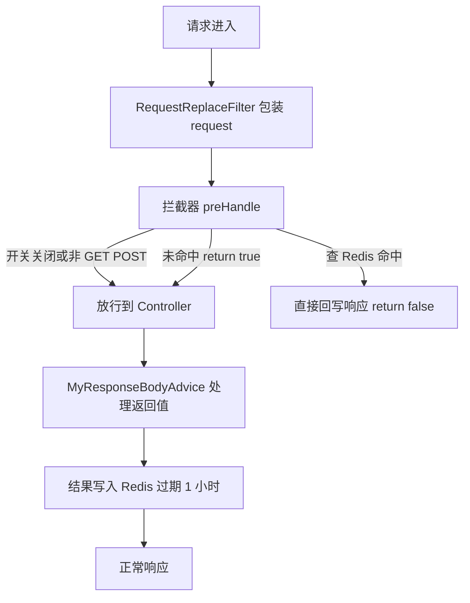

# 统一缓存逻辑：拦截器查 Redis、ResponseBodyAdvice 写 Redis 的整套无侵入封装

> 🔒 安全提示：文中示例的口令/密钥均为课程教学环境演示口径，生产环境的安全要求见《安全与合规须知》。

今日佳人与推荐列表两个接口都跑通了，随之而来的是性能账本：每次下拉刷新推荐列表，请求都要穿过 dubbo 打到 MongoDB，再回 MySQL 捞用户详情，热门接口被高频重复调用时，数据库扛不住也不必扛。缓存必须做，问题在于怎么做：在每个接口里各写一份「先查缓存、没有再查库、结果写回缓存」，还是把这套动作抽出来在框架层统一完成。这一课用三段连续的推演给出统一方案的完整落地，从拦截器查缓存、key 的设计，到 POST 请求体的包装坑，再到 ResponseBodyAdvice 写缓存，最后联调验证命中与未命中。

## 先给结论

- 方案取舍的判据是管理成本：接口内散装写缓存会随接口数量线性膨胀，统一封装一次写完，业务代码零改动，课程选择统一方案。
- 读侧用 HandlerInterceptor：preHandle 里查 Redis，命中就把缓存数据写回响应并返回 false 拦截请求，未命中返回 true 放行。
- 写侧不能用拦截器，afterCompletion 触发时视图渲染已完成，响应体拿不到了；改用 Spring MVC 的 ResponseBodyAdvice，在 Controller 返回后、消息转换前把结果写入 Redis，过期时间 1 小时。
- 缓存 key 由三要素拼成：请求 URI、请求参数（GET 取参数表序列化，POST 取请求体）、Authorization 请求头里的 token，整体做 MD5 后加 `SERVER_DATA_` 前缀。
- POST 请求体在输入流里只能读一次，拦截器读完后 Controller 再读就是空，需要过滤器把 request 换成可重复读的包装对象；全部逻辑由 `tanhua.cache.enable` 开关统一控制。

## 两种做法的取舍：散装缓存与统一缓存

给接口加缓存有两条路。一条是在每个接口方法里各自控制：先查 Redis，命中返回，未命中走完业务再写回。这条路的问题不在难度而在重复，每加一个接口就复制一遍模板，改一次 key 规则就要全项目翻一遍，忘改一处就出现口径分裂。另一条是把缓存逻辑统一管理，写一次、全项目生效，接口代码里一个字都不用改。

类比小区门禁：散装方案等于每户自己雇保安看门，统一方案是物业在大门口装一套系统。检查动作是一样的，但后者只维护一处，覆盖所有住户。课程选择第二条路，原因是管理成本更低、可以统一处理，而且这套封装是通用的，搬到任何 Spring Boot 项目里都能直接用。

散装方案的隐性成本有三笔。**第一，口径漂移。** 每个接口自定 key 规则与过期时间，改规则时漏掉一处，同一份数据在两个接口里就得到两个版本。**第二，覆盖遗漏。** 新接口上线时忘加缓存没人察觉，性能问题要等流量上来才暴露。**第三，排查困难。** 出了问题要在每个接口里翻各自的缓存代码，统一方案只需看一处。

统一封装要解决读和写两件事。读很简单，请求进来先拦一下，缓存有就直接还回去；写麻烦一些，Controller 执行完的结果要落进 Redis，拦截的位置必须在「结果已产生」和「结果已序列化给客户端」之间，这个位置后面专门展开。

## 读缓存：拦截器把命中挡在 Controller 之外

先解决读。思路是给所有请求挂一个拦截器，preHandle 阶段拿 key 去 Redis 探一下：命中就直接把数据写进响应并返回 false，请求根本不会到达 Controller；未命中返回 true，业务照常执行。拦截器类放在 interceptor 包下，实现 HandlerInterceptor 接口：

```java
package com.study.tanhua.server.interceptor;

import com.fasterxml.jackson.databind.ObjectMapper;
import org.apache.commons.codec.digest.DigestUtils;
import org.apache.commons.lang3.StringUtils;
import org.springframework.beans.factory.annotation.Autowired;
import org.springframework.beans.factory.annotation.Value;
import org.springframework.data.redis.core.RedisTemplate;
import org.springframework.stereotype.Component;
import org.springframework.web.servlet.HandlerInterceptor;

import javax.servlet.http.HttpServletRequest;
import javax.servlet.http.HttpServletResponse;

@Component
public class RedisCacheInterceptor implements HandlerInterceptor {

    private ObjectMapper mapper = new ObjectMapper();

    @Autowired
    private RedisTemplate<String, String> redisTemplate;

    @Value("${tanhua.cache.enable}")
    private Boolean enable;

    @Override
    public boolean preHandle(HttpServletRequest request, HttpServletResponse response, Object handler) throws Exception {
        // 缓存开关未开启，直接放行
        if (!enable) {
            return true;
        }
        String method = request.getMethod();
        // 仅对 GET、POST 请求做缓存，其余放行
        if (!StringUtils.equalsIgnoreCase(method, "GET") && !StringUtils.equalsIgnoreCase(method, "POST")) {
            return true;
        }
        // 生成缓存 key
        String redisKey = this.createRedisKey(request);
        // 从 redis 中读取缓存
        String data = this.redisTemplate.opsForValue().get(redisKey);
        if (StringUtils.isEmpty(data)) {
            // 缓存未命中，放行
            return true;
        }
        // 命中缓存，直接把数据写回响应
        response.setContentType("application/json;charset=utf-8");
        response.getWriter().write(data);
        return false;
    }
}
```

三个前置判断各司其职。`enable` 是配置开关，值为 false 时整个拦截器形同虚设，所有请求原样放行；请求方法用 `equalsIgnoreCase` 判断，只放行 GET 与 POST 之外的类型，因为缓存面向的是查询类接口；key 的生成被抽成 `createRedisKey`，读与写两侧共用，保证两侧永远指向同一个槽位。命中分支里 `response.getWriter().write(data)` 把 Redis 里的 JSON 原样回写，Content-Type 置为 JSON，随后 `return false` 语义明确：请求到此为止，Controller、Service、数据库一概不碰。

`return false` 的效果值得强调：客户端拿到的是与真实执行完全同构的 JSON，前端无从分辨这次响应来自缓存还是来自业务逻辑，这正是无侵入的体现。拦截路径虽然配成 `/**`，三道判断实际把缓存范围收得很窄：开关关闭直接全放行，非 GET、POST 全放行，key 查不到再放行，真正被拦下改道的只有「已经缓存的那部分读请求」。

拦截器要注册进 Spring MVC 才能生效，配置类实现 WebMvcConfigurationSupport 并注入拦截器，路径规则配成 `/**`，所有请求都要过一遍：

```java
package com.study.tanhua.server.config;

import com.study.tanhua.server.interceptor.RedisCacheInterceptor;
import org.springframework.beans.factory.annotation.Autowired;
import org.springframework.context.annotation.Configuration;
import org.springframework.web.servlet.config.annotation.InterceptorRegistry;
import org.springframework.web.servlet.config.annotation.WebMvcConfigurationSupport;

@Configuration
public class WebConfig extends WebMvcConfigurationSupport {

    @Autowired
    private RedisCacheInterceptor redisCacheInterceptor;

    @Override
    public void addInterceptors(InterceptorRegistry registry) {
        registry.addInterceptor(this.redisCacheInterceptor).addPathPatterns("/**");
    }
}
```



这张图是整套方案的路线图：请求先被过滤器换上可重复读的包装，再经过拦截器这扇门，命中就原地返回，未命中才进 Controller；Controller 的返回值在送出门之前被 ResponseBodyAdvice 顺手存进 Redis，供下一个相同请求直接命中。

## key 如何设计：URL 加参数加 token，整体 MD5

缓存的一切都建立在 key 的区分度上：key 设计错了，要么缓存永远不命中，要么把张三的数据还给了李四。设计依据是一个朴素判断：一次请求由请求地址、请求参数与请求头里的 token 共同决定，三样都相同，响应必然相同，可以互相缓存。

于是 key 的生成规则是：取请求 URI，拼上参数串，再拼上 Authorization 请求头中的 token，整体做 MD5，得到定长的十六进制串，外加 `SERVER_DATA_` 前缀便于在 Redis 里归类。GET 与 POST 取参数的方式不同，代码里按参数表是否为空分流：

```java
public static String createRedisKey(HttpServletRequest request) throws Exception {
    // 请求的 url
    String paramStr = request.getRequestURI();
    Map<String, String[]> parameterMap = request.getParameterMap();
    if (parameterMap.isEmpty()) {
        // 参数为空视为 POST 请求，参数在请求体中
        // 请求体的流只能读一次，需要经过包装后的 request 读取
        paramStr += "_" + IOUtils.toString(request.getInputStream(), "UTF-8");
    } else {
        // GET 请求，参数直接序列化
        paramStr += "_" + this.mapper.writeValueAsString(parameterMap);
    }
    // 探花交友的 token 放在 Authorization 请求头中，不同用户响应不同，必须参与 key
    String authorization = request.getHeader("Authorization");
    if (StringUtils.isNotEmpty(authorization)) {
        paramStr += "_" + authorization;
    }
    // 整体做 MD5，得到定长 key
    return "SERVER_DATA_" + DigestUtils.md5Hex(paramStr);
}
```

MD5 用的是 commons-codec 的 `DigestUtils.md5Hex`，流转字符串用 commons-io 的 `IOUtils.toString`，pom 里补上这两个依赖，版本按课程环境 commons-io 用 2.6：

```xml
<dependency>
    <groupId>commons-codec</groupId>
    <artifactId>commons-codec</artifactId>
</dependency>
<dependency>
    <groupId>commons-io</groupId>
    <artifactId>commons-io</artifactId>
    <version>2.6</version>
</dependency>
```

token 参与 key 是本设计的安全底线。同一个推荐列表接口，用户 A 与用户 B 的缘分值、推荐对象都不同，数据按登录人隔离；如果把 token 留在 key 之外，第一个登录的用户会把私有响应缓存成公共答案。token 由 JWT 签名保证唯一性，拼进原串再散列，不同用户的 key 天然不同。MD5 在这里只做指纹，不做加密，碰撞概率对缓存场景可以忽略，换来的是 key 长度恒定，Redis 里无论接口路径多长、参数多复杂，key 都是 32 位十六进制加前缀。

两处细节同样有讲究。`SERVER_DATA_` 前缀是在划分命名空间：Redis 集群由多个工程共用，SSO 系统还在里面存 token 与验证码，业务 key 不加前缀就会混作一团，排查问题或批量清理时也无法按前缀圈定范围。不把拼接原文直接当 key，一是长度不可控，接口路径加完整参数加长 token，key 可能拖得很长；二是 token 属于敏感信息，明文躺在 key 里等于把凭证暴露在存储层，散列之后这些顾虑一并消除。

调试时的实测画面值得记录：断点停在 preHandle，第一次请求 page=1 时 key 算出来形如 `SERVER_DATA_5c97329b5e0a4050b5f70d05030f...`，Redis 返回 null，放行；改成 page=2 再请求，URI 里的参数变了，key 立刻变成另一个值。区分度符合预期。

## POST 请求体只能读一次：request 的包装术

key 规则里 GET 一路顺风，POST 一路有雷。GET 的参数挂在 URL 上，`request.getParameterMap()` 随取随有；POST 的参数在请求体里，请求体是一个流，Servlet 规范里流只能读一次。拦截器为了算 key 把流读了，请求放行到 Controller 时，`@RequestBody` 再去读就是空的，业务直接瘫掉。更隐蔽的是，就算拦截器不读，`getParameterMap()` 对 JSON 体的 POST 也取不到东西，读流这条路绕不开。

解法是对 request 做包装：把请求体字节读进内存存起来，之后每次 `getInputStream()` 都从内存回放，流就可以重复读了。包装类继承 HttpServletRequestWrapper，写法相对固定：

```java
package com.study.tanhua.server.interceptor;

import org.apache.commons.io.IOUtils;

import javax.servlet.ReadListener;
import javax.servlet.ServletInputStream;
import javax.servlet.http.HttpServletRequest;
import javax.servlet.http.HttpServletRequestWrapper;
import java.io.BufferedReader;
import java.io.IOException;
import java.io.InputStreamReader;

/**
 * 包装 HttpServletRequest，使请求体可重复读取
 */
public class MyServletRequestWrapper extends HttpServletRequestWrapper {

    private final byte[] body;

    public MyServletRequestWrapper(HttpServletRequest request) throws IOException {
        super(request);
        // 构造时把请求体一次性读进内存
        body = IOUtils.toByteArray(super.getInputStream());
    }

    @Override
    public BufferedReader getReader() throws IOException {
        return new BufferedReader(new InputStreamReader(getInputStream()));
    }

    @Override
    public ServletInputStream getInputStream() throws IOException {
        // 每次都基于内存中的 body 重建流，实现重复读取
        return new RequestBodyCachingInputStream(body);
    }
}
```

`RequestBodyCachingInputStream` 是基于 body 字节数组实现的 ServletInputStream，附带重写的 `isFinished`、`isReady` 与 `setReadListener`，这三者是 Servlet 3.0 异步读流的配套方法，照固定写法补齐即可。包装类本身不会生效，得有人把 `HttpServletRequest` 换成它。换的动作发生在过滤器里，因为过滤器是 Servlet 级别的组件，在所有框架处理之前执行，比 Spring MVC 的拦截器更早：

```java
package com.study.tanhua.server.interceptor;

import org.springframework.stereotype.Component;
import org.springframework.web.filter.OncePerRequestFilter;

import javax.servlet.FilterChain;
import javax.servlet.ServletException;
import javax.servlet.http.HttpServletRequest;
import javax.servlet.http.HttpServletResponse;
import java.io.IOException;

/**
 * 用包装后的 request 替换原始 request
 */
@Component
public class RequestReplaceFilter extends OncePerRequestFilter {

    @Override
    protected void doFilterInternal(HttpServletRequest request, HttpServletResponse response, FilterChain filterChain) throws ServletException, IOException {
        // 尚未包装过才包装，避免重复处理
        if (!(request instanceof MyServletRequestWrapper)) {
            request = new MyServletRequestWrapper(request);
        }
        filterChain.doFilter(request, response);
    }
}
```

判断条件是「不是包装类型才包装」，防止链路上重复套壳。类标了 `@Component`，Spring Boot 会自动把它注册成 Servlet 过滤器，不需要再写注册代码。强调一遍层次关系：Filter 归 Servlet 容器管，HandlerInterceptor 归 Spring MVC 管，前者先执行，所以替换 request 的动作必须放在 Filter 里，等拦截器拿到 request 时它已经是包装对象。调试窗口可以验证：请求进入拦截器时，request 对象的实际类型已经是 `MyServletRequestWrapper`。课后可自行做个对照实验，发一个带 JSON 体的 POST 请求，注释掉过滤器后 Controller 里的参数必为空。

## 写缓存：ResponseBodyAdvice 抢在序列化之前

读的一侧有了，写的一侧还空着。直觉方案是给拦截器补 postHandle 或 afterCompletion，但拦不住。HandlerInterceptor 的三个拦截点分别是 preHandle、postHandle 与 afterCompletion：postHandle 虽在 Controller 之后，但响应体尚未真正写出；afterCompletion 触发时视图渲染已经完成，响应早交出去了，方法签名里根本没有地方拿响应内容。想拿到 Controller 的返回值，得用 Spring MVC 的另一件武器：ResponseBodyAdvice，它在返回值经过消息转换器写出之前介入，拿到的是原始对象。

```java
package com.study.tanhua.server.advice;

import com.fasterxml.jackson.databind.ObjectMapper;
import com.study.tanhua.server.interceptor.RedisCacheInterceptor;
import org.springframework.beans.factory.annotation.Autowired;
import org.springframework.core.MethodParameter;
import org.springframework.data.redis.core.RedisTemplate;
import org.springframework.http.MediaType;
import org.springframework.http.server.ServerHttpRequest;
import org.springframework.http.server.ServerHttpResponse;
import org.springframework.http.server.ServletServerHttpRequest;
import org.springframework.web.bind.annotation.ControllerAdvice;
import org.springframework.web.bind.annotation.GetMapping;
import org.springframework.web.bind.annotation.PostMapping;
import org.springframework.web.servlet.mvc.method.annotation.ResponseBodyAdvice;

import javax.servlet.http.HttpServletRequest;
import java.time.Duration;

@ControllerAdvice
public class MyResponseBodyAdvice implements ResponseBodyAdvice {

    @Autowired
    private RedisTemplate<String, String> redisTemplate;

    private ObjectMapper mapper = new ObjectMapper();

    @Override
    public boolean supports(MethodParameter returnType, Class converterType) {
        // 仅对标注了 GetMapping、PostMapping 的接口生效
        return returnType.hasMethodAnnotation(GetMapping.class)
                || returnType.hasMethodAnnotation(PostMapping.class);
    }

    @Override
    public Object beforeBodyWrite(Object body, MethodParameter returnType, MediaType selectedContentType,
                                  Class selectedConverterType, ServerHttpRequest request, ServerHttpResponse response) {
        try {
            // 与读侧共用同一个 key 生成规则
            HttpServletRequest servletRequest = ((ServletServerHttpRequest) request).getServletRequest();
            String redisKey = RedisCacheInterceptor.createRedisKey(servletRequest);
            String redisValue;
            if (body instanceof String) {
                redisValue = (String) body;
            } else {
                redisValue = mapper.writeValueAsString(body);
            }
            // 写入 redis，1 小时后过期
            this.redisTemplate.opsForValue().set(redisKey, redisValue, Duration.ofHours(1));
        } catch (Exception e) {
            // 写缓存失败不影响正常响应
        }
        return body;
    }
}
```

类上的 `@ControllerAdvice` 让 Spring MVC 识别它，所有 Controller 处理完返回值后都会路过这里。`supports` 用方法注解做筛选，只认 `@GetMapping` 与 `@PostMapping` 标记的接口，与拦截器的 GET、POST 判断呼应；`beforeBodyWrite` 里先用 `ServletServerHttpRequest` 换回 Servlet 的 request 对象，再调 `createRedisKey` 算 key，读与写两侧指向同一个 key，这正是把 key 生成抽成静态方法的回报。对象序列化用 Jackson 的 ObjectMapper，返回值本身已是字符串时直接使用，避免双重转义。过期时间 1 小时给缓存兜底：即便上游数据变化，一小时后这条缓存也会自然失效。最后 `return body`，缓存写入是旁路动作，不影响响应本身；写入包在 try-catch 里，Redis 抖动时最多损失一次缓存机会，绝不拖垮主流程。

把 ResponseBodyAdvice 放进 Spring MVC 的处理流程里，位置更清楚：请求经 DispatcherServlet 分发，HandlerAdapter 调完 Controller 拿到返回值，接下来才轮到消息转换器把对象写成 JSON 交给客户端，`beforeBodyWrite` 正好卡在转换之前，拿到的是尚未变成字符串的原始对象。`supports` 的两个参数分别是返回值的方法元数据与即将使用的转换器类型，本方案只用了注解判断，需要更细的过滤粒度时，转换器类型同样可以充当条件。

## 配置与开关

让整套机制转起来还差配置文件。Redis 用 day1 部署好的集群，配置项直接从 SSO 工程复制过来，外加缓存开关：

```properties
# 缓存总开关
tanhua.cache.enable=true

# Redis 集群，与 SSO 工程共用
spring.redis.cluster.nodes=192.168.31.81:6379,192.168.31.81:6380,192.168.31.81:6381,192.168.31.81:6382,192.168.31.81:6383,192.168.31.81:6384
spring.redis.lettuce.pool.max-active=8
spring.redis.lettuce.pool.max-idle=8
spring.redis.lettuce.pool.min-idle=0
spring.redis.lettuce.pool.max-wait=10000ms
```

开关的价值在于场景切换：联调业务功能时不想被缓存干扰，把 `tanhua.cache.enable` 设为 false，拦截器第一步就放行，等价于没有缓存；上线后设回 true，同一份代码两种行为，不用删改任何业务逻辑。

连接池参数照 SSO 工程的口径保留，含义也不复杂：max-active 是并发获取连接的上限，max-idle 与 min-idle 圈定空闲连接的保留区间，max-wait 是拿不到连接时的最长等待。集群模式下 lettuce 会为六个节点分别维护连接，这些数值在联调环境不必调优，照搬即可。

## 联调验证：命中、未命中与一次超时插曲

验证按命中路径逐段走。debug 启动 server 服务，用 REST 客户端发起 GET 请求，请求经统一入口 Nginx 转到 server，响应头里的 Server 字段显示 nginx，说明入口层在岗。断点观察：preHandle 中 enable 为 true，方法是 GET，createRedisKey 依次算出 URI、参数串与 token 的拼接体，MD5 后得到 key，第一次查 Redis 返回 null，放行；请求穿过 Controller，回到 MyResponseBodyAdvice 的 supports 与 beforeBodyWrite，PageResult 对象被序列化成 JSON，set 进 Redis，过期 1 小时。

同一请求再发一次：拦截器从 Redis 拿到了数据，代码不再走向 return true，而是把缓存内容写进响应后 return false。Controller 没有执行，dubbo 调用与两次数据库查询全部跳过，这就是缓存的价值所在。改动一个参数，把 page 换成 2 再发，key 随参数变化而不同，Redis 返回 null，请求回源，走完 Controller 后新的结果又被写进缓存，下次 page=2 的请求即可命中。命中与未命中两条路都验证通过。

存储端同样可以佐证：断点里已经看到过形如 `SERVER_DATA_5c97...` 的 key，换用 Redis 客户端观察还能看到整批这样的键，值是与 App 页面一致的 JSON，TTL 从 3600 秒起倒数；命中过的请求再次发起时，数据库侧不再出现对应的查询。客户端行为与存储端状态相互印证，验证才算闭环。

中间有个小插曲：断点停留时间太长，REST 客户端等不到响应报了超时。这不是缓存逻辑的问题，去掉断点重跑即可，调试验证阶段遇到这类超时，先看是不是断点把请求按住了。

## 常见误区

- **想用拦截器写缓存。** 错例：在 afterCompletion 里取响应体写 Redis，结果什么都拿不到。正解：写缓存用 ResponseBodyAdvice，它在消息转换器写出之前介入，能拿到 Controller 的原始返回值。
- **POST 请求体不包装直接读。** 错例：拦截器里 `IOUtils.toString(request.getInputStream())` 读完放行，Controller 的 `@RequestBody` 拿到空。正解：过滤器统一把 request 换成可重复读的包装对象，流从内存回放。
- **key 忘记拼 token。** 错例：只按 URI 加参数生成 key，用户 A 的私人推荐列表被缓存后还给了用户 B。正解：按登录态区分响应的接口，token 必须参与 key；完全公共的接口才可省略。
- **缓存不设过期时间。** 错例：`set(key, value)` 一把梭，上游数据变了缓存还是旧值，只能手工清库。正解：写入时带上过期时间，本课用 1 小时兜底，数据更新频繁的场景再配主动失效。

## 面试可能被问到的问题

1. 面试官追问：「过滤器和拦截器有什么区别？」
   答：过滤器是 Servlet 规范的组件，由容器管理，拦截的是所有请求，在 Servlet 之前执行；拦截器是 Spring MVC 的组件，由容器上下文管理，只拦截进入 DispatcherServlet 的请求，还能拿到 handler 信息做更细的控制。本课替换 request 用过滤器，因为它必须发生在 Spring MVC 处理之前。
2. 面试官追问：「为什么写缓存不用拦截器的 afterCompletion？」
   答：拦截器的三个方法里，preHandle 在执行前、postHandle 在 Controller 之后但响应体未写出、afterCompletion 在视图渲染完成后，此时响应已交付，拿不到内容。ResponseBodyAdvice 挂在消息转换器之前，能直接拿到返回对象，位置正合适。
3. 面试官追问：「缓存 key 里为什么要拼上用户 token？」
   答：接口响应与登录人相关，推荐列表因人而异，token 不进 key 会导致不同用户共享同一份缓存，既泄露数据又造成业务错误。把 token 拼进原串再 MD5，不同用户的 key 天然隔离，等于把用户维度编进了缓存槽位。
4. 面试官追问：「请求体为什么只能读一次？怎么解决？」
   答：请求体是 Servlet 的输入流，读完游标到尾，再读返回空。解决思路是把字节提前读入内存并包装 request，之后每次 getInputStream 都基于内存重建流，Spring 自带 ContentCachingRequestWrapper，本课按课程写法实现了同原理的自定义包装类，由过滤器统一替换。
5. 面试官追问：「用 MD5 做缓存 key 有什么风险？」
   答：MD5 理论上可碰撞，但缓存场景 key 数量远未到碰撞量级，风险可忽略；真正的风险在拼接歧义，比如不同字段拼串后边界混淆，所以拼接时要带分隔符。MD5 不用于安全场景，这里只取其定长与快速散列的特性。
6. 面试官追问：「缓存了 1 小时，期间数据变了怎么办？」
   答：本课的读接口容忍短时不一致，过期时间是兜底手段；对实时性要求高的场景，通常在写操作完成时主动删除对应缓存，下次读请求回源刷新，也就是 cache aside 模式。本项目的写接口尚未开发，先用 TTL 兜底是合理的阶段性选择。

## 配套资料

- 学习目标：`materials/code/07/day02 探花交友-实现首页功能/day02/学习目标.md`，其中「掌握缓存的添加逻辑」即本课对应目标。
- 说明：day02 资料包未含工程源码，拦截器、配置类、包装类、过滤器与 ResponseBodyAdvice 均按课程画面逐行整理并补全为可编译示例，`RequestBodyCachingInputStream` 为配套的字节流实现按本课写法补全；包名按规范改写为 `com.study.tanhua` 系；Redis 集群配置与 day1 部署环境一致。
