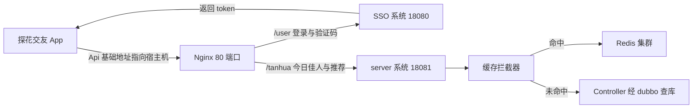

# App 端整合测试：从模拟器安装、地址切换到 day02 全功能收官

> 🔒 安全提示：文中示例的口令/密钥均为课程教学环境演示口径，生产环境的安全要求见《安全与合规须知》。

后端接口在 REST 客户端里逐条验证通过，还差最后一道关：真实用户手里跑的是 App。整合测试把 day02 的所有产出放进一次完整流程里验收，启动 Android 模拟器，安装课程 APK，把请求地址从 mock 切到本机后端，走完登录、首页、今日佳人、推荐列表与缓存，最后对照学习目标盘一遍 day02 的收获。

## 先给结论

- 模拟器使用 day1 安装的 Genymotion，安装资料包里的 `app-debug-004.apk`；App 自带「Api 基础地址」设置入口，默认指向 mock 地址，联调前必须切到本机。
- 地址要填宿主机的局域网 IP（如 `http://172.16.55.153`），不能填 127.0.0.1；模拟器是独立虚拟设备，环回地址指向它自己。入口是 Nginx 的 80 端口，地址不带端口号。
- 登录用资料包 `mytanhua.sql` 里预置的测试手机号，验证码固定 123456，登进首页后今日佳人卡片与推荐列表都由后端真实数据驱动，上拉可加载下一页。
- 首页若有其他模块弹出接口异常提示，例如尚未实现的访客统计接口，与本课功能无关，忽略即可。
- IDE 断点可以看到 App 的请求真实经过缓存拦截器，统一入口与统一缓存两件基础设施在真实流量下运转正常。

## 准备：模拟器、APK 与地址切换

启动 Genymotion 的虚拟设备，把资料 day02 目录下的 `app-debug-004.apk` 拖进模拟器完成安装。App 首次进入带有「修改服务 API 地址」的设置入口，这是课程特意留的后门：默认地址指向 mock 平台，App 展示的是设计稿数据，方便前端独立开发；做整合测试时，先在 mock 模式下浏览一眼页面效果，确认 UI 没有变化，再进入设置把地址换掉。

改地址前先弄清该填什么。模拟器是独立的虚拟设备，有自己独立的网络栈，`127.0.0.1` 在它身上指向模拟器自身，填了必然连不上宿主机的服务。宿主机对模拟器而言是局域网里的另一台机器，所以在宿主机上先查 IP：

```bash
ipconfig    # 查看本机网络适配器，取当前使用的 IPv4 地址
```

输出里能看到以太网适配器、VMware 虚拟网卡等多个适配器，取 App 所在网络可达的那个 IPv4 地址（演示环境为 `172.16.55.153`），在 App 设置里填入 `http://172.16.55.153` 并保存。地址不带端口，因为请求先打到 Nginx 的 80 端口，再由统一入口按路径分发，这正是 day02 前面把入口统一的意义：App 只需要记住一个地址，后端怎么拆分它一概不知。

## 从登录到首页：全链路验收

登录从资料包的测试用户开始，`mytanhua.sql` 里预置了账号数据：

```sql
-- 资料包 mytanhua.sql 中预置的测试用户（密码字段的 MD5 即 123456）
INSERT INTO `tb_user` VALUES ('3', '17602189189', 'e10adc3949ba59abbe56e057f20f883e', '2019-08-02 16:43:46', '2019-08-02 16:43:46');
```

在 App 里输入手机号 17602189189，点击获取验证码，验证码输入 123456 提交。这个固定验证码是联调阶段登录接口的 mock 口径，测试环境便利性优先。登录请求经 Nginx 命中 SSO 系统的 `/user` 路径，返回的 token 由 App 保存，后续每个请求放在 Authorization 请求头里携带，这也正是缓存 key 把 token 拼进去的原因。

登进首页，验收重点逐个过。今日佳人卡片显示缘分值最高的一位推荐用户，数据来自 dubbo 服务的 `queryWithMaxScore`；往下是推荐列表，缘分值从高到低排列；列表上拉可以继续加载下一页，分页参数随请求上送，对应 `queryPageInfo` 的翻页能力。第一次进入页面时 IDE 的断点会拦住请求，放行后页面正常渲染，断点只是调试期遗留，不是问题。

中途可能弹出一次接口异常的提示，出现在首页顶部附近。原因是首页还挂着其他模块的接口，比如今日访客数量，这些功能不在 day02 范围内，后端尚未实现，App 收到错误就提示异常。它与今日佳人和推荐列表无关，不影响本次验收，后续课程补齐对应接口后自然消失。



这张图把整合测试的全部链路收进一张网：App 的每一个请求都从 Nginx 进来，登录类接口流向 SSO 系统，业务类接口流向 server 系统，server 侧的缓存拦截器再决定是直接还数据还是回源查库。任何一环出问题，都能顺着这条路径定位到具体层。

## 缓存在真实流量下的验证

App 端的请求与 REST 客户端走的是同一套后端逻辑，缓存验证可以顺带完成。断点打在拦截器 preHandle，观察 App 的请求进来时 enable 为 true，key 按请求参数与 token 生成；第一次拉取推荐列表未命中，回源后 MyResponseBodyAdvice 把结果写入 Redis；回到 App 下拉刷新，同样的请求再次进入拦截器，这次命中，直接返回，dubbo 调用与数据库查询都被跳过。翻到第二页又是未命中、回源、写入，与前文调试验证的路径完全一致。真实流量下命中与未命中的交替出现，等于把缓存的两条分支又跑了一遍。

## day02 收官清单

对照 day02 的学习目标逐条盘点：首页功能说明与数据来源分析，铺垫了 `recommend_user` 集合的口径；MongoDB 部署、集合设计与造数、dubbo 工程搭建、接口定义与服务实现，完成了今日佳人的数据层；接口服务工程从 mock 起步，业务代码填实，顺手解决了枚举反序列化的坑；Nginx 统一接口入口，App 从此只记一个地址；推荐用户列表走通 dubbo 分页加 MySQL 详情拼装的完整链路；统一缓存逻辑用拦截器加 ResponseBodyAdvice 实现读写两侧封装；最后整合测试把整条链在真实 App 上验完。首页两条主链路至此闭环，day03 起转入圈子功能，今天积累的 dubbo 契约、统一入口与统一缓存会继续沿用。

## 常见误区

- **App 里填 127.0.0.1。** 错例：以为本机就是宿主机，填环回地址后所有请求超时。正解：模拟器是独立设备，填宿主机的局域网 IPv4，用 ipconfig 确认。
- **忘了切 Api 基础地址。** 错例：App 还停在 mock 地址上，页面有数据就以为后端通了，实际看到的全是设计稿数据。正解：联调前先确认设置里的地址指向本机，再看数据。
- **把首页其他接口的异常当成新功能故障。** 错例：看到接口异常提示就回头排查今日佳人。正解：认清未实现模块的提示与本次验收范围无关，按接口清单核对。
- **带着断点联调忘了关。** 错例：IDE 挂着断点，App 每次请求都卡住，误判为模拟器或网络问题。正解：整合测试前清掉调试断点，或放行后观察页面是否恢复。

## 面试可能被问到的问题

1. 面试官追问：「模拟器里访问宿主机服务，为什么不能用 127.0.0.1？」
   答：环回地址永远指向设备自身的网络栈，模拟器是独立虚拟设备，127.0.0.1 只会打到它自己。宿主机是局域网中的另一台机器，要用宿主机的实际 IPv4 访问；换到 Android 官方模拟器还有 10.0.2.2 这类专用别名，原理相同，都是跨设备寻址问题。
2. 面试官追问：「整合测试和接口测试、单元测试的分工是什么？」
   答：单元测试验证类与方法，接口测试用 REST 客户端验证单个接口的契约与状态码，整合测试把前端、入口层、缓存、RPC 与数据库串起来验证端到端行为。层次越往上越接近用户真实路径，能暴露的集成问题也越多，成本也越高，三层互为补充。
3. 面试官追问：「App 端请求异常时，如何分层排查？」
   答：按请求路径逐层收窄：先看 App 设置的地址与网络可达性，再看 Nginx 是否收到请求并正确转发，然后看 server 日志与缓存拦截器的命中情况，最后看 dubbo 调用与数据库。每层都有独立证据（响应头、日志、断点），从外向内排除，定位成本最低。
4. 面试官追问：「首页聚合了多个接口，部分接口失败时怎么处理？」
   答：接口独立请求、独立响应，单个接口失败只提示该模块异常，不阻塞其他模块渲染，这是本课首页的表现；更完整的做法是服务端做聚合接口加降级策略，部分依赖失败时返回兜底数据，保证主功能可用。
5. 面试官追问：「联调环境验证码固定为 123456，生产环境怎么处理？」
   答：这是环境隔离的口径，联调期为绕开短信依赖而固定，生产环境必须走真实短信通道并校验 Redis 中存储的动态验证码，同时加上发送频控与有效期限制。固定验证码属于必须随环境裁剪的测试后门，上线前要专项确认。
6. 面试官追问：「整合测试通过后，这一天的工作就算完成了吗？」
   答：功能验收通过只是底线，还要对照学习目标盘点产出、整理可复用的基础设施，本项目的统一入口与统一缓存就是后续每天都要用的组件；最后把测试中发现的遗留项，比如未实现的访客接口，记录成待办带入后续迭代。

## 配套资料

- 学习目标：`materials/code/07/day02 探花交友-实现首页功能/day02/学习目标.md`，其中「掌握整合测试」即本课对应目标，七条目标在本课后全部闭环。
- 数据库：`materials/code/07/day01 探花交友-项目搭建以及登录完善个人信息/day01/代码/mytanhua.sql`，联调登录使用的测试用户数据出自其中的 `tb_user` 记录。
- 说明：day02 资料包中的 `app-debug-004.apk` 未随代码资料入库，以课程画面为准；示例中的 IP 地址为演示环境的本机局域网地址，读者按实际环境替换。
