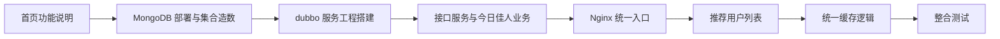

# day02 收官复盘：首页三大重点、遗留问题与下一站圈子

一天下来，首页这条线走过 MongoDB 部署、dubbo 工程、接口服务、Nginx 统一入口、统一缓存与整合测试，产出散落在十几个环节里。复盘的价值不在重述步骤，而在把零散动作收拢成能带走的方法论：哪三件事必须吃透，哪些坑记进了清单，哪些接口还欠着账。

## 先给结论

- day02 细节虽多，收拢后只有三个重点：今日佳人的实现、推荐列表的实现、缓存逻辑的解决方案，其余环节都是为这三条链路服务的。
- 今日佳人取 `recommend_user` 集合中缘分值最高的一条；推荐列表走 dubbo 分页查询加 MySQL 详情拼装的组合链路。
- 统一缓存是通用基建：拦截器负责读缓存，`MyResponseBodyAdvice` 负责写缓存，key 为 `SERVER_DATA_` 前缀加请求要素 MD5 摘要，过期 1 小时。
- Nginx 统一入口落地后，App 只需要记一个地址：`/user` 路径流向 SSO 系统 18080 端口，其余请求兜底流向 server 系统 18081 端口。
- 遗留问题要记录带走：首页其他模块的接口（如今日访客）尚未实现，整合测试时弹出的异常提示即来源于此。

## 一天产出的主线回顾

把当天的动作按依赖顺序串起来，就是一条从需求到验收的流水线。这张图按课堂推进顺序画出各环节的先后关系。



链路的关键在依赖关系：没有 `recommend_user` 的数据就没有今日佳人，没有 dubbo 契约就没有接口服务可写，没有统一入口整合测试就无从谈起。复盘时沿这条主线自问「每一步的产出是什么、下一步拿它做什么」，比逐页翻笔记高效得多。

## 重点一：今日佳人的实现链路

今日佳人要的是「与当前用户缘分值最高的一个人」。数据源是 MongoDB 里的 `recommend_user` 集合，部署的是 MongoDB 4.0.3，文档结构围绕四个字段展开：`userId` 登录用户、`touserId` 被推荐用户、`score` 缘分值、`date` 推荐日期。查询动作本身很简单，难的是工程拆分：接口定义放在 `my-tanhua-dubbo-interface`，服务实现放在 `my-tanhua-dubbo`，对外通过 dubbo 2.6.4 注册到 ZooKeeper 3.4.13，接口服务工程只依赖接口模块发起远程调用。

```java
// recommend_user 集合的文档映射与 dubbo 契约（按课程画面与本课写法补全）
@Document(collection = "recommend_user")
public class RecommendUser {

    private Long userId;      // 登录用户 id
    private Long toUserId;    // 被推荐用户 id
    private Double score;     // 缘分值，今日佳人取最高分
    private Date date;        // 推荐日期
    // getter / setter 略
}

public interface RecommendUserApi {

    // 今日佳人：缘分值最高的一位
    RecommendUser queryWithMaxScore(Long userId);

    // 推荐列表：按缘分值分页
    PageInfo<RecommendUser> queryPageInfo(Long userId, Integer page, Integer pageSize);
}
```

这一段的通用经验是契约先行：先把接口签名定下来，接口服务工程就能用 mock 数据并行开发，dubbo 实现随后填实即可，两头不互相等待。

## 重点二：推荐列表的完整链路

推荐列表比今日佳人复杂一步：缘分值在 MongoDB，用户资料（头像、昵称、年龄、学历）在 MySQL，展示时必须两库拼装。链路是 dubbo 按 `score` 倒序分页取出推荐记录，再批量到 MySQL 查 `tb_user_info` 补齐资料，组装成卡片返回。分页参数由 App 上拉加载时上送，`queryPageInfo` 负责翻页能力。这个「一个数据源做排序分页、另一个数据源做详情补齐」的组合在聚合类接口里非常典型，值得单独记一笔。

## 重点三：统一缓存的解决方案

缓存单独作为重点，是因为它的实现方式不绑定任何业务：拦截器在请求进入时按「请求路径 + 参数 + token」生成 `SERVER_DATA_` 前缀的 MD5 key 去查 Redis，命中直接返回；未命中则放行到 Controller，响应阶段由 `MyResponseBodyAdvice` 统一写入，过期 1 小时。业务代码零侵入，新接口天然获得加速能力。

```java
// 统一缓存 key 的生成口径（按本课写法补全）
String param = request.getRequestURI()
        + JSON.toJSONString(request.getParameterMap())
        + request.getHeader("Authorization");
String key = "SERVER_DATA_" + DigestUtils.md5Hex(param);
```

token 参与摘要意味着同一个接口对不同用户各存一份，谁也读不到谁的缓存；这也解释了整合测试里 App 请求为什么每次都带着 Authorization 头。

## 遗留问题与 day03 展望

盘点产出之外，遗留账也要记清。首页还挂着其他模块的接口，例如今日访客数量，后端尚未实现，整合测试时 App 弹出的接口异常提示即来源于此，不影响首页主功能，后续课程补齐后自然消失。这类「已知未实现」的清单越明确，后面排查问题时越不会被它干扰。

day03 转入圈子功能，对标微信朋友圈：发布动态、浏览好友与推荐动态、点赞评论喜欢。存储继续用 MongoDB，但表设计与读写链路都是新的，发布动作还会引入消息中间件做异步化。今天积累的 dubbo 契约、统一入口与统一缓存会原样复用，这正是把它们抽成基建的意义。

## 常见误区

- **把复盘写成流水账。** 错例：按视频顺序背一遍「先部署、再建工程」。正解：收拢为今日佳人、推荐列表、统一缓存三个重点，每个重点能独立讲清输入、输出与依赖。
- **缓存 key 不带 token。** 错例：只按路径与参数摘要，A 用户的响应被缓存后 B 用户也命中同一份。正解：token 参与摘要，按用户维度隔离缓存。
- **混淆两个 dubbo 工程的职责。** 错例：把实现类写进 `my-tanhua-dubbo-interface`。正解：接口模块只放契约供双方依赖，实现模块负责注册服务。
- **忽视整合测试里的异常提示。** 错例：见到接口异常就当新功能出了 bug，反复排查。正解：对照接口清单区分「未实现的遗留项」与「已实现功能的缺陷」。

## 面试可能被问到的问题

1. 面试官追问：「今日佳人这个需求，你完整讲一下实现过程？」
   答：数据层用 MongoDB 4.0.3 建 `recommend_user` 集合，存用户与被推荐用户的缘分值；服务层拆成 dubbo 接口与实现两个工程，提供 `queryWithMaxScore` 取最高分记录；接口服务经 dubbo 远程调用拿到结果后组装卡片返回。难点在工程拆分与契约先行，不在单条查询本身。
2. 面试官追问：「推荐列表为什么要同时查 MongoDB 和 MySQL？」
   答：排序分页依赖缘分值，它只存在于 MongoDB 的推荐集合；而展示需要头像昵称等资料，这些在 MySQL 的用户信息表。让 MongoDB 做它擅长的批量排序分页，MySQL 做详情补齐，两边各司其职，避免把全量资料冗余进推荐集合。
3. 面试官追问：「统一缓存为什么用拦截器加 ResponseBodyAdvice，而不是每个接口手写？」
   答：拦截器在请求入口统一判断命中与否，`MyResponseBodyAdvice` 在响应出口统一回写，读写两端都对业务零侵入。key 按路径、参数、token 摘要，天然覆盖同请求不同用户的场景。手写缓存会散落每个方法里，口径不一致还容易漏。
4. 面试官追问：「Nginx 统一入口解决的是什么问题？」
   答：后端按业务拆成 SSO 与 server 两个系统，端口、路径各不相同，App 不应该感知这些。统一入口按路径把 `/user` 类请求转发到 18080，其余兜底到 18081，前端只记一个地址，后端拆分与迁移都被隔离在网关之后。
5. 面试官追问：「一天产出这么多，怎么保证质量？」
   答：每条链路在完成时就地验证，例如缓存逻辑先在 REST 客户端里验证命中与未命中两条分支，再由整合测试在真实 App 上复跑；同时把 mock 起步、契约先行这类手段用来隔离前后端进度差异，最后用遗留问题清单收口已知风险。

## 配套资料

- 学习目标：`materials/code/07/day02 探花交友-实现首页功能/day02/学习目标.md`，七条目标与复盘收拢的三个重点一一对应。
- 数据库：`materials/code/07/day01 探花交友-项目搭建以及登录完善个人信息/day01/代码/mytanhua.sql`，整合测试使用的预置用户数据出自其中的 `tb_user` 记录。
- 说明：day02 工程源码未随资料包入库，文中 Java 片段为按课程画面与本课写法补全的示例，字段与口径以课程演示为准。
