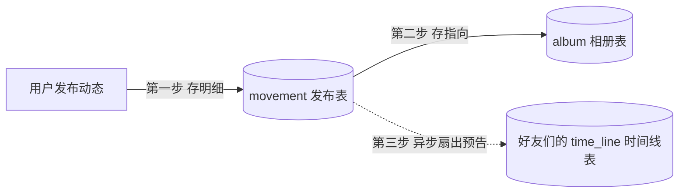
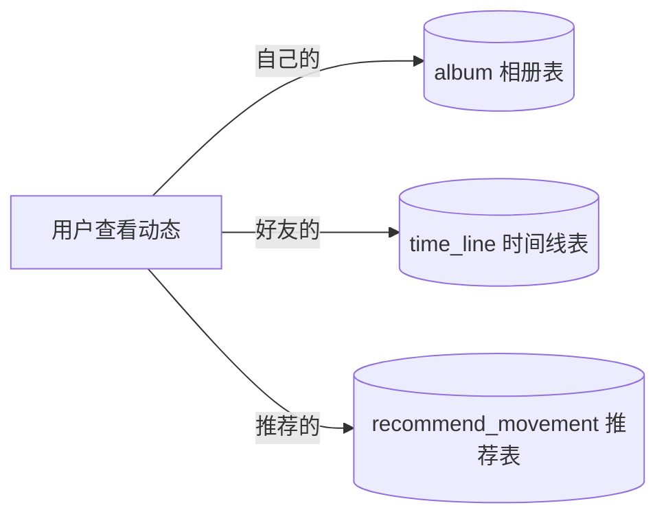

# 圈子实现方案分析：三条产品特性如何推出四张核心集合

朋友圈天天刷，轮到自己实现，第一步不是写代码，而是回答三个问题：海量动态放哪里、读多写少的矛盾怎么解、非好友不可见靠什么保证。day03 的方案分析用两条流程给出答案，这两份设计决定了后续所有编码的走向，也恰恰是社交类系统面试最爱考的内容。

## 先给结论

- 圈子的三条产品特性：数据量随用户数与时间持续增长、读多写少、非好友看不到动态内容。
- 存储选 MongoDB 而非 MySQL 这类关系型数据库，图片视频走对象存储（如阿里云 OSS 或七牛云），库里只存地址。
- 读多写少的权衡原则是尽量压低读成本、允许抬高写成本：好友发布动态时写入我的时间线，刷朋友圈只查一张集合，查询成本从「遍历所有好友」降到「一次查询」。
- 核心四张集合：发布表存动态明细，相册表存个人动态的指向，评论表存评论、点赞、喜欢三类互动，时间线表存好友动态的指向。
- 技术方案定为 MongoDB 加 Redis，发布流程三步走，查看流程按「自己的、好友的、推荐的」三个来源分流。

## 三条产品特性决定方案走向

方案分析从产品特性出发，课堂归纳为三条。**第一，数据量持续增长。** 动态会随用户数增加而变多，也随时间自然累积，每天都有新内容发布，这是一张只增不减的大表。**第二，读多写少。** 一个人发布一条动态，他所有的好友都能浏览，浏览次数远大于发布次数，读写比严重倾斜。**第三，可见范围受限。** 非好友看不到我的动态，可见性由社交关系决定，这既是产品规则，也直接影响存储组织方式。

三条特性各自指向一个技术判断：数据量大，关系型数据库不是好选择；读多写少，要围绕「降低读成本」做设计；可见性受限，存储层面就要按用户隔离数据。

## 存储选型：为什么不是 MySQL

海量数据场景下，MySQL、Oracle 这类关系型数据库在单表规模与扩展方式上都会吃紧。MongoDB 的文档模型与动态数据的形态天然契合：一条动态可能只有文字，可能带九张图，可能附视频，字段弹性大，文档库不需要为每种动态改表结构。水平扩展也是 MongoDB 的强项，数据量增长时分片扩容即可。

课堂还给出一个更细的判断依据：单条查询里，单集合一定比多集合联合查询快，SQL 的多表连接越多条件越多越慢。顺着这个思路，设计目标就是让一次浏览尽量只碰一张集合。至于图片视频这类大文件，一律不进数据库，上传到对象存储（如阿里云 OSS 或七牛云），库里只落地址列表。

按本课写法补全的四张核心集合定义如下：

```java
// 圈子四张核心集合的文档结构（按课程画面与本课写法补全）
@Document(collection = "movement")
public class Movement {
    private String id;               // 动态 id，相册与时间线只存这个指向
    private Long userId;             // 发布者
    private String textContent;      // 文字内容
    private List<String> medias;     // 图片地址列表，本体在对象存储
    private String locationName;     // 发布地名称
    private double[] location;       // 发布地经纬度，距离计算用
    private Date createDate;
}

@Document(collection = "album")
public class Album {
    private String id;
    private Long userId;              // 相册主人，一人一份
    private List<String> movementIds; // 该用户所有动态的指向
}

@Document(collection = "comment")
public class Comment {
    private String id;
    private String publishId;         // 被操作的动态或评论的 id
    private Long userId;              // 操作人
    private Integer type;             // 1 评论 2 点赞 3 喜欢
    private String content;           // 评论文字，点赞与喜欢为空
    private Date createDate;
}

@Document(collection = "time_line")
public class TimeLine {
    private String id;
    private Long userId;              // 时间线主人
    private String publishId;         // 好友动态的指向
    private Date createDate;
}
```

四张集合正好对应可见性设计的第三条特性：相册与时间线都按用户隔离，一个人只能读到自己的相册与时间线指向的内容，非好友的数据根本不会出现在他的查询结果里，隔离天然带出权限控制。这套隔离还有工程红利，后期要做分布式存储时按用户切分即可，上海的用户数据落上海机房，北京的用户数据落北京机房。

## 读多写少的取舍：把成本挪到写入侧

写少读多意味着优化要砸在读路径上。以一个有一千个好友的用户为例，查看好友动态有两种方案：一是遍历一千个好友的相册再合并结果，读一千次；二是让这一千个好友在发布时把动态指向写进我的时间线，我只查一次。课堂明确选择第二种，写入成本适当增加，读取成本大幅下降。

这张图画出发布动态时的三步写入，前两步落自己，第三步扇出到所有好友。



流程解读：动态明细只写一份进发布表；相册表记下这条动态的指向，相当于个人主页的目录；第三步向每个好友的时间线写入指向，好友越多这一步越重。明细与指向分离是关键设计，相册与时间线里不冗余动态内容，只存类似外键的引用，读取时再回查明细或命中缓存。时间线的本质是收件箱模式，也叫写扩散，朋友圈刷的就是它。

三步翻译成示意代码就是这样的骨架：

```java
// 发布动态三步的示意实现（按本课写法补全，异常与幂等处理略）
public void publish(Movement movement, Long userId) {
    String pid = movementApi.publish(movement);     // 第一步：写发布表，拿到动态 id
    albumApi.save(userId, pid);                     // 第二步：指向写入自己的相册
    // 第三步：扇出写入所有好友的时间线，好友量大时经 RocketMQ 异步完成
    List<Long> friendIds = friendApi.queryFriendIds(userId);
    friendIds.forEach(fid -> timeLineApi.save(fid, pid));
}
```

写扩散的代价在发布侧，好友量大时第三步串行写入会拖慢发布接口，这正是课程在技术实现环节引入 RocketMQ 做异步化的动机：发布接口先落自己的数据即返回，时间线扇出交给消息队列异步完成，失败可重试补偿。

## 技术方案：发布与查看两条流程

技术方案一句话概括：MongoDB 负责存储，Redis 负责缓存，二者结合实现圈子。把发布流程记成三步、查看流程记成三个来源，编码阶段就是把这两条流程翻译成接口。

查看流程的分流规则这张图画得很直白：



三个来源对应三个查询入口：看自己的动态查相册表，对应「我的相册」页；看好友动态查时间线表，对应刷朋友圈；看推荐动态查推荐表，数据由推荐系统写入，本项目后续用 Spark MLlib 实现推荐逻辑后自动供给。服务实现时，三步发布与三类查询各自封装成 dubbo 接口方法，接口服务工程照常经统一入口与统一缓存对外服务。

## 常见误区

- **把动态明细冗余进时间线或相册。** 错例：每个好友的时间线都存一份完整动态，存储瞬间翻倍且更新困难。正解：相册与时间线只存指向，明细在发布表里全局唯一。
- **用遍历好友相册的方式实现好友动态。** 错例：查好友列表后逐个查相册再合并，一千个好友一千次读。正解：写扩散进时间线，读路径一次查询收口。
- **以为非好友不可见要靠查询时过滤。** 错例：查出全部动态再在代码里判断好友关系。正解：按用户隔离的存储结构让非好友数据根本不在查询范围内，权限控制内建于设计。
- **发布三步强绑成一个同步事务。** 错例：三步任一失败就全部回滚，发布接口响应时间长且实现复杂。正解：按最终一致处理，自己的数据同步写，扇出写入异步化并用消息重试补偿。
- **把推荐动态也当成时间线的一部分。** 错例：推荐系统直接往用户时间线里塞数据。正解：推荐动态走独立的推荐表，两个读入口互不干扰，推荐池可单独清理重建。

## 面试可能被问到的问题

1. 面试官追问：「朋友圈类功能为什么选 MongoDB 而不是 MySQL？」
   答：动态数据量大且只增不减，文档字段弹性大，文字图片视频的组合形态不需要频繁改表；MongoDB 水平扩展能力强，分片扩容从容；单集合查询避免了关系型的多表连接开销。图片等大文件另存对象存储，库里只存地址。
2. 面试官追问：「读扩散和写扩散怎么取舍？」
   答：读扩散是读的时候遍历每个好友的发布记录再合并，写一次读多次，读路径重；写扩散是发布时写入每个好友的时间线，读一次收口，写路径重。社交信息流是典型读多写少场景，选写扩散，把成本压在写入侧，时间线本质就是收件箱。
3. 面试官追问：「四张核心表各自的职责是什么？为什么相册和时间线只存指向？」
   答：发布表存全局唯一的动态明细；相册表按人隔离，记录个人的发布目录；评论表统一存评论、点赞、喜欢三类互动；时间线表按人存好友动态的收件箱。只存指向是因为明细一份即可，冗余内容会让存储随好友数爆炸，也让修改与删除失去唯一事实源。
4. 面试官追问：「发布动态的完整流程是什么？好友很多时怎么办？」
   答：三步：写发布表拿动态 id，写自己的相册，向所有好友的时间线扇出写入指向。好友量大时扇出步经 RocketMQ 异步化，发布接口只完成前两步即返回，扇出失败靠消息重试收敛，用最终一致换取发布响应速度。
5. 面试官追问：「非好友不可见是怎么保证的？」
   答：靠存储隔离而不是查询后过滤。相册与时间线都按用户划分，一个用户能触达的内容边界就是他自己的相册与时间线，非好友动态不会进入这些集合，查询天然越不了界，也顺带获得了按地域做分布式存储的便利。
6. 面试官追问：「推荐动态的数据从哪里来？」
   答：由推荐系统计算后写入推荐表，业务侧只做查询。本项目后续用 Spark MLlib 基于行为数据训练推荐模型，产出写入推荐池；业务与推荐解耦后，推荐算法怎么迭代都不影响圈子接口的形态。

## 配套资料

- 圈子页面交互原型：`materials/code/07/day01 探花交友-项目搭建以及登录完善个人信息/day01/资料/探花交友移动端原型V1.2/圈子.html`，方案对应的产品口径与原型一致。
- day03 资料目录：`materials/code/07/day03 探花交友-实现圈子功能/`，day03 资料包未随代码资料入库，方案图与表结构以课程画面为准。
- 说明：四张集合的定义、发布流程示意代码为按本课写法补全的示例，最终实现以编码环节为准。
