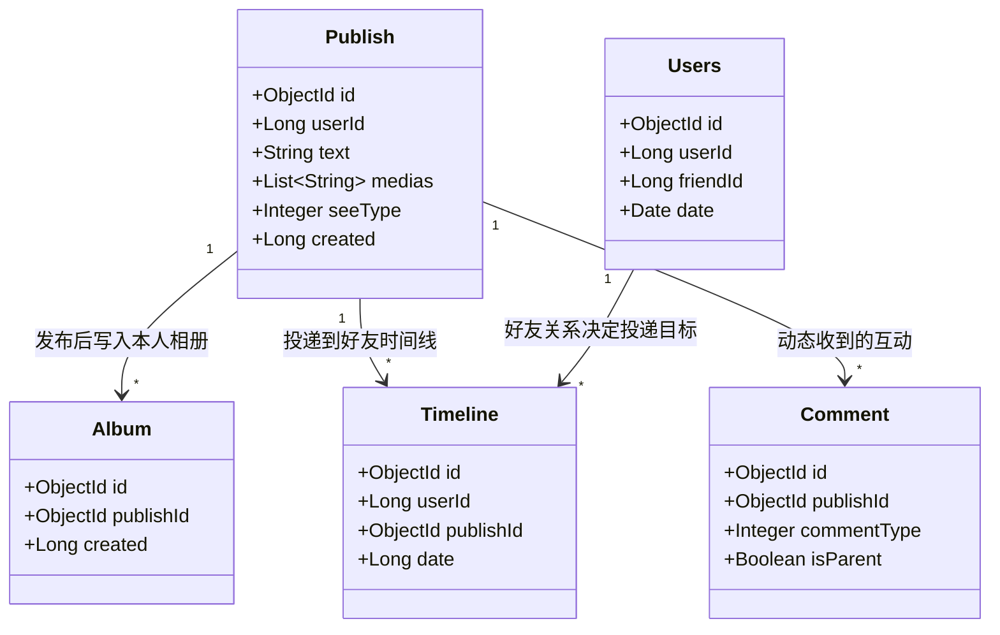

# 圈子实体层落地：五个 MongoDB pojo 与映射注解

表结构定稿后，第一层代码是把纸面模型翻译成 Java 实体。这些实体往哪放有讲究：接下来的 `savePublish` 是 Dubbo 服务，接口签名里要引用 `Publish`，所以实体必须写进 `my-tanhua-dubbo` 的 `my-tanhua-dubbo-interface` 模块，让契约与传输对象待在一起。这一课把发布、相册、时间线、评论四张表加上临时客串的好友表，一共五个 pojo 一次写齐。

## 先给结论

- 五个实体 `Publish`、`Album`、`Timeline`、`Comment`、`Users` 统一放在 interface 模块的 `com.study.tanhua.dubbo.server.pojo` 包下。
- 每个类的固定套路：Lombok 的 `@Data` 加两组构造器注解、`@Document(collection = "...")` 映射集合、实现 `Serializable` 并声明 `serialVersionUID`。
- 主键用 `org.bson.types.ObjectId`，字段名 `id` 自动映射 MongoDB 的 `_id`；时间字段统一 Long 时间戳，`Users` 的 `date` 按画面暂用 `Date`。
- 相册与时间线集合按用户动态命名，注解里的集合名只是缺省兜底，真正写入靠 `save` 的第二个参数。
- `commentType` 这类多值字段建议补常量类或枚举，避免魔法数字散落（课程画面未单独给出，示例按主流写法补全）。

## 一、Publish：发布表对应的实体

先看最核心的发布实体，注解套路与字段命名都在它身上：

```java
package com.study.tanhua.dubbo.server.pojo;

import lombok.AllArgsConstructor;
import lombok.Data;
import lombok.NoArgsConstructor;
import org.bson.types.ObjectId;
import org.springframework.data.mongodb.core.mapping.Document;
import java.util.List;

/**
 * 发布表，存储用户动态的正文
 */
@Data
@NoArgsConstructor
@AllArgsConstructor
@Document(collection = "quanzi_publish")
public class Publish implements java.io.Serializable {

    private static final long serialVersionUID = 873238321802804771L;

    private ObjectId id; //主键id
    private Long userId; //用户id
    private String text; //文字
    private List<String> medias; //媒体数据，图片或小视频 url
    private Integer seeType; //谁可以看：1-公开，2-私密，3-部分可见，4-不给谁看
    private List<Long> seeList; //部分可见的列表
    private List<Long> notSeeList; //不给谁看的列表
    private String longitude; //经度
    private String latitude; //纬度
    private String locationName; //位置名称
    private Long created; //发布时间
}
```

几个注解各司其职。`@Document(collection = "quanzi_publish")` 把类与 MongoDB 集合绑定，注意导的是 `org.springframework.data.mongodb.core.mapping.Document` 这个映射注解，不要与 `org.bson.Document`（文档数据结构）混淆。`@Data` 生成 getter、setter 与 toString 等样板方法，两组构造器注解补出无参与全参构造。实现 `Serializable` 是 Dubbo 的硬要求：对象要在网络传输中做序列化反序列化，`serialVersionUID` 固定版本，避免类升级后新旧节点反序列化冲突。字段 `id` 用 `ObjectId` 类型，Spring Data 看到 `id` 字段自动与 `_id` 主键映射，`ObjectId` 可以在客户端直接生成，这也是后续发布逻辑里 `ObjectId.get()` 的用武之地。`created` 按表结构设计存毫秒时间戳，用 Long。

## 二、Album 与 Timeline：两张指针表实体

相册与时间线只存发布 ID 指针，实体字段相应精简：

```java
/**
 * 相册表，存储自己发布的动态记录，每个用户一张表
 */
@Data
@NoArgsConstructor
@AllArgsConstructor
@Document(collection = "quanzi_album")
public class Album implements java.io.Serializable {

    private static final long serialVersionUID = 4321830950922168171L;

    private ObjectId id; //主键id
    private ObjectId publishId; //发布id
    private Long created; //发布时间
}
```

```java
/**
 * 时间线表，投递给用户的好友动态记录，每个用户一张表
 */
@Data
@NoArgsConstructor
@AllArgsConstructor
@Document(collection = "quanzi_time_line")
public class Timeline implements java.io.Serializable {

    private static final long serialVersionUID = 9096178416317502524L;

    private ObjectId id; //主键id
    private Long userId; //发布该动态的用户id
    private ObjectId publishId; //发布id
    private Long date; //发布时间
}
```

这两张表的注解集合名「用不上」，课程里点得很明白：真实写入时每个用户都要落到自己的集合，`quanzi_album_1`、`quanzi_time_line_2` 这样的名字是运行期拼出来的，靠 `MongoTemplate.save` 的两个参数版本动态指定。注解里的固定集合名只在直接 `save(obj)` 不带集合名时兜底生效。`Timeline.userId` 的语义要咬准：它记的是「这条动态是谁发的」，落到谁的集合里由写入时的集合名决定，字段与集合名分工明确，一个是发布者身份，一个是投递目的地。

## 三、Comment 与 Users：评论与临时好友表

评论表全局一张，类型字段是它的灵魂：

```java
/**
 * 评论表，点赞、评论、喜欢共用，按 commentType 区分
 */
@Data
@NoArgsConstructor
@AllArgsConstructor
@Document(collection = "quanzi_comment")
public class Comment implements java.io.Serializable {

    private static final long serialVersionUID = -291788258125767614L;

    private ObjectId id; //主键id
    private ObjectId publishId; //发布id
    private Integer commentType; //评论类型：1-点赞，2-评论，3-喜欢
    private String content; //评论内容
    private Long userId; //评论人
    private Boolean isParent = false; //是否为父节点，默认否
    private ObjectId parentid; //父节点id
    private Long created; //发布时间
}
```

`isParent` 给了默认值 `false`，新评论默认是子节点语义，做根评论时显式置 true。`parentid` 按画面保持全小写拼写，字段名即文档键名，查询与写入都用它，不要随手改成驼峰否则与已有文档对不上。`Users` 是临时补位的好友表实体，好友业务要到消息模块才正式展开，圈子发布时先拿它查好友列表：

```java
/**
 * 用户好友关系表，暂代好友业务
 */
@Data
@NoArgsConstructor
@AllArgsConstructor
@Document(collection = "tanhua_users")
public class Users implements java.io.Serializable {

    private static final long serialVersionUID = 6003135946082087423L;

    private ObjectId id; //主键id
    private Long userId; //用户id
    private Long friendId; //好友id
    private Date date; //时间
}
```

`Users.date` 按画面用了 `Date` 类型，课程里留了话：这个时间目前用不到，按整体口径其实该统一成 Long 时间戳，后续结构可能会调整。跟着画面走，先保证圈子链路跑通，这里存疑但不妨碍编译与逻辑。

## 四、给 commentType 补上常量

三个类型值 1、2、3 如果直接散在业务代码里，三个月后没人记得 2 是评论还是喜欢。课程画面没有单独给出枚举类，这里补一个按本课写法的常量类示例：

```java
public final class CommentType {

    public static final Integer LIKE = 1;    //点赞
    public static final Integer COMMENT = 2; //评论
    public static final Integer LOVE = 3;    //喜欢

    private CommentType() {}
}
```

业务代码一律写 `CommentType.LIKE`，类型的增删只动这一处。实体层不引枚举是因为 Dubbo 传输对象保持简单 pojo 更稳，常量类放在同一包下即可。

五个实体的关系一张图收拢：



读图的关键在依赖方向：Album、Timeline、Comment 都拿 `publishId` 指回 Publish，正文一份、指针多处；Users 决定一条发布要投递给几个 Timeline。

## 常见误区

- **@Document 导错包。** 错例：IDE 自动补全选了 `org.bson.Document` 或其他同名类，注解不生效，实体落进默认集合。正解：映射注解在 `org.springframework.data.mongodb.core.mapping` 包下。
- **实体漏实现 Serializable。** 错例：实体只加了 Lombok 注解，接口定义后 Dubbo 序列化传输时报序列化异常。正解：契约里流转的所有对象实现 `Serializable` 并声明 `serialVersionUID`。
- **字段名与文档键名不一致。** 错例：把画面上的 `parentid` 自作主张改成 `parentId`，与历史文档的键对不上，查询永远为空。正解：实体字段名、文档键名、查询条件三处同一拼写。
- **Timeline.userId 语义写反。** 错例：以为该字段是「时间线属于谁」，其实集合名才代表归属，字段存的是发布者 ID。正解：归属看集合名后缀，字段记发布者，两者混用会让 feed 展示成自己的名字。

## 面试可能被问到的问题

1. 面试官追问：「为什么这些 pojo 放在 interface 模块而不是 server 模块？」
   答：Dubbo 服务接口的方法签名引用了 Publish 等类型，契约 jar 必须自带这些类型，消费方依赖 interface 就能编译与反序列化，不必接触服务端实现。放在 server 模块会导致消费方编译不过，或被迫反向依赖实现工程形成循环。
2. 面试官追问：「ObjectId 的结构是什么，为什么客户端就能生成？」
   答：ObjectId 由 4 字节秒级时间戳、5 字节随机值、3 字节递增计数器组成，共 12 字节。生成只依赖本机时间与进程内计数，天然无协调、趋势递增。客户端先生成主键的好处是插入前就拿到 ID，后续写相册、时间线时可以直接引用，不用等数据库返回。
3. 面试官追问：「@Document 里的集合名与 save 时传入的集合名，谁生效？」
   答：调用 `save(obj)` 不带集合名时用注解里的缺省集合；调用 `save(obj, collectionName)` 两个参数版本时，显式集合名优先。相册与时间线按用户分表，实际写入全走两参版本，注解名只是兜底与语义说明。
4. 面试官追问：「serialVersionUID 不声明会怎样？」
   答：JVM 会按类结构自动计算一个，类只要改一个字段，自动值就变。Dubbo 场景下服务端与消费端各自升级，版本号不一致时反序列化直接抛 InvalidClassException。显式声明并保持稳定，允许类演进时通过兼容策略平滑处理。
5. 面试官追问：「实体字段用包装类型 Long 而不是 long，有什么讲究？」
   答：MongoDB 文档字段可以缺失，包装类型能表达 null，基本类型会给出 0 这种语义错误的默认值。校验逻辑里判 `userId == null` 才有意义，这也是发布校验的前提。同时 Long 与文档的整型存储对齐，避免隐式转换。

## 配套资料

- 原型：`materials/code/07/day01 探花交友-项目搭建以及登录完善个人信息/day01/资料/探花交友移动端原型V1.2/圈子.html`，实体层支撑的圈子交互原型。
- 数据库：`materials/code/07/day01 探花交友-项目搭建以及登录完善个人信息/day01/代码/mytanhua.sql`，MySQL 侧用户表结构，`Users` 实体的 userId 与 MySQL 用户 id 对齐。
- 说明：day03 资料包未解出工程源码，五个实体按课程画面逐字段整理并改写包名为 `com.study.tanhua` 系；`Users.date` 的类型以画面为准，课程内已提示后续可能调整为 Long；`CommentType` 常量类为按本课写法补全的示例。
