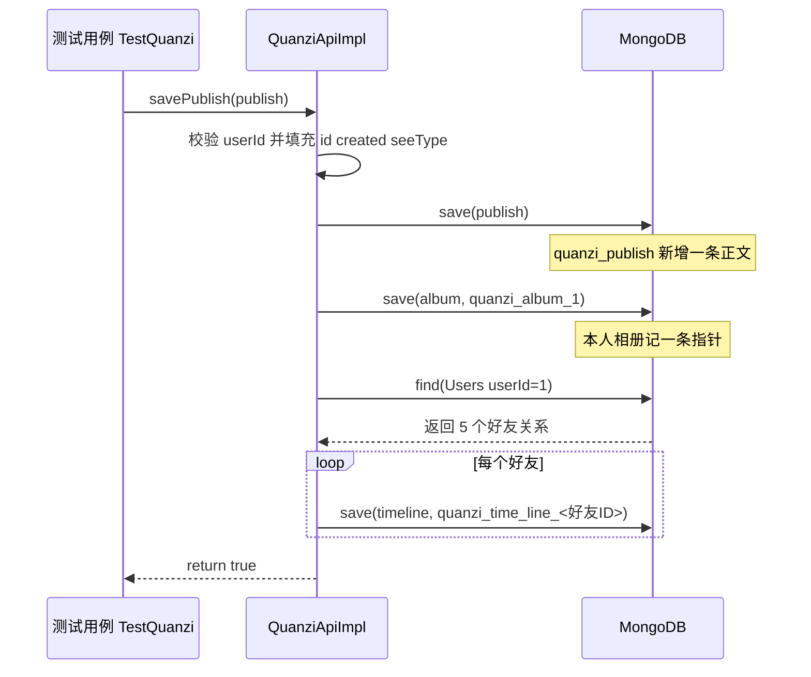

# 发布动态全链路：Dubbo 接口、三次写入与好友时间线投递

圈子最核心的动作是发布动态：在朋友圈发一段文字配几张图，好友们就能刷到。这个动作在后台不是一次写入，而是三步落库加一轮投递：动态正文进发布表，自己的相册表记一条指针，再往每个好友的时间线表里各投一条。这一课用三段视频把 `savePublish` 从接口定义写到测试跑通，中间还顺手补上了好友关系的测试数据，是 day03 里工程量最大的一讲。

## 先给结论

- 接口定义在 interface 模块：`QuanziApi.savePublish(Publish)`，入参是发布对象，返回 boolean 表示成功与否。
- 实现类 `QuanziApiImpl` 用 Dubbo 的 `@Service(version = "1.0.0")` 暴露为服务，注意导的是 `com.alibaba.dubbo.config.annotation.Service`，与 Spring 的同名注解不是一回事。
- 实现分三步：校验并填充数据，`mongoTemplate.save(publish)` 写发布表，相册对象写入 `quanzi_album_<userId>`，最后查询好友列表逐个写 `quanzi_time_line_<friendId>`。
- 按用户分表的集合名靠 `MongoTemplate.save` 的两个参数版本动态指定，这是分表设计能否落地的关键一行。
- 三段写入包进 try-catch，异常返回 false；完整事务处理课程留作实践，MongoDB 4.0.3 已具备多文档事务能力。
- 测试用例构造 userId 为 1 的动态，断点逐步验证：发布表多一条，相册集合出现，五个好友的时间线集合各进一条。

## 一、图片先走上传，medias 从哪来

发布动态的表单里最重的数据是图片。流程上 APP 先把选中的图片传到对象存储（day01 已打通的 OSS 上传链路），拿到一组 URL，再把文本内容、媒体 URL 列表、位置信息一起打包成发布请求提交到后台。也就是说，服务端拿到 `Publish` 对象时，`medias` 里已经是可以直接展示的图片或小视频地址，服务端不再处理文件流，只负责把这些地址作为动态的一部分存好。这个拆分让发布接口保持轻，上传的偶发失败也不会污染动态数据：图片没传完，请求根本不会发出来。

为什么媒体是 List 而不是单个地址，答案就在业务形态里：一条动态允许配多张图，九宫格布局就是由这个列表驱动的。列表元素是完整的 URL，包含协议、域名与路径，前端拿到后无需再拼基地址，直接塞进图片控件的 src。URL 由上传服务生成时已经带上存储路径与文件名，动态表只做忠实的记录者，不感知文件的存在形态。将来如果要支持删除某张配图，也是对列表做裁剪后整体更新，存储模型不需要任何改动。

## 二、接口契约先定

Dubbo 开发的惯例是契约先行。在 `my-tanhua-dubbo-interface` 的 api 包里定义圈子服务接口：

```java
package com.study.tanhua.dubbo.server.api;

import com.study.tanhua.dubbo.server.pojo.Publish;

public interface QuanziApi {

    /**
     * 发布动态
     * @param publish 发布数据
     * @return 是否发布成功
     */
    boolean savePublish(Publish publish);
}
```

接口就一个方法，入参 `Publish` 是上一课写好的实体，出参 boolean。返回布尔而不是抛异常，是课程对这个服务的定位：发布动态是用户主动触发的低频操作，成功失败用返回值就够表达，前端拿到 false 提示重试即可；真要把失败原因分门别类，再用自定义异常体系也不迟，接口一旦发布就被多方依赖，先简单后演进比一上来就过度设计稳妥。契约放在 interface 模块，消费方与提供方共同依赖它，这条纪律在拆工程那一课已经立下。

## 三、实现类：Dubbo 的 @Service 与数据填充

实现写在 `my-tanhua-dubbo-server` 里，先搭类骨架：

```java
package com.study.tanhua.dubbo.server.api;

import com.alibaba.dubbo.config.annotation.Service;
import com.study.tanhua.dubbo.server.pojo.Publish;
import org.bson.types.ObjectId;

@Service(version = "1.0.0")
public class QuanziApiImpl implements QuanziApi {

    @Override
    public boolean savePublish(Publish publish) {
        //校验publish对象
        if (publish.getUserId() == null) {
            return false;
        }
        // ...... 其他的校验逻辑类似
        return false;
    }
}
```

`@Service` 这个注解是整段代码最容易踩的坑：它长得很像 Spring 的 `@Service`，但真正导入的是 `com.alibaba.dubbo.config.annotation.Service`。Spring 的注解只把类注册成本地 Bean，Dubbo 的注解才会在服务启动时把实现注册到 ZooKeeper，供消费方发现与调用。导错包不会编译报错，只会出现「服务起了但消费方永远找不到」的灵异现象，排查时先看 import。`version = "1.0.0"` 给服务打上版本号，为将来多版本共存留出空间。

方法内第一件事是校验与填充。`userId` 是这条动态的归属，空了直接返回 false，其余校验逻辑同型。然后补齐不该由调用方传的字段：

```java
//填充数据
publish.setId(ObjectId.get());
publish.setCreated(System.currentTimeMillis()); //发布时间
publish.setSeeType(1); //查看权限，默认公开
```

主键不能信任外部传入，由服务端 `ObjectId.get()` 生成，前面实体课讲过它的组成，客户端生成让后续写入可以直接引用这个 ID。发布时间取当前毫秒值。`seeType` 默认给 1（公开），因为可见性过滤本期没有实现，先落默认值，`seeList` 与 `notSeeList` 也不填，等需求真正落地再补，字段在表结构里已经就位，补逻辑不需要动模型。

## 四、写发布表与相册表

注入 `MongoTemplate` 后开始第一次写入，然后立刻写相册：

```java
import org.springframework.beans.factory.annotation.Autowired;
import org.springframework.data.mongodb.core.MongoTemplate;

@Autowired
private MongoTemplate mongoTemplate;

//保存动态信息
this.mongoTemplate.save(publish);
//写入到自己的相册表中
Album album = new Album();
album.setId(ObjectId.get());
album.setPublishId(publish.getId()); //动态id
album.setCreated(System.currentTimeMillis());
//将相册对象写入到MongoDB中
this.mongoTemplate.save(album, "quanzi_album_" + publish.getUserId());
```

第一行 `save(publish)` 不带集合名，`Publish` 的 `@Document` 注解里写着 `quanzi_publish`，发布表全局一张，直接落。第二段构建相册对象，`publishId` 指向刚生成的动态 ID，时间取当前时间戳，然后调用两个参数的 `save`：第二个参数 `"quanzi_album_" + publish.getUserId()` 是运行期拼出的集合名。相册按用户分表，userId 为 1 的用户所有动态指针都进 `quanzi_album_1` 集合，userId 为 2 的进 `quanzi_album_2`，互不掺杂。这个两参 `save` 就是分表设计落地的那一行，注解里的固定集合名在这种场景只是兜底。

`MongoTemplate` 的 `save` 语义值得记一笔：按对象的主键判断，不存在则插入，存在则整体替换。发布场景主键都是新生成的，行为等同插入；但要知道它的替换语义，避免日后拿 `save` 做局部更新时踩坑。

集合名的拼接还有一条纪律要立：拼串逻辑只在服务层出现一次，别在代码里到处手写 `quanzi_album_` 前缀。手写两处就可能拼出两种结果，一个字母之差就是两个不同的集合，数据会安静地分裂，没有任何报错提示。更稳妥的收口是抽一个私有方法，入参 userId 返回集合名，或者用常量定义前缀再拼接，让命名规则在代码里只有一份权威定义。分表方案的运维成本大头就在命名纪律上，数据库里几百个 `quanzi_time_line_N` 集合，命名规则一旦漂移，排查问题的人要在集合列表里逐个辨认。

## 五、好友数据就位：一段临时测试数据

投递时间线的前提是知道好友是谁。好友业务要到消息模块才正式实现，这里先用测试用例往 `tanhua_users` 集合里灌一段关系数据：

```java
package com.study.tanhua.dubbo.server.api;

import com.study.tanhua.dubbo.server.pojo.Users;
import org.bson.types.ObjectId;
import org.junit.Test;
import org.junit.runner.RunWith;
import org.springframework.beans.factory.annotation.Autowired;
import org.springframework.boot.test.context.SpringBootTest;
import org.springframework.data.mongodb.core.MongoTemplate;
import org.springframework.data.mongodb.core.query.Criteria;
import org.springframework.test.context.junit4.SpringJUnit4ClassRunner;
import java.util.Date;

@RunWith(SpringJUnit4ClassRunner.class)
@SpringBootTest
public class TestUsers {

    @Autowired
    private MongoTemplate mongoTemplate;

    @Test
    public void saveUsers() {
        this.mongoTemplate.save(new Users(ObjectId.get(), 1L, 2L, new Date()));
        this.mongoTemplate.save(new Users(ObjectId.get(), 1L, 3L, new Date()));
        this.mongoTemplate.save(new Users(ObjectId.get(), 1L, 4L, new Date()));
        this.mongoTemplate.save(new Users(ObjectId.get(), 1L, 5L, new Date()));
        this.mongoTemplate.save(new Users(ObjectId.get(), 1L, 6L, new Date()));
    }
}
```

这段数据表达的是：1 号用户有 2、3、4、5、6 五个好友。跑完用图形化客户端检查 `tanhua_users` 集合，五条关系一目了然。现场有个小插曲值得记录：用例执行了两遍，数据翻倍成十条，处理方式是把集合 drop 掉重新跑一遍，五条干净数据落库。测试数据脏了就清空重建，比逐条挑着删可靠，这个习惯在造数场景里通用。

## 六、第三次写入：向好友时间线投递

回到 `savePublish`，发布表与相册写完后，查询当前用户的好友列表并逐个投递：

```java
//查询当前用户的好友数据
Query query = Query.query(Criteria.where("userId").is(publish.getUserId()));
List<Users> users = this.mongoTemplate.find(query, Users.class);
for (Users user : users) {
    Timeline timeline = new Timeline();
    timeline.setId(ObjectId.get());
    timeline.setUserId(publish.getUserId()); //发布者的id
    timeline.setPublishId(publish.getId()); //动态id
    timeline.setDate(System.currentTimeMillis());
    //写入到好友的时间线表中
    this.mongoTemplate.save(timeline, "quanzi_time_line_" + user.getFriendId());
}
return true;
```

`Criteria.where("userId").is(publish.getUserId())` 表达「`userId` 字段等于发布者」这个条件，`find` 返回所有好友关系。循环体里为每个好友构建一条 `Timeline`：`userId` 填发布者的 ID，这条动态是谁发的在 feed 里要展示；`publishId` 指向正文；集合名用 `user.getFriendId()` 拼，投进好友自己的时间线集合。整段逻辑跑完返回 true。

课程现场在这里写错过一次，正好是理解语义的好例子：集合名一开始拼的是发布者的用户 ID，等于把动态投进了自己的时间线，好友那边什么都没有。投递的语义是「写到对方的表里」，集合名必须取 `friendId`，循环变量代表哪个好友，就用谁的 ID 命名他的集合。字段与集合名各管一头：字段记发布者，集合名记收件人，两个都对了，读取侧「查我好友们发过的动态」才能一句查询命中。

整条链路的时序收拢成一张图：



读图的要害在 loop 那一段：一次发布产生 N 次时间线写入，N 等于好友数。写入成本随好友数线性增长，这正是写扩散的代价，换来的是读取时每个用户只查自己那张小表。

## 七、异常兜底与事务话题

三次写入串在一条链上，任何一步抛异常都会让数据残缺：动态发了但相册没有，或者发布表有了、时间线投了一半。课程的收尾处理是把三段保存包进 try-catch：

```java
try {
    //保存动态信息
    this.mongoTemplate.save(publish);
    //写入相册
    this.mongoTemplate.save(album, "quanzi_album_" + publish.getUserId());
    //投递好友时间线
    for (Users user : users) {
        // ...... 构建 Timeline 后写入
        this.mongoTemplate.save(timeline, "quanzi_time_line_" + user.getFriendId());
    }
    return true;
} catch (Exception e) {
    e.printStackTrace();
}
return false;
```

出错就返回 false，不让异常向上扩散，至少调用方能拿到明确的失败信号。真要保证三处写入的原子性，就是事务话题了。MongoDB 从 4.0 开始支持多文档事务，课程环境部署的正是 4.0.3，但事务还有一道门槛：它要求部署形态是副本集或分片集群，单机 mongod 即便版本到了 4.0 也开不了事务，课程环境恰好是单机安装，这是没有引入事务的现实原因之一。此外按用户分表后一次发布横跨多个集合，事务范围大、持有锁的时间长，吞吐会明显下降。工程上更常见的做法是失败补偿：投递失败的好友记一条补偿任务，异步重试补齐，投递动作本身是幂等的，同一 publishId 重复投递可以在读取侧去重，最终一致即可接受。顺带预告一下生产形态：动态发布之后通常还要送内容安全审核，合规图文才真正可见，这类旁路处理一般用 RocketMQ 之类的消息队列异步衔接，发布链路只管落库与投递，审核结果通过回调改变动态的可见状态，本课先把写入链路跑通，消息与审核在后续课程展开。

## 八、测试联调：断点里的三张表

接口写完，用测试用例端到端验证一遍。测试类放在 server 工程，通过 Dubbo 的 `@Reference` 拿服务代理，走真实的注册与调用链路（也可直接注入实现类做纯本地验证）：

```java
@RunWith(SpringJUnit4ClassRunner.class)
@SpringBootTest
public class TestQuanzi {

    @Reference(version = "1.0.0")
    private QuanziApi quanziApi;

    @Test
    public void testSavePublish() {
        Publish publish = new Publish();
        publish.setUserId(1L);
        publish.setLocationName("上海市");
        publish.setSeeType(1);
        publish.setText("今天天气不错");
        publish.setMedias(Arrays.asList("https://example.com/images/quanzi/1.jpg"));
        boolean result = this.quanziApi.savePublish(publish);
        System.out.println(result);
    }
}
```

用例构造 1 号用户的动态，媒体地址给了一张示例图（对象存储地址在课程里指向真实 bucket，写作时换成占位域名）。断点打在 `savePublish` 入口做 debug 启动，逐步单步可以看清每张表的变化：第一处 `save(publish)` 执行完，刷新客户端，`quanzi_publish` 集合出现一条文档，主键是断点里看到的那个 ObjectId；单步到相册写入后，`quanzi_album_1` 集合生成，里面那条 `publishId` 正是刚才记下的 ID，指针对得上；继续放行进入循环，每过一个好友，就多一个 `quanzi_time_line_2`、`quanzi_time_line_3` 这样的新集合，各自装着同一条动态的投递记录。五个好友走完返回 true，控制台打印 true。

把断点去掉完整跑一遍，再用查询视角收个尾：以 5 号用户登录，刷圈子动态时查 `quanzi_time_line_5` 这一张表就够了，不用碰发布集合的大海捞针。发布时多写的那些功夫，此刻全部兑现成读取的简单。写入与读取的成本像跷跷板，这一课把砝码明确压给了读取侧，后续的查询接口都是这个决定的受益者。

验证环节还有一层价值容易被忽略：它同时验证了前面几课的成果。Dubbo 服务注册依赖 ZooKeeper 在线，`@Reference` 拿到代理说明注册与发现是通的；MongoDB 写入成功说明连接配置正确；实体序列化没报错说明 interface 模块的契约完整。一次端到端的发布测试，等于把 day1 以来的环境、工程、实体三层全部过了一遍电流。以后任何一天环境出了问题，这条链路就是最快的手工体检工具：发布失败先看服务是否注册，再看 MongoDB 是否可写，最后才怀疑业务代码。

## 常见误区

- **@Service 导成 Spring 的包。** 错例：`org.springframework.stereotype.Service` 注册了 Bean 但不是 Dubbo 服务，消费方订阅不到，报找不到提供者。正解：导 `com.alibaba.dubbo.config.annotation.Service`，发布前看一眼 import。
- **时间线集合名拼成发布者 ID。** 错例：`"quanzi_time_line_" + publish.getUserId()`，动态全投进自己表里，好友永远刷不到。正解：投递写对方表，集合名用循环里好友的 `getFriendId()`。
- **相册集合名漏了下划线。** 错例：拼成 `quanzi_album1`，与设计文档的 `quanzi_album_<userId>` 对不上，排查数据时两个集合来回找。正解：命名规则与设计稿保持一字不差，拼接逻辑收敛到一处常量或方法。
- **主键信任外部传入。** 错例：直接用调用方传来的 `publish.getId()` 落库，主键冲突或被恶意构造。正解：服务端 `ObjectId.get()` 统一生成，外部传值一律覆盖。
- **save 与 insert 混用。** 错例：拿 `save` 做并发更新，整体替换语义把别处刚写入的字段覆盖掉。正解：新增用 save 无妨，局部更新用 `updateFirst` 加 `Update` 对象。

## 面试可能被问到的问题

1. 面试官追问：「发布动态为什么要写三张表，只写发布表不行吗？」
   答：只写发布表的话，读侧每次刷 feed 都要按好友列表过滤全量发布集合，数据量大后查询越来越慢。相册与时间线是两个读路径的索引化落位：相册服务「看某人主页」，时间线服务「看好友 feed」。写扩散把查询时代价提前付掉，读取只剩单表遍历，社交场景读远多于写，整体是划算的。
2. 面试官追问：「Dubbo 的 @Service 和 Spring 的 @Service 有什么区别？」
   答：Spring 的注解把类注册为本地 Bean，走依赖注入体系；Dubbo 的注解把实现暴露为 RPC 服务，启动时向注册中心注册地址、发布元数据，消费方用 @Reference 才能拿到代理。类名相同、包不同、职责完全不同，混用不会报编译错，只会让服务「起了但不可见」，属于高频事故点。
3. 面试官追问：「三处写入怎么保证一致性，怎么应对部分失败？」
   答：单机 MongoDB 4.0 以上可用多文档事务包住多个集合的写入，但按用户分表后事务跨度大、吞吐下降。工程上常用失败补偿：时间线投递失败时记录补偿队列异步重试，投递是幂等的（同一 publishId 重复写可在读取侧或写入侧去重），最终一致即可。也可以引入消息队列，把投递从同步链路里拆出去。
4. 面试官追问：「MongoTemplate 的 save 和 insert 有什么区别？」
   答：insert 遇到相同 _id 直接抛 DuplicateKeyException，是纯新增语义；save 按主键判断，存在则整文档替换、不存在则插入。发布场景主键新生成，两者等价；更新场景必须清楚 save 是整体替换，局部修改要用 update 系列 API，否则并发下容易丢字段。
5. 面试官追问：「好友时间线投递这个循环，好友数量大了会有什么问题？」
   答：写入耗时与请求数随好友数线性增长，接口延迟被最慢的那次写入拖住，极端情况下一次发布要写几千条。优化方向有三档：异步化，同步链路只写发布表与相册，投递交给消息队列后台消费；分批并行写入；大 V 场景改推拉结合，普通用户推、大 V 拉读时合并。熟人社交好友数有限，同步循环够用，但要意识到它的扩展边界。
6. 面试官追问：「ObjectId 为什么在客户端生成，好处是什么？」
   答：ObjectId 由时间戳、机器标识、进程内计数器组成，本机生成无协调开销且趋势递增。客户端先生成主键，插入前的代码就能持有 ID 去写相册与时间线的关联字段，省去回查；对分片集群也避免了由单一节点分配主键的瓶颈。

## 配套资料

- 原型：`materials/code/07/day01 探花交友-项目搭建以及登录完善个人信息/day01/资料/探花交友移动端原型V1.2/圈子.html`，发布动态入口与动态列表的交互原型。
- 数据库：`materials/code/07/day01 探花交友-项目搭建以及登录完善个人信息/day01/代码/mytanhua.sql`，用户表结构，测试用例中 userId 取值与其种子数据对齐。
- 学习目标：`materials/code/07/day02 探花交友-实现首页功能/day02/学习目标.md`，Dubbo 服务开发与本课实现部分的对应关系。
- 说明：day03 资料包未解出工程源码，接口与实现代码按课程画面逐段整理，包名与 groupId 按规范改写为 `com.study.tanhua` 系；测试用例中的图片地址改为 example.com 占位（课程画面为对象存储真实地址）；RocketMQ 内容审核衔接为课程后续内容，此处仅作流程预告。
