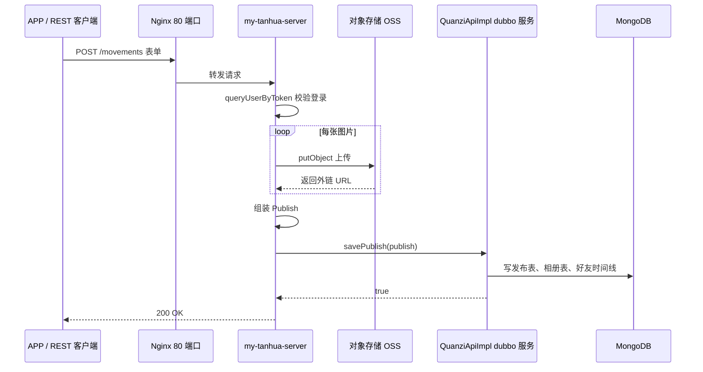

# 发布动态的接口服务：Movements 控制器、参数接收与图片先行上传

> 🔒 安全提示：文中示例的口令/密钥均为课程教学环境演示口径，生产环境的安全要求见《安全与合规须知》。

dubbo 那一侧的 `savePublish` 已经跑通，动态落库的三步写入不成问题了，但用户的手指还碰不到它：APP 发出的请求先落在接口服务工程上，得有人接住表单、收好图片、拼出 `Publish`，再去调用 dubbo 服务。这一课用三段视频把这段接口层补齐，从 mock 文档的参数清单，写到 `MovementsController` 的五种参数接收，再到 `MovementsService` 里 token 换用户、图片先行上传 OSS、组装对象转发 dubbo，最后三个工程一起启动做联调，连模拟器上的真实发帖也走了一遍。

## 先给结论

- 接口契约以 mock 文档为准：`POST /movements`，请求体是 `multipart/form-data`，五个业务参数加一个 `Authorization` 请求头，成功响应 200，失败响应 500。
- Controller 用 `@RequestParam` 逐个接参，图片参数是 `@RequestParam("imageContent") MultipartFile[]` 数组，多张图片一次接收；token 用 `@RequestHeader("Authorization")` 取。
- Service 第一步永远是 token 换用户，查不到直接返回 false；随后组装 `Publish`，图片先逐张传 OSS 拿外链，再 `setMedias` 进对象。
- OSS 上传链路整体从 sso 工程搬进 server 工程：`PicUploadService`、`AliyunConfig`、`aliyun.properties`、`PicUploadResult` 四件套照搬，改包名补依赖即可，`name` 字段即图片外链。
- 联调按「dubbo 服务 → sso → server」的顺序启动，测试请求走 80 端口的 Nginx 入口；表单字段名必须与 `@RequestParam` 的名字一字不差，否则文件收不全。

## 接口契约：POST /movements 的参数清单

动手之前先看 mock 平台上定好的接口文档，路径是根目录下的 `movements`，请求方法 POST。请求头里有两样：`Content-Type: multipart/form-data`，说明这是带文件的表单提交；`Authorization`，装的是登录后拿到的 token。请求体五个参数：`textContent` 是文字内容，`imageContent` 是文件类型且支持多张图片，`location` 是位置名称，`longitude` 与 `latitude` 是经纬度。响应只有状态码：成功 200，失败 500。

这份清单决定了后面所有代码的形状。`multipart/form-data` 意味着文本与文件混在一张表单里，文本走 `@RequestParam`，文件走 `MultipartFile`；「支持多张图片」意味着参数类型必须是数组；「响应只有状态码」意味着返回值类型选 `ResponseEntity<Void>`，成功失败都只靠 HTTP 状态表达，不带响应体。契约先于实现，Controller 的每个方法签名都能从这份文档里推出来，写代码时不会有悬而未决的选择。

顺带把提交方式的选择讲透。发布动态为什么不用常见的 JSON 请求体？因为 JSON 里放不了二进制文件，图片要走 base64 编码塞进字符串的话，体积膨胀三分之一，序列化与反序列化都在白白消耗 CPU；表单协议天然支持文件段，文本字段与文件字段并肩共存，Servlet 容器替你完成切割与封装。代价是文本字段不能像 JSON 那样嵌套结构，但对「五个平铺参数」的发布场景毫无影响。选 `multipart/form-data` 不是习惯，是数据形态决定的。响应侧只给状态码也是同理：发布这个动作没有回显数据的需求，前端要的只是一个「成了没」，多包一层 JSON 响应结构属于过度设计。

## Controller：五种参数各自的接收方式

进入 `my-tanhua-server` 工程，新建 `MovementsController`。类上两个注解定路径，方法上一个 `@PostMapping` 定动作：

```java
package com.study.tanhua.server.controller;

import com.study.tanhua.server.service.MovementsService;
import org.springframework.beans.factory.annotation.Autowired;
import org.springframework.http.HttpStatus;
import org.springframework.http.ResponseEntity;
import org.springframework.web.bind.annotation.*;
import org.springframework.web.multipart.MultipartFile;

@RestController
@RequestMapping("movements")
public class MovementsController {

    @Autowired
    private MovementsService movementsService;

    /**
     * 发布动态
     */
    @PostMapping
    public ResponseEntity<Void> saveMovements(@RequestParam("textContent") String textContent,
                                              @RequestParam("location") String location,
                                              @RequestParam("longitude") String longitude,
                                              @RequestParam("latitude") String latitude,
                                              @RequestParam("imageContent") MultipartFile[] multipartFile,
                                              @RequestHeader("Authorization") String token) {
        try {
            Boolean bool = this.movementsService.saveMovements(textContent, location, longitude,
                    latitude, multipartFile, token);
            if (bool) {
                //发布成功，响应 200
                return ResponseEntity.ok(null);
            }
        } catch (Exception e) {
            e.printStackTrace();
        }
        //发布失败，响应 500
        return ResponseEntity.status(HttpStatus.INTERNAL_SERVER_ERROR).build();
    }
}
```

参数列表里藏着几个值得留意的细节。**其一，`@RequestParam` 里的名字不能省。** 方法形参名在编译后可能丢失，显式写 `@RequestParam("textContent")` 才能保证表单字段与参数一一对应，这也是后面联调时排查问题的锚点。**其二，图片参数是数组。** `MultipartFile[]` 对应「支持多张图片」的契约，前端选几张，框架就封装几个元素进来，Service 里用循环逐张处理。**其三，token 走请求头。** `@RequestHeader("Authorization")` 从请求头取值，与表单参数是两个来源，不能混用 `@RequestParam` 去接。

路径也是两段拼出来的。类上的 `@RequestMapping("movements")` 定了模块前缀，方法上的 `@PostMapping` 没带值，表示直接挂在类路径上，两者合成 `POST /movements`，与 mock 文档的路径严格对齐。类上的 `@RestController` 是 `@Controller` 与 `@ResponseBody` 的组合注解，方法返回的 `ResponseEntity` 直接写入 HTTP 响应，不会被视图解析器拿去跳转页面。接口工程里每个 Controller 都是同样的三件套，这套骨架写顺了，后面查询好友动态的接口只是换个方法体。

方法体的结构是标准的「布尔语义 + 状态码映射」：Service 返回 true 响应 200，返回 false 或者抛异常都落到方法末尾的 500。把 try-catch 写在 Controller 这一层，Service 里就不用到处捕获异常，任何运行时错误最终都会变成一个明确的失败状态码返回给 APP，不会让连接被异常打断悬在那里。

## Service：token 换用户，再组装 Publish

Controller 只是收发室，业务在 `MovementsService` 里。先建类，标记为 Spring 的 `@Service`（注意它注册的是本地 Bean，与上一课 dubbo 侧用的 `com.alibaba.dubbo.config.annotation.Service` 不是同一个注解，import 不要拿错）。方法签名直接从 Controller 抄过来，参数多到注释都要分行写：

```java
package com.study.tanhua.server.service;

import com.alibaba.dubbo.config.annotation.Reference;
import com.study.tanhua.dubbo.server.api.QuanziApi;
import com.study.tanhua.dubbo.server.pojo.Publish;
import com.study.tanhua.server.pojo.User;
import com.study.tanhua.server.vo.PicUploadResult;
import org.springframework.beans.factory.annotation.Autowired;
import org.springframework.stereotype.Service;
import org.springframework.web.multipart.MultipartFile;

import java.util.ArrayList;
import java.util.List;

@Service
public class MovementsService {

    @Autowired
    private UserService userService;

    @Reference(version = "1.0.0")
    private QuanziApi quanziApi;

    public Boolean saveMovements(String textContent, String location, String longitude,
                                 String latitude, MultipartFile[] multipartFile, String token) {
        //根据 token 查询用户，查不到说明登录已失效
        User user = this.userService.queryUserByToken(token);
        if (null == user) {
            return false;
        }
        Publish publish = new Publish();
        publish.setUserId(user.getId());
        publish.setText(textContent);
        publish.setLocationName(location);
        publish.setLongitude(longitude);
        publish.setLatitude(latitude);

        //todo 图片处理
        return this.quanziApi.savePublish(publish);
    }
}
```

方法内有两个先后关系要守住。第一件事是拿 token 换用户：`queryUserByToken` 是打通登录时就写好的方法，拿 token 拼 key 去 Redis 查，查到就续期并反序列化成 `User`。查不到说明登录已失效或 token 伪造，直接返回 false，Controller 会把它翻译成 500。发布者是谁必须由服务端从 token 里解出来，请求体里没有 userId 这个字段，这个设计堵住了「替别人发动态」的口子。

第二件事是组装 `Publish`。表单里的字段与实体的字段名并不一致：`textContent` 对应 `text`，`location` 对应 `locationName`，经纬度同名直传。实体的 `seeType`、`seeList`、`notSeeList` 本期不填，可见性过滤还没实现，字段留空不影响落库；`id`、`created` 这些服务端该管的字段更轮不到接口层操心，dubbo 侧的 `savePublish` 已经统一填充。写完这一段，主干逻辑其实只剩最后一行：`this.quanziApi.savePublish(publish)` 把布尔返回值原样抛回 Controller。

参数一共六个，Controller 与 Service 之间原样传递，有人会问为什么不封装一个请求对象。答案藏在变化的方向里：这六个参数是 mock 契约逐条定下来的，契约稳定，散参直来直去，IDE 跳转一眼可见；一旦封装成对象，参数名就多了一层映射，联调时字段对不上的排查反而绕远。什么时候值得封装？参数超过十个，或者多个接口共享同一组参数，或者后续要加参数校验注解的时候。本期的做法是先直白后演进，与接口层「只做翻译不做加工」的定位一致：把 HTTP 世界的表单字段翻译成 Java 世界的方法参数，再把业务结果翻译回状态码，中间不夹带任何私货。

## 图片先行：把 sso 的上传链路搬进 server 工程

图片不能等 dubbo 那边处理。`savePublish` 的入参 `Publish` 里，`medias` 存的是图片 URL 列表，落库时它已经是可直接展示的地址。所以图片必须在接口层解决：先传 OSS，拿到外链，再填进对象。头像上传那天（day01 的 OSS 接入课）这条链路已经在 sso 工程里完整跑通，现在整体搬过来。

要搬的是四样东西：`PicUploadService`（上传与后缀白名单校验）、`AliyunConfig`（读配置初始化 `OSSClient`）、`aliyun.properties`（endpoint、一对 AccessKey、bucketName、urlPrefix 五个参数，密钥打码保密）、`PicUploadResult`（返回值 VO）。包名从 `com.study.tanhua.sso.*` 改成 `com.study.tanhua.server.*`，配置类移入 config 包，VO 移入 vo 包。依赖也要跟着补：

```xml
<dependency>
    <groupId>com.aliyun.oss</groupId>
    <artifactId>aliyun-sdk-oss</artifactId>
    <version>2.8.3</version>
</dependency>
<dependency>
    <groupId>commons-io</groupId>
    <artifactId>commons-io</artifactId>
    <version>2.6</version>
</dependency>
```

`AliyunConfig` 的内容与 sso 工程一字不差，只是换了包：

```java
package com.study.tanhua.server.config;

import com.aliyun.oss.OSSClient;
import lombok.Data;
import org.springframework.boot.context.properties.ConfigurationProperties;
import org.springframework.context.annotation.Bean;
import org.springframework.context.annotation.Configuration;
import org.springframework.context.annotation.PropertySource;

@Configuration
@PropertySource("classpath:aliyun.properties")
@ConfigurationProperties(prefix = "aliyun")
@Data
public class AliyunConfig {
    private String endpoint;
    private String accessKeyId;
    private String accessKeySecret;
    private String bucketName;
    private String urlPrefix;

    @Bean
    public OSSClient ossClient() {
        return new OSSClient(endpoint, accessKeyId, accessKeySecret);
    }
}
```

搬完类还要补一个容易被漏掉的依赖：上传路径里按日期分目录用到了 `joda-time` 的 `DateTime`，`aliyun.properties` 也要原样放进 server 工程的 resources 目录。存储路径的规则保持 `images/yyyy/MM/dd/uuid.jpg` 的形态，日期目录让运维按时间清理与迁移都有抓手，UUID 文件名兜住同名覆盖。整个搬运过程没有改任何业务逻辑，只改了包声明与 import，这正是复制粘贴式迁移该有的纪律：能不动的不动，diff 才能小到一眼审完。

`PicUploadService.upload` 的调用约定记住一条就够：入参是 `MultipartFile`，出参 `PicUploadResult` 的 `name` 字段存的是图片外链（`urlPrefix` 拼上存储路径），`status` 非 error 即成功。回到 `MovementsService`，把「todo 图片」那行注释换成真正的上传循环：

```java
@Autowired
private PicUploadService picUploadService;

//图片上传，拿到每一张图片的外链
List<String> imageUrls = new ArrayList<>();
for (MultipartFile file : multipartFile) {
    PicUploadResult uploadResult = this.picUploadService.upload(file);
    imageUrls.add(uploadResult.getName()); //name 即图片外链 URL
}
publish.setMedias(imageUrls);

//调用 dubbo 服务保存动态
return this.quanziApi.savePublish(publish);
```

循环体每转一圈，一张图就落到 OSS，外链收进 `imageUrls`；循环结束后 `setMedias` 一次填入。`medias` 里因此全是带协议带域名的完整 URL，前端拿到直接塞进图片控件，不需要再拼前缀。上传失败的后缀不合法文件会被白名单拦下并标记 error，这个分支在课程实现里没有做更细的处理，属可完善的点；但整体顺序是清楚的：图片全部落定，动态才开始落库，上传的意外不会污染动态数据。

## 三工程联调：启动顺序与断点观察

整条链路横跨三个工程，启动顺序由依赖方向决定。把整张时序图摆在这里，联调就是照着它跑一遍：



启动顺序是图里自上而下的依赖关系反过来：先启 `my-tanhua-dubbo-server`（它要向 ZooKeeper 注册 `QuanziApi`），再启 sso 工程（登录发 token 用），最后以 debug 方式启动 `my-tanhua-server`，在 Controller 入口和 Service 内部各打一个断点。

测试分两步走。先登录：REST 客户端向登录接口发手机号请求验证码，课程环境的验证码固定 123456，校验通过后响应里拿到有效 token。随后构造发布请求：路径 `movements`，POST，请求头加 `Authorization`，表单里填文字「今天很开心」、位置「上海」、随意编造的经纬度，再选一张本地图片。发送后请求在断点处停下。

启动是否正常，控制台日志就是证据：dubbo 服务方启动完成后会输出注册到 ZooKeeper 的服务清单，server 工程启动时能看到数据源连接池与内嵌容器的初始化记录。若 server 启动即抛出找不到 dubbo 服务的警告，多半是启动顺序反了，先起 server 后起服务方，订阅落空。

断点里能看到两处现场细节。一是 `textContent` 与 `location` 显示为一串百分号编码，这是 HTTP 表单传输的正常形态，框架会按请求编码自动解码，不必当作故障处理。二是第一次请求只收到长度为 1 的图片数组，原因是第二个文件的表单字段名没有改成 `imageContent`，名字对不上框架就不往数组里装。把字段名改齐再发，数组长度变成 2。单步放行到上传环节，两张图依次传完，从断点里拷出其中一个外链到浏览器打开，图片就是刚才本地选中的那张，说明 OSS 环节真实生效。最终响应 200，发布成功。

为了验证「多次发布互不干扰」，紧接着再发一条内容与位置都改过的动态：文字换成另一句，位置改成另一座城市，图片保持两张。两次请求都拿到 200，说明接口不是只能处理恰好一组数据的巧合实现，参数化路径是通的。

## 落库验证与模拟器实测

状态码只是第一层证据，数据落没落对要看 MongoDB。打开图形客户端检查 `quanzi_publish` 集合，里面共三条文档：一条是上一课测试用例发的，剩下两条就是刚才连发的两次。动态正文之外，再看写扩散的第二层效果：挑出本次动态的 id 记下尾号，去检查用户 2、用户 3 的时间线集合，各自的 `quanzi_time_line_N` 里都能找到指向这条动态的投递记录。发布接口自己一张表都没写，全部动作都委托给了 dubbo 服务，分工边界与代码结构是一致的。

浏览器之外还有真实用户视角。启动 Genymotion 模拟器装上 APP，把应用配置里的请求地址改成宿主机局域网 IP（每台机器不一样，改成自己的），然后按「登录注册 → 进圈子 → 发帖」的路径走。输入测试数据里的手机号，验证码 123456 通过后进入圈子页，点发布，写点内容，选图时长按可以多选，选中两张后点发帖，动态即刻出现在列表里。回到 MongoDB 检查最新一条文档：`locationName` 有值，`medias` 数组里躺着两条外链，随便拷一条到浏览器又能看到图。文字线、图片线、投递线全部闭合，发布动态这一功能从接口到存储到端上体验才算真正交付。

这一轮联调还有个隐性收益值得记下：三工程串联的环境问题会在这里集中暴露。dubbo 服务没注册、Redis 掉线、OSS 密钥配错，任何一环断了都会卡在对应步骤，现象各不相同但排查路径明确：先看服务是否注册（ZooKeeper），再看 Redis 是否可读（登录），最后看 OSS 是否可写（图片）。以后遇到「动态发不出去」，照这个顺序查，比盯业务代码快得多。

## 常见误区

- **表单字段名与 `@RequestParam` 名不一致。** 错例：图片字段写成 `imageContent1`，接口收到长度为 0 或 1 的数组，还以为前端没传。正解：字段名与注解里的名字一字不差，多文件上传时每个文件都要挂在同一个字段名下。
- **图片参数用单个 `MultipartFile` 接收。** 错例：`MultipartFile multipartFile`，前端传两张图直接报参数类型错误。正解：契约支持多图就声明为数组 `MultipartFile[]`，循环处理。
- **把 userId 做成请求参数。** 错例：表单里加 `userId` 由前端传，任何人都能替别人发动态。正解：发布者一律由服务端从 token 解析，请求体不信任。
- **Service 里吞掉异常不返回失败。** 错例：catch 块里只 `printStackTrace` 不设返回值，调用方拿到 null，前端无从判断。正解：Controller 层统一兜底，false 与异常都映射到 500 状态码。
- **OSS 迁包漏搬配置类。** 错例：只拷了 `PicUploadService`，`OSSClient` 注入不到，启动即报 Bean 缺失。正解：`AliyunConfig`、`aliyun.properties`、依赖三者随服务一起搬，密钥重新打码确认。

## 面试可能被问到的问题

1. 面试官追问：「发布动态接口为什么要先传图片再调 dubbo 保存，能不能反过来？」
   答：`medias` 字段存的是完整 URL，dubbo 落库时数据必须终态。先传图才能把外链随对象一次写进 MongoDB，避免动态先落库、图片地址后补的中间态；反过来做就要引入状态机或二次更新，链路更长，失败窗口更大。图片先行让落库动作原子化：要么完整发布，要么请求根本没发成功。
2. 面试官追问：「MultipartFile 数组接收多文件，Spring 是怎么装进来的？」
   答：Servlet 容器解析 `multipart/form-data`，把每个同名文件段封装成一个 `MultipartFile`，Spring MVC 按参数名把同名的多个段收集成数组注入。字段名必须与 `@RequestParam` 指定的一致，这也是本次联调里「改了字段名才收到两张图」的原因。
3. 面试官追问：「Controller 返回 ResponseEntity<Void> 而不是统一的 JSON 响应体，合理吗？」
   答：对这个接口是合理的。mock 契约定了成功失败只看状态码，无响应体，`ResponseEntity<Void>` 恰好只携带状态码。工程上如果全局有统一的响应包装器，也可以返回包装类型，两种写法要对齐前端约定；关键是失败路径必须有明确的状态码，不能吞异常后静默 200。
4. 面试官追问：「接口层每个方法都先 queryUserByToken，这样写有什么问题？」
   答：重复代码随接口数量线性增长，还容易漏写；校验横切关注点散落在业务方法里，改动要全局搜索。更彻底的做法是拦截器统一校验，把用户放进 ThreadLocal，业务方法直接取。这个重构在紧随其后的统一处理 token 一课落地，本课的写法是重构前的基线。
5. 面试官追问：「上传 OSS 的逻辑从另一个工程复制过来，有什么更好的组织方式？」
   答：复制能跑但会分叉，两个工程各一份上传代码，改白名单要改两处。可选的收口方式有三种：抽公共模块供两端依赖；把上传独立成文件服务，接口层只发请求；或用 starter 形式封装自动配置。课程选复制是为教学聚焦，工程上至少要保证配置项与校验规则单一来源。

## 配套资料

- 代码：`materials/code/07/day03 探花交友-实现圈子功能/`，day03 资料包未解出工程源码（目录内仅存提取清单），本课 Controller、Service 与 OSS 迁包代码按课程画面逐段整理，包名统一改写为 `com.study.tanhua` 系。
- 代码：`materials/code/07/day01 探花交友-项目搭建以及登录完善个人信息/`，OSS 上传链路与 `aliyun.properties` 的完整讲解见对应 day01 的头像上传课程，登录验证码与测试账号数据在本目录资料中（`mytanhua.sql`）。
- 原型：`materials/code/07/day01 探花交友-项目搭建以及登录完善个人信息/` 资料目录内的移动端原型，圈子页的发布动态交互与参数形态与之对应。
- 说明：课程画面中的对象存储地址与密钥均为真实环境数据，文中一律替换为占位或打码表述；图片外链在示例中以 example 风格占位。
