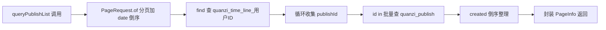

# 查询好友动态的 dubbo 服务：读一张时间线表，两段查询拼出分页动态

发布动态那天在写入侧多花的功夫，读取侧开始收利息了。好友每次发布，`savePublish` 都会把动态指针投进我的时间线集合，所以「刷好友动态」根本不用去碰全量的发布表，查自己那张 `quanzi_time_line_<userId>` 就够了。这一课在 dubbo 服务里补上这个查询：契约是带分页的 `queryPublishList`，实现是两段查询加一个自定义分页对象的封装，整体比发布动态还短。

## 先给结论

- 查询好友动态的本质是查自己的时间线集合，集合名按用户分表规则拼成 `quanzi_time_line_<userId>`，一个用户一张小表。
- 接口契约新增 `PageInfo<Publish> queryPublishList(Long userId, Integer page, Integer pageSize)`，返回的 `PageInfo` 是自定义 VO，必须可序列化并提供无参构造。
- 实现是两段查询：先按 `date` 倒序分页查时间线拿 `publishId`，再用 `id in` 批量查发布表并按 `created` 倒序整理。
- 分页页码从 1 起算，`PageRequest.of(page - 1, ...)` 转成 Spring Data 从 0 起算的页索引，错一格数据就错一页。
- `total` 本期是占位语义：前端瀑布流只靠页码加载下一页，不依赖总条数，与推荐列表接口的口径一致。

## 写扩散的回报：读取只需一张表

把读写两条路径摆在一起看，这套表结构的设计意图就清楚了。发布侧动三张表：发布表存正文，自己的相册存指针，每个好友的时间线再各投一条，写入成本随好友数线性增长。读取侧则永远是单表遍历：刷 feed 查自己的时间线，看主页查对方的相册，两张指针表把「好友发的」「某人发的」两种视图都索引化了。

这就是社交 feed 设计里典型的空间换时间。发布是低频操作，好友量再大也就几百上千；刷新是高频操作，每次都要快。把成本压在低频的写上，换高频的读走最短路径，这笔账是划算的。dubbo 服务这一课要做的查询因此非常克制：给定 userId，查这个用户的时间线集合，翻页取当页，再拿当页的动态 id 去发布表取正文。没有跨集合 join，没有全表过滤，查询计划干净利落。

## 接口契约与自定义 PageInfo

契约继续落在 `my-tanhua-dubbo-interface` 的 api 包里，`QuanziApi` 在已有 `savePublish` 的下面追加一个方法：

```java
package com.study.tanhua.dubbo.server.api;

import com.study.tanhua.dubbo.server.pojo.Publish;
import com.study.tanhua.dubbo.server.vo.PageInfo;

public interface QuanziApi {

    /**
     * 发布动态
     */
    boolean savePublish(Publish publish);

    /**
     * 查询好友动态（查询自己的时间线）
     * @param userId 用户 id
     * @param page 页码，从 1 开始
     * @param pageSize 页大小
     * @return 分页的动态数据
     */
    PageInfo<Publish> queryPublishList(Long userId, Integer page, Integer pageSize);
}
```

三个入参各就各位：userId 是「查谁的时间线」，page 与 pageSize 是翻页控制，页码约定从 1 开始，对人类直觉友好。返回值不是裸 List 而是 `PageInfo`，把页码、页大小、数据列表打包一起走网络，消费方拿到一个自解释的分页结构。这个 VO 放在 interface 模块的 vo 包里，双方共用：

```java
package com.study.tanhua.dubbo.server.vo;

import lombok.AllArgsConstructor;
import lombok.Data;
import lombok.NoArgsConstructor;

import java.io.Serializable;
import java.util.List;

@Data
@NoArgsConstructor
@AllArgsConstructor
public class PageInfo<T> implements Serializable {

    private static final long serialVersionUID = 1L;

    private Integer pageNum;   //当前页码
    private Integer pageSize;  //页大小
    private Long total;        //总条数，本期不提供
    private List<T> records;   //当前页数据
}
```

两个细节在编码时就会暴露。泛型参数让同一个 VO 能装动态、也能装将来任何分页列表。`@NoArgsConstructor` 不是可有可无：dubbo 反序列化对象时要求先实例化再填字段，课程现场 new 的时候IDE 报了「没有无参构造」，补上 Lombok 的注解才编译通过；`Serializable` 同理，跨网络传输的对象必须可序列化，接口模块里所有出入参都守这条规矩。

## 实现：时间线查指针，发布表查正文

`QuanziApiImpl` 补上实现方法，`MongoTemplate` 仍是唯一的访问通道：

```java
@Override
public PageInfo<Publish> queryPublishList(Long userId, Integer page, Integer pageSize) {
    //分页并且按 date 倒序；page 从 1 开始，转成 PageRequest 从 0 开始的页索引
    Pageable pageable = PageRequest.of(page - 1, pageSize, Sort.by(Sort.Order.desc("date")));
    //查询自己的时间线表，一人一张集合
    Query query = new Query().with(pageable);
    List<Timeline> timelines = this.mongoTemplate.find(query, Timeline.class,
            "quanzi_time_line_" + userId);
    //收集时间线里的动态指针
    List<ObjectId> publishIds = new ArrayList<>();
    for (Timeline timeline : timelines) {
        publishIds.add(timeline.getPublishId());
    }
    //按 id 批量查动态详情，按 created 倒序
    Query queryPublish = Query.query(Criteria.where("id").in(publishIds))
            .with(Sort.by(Sort.Order.desc("created")));
    List<Publish> publishList = this.mongoTemplate.find(queryPublish, Publish.class);

    //封装分页对象
    PageInfo<Publish> pageInfo = new PageInfo<>();
    pageInfo.setPageNum(page);
    pageInfo.setPageSize(pageSize);
    pageInfo.setTotal((long) timelines.size()); //总条数暂不提供，前端分页不依赖总数
    pageInfo.setRecords(publishList);
    return pageInfo;
}
```

第一段查询查的是指针表。`PageRequest.of(page - 1, pageSize, Sort.by(Sort.Order.desc("date")))` 一次把分页与排序都带上：按 `date` 倒序，最新投递的排最前，这正是朋友圈「新动态在上」的语义；`find` 的三参版本指定集合名，拼出当前用户专属的那张 `quanzi_time_line_<userId>`。时间线文档里只有 id、发布者、动态指针与时间四个字段，拿它当返回值不够看，所以第二段查询拿 `publishId` 去发布表取正文：`Criteria.where("id").in(publishIds)` 表达「主键在这批 id 之中」，一次网络往返把当页十几条动态全部取回。

第一段查询里的 `Query` 为什么没有条件对象？时间线表里全是「我要看的动态」，不存在过滤一说，唯一的控制维度就是分页与排序，所以直接 `new Query().with(pageable)` 起手。条件不是必须品，`Criteria` 需要时才构造，这个写法比硬凑一个恒真条件清爽得多。



读图的要点在两段查询的分工：前半段决定「翻到哪一页」，后半段决定「这一页长什么样」，指针与正文分离，各自按自己的时间字段排序。

## 两个必须想清楚的细节

**第一，为什么查发布表时还要再排一次序？** 时间线那段已经按 `date` 倒序了，发布表又按 `created` 倒序，看着重复，实则必要。前一段拿到的只是一个 id 集合，第二段用 `in` 去查时，MongoDB 返回文档的顺序与传入 id 的顺序没有任何约定，可能按存储位置也可能按索引命中顺序回来。不排序的话，同一页动态的先后每次刷新都在洗牌。两次排序的字段也确实是两个：时间线的 `date` 是投递时间，发布表的 `created` 是发布时间，正常场景两者只差毫秒级，但语义上各管各的表。为了让第二段排序生效，id 集合在循环里按时间线的先后顺序收集，倒序整理后与时间线视图保持一致。

**第二，total 为什么是占位值？** 讲解口径很明确：总条数本期不提供，前端做的是拉到底加载下一页的瀑布流，页码加一就能翻页，不依赖总数渲染任何东西。代码里填的 `timelines.size()` 只是当页时间线的条数，想表达精确总数就得对集合做 count，本期不值得为没人消费的字段多付一次查询。它与 day02 推荐列表里 `PageResult` 的 counts 置零是同一条约定，接口之间口径不漂移。

dubbo 侧就绪后，消费方一调用就能拿到带正文的分页结构。剩下的装配工作在接口服务层：把 `Publish` 翻译成朋友圈卡片需要的字段，补上用户昵称头像这些社交属性，那是紧随其后的下一课。

## 常见误区

- **页码直接传给 PageRequest.of。** 错例：`PageRequest.of(page, ...)`，前端传 page=1 查到的却是第二页，第一页永远看不到。正解：`PageRequest.of(page - 1, ...)`，接口对外从 1 起算，Spring Data 内部从 0 起算，边界处转换一次。
- **只查时间线就返回。** 错例：把 `List<Timeline>` 直接塞进分页对象，前端拿到的动态没有文字与图片。正解：时间线是指针表，必须第二段查询回发布表取正文。
- **省略发布表的二次排序。** 错例：认为 `in` 查询会按传入 id 的顺序返回，实际顺序不定，页面动态顺序每次刷新都在变。正解：第二段查询带 `Sort.by(Sort.Order.desc("created"))`，顺序由数据库保证。
- **集合名拼接漏了用户维度。** 错例：写成固定的 `quanzi_time_line`，所有用户共享一张大表，查询全错还把分表设计架空。正解：集合名永远由 `userId` 运行期拼出，与写入侧的命名一字不差。

## 面试可能被问到的问题

1. 面试官追问：「为什么读好友动态查时间线表，而不去发布表按好友列表过滤？」
   答：发布表是全量用户的动态集合，按好友过滤意味着每次刷新都要先查好友关系再做集合内筛选，数据量上去后查询代价线性恶化。时间线表把「我该看哪些动态」提前物化到写入侧，读取退化成单集合分页扫描，社交场景读远多于写，整体收益为正。代价是写入要投递 N 份，以及大 V 的写放大问题。
2. 面试官追问：「MongoDB 里一次 in 查询返回的文档顺序是确定的吗？」
   答：不保证。in 条件只约束结果集合，不约束顺序，除非显式加 sort。依赖传入顺序返回结果属于未定义行为，同一批查询可能因存储布局变化而顺序不同。需要确定顺序就在查询上带 sort，或者在应用侧按自己的序列重排。
3. 面试官追问：「分页接口的 page 参数为什么常见从 1 开始，底层却从 0 算起？」
   答：页码是给人与客户端看的语义，第一页直觉上就是 1；存储与框架的偏移量是给机器的语义，skip 0 才是第一条。两层语义不同，在接口边界做一次减法转换，内部一律用偏移量。约定要在接口文档里写死，两端各转一次就会错一页。
4. 面试官追问：「total 不提供，前端怎么知道还有没有下一页？」
   答：瀑布流不需要 total，只需要「本页是否为空」：请求下一页，返回空列表说明到底了。这是无限滚动类接口的常见约定，省掉 count 查询，也避免了分页期间数据变动导致的总数抖动。需要页码跳转的场景才必须提供精确 total，代价是对集合的 count。
5. 面试官追问：「按用户把时间线拆成一张张小集合，集合数量会有什么问题？」
   答：用户量大时集合数会到百万级，MongoDB 对集合数量没有硬上限但命名空间与索引元数据会被拖累，运维也会更难。更主流的方案是单集合加分片键（userId 或 userId 哈希），逻辑上仍是按用户隔离，物理上由分片集群管理。教学项目选分集合是为了把分表语义讲直白，迁移到生产要重新评估。

## 配套资料

- 代码：`materials/code/07/day03 探花交友-实现圈子功能/`，day03 资料包未解出工程源码（目录内仅存提取清单），接口定义、`PageInfo` VO 与 `queryPublishList` 实现按课程画面与讲义逐段整理，包名统一为 `com.study.tanhua` 系。
- 代码：`materials/code/07/day01 探花交友-项目搭建以及登录完善个人信息/`，用户与好友相关的测试数据（`mytanhua.sql` 等）随 day01 资料提供，时间线里的 userId 取值与种子数据对齐。
- 说明：发布动态三步写入的实现口径承接 day03 前文的发布动态课程；`total` 占位与前端瀑布流的约定同 day02 推荐列表接口，两处口径保持一致。
