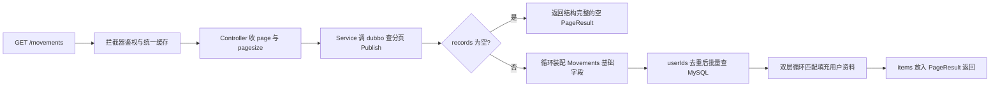

# 好友动态接口服务：把 Publish 装配成朋友圈卡片

dubbo 服务已经能把分页动态取回来，但 APP 圈子页要的不是裸的 `Publish`：卡片上得有头像昵称、性别年龄、个性标签，发布时间要显示成「10分钟前」，点赞评论的数字也得占好位。这一课在接口服务层补齐这个翻译过程：新建 `Movements` 视图对象，Controller 接住两个查询参数，Service 里调 dubbo 拿数据、循环装配、批量补用户资料，最后装进 `PageResult` 返回。

## 先给结论

- 接口契约是 `GET /movements`，query 参数为 `page` 与 `pagesize`，注意 pagesize 全小写；返回 `PageResult`，`items` 里是 `Movements` 卡片对象。
- Service 用 `UserThreadLocal.get()` 拿当前用户（拦截器已放好），调 `queryPublishList` 取分页数据，空列表时也要返回结构完整的空对象。
- 装配三件事：字段映射（ObjectId 转 String、medias 转 String 数组）、发布时间用 `RelativeDateFormat` 转相对描述、用户资料按 userId 去重后批量查 MySQL 再双层循环填充。
- 点赞数、评论数、是否点赞、距离等字段本期占位打上 TODO，day04 的点赞评论功能落地后回填真实数据。
- GET 查询天然被 day02 的统一缓存拦截器接管，同一用户重复查询直接命中 Redis，测试时先用 `tanhua.cache.enable=false` 关闭缓存。

## 接口契约：GET /movements 与 Movements VO

mock 文档上这个接口的形态很朴素：GET 方式，路径 `movements`，请求参数除了认证头只有 `page` 与 `pagesize` 两个 query 参数。返回数据是典型的分页结构，重点全在 `items` 数组的元素里：动态 id、发布者 id、头像、昵称、性别、年龄、标签、文字动态、图片动态、距离、发布时间、评论数、点赞数、是否点赞、是否喜欢，一张卡片该有的社交属性一次列全。

接口服务层新建 `Movements` VO 承接这份清单：

```java
package com.study.tanhua.server.vo;

import lombok.Data;

@Data
public class Movements {

    private String id;             //动态 id
    private Long userId;           //用户 id
    private String avatar;         //头像
    private String nickname;       //昵称
    private String gender;         //性别 man woman
    private Integer age;           //年龄
    private String[] tags;         //标签
    private String textContent;    //文字动态
    private String[] imageContent; //图片动态
    private String distance;       //距离
    private String createDate;     //发布时间，如：10分钟前
    private Integer commentCount;  //评论数
    private Integer likeCount;     //点赞数
    private Integer hasLiked;      //是否点赞（1是，0否）
    private Integer hasLoved;      //是否喜欢（1是，0否）
}
```

这份 VO 与 dubbo 侧的 `Publish` 是两个世界的对象：`Publish` 是领域模型，字段跟着 MongoDB 表结构走；`Movements` 是端上视图，字段跟着 UI 走。视图里混进了用户资料（头像昵称性别年龄标签）与互动数据（点赞评论喜欢），这些都不属于发布表，装配的意义就是把分散在三处的数据焊成一张卡片。

## Controller：两个查询参数的接法

方法加进已有的 `MovementsController`，类级路径 `movements` 不变，方法级换成 `@GetMapping`：

```java
/**
 * 查询好友动态
 */
@GetMapping
public ResponseEntity<PageResult> queryPublishList(@RequestParam("page") Integer page,
                                                   @RequestParam("pagesize") Integer pageSize) {
    try {
        PageResult pageResult = this.movementsService.queryPublishList(page, pageSize);
        //查询本身成功就返回 200，有没有数据由 items 表达
        return ResponseEntity.ok(pageResult);
    } catch (Exception e) {
        e.printStackTrace();
    }
    //查询过程出错，响应 500
    return ResponseEntity.status(HttpStatus.INTERNAL_SERVER_ERROR).build();
}
```

参数名的大小写在这里是硬约束。mock 文档里写的是 `pagesize`，s 没有大写，`@RequestParam("pagesize")` 必须照抄。query 参数名与 Java 驼峰习惯不一致很常见，接口层照单全收，进到方法内部再用自己的命名习惯，注解里的字符串是双方对齐的唯一凭据。返回值用 day02 就定义好的 `PageResult`，counts、pagesize、pages、page、items 五个字段与推荐列表接口共用一套分页口径。

catch 分支兜住 Service 抛出的任何异常，统一映射成 500，与发布接口的失败语义一致。查询成功但没数据不是异常，200 加空列表就是正确的响应。

## Service 主干：dubbo 取数与空态处理

Service 方法从拿用户开始，但这次的拿法是轻的：

```java
public PageResult queryPublishList(Integer page, Integer pageSize) {
    //登录用户已由拦截器放入当前线程
    User user = UserThreadLocal.get();
    //调用 dubbo 服务查询好友动态
    PageInfo<Publish> pageInfo = this.quanziApi.queryPublishList(user.getId(), page, pageSize);
    List<Publish> records = pageInfo.getRecords();

    PageResult pageResult = new PageResult();
    pageResult.setCounts(0);     //总数本期不提供
    pageResult.setPages(0);      //总页数本期不提供
    pageResult.setPage(page);
    pageResult.setPagesize(pageSize);
    if (CollectionUtils.isEmpty(records)) {
        //没有动态也返回结构完整的空对象，前端不必特判
        return pageResult;
    }

    List<Movements> movementsList = new ArrayList<>();
    List<Long> userIds = new ArrayList<>();
```

空态要专门处理：用户刚注册还没有好友发过动态，records 是空的，此时返回的 `PageResult` 依旧带着页码与页大小，只是 items 为空，前端拿到一个结构完整的对象做统一的空视图渲染，比 null 安全得多。counts 与 pages 置零沿用推荐列表的约定，瀑布流不依赖总数。

`UserThreadLocal.get()` 一行就完成了过去「token 换用户加判空」的整套动作，统一处理 token 那一课的红利在这里兑现。dubbo 调用把 userId、page、pageSize 三个参数传过去，拿回 `PageInfo`。方法走到这里只声明了两个待填的列表，下面开始装配。

## 装配明细：字段映射、相对时间与占位

循环体是逐字段的翻译工作：

循环体是逐字段的翻译工作：

```java
for (Publish record : records) {
    Movements movements = new Movements();
    movements.setId(record.getId().toString()); //ObjectId 转 String
    movements.setUserId(record.getUserId());
    movements.setTextContent(record.getText());
    //medias 是 List，卡片要数组，转一次
    movements.setImageContent(record.getMedias().toArray(new String[]{}));
    //发布时间转「10分钟前」样式的相对描述
    movements.setCreateDate(RelativeDateFormat.format(new Date(record.getCreated())));
    //互动数据本期占位，点赞评论在后续课程实现
    movements.setLikeCount(100);   //TODO 点赞数
    movements.setCommentCount(30); //TODO 评论数
    movements.setHasLiked(0);      //TODO 是否点赞
    movements.setHasLoved(1);      //TODO 是否喜欢
    movements.setDistance("1.2公里"); //TODO 距离，依赖地理位置计算
    //发布者可能贡献多条动态，收集 userId 时去重
    if (!userIds.contains(record.getUserId())) {
        userIds.add(record.getUserId());
    }
    movementsList.add(movements);
}
```

几处转换各有缘由。`Publish` 的主键是 ObjectId，直接序列化会带出多余的内部结构，`toString()` 取十六进制字符串，前端拿到的是干净的 id 文本。`medias` 在领域模型里是 `List<String>`，VO 按前端习惯声明为数组，`toArray(new String[]{})` 一步转换。发布时间最讲究：存库的是毫秒时间戳，卡片上显示的是「10分钟前」「1小时前」这类相对描述，转换交给拷进 utils 包的 `RelativeDateFormat`，它把目标时间与当前时间的差值归入分钟、小时、天、年等档位输出中文，课程现场拿一个 2013 年的时间做实参，输出正是「几年前」这一档。相对时间的计算放服务端，保证所有客户端对同一条动态的显示一致。

占位字段集中在此交代：点赞数、评论数、是否点赞、是否喜欢、距离这五项的数据来源都还没有实现，先给定值再打 TODO，VO 的形状从第一天就完整，后续功能上线只是把常量换成真实查询，前端与接口契约都不用动。

## 补齐用户资料：批量查询与双层循环

用户资料在 MySQL 的用户信息表里，按 userId 批量取：

```java
//按 userId 批量查询用户资料
QueryWrapper<UserInfo> userInfoQueryWrapper = new QueryWrapper<>();
userInfoQueryWrapper.in("user_id", userIds);
List<UserInfo> userInfoList = this.userInfoService.queryUserInfoList(userInfoQueryWrapper);
//双层循环按 userId 匹配填充
for (Movements movements : movementsList) {
    for (UserInfo userInfo : userInfoList) {
        if (movements.getUserId().longValue() == userInfo.getUserId().longValue()) {
            movements.setTags(StringUtils.split(userInfo.getTags(), ','));
            movements.setNickname(userInfo.getNickName());
            movements.setGender(userInfo.getSex().name().toLowerCase());
            movements.setAvatar(userInfo.getLogo());
            movements.setAge(userInfo.getAge());
            break;
        }
    }
}
```

收集 userId 时已做过 contains 去重，同一位好友一次发布连发三条，userIds 里也只有一条，`in` 查询不浪费任何条件。MyBatis-Plus 的 `QueryWrapper` 拼 `user_id in (...)` 条件，一 条 SQL 取回本页涉及的全部用户资料。填充阶段的比较用 `longValue()` 而不是对象引用，Long 与 long 的等值判断是经典易错点；匹配到就填，填完 break 跳出内层循环。填充内容照着 VO 的字段清单来：标签按逗号拆成数组，昵称直取，性别从枚举 `MAN`/`WOMAN` 转小写对齐契约，头像取 logo 字段，年龄取整数值。

装配收尾就是把卡片列表挂进分页对象返回：

```java
pageResult.setItems(movementsList);
return pageResult;
```



整条链路上 MongoDB、Dubbo、MySQL 各取所需：MongoDB 出动态正文，MySQL 出用户资料，接口层把它们焊成一张卡片。空态在 dubbo 返回后第一时间处理，后面的装配代码不需要考虑空列表。

## 缓存与测试注意

这个接口是 GET 查询，正好落在 day02 统一缓存拦截器的管辖范围：拦截器按 URI、参数串与 token 拼 key 做 MD5，命中就直接从 Redis 回写响应，Controller 与 Service 都不执行。同一用户短时间内重复下拉刷新，命中的是自己的缓存，不同用户的 token 不同，key 天然隔离，不会串数据。这个特性给测试带来一个反直觉的现象：改了代码重启再发同样的请求，断点不进 Controller，因为缓存里还有上一次的响应。功能联调时把配置文件里的 `tanhua.cache.enable` 设为 false，缓存拦截器第一步放行，验证完业务再设回 true，同一份代码在两种模式间切换。

## 常见误区

- **参数名写成驼峰。** 错例：`@RequestParam("pageSize")`，mock 文档是全小写的 `pagesize`，参数接收不到，页码始终是默认值。正解：注解里的名字与接口文档逐字符对齐，大小写敏感。
- **ObjectId 直接塞进 VO。** 错例：`movements.setId(String.valueOf(record.getId()))` 之外不做处理，或直接赋值导致序列化出嵌套结构。正解：`toString()` 取十六进制字符串，id 在端上就是一段文本。
- **用 == 比较两个 Long。** 错例：`movements.getUserId() == userInfo.getUserId()`，超过缓存范围的 Long 是不同对象，恒为不等，用户资料填不上。正解：`longValue()` 后比较基本类型。
- **循环里逐个查用户资料。** 错例：装配循环内每次 `queryUserInfoByUserId`，一页十几条动态就是十几次 SQL，典型 N+1 查询。正解：先收集去重后的 userIds，一次 `in` 查询取回，再双层循环匹配。
- **把占位数据当成真实数据。** 错例：看到页面显示点赞 100 就以为点赞功能可用。正解：TODO 字段的值是装配时的常量，真实互动数据要等 day04 的点赞评论实现后回填。

## 面试可能被问到的问题

1. 面试官追问：「VO 转换为什么放在接口服务层做，不让 dubbo 服务直接返回端上需要的结构？」
   答：dubbo 返回领域模型，字段跟存储走，被多个消费方共享；VO 跟端上 UI 走，随产品形态频繁变化。把两者分开，领域层不会为了某端的需求加字段，端的改动也不用惊动 dubbo 契约。装配逻辑（合并用户资料、格式化时间）属于展示逻辑，天然属于接口层。
2. 面试官追问：「一页动态要补用户资料，怎么避免 N+1 查询？」
   答：先收集本页所有发布者的 userId 并去重，一次 `in` 查询批量取回，再做内存匹配。SQL 次数从 N 次降到 1 次。进一步可以把 userId 建成 Map 加速匹配，把双层循环的 O(n×m) 降为 O(n)；本页规模小的时候双层循环够用，规模上去再优化。
3. 面试官追问：「发布时间显示「10分钟前」，应该服务端算还是前端算？」
   答：两处都能算，取舍在一致性与成本。服务端算保证多端口径统一，对时区与时钟偏差不敏感，但缓存命中时返回的是渲染时刻的快照，时间会「停住」；前端算永远基于本地时钟，实时性好，逻辑要各端各写一遍。本项目由服务端算，配合缓存过期策略，显示误差可接受。
4. 面试官追问：「同一个用户查询好友动态，第二次为什么会变快？代价是什么？」
   答：统一缓存拦截器把首次查询的响应 JSON 写进 Redis，key 由 URI、参数与 token 组成，同一用户重复请求直接命中回写，跳过了 dubbo 调用与装配全程。代价是数据的时效性：其他用户新发的动态要等缓存过期才可见，社交 feed 场景通常用较短的过期时间换取查询性能。
5. 面试官追问：「点赞数、评论数这些字段先用常量占位，这样做好不好？」
   答：接口先行时是合理的过渡手段，好处是 VO 契约一次性定稳，前端可以并行开发，后续实现只换数据来源不动契约。风险是占位值必须显式标注 TODO 并在联调清单里登记，否则容易被遗忘，带着假数据上线。工程上更规范的做法是返回 null 或不给字段，让前端明确知道数据未就绪。

## 配套资料

- 代码：`materials/code/07/day03 探花交友-实现圈子功能/`，day03 资料包未解出工程源码（目录内仅存提取清单），`Movements` VO、Controller 与 Service 装配代码按课程画面逐段整理，包名统一为 `com.study.tanhua` 系。
- 代码：`materials/code/07/day01 探花交友-项目搭建以及登录完善个人信息/`，用户信息表结构（昵称、性别枚举、头像、标签、年龄）与种子数据见本目录资料（`mytanhua.sql`），`UserInfo` 实体与 `SexEnum` 口径承接 day01 的完善个人信息课程。
- 代码：`materials/code/07/day02 探花交友-实现首页功能/`，`PageResult` 分页结构与统一缓存拦截器出自 day02 课程，本课复用同一套口径。
- 说明：`RelativeDateFormat` 为课程提供的相对时间工具类，资料包未含源码，文中按其行为描述（分钟、小时、天、年档位）整理用法，实现为按本课写法补全。
