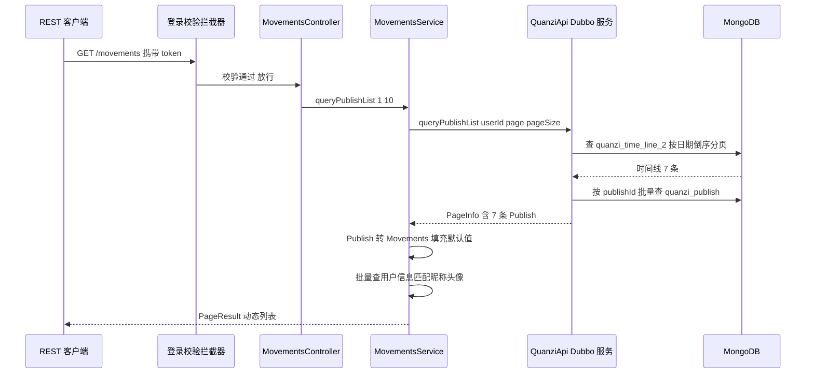

# 好友动态功能测试：断点逐层验收与 App 端真实账号联调

> 🔒 安全提示：文中示例的口令/密钥均为课程教学环境演示口径，生产环境的安全要求见《安全与合规须知》。

好友动态的读取链路已经写完：接口服务从 ThreadLocal 取登录用户，经 Dubbo 调用查询对方时间线分表，再把动态与用户信息拼装成列表返回。代码能编译、服务能注册，都只是底线，功能是否真的按预期工作，要靠一轮完整的测试来回答。这一课专门做验收：先用 REST 客户端携带 token 打接口，断点逐层跟进看数据怎么流；再启动模拟器，换一个测试账号登录，从 App 端看好友动态卡片真实渲染出来的样子。

## 先给结论

- 测试前先把分页参数补上默认值：`@RequestParam` 加 `defaultValue = "1"` 与 `defaultValue = "10"`，调用方不传参数也能正常查询，避免必填参数缺失直接 400。
- REST 客户端验证的完整姿势：先走登录链路拿 token，再把 token 放进 Authorization 请求头，`GET http://<本机IP>:18081/movements?page=1`，请求会先经过登录校验拦截器。
- 断点路径覆盖四层：Controller 收到 page 为 1、pageSize 为 10；Service 从 ThreadLocal 拿到用户；Dubbo 服务查时间线分表命中 7 条；循环封装 Movements 并批量补齐用户信息。
- App 端验收用第二个测试账号登录，验证码固定 123456，进入圈子切到好友页签，好友发的动态卡片按预期展示。
- 联调前必须清掉 IDE 断点，App 的请求被断点挂住会超时；推荐页签此时没有数据是正常的，推荐表还没造数，属于下一课的内容。

## 一、测试前的改造：给分页参数上默认值

好友动态接口定义了 page 与 pageSize 两个参数，App 端发起的请求未必总是携带它们。参数一旦声明为 `@RequestParam`，默认就是必填，缺一个请求就被 Spring MVC 以 400 拒之门外，页面只能看到加载失败。给参数补默认值，是让接口对调用方更宽容的标准做法：

```java
@GetMapping
public ResponseEntity<PageResult> queryPublishList(
        @RequestParam(value = "page", defaultValue = "1") Integer page,
        @RequestParam(value = "pagesize", defaultValue = "10") Integer pageSize) {
    try {
        PageResult pageResult = this.movementsService.queryPublishList(page, pageSize);
        return ResponseEntity.ok(pageResult);
    } catch (Exception e) {
        e.printStackTrace();
    }
    return ResponseEntity.status(HttpStatus.INTERNAL_SERVER_ERROR).build();
}
```

`defaultValue` 同时隐含了「参数可缺省」的语义：请求不带 page 时按 1 处理，不带 pagesize 时按 10 条处理。默认查 10 条也是社交 feed 的常见口径，首屏一屏刚好放下，上拉加载再带分页参数取下一页。改完重启 server 系统，测试就有了一个稳定的前提。

## 二、REST 客户端里的逐层断点

接口测试先解决身份问题。好友动态是登录后才能用的功能，请求要先走登录链路换 token：以 JSON 方式提交手机号触发验证码下发，再用手机号与固定验证码 123456 调校验接口，拿到 JWT 字符串。课程环境用浏览器里的 Advanced REST Client 插件完成这两步，请求形态等价于：

```bash
# 登录换取 token（验证码为联调约定的固定值）
curl -X POST http://172.16.55.153:18081/user/loginVerification \
  -H "Content-Type: application/json" \
  -d '{"phone":"158xxxxxxxx","verificationCode":"123456"}'

# 携带 token 查询好友动态
curl http://172.16.55.153:18081/movements?page=1 \
  -H "Authorization: <登录返回的token>"
```

token 放进 Authorization 头之后，请求进入 server 系统会先被登录校验拦截器接住，校验通过才放行到 Controller。地址打 18081 端口是测试期的直连用法，绕过 Nginx 直接命中 server 系统，少一层转发，断点看流量更干净；生产形态下请求仍走统一入口。

把断点依次打在 Controller 入口、Service 方法与 Dubbo 服务实现里，然后发出请求，跟着断点走一遍就能看清整条数据流：



这张图里值得盯住两段。第一段在 Dubbo 服务内部：先按用户分表查时间线，`PageRequest.of(page - 1, pageSize, Sort.by(Sort.Order.desc("date")))` 按发布日期倒序并分页，把时间线里的 publishId 收集成列表后，再用 `Criteria.where("id").in(publishIds)` 批量捞发布表正文。两次查询合起来才是一条动态的完整数据。第二段在 Service 层，发布对象要转换成面向前端展示的 Movements 对象：

```java
List<Movements> movementsList = new ArrayList<>();
List<Long> userIds = new ArrayList<>();
for (Publish record : records) {
    Movements movements = new Movements();
    movements.setId(record.getId().toString());
    movements.setUserId(record.getUserId());
    userIds.add(record.getUserId());
    movements.setLikeCount(100);   // TODO 点赞数，后续课程补齐
    movements.setCommentCount(30); // TODO 评论数，后续课程补齐
    movements.setDistance("1.2公里"); // TODO 距离，待接入地理位置服务
    movements.setCreateDate(RelativeDateFormat.format(new Date(record.getCreated())));
    movements.setTextContent(record.getText());
    movementsList.add(movements);
}
```

点赞数、评论数、距离这几处先填假值并留 TODO 标记，它们分别依赖后续的计数功能与地理位置服务；发布时间用相对时间格式化工具转成「10 分钟前」这类文案，朋友圈的阅读习惯就是如此。动态归属的昵称、头像、性别、年龄不在 MongoDB 里，要回 MySQL 补齐：先收集去重后的 userIds，用 `QueryWrapper` 的 `in("user_id", userIds)` 一次查回所有用户信息，再在双层循环里按 userId 匹配填充：

```java
QueryWrapper<UserInfo> userInfoQueryWrapper = new QueryWrapper<>();
userInfoQueryWrapper.in("user_id", userIds);
List<UserInfo> userInfoList = this.userInfoService.queryUserInfoList(userInfoQueryWrapper);
for (Movements movements : movementsList) {
    for (UserInfo userInfo : userInfoList) {
        if (movements.getUserId().longValue() == userInfo.getUserId().longValue()) {
            movements.setTags(StringUtils.split(userInfo.getTags(), ','));
            movements.setNickname(userInfo.getNickName());
            movements.setGender(userInfo.getSex().name().toLowerCase());
            movements.setAvatar(userInfo.getLogo());
            movements.setAge(userInfo.getAge());
            break;
        }
    }
}
```

断点里 PageInfo 变量展开能看到 7 条记录，这正是此前发布测试在用户 1 的时间线里留下的全部动态；用户 2 是用户 1 的好友，发布时投递进 `quanzi_time_line_2` 的那 7 条指针，此刻被原样取了出来。接口最终响应的字段在断点放行后一目了然：动态 id、用户 id、头像、昵称、性别、年龄、标签、文字内容、图片地址、距离与发布时间，与前端约定的结构一一对应。

## 三、换账号上 App：用户视角的验收

REST 客户端验证的是接口契约，App 端验证的是真实用户体验。启动 Genymotion 模拟器，先确认 App 设置里的 Api 基础地址仍指向宿主机的局域网 IP，然后登录第二个测试账号，也就是 day1 联调时通过 App 注册的用户 2，验证码照旧输入 123456。登录成功后有一件必做的事：把 IDE 里所有断点清掉。App 对请求超时是敏感的，只要断点挂住请求几秒钟，App 那边就报超时错误，功能明明是对的却被调试状态污染，这是联调期最容易误判的一类假故障。

进入圈子页，推荐页签是空的，切到好友页签，用户 1 发布的动态卡片完整出现：头像、昵称、年龄、标签、文字、配图、距离与相对时间，与 REST 客户端里看到的响应字段严丝合缝。用户 2 能看到这些内容，靠的不是查询发布集合，而是发布时投递到自己时间线表里的那 7 条记录，写扩散的设计在这一刻完成了闭环。

推荐页签空着不是 bug。推荐动态的数据来源是一张独立的推荐表，此刻还没有任何数据落进去，App 请求它自然返回空列表，等下一课把推荐数据造好，这个页签就会亮起来。空列表与报错要能分清：前者是数据问题，后者才是功能问题。

## 常见误区

- **必填参数不设默认值就交给 App 调用。** 错例：App 请求不带 page，Spring MVC 直接 400，页面加载失败。正解：`@RequestParam` 补 `defaultValue`，缺省参数在服务端兜底。
- **带着断点做 App 联调。** 错例：断点留在 Service 里，App 每次请求都被挂住直至超时，误以为是接口或网络故障。正解：REST 客户端断点验证结束后，清掉全部断点再上 App。
- **把空推荐页当成好友动态故障。** 错例：看到推荐页签空白就回头排查时间线查询。正解：两张表的数据来源不同，推荐表未造数返回空列表是预期行为。
- **token 过期后反复重试业务请求。** 错例：接口返回 401 仍不断重发请求。正解：401 表示登录态失效，重新走登录链路换新 token，再继续测试。

## 面试可能被问到的问题

1. 面试官追问：「功能测试为什么要在 REST 客户端和 App 两端各做一遍？」
   答：REST 客户端验证的是接口契约，请求可控、可断点、可重复，适合确认数据流与响应结构；App 端验证的是真实调用方式下的体验，参数缺省、token 携带、超时容忍这些差异只有真实客户端才暴露。两端互补，缺了任何一端都可能漏掉契约正确但体验有问题的情况。
2. 面试官追问：「defaultValue 在什么场景下使用，它和 required=false 有什么区别？」
   答：defaultValue 让参数缺省时取给定值，请求照常处理；required=false 只是允许不传，参数值为 null，业务代码还得自己判空兜底。需要固定业务口径的分页参数用 defaultValue 更直接，语义上「没传就按 1 和 10 来」。
3. 面试官追问：「为什么动态列表的时间要格式化成相对时间？」
   答：社交 feed 的阅读习惯关心的是新鲜度而不是绝对时刻，「10 分钟前」比完整日期更符合用户心智，也节省卡片空间。服务端用格式化工具统一转换，前端拿到的就是可直接展示的文案，各端不必重复实现同样的逻辑。
4. 面试官追问：「封装列表时先批量查用户信息再内存匹配，为什么不用每条动态查一次数据库？」
   答：一页 10 条动态逐条查用户表要发起 10 次 SQL，网络往返与数据库开销都放大 10 倍；先收集 userIds 去重，一次 in 查询取回，再内存匹配，把 N 次查询压缩成一两次。这是典型的批量化优化，列表类接口几乎都该这么做。
5. 面试官追问：「联调时接口被断点挂住，App 报超时，这类问题怎么快速识别？」
   答：特征是 REST 工具手动放行后一切正常，只有 App 自动请求时失败，且失败形式是超时而非业务错误码。排查时先确认 IDE 是否残留断点，再怀疑网络与接口本身；调试与联调是两个阶段，切换时清干净调试状态是纪律。

## 配套资料

- 原型：`materials/code/07/day01 探花交友-项目搭建以及登录完善个人信息/day01/资料/探花交友移动端原型V1.2/圈子.html`，好友动态页签的卡片布局与字段，与本课响应字段对应。
- 数据库：`materials/code/07/day01 探花交友-项目搭建以及登录完善个人信息/day01/代码/mytanhua.sql`，`tb_user` 种子数据给出的测试账号体系，联调登录的验证码口径与其一致。
- 说明：day03 资料包未解出工程源码，接口与实现代码按课程画面逐段整理，包名与引用按规范改写为 `com.study.tanhua` 系；演示地址 `172.16.55.153` 为课程环境的本机局域网 IP，按实际环境替换；App 登录使用的第二个账号为课程演示环境中注册的测试用户，手机号以实际环境为准。
