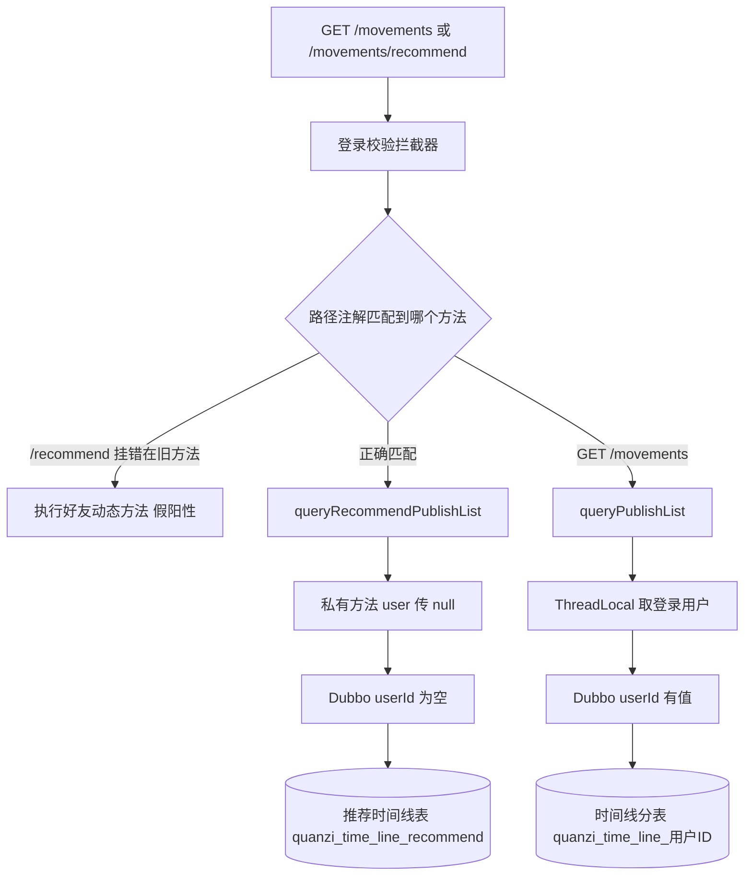

# 推荐动态接口服务：两个入口收敛一套逻辑，以及一次假阳性排查实录

> 🔒 安全提示：文中示例的口令/密钥均为课程教学环境演示口径，生产环境的安全要求见《安全与合规须知》。

Dubbo 侧已经能按 userId 的空与不空分别查推荐表与好友时间线，接口服务层剩下的工作是接出 HTTP 契约：把 `/movements/recommend` 挂上路径，让 App 的推荐页签有数据可拉。这一课的工程量不大，却攒下两个高价值的现场片段：一个是 Service 层的小重构，两个公开入口共用一个私有方法；另一个是一次「数据看起来全对、断点却始终不进」的假阳性排查，根因是复制 Controller 时注解挂错了方法。

## 先给结论

- 接口契约与好友动态完全同构：`GET /movements/recommend`，page 与 pageSize 默认 1 和 10，响应同为 PageResult，App 端两个页签用同一套解析逻辑。
- Controller 复制改造的第一坑是路径冲突：两个方法都不带子路径会触发启动异常，`@GetMapping("/recommend")` 必须挂在新方法上，注解与方法体一一对应。
- Service 层重构为一个私有方法 `queryUserPublishList(User user, ...)`：好友动态入口传 ThreadLocal 里的登录用户，推荐动态入口传 null，null 直通 Dubbo 查推荐表。
- 联调时数据返回正确不代表路径正确，本课现场注解挂错方法后推荐数据依然返回，因为推荐表内容本就是好友时间线的复制；断点才是验证执行路径的证据。
- App 端验收结果：圈子页推荐页签亮起，内容与好友页签一致，待推荐系统落地后数据来源替换，接口与页面无需改动。

## 一、Controller 落地与路径冲突

接口文档里推荐动态的契约与好友动态并排摆放：地址是 `/movements/recommend`，参数同 page 与 pageSize，返回结构同 PageResult。照着契约复制已有 Controller 方法改造，是最省事也最容易出错的做法。先看最终形态：

```java
@GetMapping("/recommend")
public ResponseEntity<PageResult> queryRecommendPublishList(
        @RequestParam(value = "page", defaultValue = "1") Integer page,
        @RequestParam(value = "pagesize", defaultValue = "10") Integer pageSize) {
    try {
        PageResult pageResult = this.movementsService.queryRecommendPublishList(page, pageSize);
        return ResponseEntity.ok(pageResult);
    } catch (Exception e) {
        e.printStackTrace();
    }
    return ResponseEntity.status(HttpStatus.INTERNAL_SERVER_ERROR).build();
}
```

课程现场第一次启动就报了错：复制出来的方法没有改 `@GetMapping` 的路径，两个方法都声明在同一个映射上，Spring MVC 启动阶段直接抛出映射冲突，服务起不来。这类错误好在足够「响」，启动日志把冲突路径打印得明明白白，补上 `/recommend` 重启即可。真正危险的是反过来：路径改了但挂错了方法，服务能起、数据能回，错得很安静，排查插曲留到第三节展开。

## 二、Service 层重构：一个私有方法服务两个入口

好友动态入口要取登录用户，推荐动态入口要表达「不限定用户」。两个入口的差异只有开头那几行，后面几十行的封装逻辑完全一致，复制一份改成两套是最差的解法，日后改一处忘一处的概率极高。标准做法是把差异参数化：

```java
public PageResult queryPublishList(Integer page, Integer pageSize) {
    User user = UserThreadLocal.get();
    return this.queryUserPublishList(user, page, pageSize);
}

public PageResult queryRecommendPublishList(Integer page, Integer pageSize) {
    // 推荐动态不限定用户，传 null 走推荐表
    return this.queryUserPublishList(null, page, pageSize);
}

private PageResult queryUserPublishList(User user, Integer page, Integer pageSize) {
    PageResult pageResult = new PageResult();
    Long userId = null;
    if (user != null) {
        userId = user.getId();
    }
    PageInfo<Publish> pageInfo = this.quanZiApi.queryPublishList(userId, page, pageSize);
    pageResult.setCounts(0);
    pageResult.setPages(0);
    pageResult.setPageSize(pageSize);
    pageResult.setPage(page);
    List<Publish> records = pageInfo.getRecords();
    if (CollectionUtils.isEmpty(records)) {
        // 没有查询到动态数据
        return pageResult;
    }
    // ...... Publish 转 Movements、批量补齐用户信息，逻辑与好友动态一致
    pageResult.setItems(movementsList);
    return pageResult;
}
```

好友动态入口从 ThreadLocal 拿用户再委托；推荐动态入口直接传 null。私有方法里 user 为空时 userId 保持 null，这个 null 一路透传给 Dubbo 服务，由上一课写好的分支决定查推荐表还是时间线分表。登录态的获取被限制在唯一需要它的入口里，私有方法对调用来源保持中立，这正是 ThreadLocal 使用的边界感：上下文对象只在有登录态语义的路径上取用，不该渗透进与登录无关的通用逻辑。



这张图把请求分发的两条正确路径与一条错误路径画在一起。错误路径的迷惑性在于它的终点也是数据，只是取错了来源，只有断点能揭穿它。

## 三、一次假阳性排查：数据对了，断点没进

联调按老规矩来：server 系统重启后，REST 客户端先登录。上一轮的 token 在服务重启与等待期间已经失效，请求返回 401，重新走登录链路换新 token，这也是联调期最常见的环境摩擦。token 就位后请求 `/movements/recommend`，响应里赫然是一排动态卡片，看起来一次通过。

把断点打在推荐查询的方法里复测，请求进来却绕开了断点。数据正确而断点不进，说明请求根本没走到这个方法。回查代码找到了根因：`@GetMapping("/recommend")` 挂在了复制来的旧方法上，旧方法调用的是好友动态的服务方法，新方法成了没有任何映射的孤儿。推荐数据之所以「看起来对」，是因为推荐表的内容本就是从用户 2 的时间线复制来的，两条路径返回的数据恰好一模一样，假阳性就此形成。

把注解移回正确的方法，重启后再测，断点稳稳命中，变量面板里 userId 是 null，Dubbo 调用走的是推荐表分支。这一段插曲的教训值得单独立一条纪律：接口改造后先验证路径绑定，再验证数据正确性。验证路径最直接的手段就是断点或日志，数据对错只是必要条件，不是充分条件。

## 四、App 端验收：推荐页签亮起

模拟器环节出了个小插曲，运行许久的虚拟设备卡死，关掉重新启动后再继续。App 端流程与好友动态那次一致：确认 Api 基础地址指向宿主机，用第二个测试账号登录，验证码 123456，登进去之后照例清掉所有断点，避免请求被挂住超时。

进入圈子页，推荐页签不再空白，动态卡片完整渲染，内容与好友页签一致。这个一致性正是上一课造数方式的直接体现：推荐表里放的就是用户 2 时间线里那 7 条动态的指针。等后续课程推荐系统落地，它算出的结果写进同一张表，推荐页签的内容自然会与好友页签分化，读取侧与页面端都不需要再改一行代码。至此推荐动态从表设计、Dubbo 服务、接口服务到 App 展示的全链路验收完毕。

## 常见误区

- **复制 Controller 方法不改路径或挂错方法。** 错例：两个方法共用一个映射导致启动失败；或者注解移到了旧方法上，服务能起但请求走错分支。正解：改造后逐行核对注解、方法名与服务调用三者对应，启动先于数据验证。
- **推荐入口误传登录用户。** 错例：`queryRecommendPublishList` 里也调 `UserThreadLocal.get()`，userId 永远非空，请求全部落到好友时间线，推荐表形同虚设。正解：差异点参数化，null 才是通往推荐表的信号。
- **把数据正确当成路径正确。** 错例：看到响应有数据就认为功能完成。正解：断点、日志这类执行证据与数据验证缺一不可，尤其是多条路径可能返回相似数据的场景。
- **token 失效后继续用旧请求重试。** 错例：服务重启后 token 过期，反复请求只收到 401。正解：先重登录换取新 token，再继续业务联调。

## 面试可能被问到的问题

1. 面试官追问：「复制改造接口容易出哪些事故，怎么预防？」
   答：典型事故是映射冲突与注解错位，前者启动即失败容易发现，后者表现为运行期走错分支，隐蔽得多。预防靠三件事：改造后核对注解、方法名、服务调用的一致性；启动后用一条请求验证路径绑定，断点或日志确认真的进了新方法；有条件时用 MockMvc 或接口测试脚本把契约固化成用例。
2. 面试官追问：「多个业务入口共用一段逻辑，Service 层怎么组织代码？」
   答：把差异点提取成参数，公共流程收敛到一个私有方法，各入口只负责准备自己的参数，本课的做法就是这个模式的最小形态。差异再多一层时可以引入策略或模板方法，但先用私有方法收敛已能消灭重复，抽象层级跟着复杂度走，避免过度设计。
3. 面试官追问：「ThreadLocal 传递用户上下文有什么风险？」
   答：一是线程池复用线程，处理完请求不清理会串号，所以请求结束必须 remove；二是它只在有登录态语义的调用路径上成立，异步线程、Dubbo 跨进程调用都会丢失上下文，需要显式传参或扩展传递机制。本项目的上下文获取被收在 Service 入口处，Dubbo 调用全部显式传 userId，边界是清晰的。
4. 面试官追问：「什么是假阳性测试结果，本课的例子说明什么？」
   答：假阳性指测试结果显示功能正常，实际执行的是错误路径。本课推荐数据恰好与好友数据相同，注解挂错方法后响应依旧正确。它说明数据断言不足以证明路径正确，尤其当多条路径可能产出相同数据时；测试要在数据之外增加执行证据，比如断点验证、日志埋点或对中间层调用的 mock 校验。
5. 面试官追问：「联调遇到 401，标准处理流程是什么？」
   答：401 表示认证失败，先确认 token 是否携带、是否过期，服务重启或长时间等待都可能使登录态失效；重新走登录链路换取新 token，更新到请求头再继续。反复重试业务请求只会制造噪音，排查时也要分清 401 与 403，前者是未认证，后者是已认证但无权限。

## 配套资料

- 原型：`materials/code/07/day01 探花交友-项目搭建以及登录完善个人信息/day01/资料/探花交友移动端原型V1.2/圈子.html`，推荐页签与好友页签的切换交互原型，App 端验收的对照标准。
- 数据库：`materials/code/07/day01 探花交友-项目搭建以及登录完善个人信息/day01/代码/mytanhua.sql`，`tb_user_info` 表结构，服务层批量补齐昵称、头像、标签的数据来源。
- 说明：day03 资料包未解出工程源码，Controller 与 Service 代码按课程画面逐段整理，包名与引用按规范改写为 `com.study.tanhua` 系；路径冲突与断点排查过程为课程现场实录，细节表述按画面与讲解还原。
