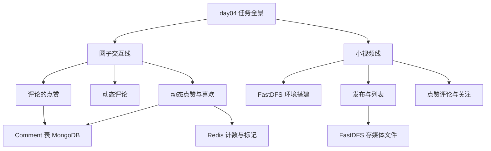

# day04 任务地图：点赞、评论与小视频两线并进，欠下的账一天还清

day03 收官时留了一笔明账：评论功能顺延，评论数与点赞数两处 TODO 用假值占位，Redis 的计数能力蓄势待发。day04 一开工就要还这笔账，而且账单比预想的长：除了圈子里的点赞、喜欢、评论，还要开辟一个全新战场，小视频。一个功能说明环节只有两分多钟，背后压着两天的代码量，开工前把地图摊开看清楚，比急着动手写第一行代码重要得多。

## 先给结论

- day04 有两条主线：圈子交互线要做动态的点赞、喜欢、评论，以及评论自身的点赞；小视频线要做类短视频形态的上传、列表、点赞、评论与关注。
- 点赞、喜欢、评论在存储上不是三张表，而是共用一张评论表，靠 `commentType` 字段区分类型，这是全天下线任务最重要的设计决定。
- Redis 在这一天正式登场，承担点赞数、喜欢数等高频读计数，day03 留下的假值 TODO 由此填实。
- 小视频的媒体文件落在 FastDFS 分布式文件系统上，动手写功能前要先完成环境搭建。
- 学习目标把「了解」与「独立完成」分了级：圈子三项交互与小视频全链路要求独立完成，小视频的功能说明只要求了解。

## 任务全景：两条主线，六个条目

课程说明的 PPT 列了六条：圈子实现点赞、喜欢功能；圈子实现评论；圈子实现评论的点赞；小视频功能说明；FastDFS 环境搭建；小视频的功能实现。前三条是圈子线的三步走，后三条是小视频线的三步走，两条线共用 day03 已经铺好的圈子底座。这张图把六条任务、两条主线和它们依赖的技术组件放在一张图里。



读图的抓手在两条线各自的技术落点：圈子线的新增存储只有 MongoDB 里的 Comment 表和 Redis 里的计数结构，都是 day03 已部署组件的深度使用；小视频线则引入了一个新组件 FastDFS，这是 day04 唯一需要从零搭建的环境，所以功能说明排在环境搭建之前，先把形态讲明白再谈实现。

## 圈子线：给动态表态，给评论盖楼

圈子线要做的操作听起来是一堆按钮，本质上只有两类动作。一类是对动态本身的表态：好友发了一条动态，可以点赞，表示喜欢这条内容，也可以点喜欢，表达对发布这个人的兴趣，还可以写评论，把自己的想法留在动态下面。另一类是对评论的表态：张三发了一条动态，李四和王五分别在下面评论，我可以浏览这些评论，然后给某条评论点赞。给评论点赞和给动态点赞是两个粒度的操作，前者是对某条具体评论的认可，后者是对整条动态的认可，实现时通过不同的关联对象区分。

把这三种操作合并成一个模型来看会更轻：点赞没有文字，喜欢没有文字，评论有文字，它们都是「用户对动态的一次表态」，差别只在表态的形式和是否携带内容。存储层因此不需要为点赞单独建表，一张评论表加一个类型字段就够了。这个设计决定了后面所有代码的形状，也是 day04 圈子线真正难想而好写的原因。

Redis 在这条线里的角色同样值得开工前想清楚。点赞数会被列表里的每张卡片反复读取，每次都去 MongoDB 里 count 一遍，代价随动态热度线性上涨，所以计数进 Redis，MongoDB 保存表态记录本身。day03 里点赞数填 100、评论数填 30 的假值，就是等着这一天用真实的计数逻辑替换。开工前把两天的存储家底盘一遍，新增与既有一目了然：

```bash
quanzi_publish                 # day03 既有，动态正文唯一权威
quanzi_comment                 # day04 新增，点赞、喜欢、评论共用的表态表
QUANZI_COMMENT_LIKE_*          # Redis 计数与标记 key，点赞环节起启用
```

## 小视频线：类短视频形态与 FastDFS 的引入

小视频功能的参照物是当下流行的短视频平台：用户上传一段视频做分享，其他人可以滑动浏览，对视频做点赞、评论等操作。交互形态与圈子动态高度相似，真正的差异在媒体文件的体量，短视频文件动辄几兆到几十兆，再往本地磁盘一存，服务一扩容就无处安放，所以课程选择把媒体文件交给 FastDFS 这样的分布式文件系统，应用只保存文件在集群里的地址。

这条线的实现顺序被安排成三步：先搭 FastDFS 环境，服务可用后再做发布与查询列表，最后补点赞、评论、关注这些交互。把环境搭建放在功能开发之前是合理的依赖排序，文件都传不上去，后面所有的接口都无从测试。学习目标里小视频的发布、查询、点赞、评论、关注全部标注为「独立完成」，说明这条线的代码量不小，课程说明环节点到为止，正是为了把时间留给后面的动手环节。

## 目标与依赖的对账

把学习目标与两条主线对一遍账，开工前心里有数：圈子的点赞、喜欢、评论三项交互，依赖 day03 的评论表结构与 MongoDB、Redis 两个既有组件；评论的点赞复用同一张表；小视频的功能说明是认知任务，FastDFS 环境搭建是运维任务，小视频的功能实现依赖前两者。资料目录里 day04 的学习目标清单与 day01 的移动端原型可以对照使用，原型中圈子页签的点赞、喜欢入口与小视频页签，就是这一天要逐个点亮的交互。

## 常见误区

- **把点赞、喜欢、评论设计成三张表。** 错例：按功能直觉为每种操作各建一个集合，查询计数时四处汇总。正解：三者统一为评论表中的一条记录，用 `commentType` 区分类型，一张表承接三种表态，计数与查询只碰一处。
- **把给评论点赞和给动态点赞混为一谈。** 错例：两种点赞写进同一个接口，靠前端区分。正解：两者关联对象不同，一个挂动态 ID，一个挂评论 ID，接口与数据结构都要分开建模。
- **小视频文件直接存应用服务器磁盘。** 错例：上传接口把视频写进本机目录，扩容后文件四散。正解：媒体文件进 FastDFS 分布式文件系统，应用侧只持有文件地址。
- **跳过环境搭建直接写功能代码。** 错例：FastDFS 服务还没跑通就开写上传接口，联调时问题分不清是代码还是环境。正解：环境先验证可用，再进入功能开发。

## 面试可能被问到的问题

1. 面试官追问：「点赞、喜欢、评论三种操作，存储层怎么设计？」
   答：统一建一张评论表，用类型字段区分点赞、评论、喜欢三种表态，点赞与喜欢不携带内容，评论携带正文。好处是计数、去重、删除走同一套逻辑，坏处是表行数大，需要配合索引与缓存。本课用 MongoDB 的单个集合承接，点赞数这类高频读计数另存 Redis。
2. 面试官追问：「点赞数为什么要放 Redis，直接查库不行吗？」
   答：点赞数出现在列表的每张卡片上，是典型的热点高频读，直接对库做计数查询会随访问量线性放大压力。Redis 把计数放在内存里，读写都是常数级，数据库只保留表态明细作为权威数据，缓存与库之间用写入时同步维护的策略保持一致。
3. 面试官追问：「小视频这类功能为什么要引入分布式文件系统？」
   答：视频文件体积大、数量增长快，单机磁盘既扛不住容量也扛不住并发读。FastDFS 以集群方式管理文件，横向扩容加节点即可，应用侧只保存文件地址，上传下载由专门的服务承担，与业务应用解耦。
4. 面试官追问：「新的一天开工前，怎么评估任务量与依赖？」
   答：把功能清单拆成认知任务、环境任务、编码任务三类，分别对上学习目标、环境清单与代码模块，再画出依赖图。环境类任务先行验证，编码任务按被依赖程度排序，像 FastDFS 既是独立环境又是小视频功能的前置，必须最早动手。

## 配套资料

- 资料包：`materials/code/07/day04 探花交友-实现评论、小视频/day04/`（内含本日学习目标清单，圈子点赞、喜欢、评论与小视频发布、查询、点赞、评论、关注的能力项均出自此处；day04 资料包未解出工程源码，正文涉及的设计与代码为按课程画面与讲解过程整理，包名按规范改写为 `com.study.tanhua` 系）。
- 原型：`materials/code/07/day01 探花交友-项目搭建以及登录完善个人信息/day01/`（内含移动端原型，圈子页签的点赞、喜欢入口与小视频页签的交互形态即本日任务的产品依据）。
- 数据库：`materials/code/07/day01 探花交友-项目搭建以及登录完善个人信息/day01/`（内含 `mytanhua.sql`，用户与资料表结构，圈子与小视频功能测试时的账号数据来源）。
