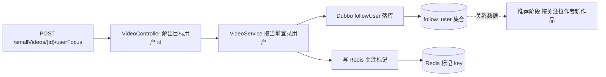

# 关注用户：从视频跳到人，一张新的关注关系表

视频详情页的作者信息旁边有一个关注按钮。这个按钮的语义在需求分析时就反复强调过：关注的是人，不是视频。点赞、评论作用于内容，落在评论集合里顺理成章；关注作用于作者本人，跟哪条视频无关。对存储来说这是一次分家：评论集合装不下这个语义，需要重新定义一张表。这一讲把关注与取关两条链路打通，顺带记一次 Dubbo 联调现场的经典报错。

## 先给结论

- 关注的对象是用户不是视频，关系独立成 MongoDB 的 `follow_user` 集合，四字段：主键、用户 id、被关注用户 id、关注时间。
- Dubbo 侧 `VideoApi` 新增 `followUser` 与 `disFollowUser` 两个方法，关注即保存一条关系文档，取关即按两个 id 的组合条件删除。
- 接口契约是 `POST /smallVideos/{id}/userFocus`，路径变量是目标用户的 id，不是当前登录用户的 id。
- 服务层调 Dubbo 落库，同时维护用户维度的 Redis 关注标记，取消关注时删除标记；关注数据是后续推荐算法的重要权重输入。
- 现场踩坑一次：Dubbo 接口加了方法但提供者没重启，注册中心里还是旧实现，消费端调用直接报 Not found method。

## 一、为什么评论集合装不下关注

统一互动模型的三要素是用户、类型、目标，目标到目前为止都是内容：动态 id、视频 id、评论 id。关注把目标换成了人。硬要在评论集合里表达也可以，把被关注用户 id 塞进目标字段、再开一个新类型值，但这条路走得别扭：互动数据跟着内容生命周期走，内容删了表态记录也失去意义；关注关系与内容无关，作者删掉所有视频，关注依然成立。语义不同的数据放进同一张表，查询时要背着额外的过滤条件，字段含义还要靠约定解释，得不偿失。

独立成表的另一个理由在推荐。需求分析时已经交代过，关注了谁，谁的新作品将来就进你的推荐，关注关系是推荐系统的直接输入，关注的作者权重更重。推荐阶段会高频地按用户拉关注列表，一张结构干净、只有关系本身的关系表，比在互动大集合里翻找高效得多。

## 二、Dubbo 服务：FollowUser 实体与两个接口

关系表的结构非常简单，pojo 放在 Dubbo 服务工程里，与 video 实体同层：

```java
@Data
@Document(collection = "follow_user")
public class FollowUser implements Serializable {

    private static final long serialVersionUID = 31490190724050L;

    private ObjectId id;          //主键id
    private Long userId;          //用户id，关注发起方
    private Long followUserId;    //关注的用户id，被关注方
    private Long created;         //关注时间
}
```

字段语义用一个例子就能钉死：张三关注李四，`userId` 存张三，`followUserId` 存李四。实现 Serializable 是 Dubbo 传输的要求，集合名 `follow_user` 与实体注解对应。接口在 `VideoApi` 里新增两个方法，实现在服务提供工程里补齐：

```java
@Override
public Boolean followUser(Long userId, Long followUserId) {
    FollowUser followUser = new FollowUser();
    followUser.setId(ObjectId.get());
    followUser.setUserId(userId);
    followUser.setFollowUserId(followUserId);
    followUser.setCreated(System.currentTimeMillis());
    this.mongoTemplate.save(followUser);
    return true;
}

@Override
public Boolean disFollowUser(Long userId, Long followUserId) {
    Query query = Query.query(Criteria.where("userId").is(userId)
            .and("followUserId").is(followUserId));
    DeleteResult deleteResult = this.mongoTemplate.remove(query, FollowUser.class);
    return deleteResult.getDeletedCount() > 0;
}
```

关注是纯粹的插入，ObjectId 现场生成，时间戳取服务端时钟；取关是组合条件删除，返回值看删除条数，删到零条说明本来就没关注过，返回 false 让上层走失败分支。与点赞的取关不同，这里没有计数要维护，关系表删除即终态。

## 三、接口层：路径变量装的是目标用户

接口文档给关注用户的定义是 `POST /smallVideos/{id}/userFocus`，取消关注把路径尾换成 `userUnFocus`，两个接口都不需要请求体。Controller 按文档落型：

```java
/**
 * 关注用户
 */
@PostMapping("/{id}/userFocus")
public ResponseEntity<Void> saveUserFocus(@PathVariable("id") Long userId) {
    try {
        Boolean bool = this.videoService.followUser(userId);
        if (bool) {
            return ResponseEntity.ok(null);
        }
    } catch (Exception e) {
        e.printStackTrace();
    }
    return ResponseEntity.status(HttpStatus.INTERNAL_SERVER_ERROR).build();
}
```

路径变量在这里有个最容易误读的地方：注解里的 `id` 装的是要关注的目标用户 id，不是当前登录用户。测试时误把自己的 id 填进去，就会变成「我关注了我自己」。Service 层把两个身份拼到一起，再同步维护 Redis 标记：

```java
public Boolean followUser(Long userId) {
    //登录用户从线程上下文取，身份以服务端凭证为准
    User user = UserThreadLocal.get();
    this.videoApi.followUser(user.getId(), userId);
    //记录当前用户已关注该作者，供详情页按钮状态判断（key 命名为按本课写法补全）
    String focusUserKey = "VIDEO_USER_FOCUS_" + user.getId() + "_" + userId;
    this.redisTemplate.opsForValue().set(focusUserKey, "1");
    return true;
}

public Boolean disFollowUser(Long userId) {
    User user = UserThreadLocal.get();
    Boolean bool = this.videoApi.disFollowUser(user.getId(), userId);
    //取消关注，删除对应的标记
    String focusUserKey = "VIDEO_USER_FOCUS_" + user.getId() + "_" + userId;
    this.redisTemplate.delete(focusUserKey);
    return bool;
}
```

当前登录用户从 `UserThreadLocal` 取，目标用户来自路径，Dubbo 调用把两者成对交给服务提供方落库。Redis 标记与点赞环节的个人标记同一思路：回答「我关注了这个人没有」这类用户维度的问题，key 存在即已关注，取消时整 key 删除，与关系表形成一对写、一对删的对称动作。关注数据流如下图：



虚线是这张图的落点：`follow_user` 集合不只是详情页按钮的后台，它是推荐流水线的原料，这也是关系要独立成表、结构要保持干净的根本原因。

## 四、关注列表与互关判断

列表页装配里的是否关注字段目前仍以 TODO 占位，等关注状态接入装配时再填。先把两个基础查询立起来：我关注了谁、谁关注了我。关系表只有两列身份，两个方向的查询各按一个字段过滤（示例为按本课写法补全）：

```java
//我关注了谁：按 userId 方向查
List<FollowUser> myFollows = this.mongoTemplate.find(
        Query.query(Criteria.where("userId").is(userId)), FollowUser.class);
//谁关注了我：按 followUserId 方向查
List<FollowUser> myFans = this.mongoTemplate.find(
        Query.query(Criteria.where("followUserId").is(userId)), FollowUser.class);
```

互相关注是两个方向各存在一条记录，判断就是两次存在性查询取交集（示例为按本课写法补全）：

```java
//是否互相关注：我关注他 且 他关注我
Query iFollow = Query.query(Criteria.where("userId").is(userId)
        .and("followUserId").is(targetId));
Query heFollows = Query.query(Criteria.where("userId").is(targetId)
        .and("followUserId").is(userId));
boolean mutual = this.mongoTemplate.exists(iFollow, FollowUser.class)
        && this.mongoTemplate.exists(heFollows, FollowUser.class);
```

`exists` 命中即返回，比 count 轻量；两个条件是「与」关系，第一向不满足时第二向短路，多数非互关场景一次查询就能出结果。两个查询方向都要快，`userId` 与 `followUserId` 各建一个索引，这与点赞环节「公共数据、个人数据分 key」是同一个原则在关系表上的投影：方向即维度，维度即索引。

## 五、测试与一次现场排错

测试数据选两个用户：当前登录用户 id 为 2，目标用户 id 为 1。发 POST 请求关注，第一次就翻车了，响应异常，日志里抛出调用失败，异常信息点名了方法：在 `VideoApiImpl` 这个类里找不到 `followUser` 方法。回头检查代码，接口与实现都在，方法签名完全一致，问题不在代码而在部署：Dubbo 服务提供者写完新方法后没有重启，注册中心 ZooKeeper 里登记的还是旧版本的实现，消费端拿着新接口的定义去调用旧实现，自然找不到方法。重启提供者让新接口完成注册，同样的请求重新发出，响应 200。

验证数据。翻进 MongoDB 查 `follow_user` 集合，多了一条文档，`userId` 为 2、`followUserId` 为 1，关注时间齐全，用户 2 关注用户 1 的关系落库。再测取关，路径尾换成 `userUnFocus` 发请求，集合里那条文档被删除，恢复到无关注状态。关注与取关各留一次真实痕迹，链路验收完成。

## 常见误区

- **把关注关系塞进评论集合。** 错例：给评论集合加一个新类型值，目标字段存被关注用户 id，互动查询全部要加场景过滤。正解：关注作用于人而非内容，独立 `follow_user` 集合，结构与查询都干净。
- **路径变量当成自己的 id。** 错例：把登录用户的 id 填进 `{id}`，自己关注了自己。正解：路径上是目标用户 id，当前登录用户由服务端从线程上下文取，前端不传身份。
- **Dubbo 加了方法不重启提供者。** 错例：接口与实现写完直接测，注册中心里还是旧实现，调用报 Not found method。正解：接口变更后先重启提供者完成注册，再从消费端联调。
- **互关判断用循环逐对查。** 错例：拉出我的关注列表，逐条去查对方是否关注我，N 次查询打爆数据库。正解：两次 `exists` 查询加短路求值，或把互关状态写入缓存，热点用户的判断不走存储。

## 面试可能被问到的问题

1. 面试官追问：「关注关系为什么独立建表，而不是复用评论集合？」
   答：语义与生命周期都不同。评论、点赞是用户对内容的表态，内容消失表态就失去意义；关注是用户对用户的关系，与具体内容无关，作者删除作品关注依然成立。独立成表让推荐系统可以高效按用户拉关注列表，不用在互动大集合里带过滤条件翻找。
2. 面试官追问：「关注和取关的接口幂等性怎么保证？」
   答：取关返回值看删除条数，删到零条返回 false，重复取关被拦下；关注这一侧的插入目前没有查重，重复关注会写出多条相同文档，生产实现应当补两层：插入前按用户与被关注用户查重，或数据库层建联合唯一索引兜底并发窗口。幂等必须落在服务端，不能依赖按钮置灰。
3. 面试官追问：「互相关注怎么判断效率最高？」
   答：关系表按两个方向各建索引，判断时两次存在性查询取交集，第一向不满足即短路，多数场景一次查询出结果。规模上来之后可以把互关状态在关注动作发生时计算好写入缓存，查询侧读缓存；大 V 场景粉丝量巨大，判断方向要选数据量小的一侧先查。
4. 面试官追问：「关注数据在推荐系统里怎么用？」
   答：关注是强度最高的兴趣信号之一。召回阶段按关注关系拉作者的新作品进候选池，排序阶段把关注状态作为权重因子，关注作者的加权明显高于普通互动。这也是为什么关系数据要保持结构干净、目标 id 存取准确，它们是推荐模型的直接输入。
5. 面试官追问：「Dubbo 报 Not found method 一般是什么原因？」
   答：最常见的是提供者与消费者的接口版本不一致：消费者拿到新接口定义，注册中心里的提供者还是旧实现，方法找不到直接抛错。排查顺序是先重启提供者确认新接口注册成功，再核对两边接口全限定名、方法签名与版本号是否一致，最后看注册中心里实际登记的服务地址。

## 配套资料

- 目标：`materials/code/07/day04 探花交友-实现评论、小视频/day04/学习目标.md`，本日官方学习目标清单，「独立完成小视频的关注」对应上述关注与取关实现。
- 数据库：`materials/code/07/day01 探花交友-项目搭建以及登录完善个人信息/day01/代码/mytanhua.sql`，关注列表装配要用的用户信息表结构与测试用户数据。
- 说明：day04 资料包未解出工程源码，正文代码按课程画面与讲解逐段整理，包名统一改写为 `com.study.tanhua` 系；关注列表查询、互关判断与 Redis 标记 key 的命名画面未给出完整代码，为按本课写法补全的示例，已在正文注明。
