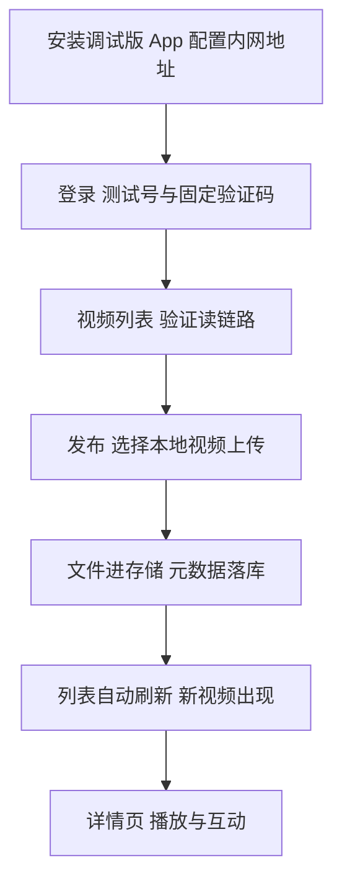

# 小视频整合测试：把功能装进真实 App 走完整条链路

> 🔒 安全提示：文中示例的口令/密钥均为课程教学环境演示口径，生产环境的安全要求见《安全与合规须知》。

REST 工具里逐个接口打 green，不等于功能真的能用。列表、发布、点赞、评论、关注分散在几个服务上，App 是唯一把它们串起来的消费方，接口层各自正确、拼在一起却翻车的情况，只有真机或模拟器装上调试包才暴露得出来。day04 的收尾环节就是把小视频整条链路装进真实 App 联调一遍，过程中还顺带揪出一个端与服务的数据约定问题。

## 先给结论

- 联调用课程资料提供的调试版 App 安装到模拟器，服务器地址切到内网配置，请求打本机服务而不是 mock，保存后生效。
- 联调前把依赖的服务起齐：接口服务、Dubbo 提供者、注册中心、Redis、MongoDB 与文件存储，缺一个链路就在断点处卡住。
- 测试路径是完整的用户动线：登录、视频列表、发布上传、详情播放、关注作者、点赞与取消、发布评论与查看评论列表。
- 一个典型联调问题：评论面板点开不显示，根因在响应数据里集合类字段为 null，端上要的是数组，装配侧空集合兜底即可修复。
- 模拟器上评论日期格式显示异常、真机正常，属于端上显示层问题，不影响数据落库，联调时要分清这类「看着像 bug 的不是 bug」。

## 一、环境就位：调试包、内网配置与服务清单

联调的载体是课程资料提供的调试版 App 包，版本号与接口实现进度对应，安装到模拟器后打开。装好先别急着点，做两件事。一是改服务器地址：App 的配置页把服务器切到内网地址，也就是本机或内网测试机的接口服务入口，保存后生效；这一版调试包加了快捷切换，mock 与内网测试配置可以在界面上直接选，省掉手改配置的麻烦。二是清点服务，联调是全链路，任何一环缺席都会以奇怪的形式报错，起服务前对照清单：

```bash
# 联调前确认在位的服务（按本课环境整理）
# 1. 接口服务      App 所有请求的统一入口
# 2. Dubbo 提供者  动态、评论、视频等业务实现
# 3. 注册中心      服务注册与发现，Dubbo 调用的前提
# 4. Redis         计数、标记与缓存
# 5. MongoDB       动态、评论、视频等业务数据
# 6. 文件存储      小视频文件与封面图
```

登录用测试账号走验证码流程：输入课程提供的测试手机号，点获取验证码，填入固定验证码 123456，进入首页。这一步同时把短信服务、用户服务与 token 链路都验了一遍，登录不通，后面的测试无从谈起。

## 二、发布与列表：从文件到卡片

切到视频页签，列表先验证读链路：此前接口测试灌进去的数据以缩略图形式排开，列表接口、装配逻辑与文件访问地址在 App 上一起得到了验证。

发布是这一环节的重头。测试用的视频文件要提前拷进模拟器的存储里，App 的发布入口打开文件选择器，选中预置的视频，界面显示上传中，上传完成后列表自动刷新，新视频的封面出现在第一位。一次发布背后是一条完整的写链路：封面与视频文件进文件存储，元数据落 MongoDB，列表接口随即能查到这条新纪录。App 侧的发布按钮、进度提示与自动刷新，正好把这条链路的每一段都覆盖到。



发布之后建议顺手再验一次列表分页与封面的加载，新数据最容易出现装配遗漏，此时发现成本最低。

## 三、详情页互动：六个功能一次过

点开新发布的视频进详情页，剩下的互动功能在这里一次测完。播放验证文件存储与访问地址；点关注按钮，作者的关注关系落库，按钮状态翻转；点赞，数字加一并点亮，再点取消，回到灰色归零；打开评论区发一条评论，再点开评论列表，刚发的内容带着用户信息显示出来。这一串动作在服务端分别对应关注关系表、点赞表态与评论文档的写入，App 上每一下点击都有一次真实的落库对应，接口测试阶段验证过的行为，在真实客户端上原样复现。

整合测试的意义就在这一段：接口测试验证的是「每个零件都合格」，整合测试验证的是「组装起来能跑」。App 的请求头、参数序列化、响应解析与服务端的实现之间，任何一处约定偏差都会在这一步显形。

## 四、评论面板翻车记：null 与空集合

联调中最有价值的一个问题出在评论面板：点击评论入口，面板弹出来却是空的，评论明明已经发成功，列表接口用 REST 工具单独测也能返回数据。接口单独测是好的，App 上就是不显示，典型的两端约定问题。排查后落点在响应数据上：装配评论列表时，没有评论或装配失败的集合类字段直接返回了 null，端上的解析把 null 当作异常数据，面板直接放弃渲染。

修复是一行兜底（示例为按本课写法补全，day04 资料包未含源码）：

```java
//装配评论列表：集合字段空值兜底，端上要数组不要 null
if (commentVoList == null) {
    commentVoList = new ArrayList<>();
}
```

约定就此立下：凡是返回给端上的集合类字段，一律给空集合，不给 null。空数组对端上是「没有数据」，null 是「数据坏了」，两种含义在协议层面必须分开。这类问题接口测试阶段完全测不出来，因为 REST 工具看到 null 与空数组都能接受，只有真实客户端的消费逻辑才会较真。

## 五、观察与收尾

评论区还有一个现象值得记录：模拟器上评论的时间显示格式不对，真机上却完全正常。数据侧的落库时间戳没问题，接口返回的数值也对，问题出在端上的格式化处理对不同设备的兼容差异。联调报告里这类条目要单独归类，它是显示问题不是数据问题，修复责任在端上，服务端不需要跟着改。

到这里，小视频的功能面全部走通：显示、列表、发布、播放、点赞、关注、评论，每一项都在真实 App 上完成了一次完整交互。day04 的开发任务就此收官，服务端的接口与数据、存储层的集合与关系、端上的交互与展示，三层的账全部对齐。

## 常见误区

- **服务没起齐就开始联调。** 错例：只起接口服务就装 App 测试，注册中心或存储缺席，报错指向不明确，逐个接口重测浪费时间。正解：对照服务清单逐项确认在位，联调报错先查环境再查代码。
- **App 停留在 mock 配置。** 错例：忘了把服务器切到内网，请求打到 mock 服务，返回的是假数据，联调成了对着空气测试。正解：安装后先改配置保存，再用一个能观察落库的动作（比如发评论）确认请求真的到达了本机服务。
- **测试视频不预先放进模拟器。** 错例：发布时才发现文件选择器里没有可用视频，误判为上传功能故障。正解：测试媒体文件提前拷进模拟器存储，发布环节只验证上传链路本身。
- **集合类字段返回 null。** 错例：接口无数据时集合字段直接 null，端上解析放弃渲染，页面空白。正解：契约约定集合字段一律空集合兜底，null 只留给真正缺失的对象语义。

## 面试可能被问到的问题

1. 面试官追问：「接口测试都通过了，为什么还要做整合测试？」
   答：接口测试验证单个零件的输入输出，整合测试验证零件组装后的系统行为。请求头、序列化、字段约定、多服务协作这些跨边界的问题，只有真实客户端接入才会暴露，评论面板 null 集合就是典型：接口单独测返回 null 没人报错，端上消费却直接不渲染。整合测试是功能交付前的最后一道关。
2. 面试官追问：「联调环境怎么组织，App 怎么打到本机服务？」
   答：模拟器与服务器在同一内网，App 的服务器配置指向接口服务的内网地址与端口，请求经统一入口转发到各服务。调试包支持在 mock 与内网配置间快捷切换，mock 服务前端独立开发用，联调必须切到真实服务，并用一个能观察落库的动作确认链路真的通了。
3. 面试官追问：「接口返回空集合和 null，怎么选？」
   答：集合语义的字段一律返回空集合。空数组表示「查询成功但没有数据」，端上可以直接渲染空状态；null 表示「该字段不存在」，端上要么判空跳过要么当成异常。两种含义混用会逼着客户端到处做防御性判断，契约层面统一空集合，是最省心的默认约定。
4. 面试官追问：「整合测试发现显示异常但数据正确，怎么归类处理？」
   答：先定位责任边界。核对落库数据与接口返回都正确，问题就在端上的显示层，比如日期格式化对不同设备的兼容差异，归端上修复，服务端不动。联调报告里把这类条目与真正的服务端缺陷分开记录，避免服务端为显示问题背锅，也让修复责任一目了然。

## 配套资料

- 原型：`materials/code/07/day01 探花交友-项目搭建以及登录完善个人信息/day01/资料/探花交友移动端原型V1.2/小视频.html`，视频列表、发布入口与详情页互动的界面形态出自这里。
- 目标：`materials/code/07/day04 探花交友-实现评论、小视频/day04/学习目标.md`，本日官方学习目标清单，整合测试覆盖的功能项与之一一对应。
- 说明：day04 资料包仅存学习目标清单，调试版 App 包与测试视频随原始课程资料分发，未收录在本资料包内；正文中的服务清单与空集合兜底代码为按本课写法补全的示例，包名统一改写为 `com.study.tanhua` 系。
