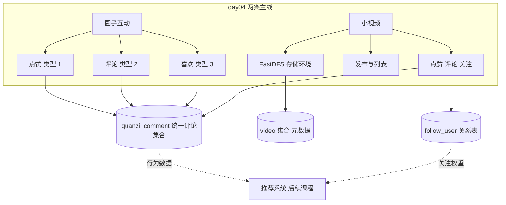

# day04 课程总结：圈子互动收官，小视频开篇

day04 在整个项目里是个承重的日子：上半场把圈子的互动闭环补完，点赞、喜欢、评论全部落地；下半场开出一个全新的内容形态，小视频，从技术方案、文件存储一路做到互动与关注。两条线共享同一个设计母题，用一套统一的互动模型承载多种表态。总结这一天的正确方式不是罗列 API，而是把设计判断、复用边界与遗留账目理清楚，让 day05 接得住。

## 先给结论

- day04 的功能清单：圈子的点赞、喜欢、单条动态查询、评论四件事收官；小视频的存储环境、发布、列表、点赞、评论、关注全部落地。
- 本日最值得带走的设计是统一互动模型：点赞、喜欢、评论在数据层都理解为一条「评论」，一张评论集合加类型字段承载三类互动，读写两侧共享同一套链路。
- 小视频的技术方案围绕三个核心点展开：存储选自建分布式文件系统，推荐靠多权重计算留给后续课程，加载速度走带宽与 CDN 加速。
- 视频的点赞与评论与圈子共用同一套实现，目标 id 换成视频 id 即可；关注作用于人，独立成关系表，为推荐积累权重数据。
- 遗留账目要记清：列表的是否关注字段仍为占位，推荐能力未接入，缓存一致性有两处边界没兜住；下一天进入消息模块。

## 一、圈子侧：一张评论集合装下三类互动

圈子互动的复盘要从接口全景看起。day04 期间 Dubbo 服务接口沉淀下来的能力大致如下：

```java
public interface QuanZiApi {

    //发布动态
    boolean savePublish(Publish publish);

    //查询动态列表
    PageInfo<Publish> queryPublishList(Long userId, Integer page, Integer pageSize);

    //点赞
    boolean saveLikeComment(Long userId, String publishId);

    //取消点赞、喜欢等
    boolean removeComment(Long userId, String publishId, Integer commentType);

    //查询评论列表
    PageInfo<Comment> queryCommentList(String publishId, Integer page, Integer pageSize);
}
```

接口命名透着设计意图：点赞的方法叫 `saveLikeComment`，取消叫 `removeComment`，点赞在系统里就是一条类型为 1 的评论记录。喜欢是类型 3，评论本体是类型 2，三种表态共用一张评论集合，写入侧只换类型参数，读取侧每条查询带类型条件隔离。这个决定在点赞环节第一次显现价值，到评论环节已经变成纯粹的机械劳动：发表评论的 Service 是点赞方法的换参版，评论点赞又是对点赞方法的转发。缓存侧同样成体系，计数 key 与个人标记 key 按目标 id 组织，列表装配直接读 Redis，四个字段（点赞数、是否点赞、喜欢数、是否喜欢）的取数逻辑互为镜像。

复盘时值得记住的是节奏：先立 Dubbo 服务与数据结构，再接 HTTP 契约，最后补装配与缓存。三步各自验证，问题定位始终在当层，这条节奏贯穿了 day04 的每一个功能。

## 二、小视频侧：三个技术点与一条功能链

小视频对标主流短视频平台，用户上传视频分享，浏览他人视频，点赞、评论、关注作者。动工之前先过技术方案，核心就三个点：

```text
存储：小视频体量与容量巨大，选择自建分布式文件系统 FastDFS 承接文件
推荐：采用多种权重的计算方式计算，推荐能力在后续课程展开
加载速度：提升服务器带宽之外，可引入 CDN 加速，需要额外购买 CDN 服务
```

存储是本日真正的新技术面。视频文件动辄几兆到几十兆，关系库与 MongoDB 都不擅长存大文件，课程选择自建 FastDFS：环境用容器方式搭建，应用侧引入现成的 Java 客户端，配置 tracker 地址后即可上传下载。元数据另走 MongoDB 的 video 集合，封面地址与播放地址存文档，文件本体在文件系统里。发布小视频的链路因此是「文件进存储、元数据落库」两步，列表装配时把地址回给端上，播放由客户端拉流完成。

功能实现沿交互链展开：发布、列表、详情，然后是互动。互动这一段几乎整段复用：视频点赞与圈子点赞逻辑一致，接口层转发到圈子的点赞实现；视频评论三件事（列表、发布、评论点赞）同样转发复用，发布时把视频 id 注入既有契约的目标键。真正单独建存储的只有关注，关系表独立成集合，写入即推荐权重。功能链路如下图：



图里的虚线是 day04 的远期伏笔：互动数据与关注关系都是推荐系统的原料，列表的最终形态是推荐流，现阶段用单表查询占位，接口契约不变，推荐就位后替换取数来源即可。

## 三、复用与分家：两个设计判断

day04 的工程判断可以浓缩成一对反义词：能复用的复用到底，该分家的分家彻底。点赞与评论复用的依据是数据同构，表态的三要素（用户、类型、目标）在动态与视频之间没有区别，复用连数据契约一起继承，改动只发生在适配层，一处 put 与一处转发。关注分家的依据是语义与生命周期不同，关注作用于人而不是内容，作者删除作品关注依然成立，推荐阶段还要高频按用户拉关注列表，独立的关系表结构干净、查询直接。

这对判断放在一起看更有意思：分家不是推翻复用，而是复用的边界划分。内容表态归一张集合，人的关系归一张表，各自内部仍然遵循统一模型的思路。将来再加新的表态形态或新的内容形态，先问「数据和谁同构」，答案决定复用还是新建，这个提问方式比任何具体代码都保值。

## 四、遗留账目与下一步

复盘要诚实地记账。day04 留下的待办有四笔：视频列表装配的是否关注字段仍以 TODO 占位，等关注状态接入装配再填实；推荐能力完全未接入，行为数据在持续积累但还没有产生排序价值；缓存与库是双写最终一致，取消点赞时计数 key 缺失会造出负数、缓存存在期间库被旁路修改会出现短暂偏差，这两处边界课程从简未兜，生产实现要补对账机制；评论面板的集合字段契约（空集合而非 null）与端上日期格式兼容，属于联调阶段定下的约定与转给端上的问题，服务端按契约守住即可。

功能侧的收官意味着数据侧的开工：点赞、评论、关注每一次落库，都是推荐模型的样本来源。下一天课程进入消息模块，互动产生的关系与行为将在消息场景里第一次被直接消费，喜欢我的人、谁看过我这类列表，数据源正是这两天攒下的表态记录。

## 常见误区

- **总结只抄接口清单不记设计判断。** 错例：复盘时把方法签名背一遍，面试被问「为什么这样设计」就卡壳。正解：按「统一互动模型、复用与分家的边界、缓存双写的取舍」这类判断线索复盘，代码可以查，判断要内化。
- **新表态形态继续往评论集合里塞。** 错例：遇到关注、收藏等新关系，惯性加类型值复用评论集合，查询条件越加越多。正解：先判数据是否与内容表态同构，作用于人的关系独立建表，类型扩展只留给内容表态。
- **类型值散落成魔法数字。** 错例：各处直接写 1、2、3 传参，新增类型或调整值时全项目排查。正解：类型收敛为常量或枚举，接口注释标明每个值的语义，写入与查询共用同一组定义。
- **把复用做成复制。** 错例：复用时整段拷贝代码改个名，两份实现并行演化，行为逐渐分叉。正解：同构逻辑转发或下沉共享，只有适配层的差异留在各自模块。

## 面试可能被问到的问题

1. 面试官追问：「用两分钟讲讲你的社交互动模块设计？」
   答：以统一互动模型为核心：一次表态由用户、类型、目标三要素构成，所有表态落在一张评论集合，类型区分点赞、评论、喜欢，目标 id 兼容动态、视频、评论多种对象。热点的计数与个人状态放 Redis 双 key，列表装配读缓存不回库；作用于人的关系（如关注）独立建表供推荐使用。写入先库后缓存，缓存缺失回源重建，最终一致。
2. 面试官追问：「这套设计里你认为生产化时最需要改进的是哪里？」
   答：缓存双写的边界。取消表态时计数 key 缺失会减出负数，缓存存在期间库被旁路修改会带偏差，需要补存在性判断、对账任务与过期重建；并发窗口的幂等要靠唯一索引兜底，不能只依赖先查后写。另外类型字段与目标字段的命名已经随复用漂移，契约要演进成中性命名。
3. 面试官追问：「小视频模块为什么要自建文件存储，用什么方案？」
   答：视频文件大、数量多、读多写少，关系库与文档库存大文件都会拖垮自身，用专门的分布式文件系统承接。课程用 FastDFS，容器化搭建 tracker 与 storage，应用侧走 Java 客户端上传下载，数据库只存元数据与播放地址。商业场景也可以选对象存储加 CDN 的组合，思路一致：文件与元数据分离，各自独立扩容。
4. 面试官追问：「关注功能看起来很小，为什么要单独讲？」
   答：因为它是复用边界与推荐数据的双重样本。语义上关注作用于人而非内容，硬塞进互动集合会让查询与生命周期都变拧巴，独立成表才干净；数据上关注是强度最高的兴趣信号，召回阶段按它拉作者新作品，排序阶段按它加权，结构干净的关系表直接决定推荐取数的效率。
5. 面试官追问：「互动数据将来怎么喂给推荐系统？」
   答：互动落库时保留用户 id、目标 id、类型与时间，天然就是行为样本。推荐分两步消费：召回按关注关系与互动历史圈定候选集，排序用多权重把关注、点赞、评论、浏览按强度加权计算。列表接口契约保持稳定，推荐算好后替换列表的取数来源，端上无感，这也是互动功能从第一天就要把目标 id 与类型存准的原因。

## 配套资料

- 目标：`materials/code/07/day04 探花交友-实现评论、小视频/day04/学习目标.md`，本日官方学习目标清单，复盘范围以此为准。
- 原型：`materials/code/07/day01 探花交友-项目搭建以及登录完善个人信息/day01/资料/探花交友移动端原型V1.2/小视频.html`，小视频模块的交互形态出处。
- 数据库：`materials/code/07/day01 探花交友-项目搭建以及登录完善个人信息/day01/代码/mytanhua.sql`，用户与资料表结构，互动装配的用户信息来源。
- 说明：day04 资料包未解出工程源码，正文代码按课程画面与讲解整理，包名统一改写为 `com.study.tanhua` 系；FastDFS 搭建细节属于本日早前环节的内容，此处仅作方案层回顾。
