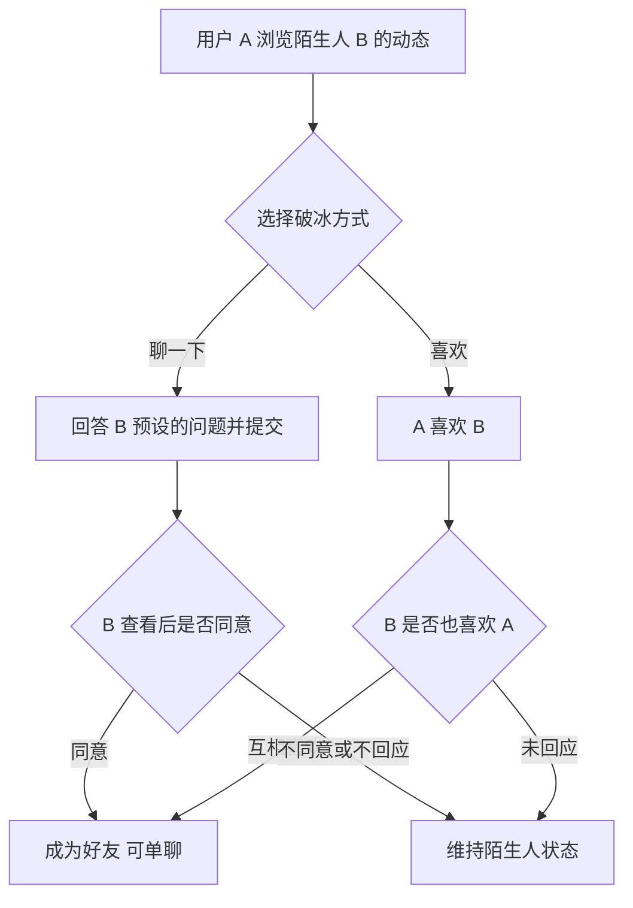

# 什么是即时通信：探花交友消息模块的功能全貌

「消息」两个字在产品语境里常常混着三件事：聊天、通知、联系人。动手编码之前先把概念与功能面分开说清：即时通信指的是什么，探花交友在它之上做了哪些功能，一个用户从陌生人到能聊天要走哪几条路径。功能面看清了，后面技术方案与环信集成的每一步才有对照物。

## 先给结论

- 即时通信简称 IM，指能够即时发送和接收互联网消息的业务，1998 年问世，微信、QQ 是每天都在发生的日常样本。
- IM 的产品形态早已超出聊天工具，逐步集成邮件、博客、音乐、游戏、电商、资讯、娱乐等能力，成为一体化平台，主战场在移动端。
- 探花交友的消息功能面：好友单聊（文字、语音、图片）加联系人管理，再加点赞、评论、喜欢、公告四类通知列表。
- 陌生人之间有两条成好友路径：走「聊一下」回答对方预设的问题，对方同意后成好友；或者双方互相点喜欢，直接成好友。
- 好友才可聊，成好友的前提是双向确认，这是社交产品与普通 IM 最不一样的业务约束。

## 一、IM 是什么：一个老业务的新舞台

即时通信的定义一句话能说完：能够即时发送和接收互联网消息的业务。它与邮件的差别在一个「即」字，邮件是存储转发，收件人何时看到不可控；IM 的两端在线时消息秒级到达，实时性完全不是一个量级，这也是聊天场景无一例外选择 IM 的原因。

这条业务线从 1998 年问世以来发展迅速，形态上经历了两个变化。

**第一，从工具到平台。** 早期的 IM 是单纯的聊天工具，现在的 IM 产品上集成了邮件、博客、音乐、游戏、电商、资讯、娱乐等大量能力，聊天只是入口，平台才是形态。

**第二，从桌面到移动。** IM 的主要使用场景已经迁移到手机端，随时在线、随时可达成了默认预期，这也把「服务端要维持海量长连接」的工程要求放大了无数倍。

## 二、探花的聊天功能：好友直接聊，陌生人先破冰

探花交友在消息模块提供了类似微信的聊天能力，但入口比微信多了一层社交筛选。用户与好友可以直接聊天；与陌生人聊天要先成为好友，路径有两条：



两条路径的设计意图不同。「聊一下」是主动破冰：在陌生人的动态下方点「聊一下」，弹出的输入框里回答的是对方预设的问题，提交后对方在消息侧能看到这条招呼，愿意聊就点同意，双方随即成为好友。互相喜欢是被动匹配：A 给 B 点喜欢，如果 B 也点了喜欢 A，双方直接成为好友。前者考验表达，后者靠缘分，两条路径殊途同归，都会在好友关系上落一条记录，之后的聊天与联系人列表都长在这条关系上。

## 三、消息中心的功能面：一屏看全

消息中心页面把三类信息组织在一起：

```text
聊天记录区    与好友的单聊会话，从联系人进入
通知列表区    点赞消息列表、评论消息列表、喜欢消息列表、公告消息列表
联系人区      联系人列表，点击联系人进入聊天界面
```

聊天界面与主流 IM 的交互一致，支持发送文字、语音、图片三类消息。通知列表区是探花的特色：把「谁赞了我、谁评论了我、谁喜欢了我、系统公告」聚合在一个页面，用户不必回到动态流里逐条翻找。

从服务端视角看，这一屏对应两类完全不同的数据：

```java
// 消息中心的资源划分（示意，按探花交友的接口风格整理）
// 点赞、评论、喜欢三类列表：查统一评论集合，按类型字段过滤
// 公告列表：系统消息，独立来源
// 联系人与聊天：依赖环信集成后的好友体系
GET /messages/likes           // 点赞消息列表
GET /messages/comments        // 评论消息列表
GET /messages/loves           // 喜欢消息列表
GET /messages/announcements   // 公告列表
GET /messages/contacts        // 联系人列表
```

点赞、评论、喜欢三类列表的数据源是 day04 落库的统一评论集合，查询时按类型字段过滤、按目标用户聚合；公告是系统侧写入的新来源；联系人与聊天则要等环信集成之后才有数据。也就是说，消息中心这一屏里，只有聊天依赖 IM 平台，其余全是常规查询接口，day04 攒下的互动数据在这里第一次被集中消费。

## 四、体验路径串讲

把功能串成一条用户旅程：新用户完善资料进入首页，刷到推荐的动态，对某个陌生人点「喜欢」；对方回了一个「喜欢」，双方互相喜欢已成为好友；打开消息中心，通知列表里躺着刚发生的互动记录，联系人列表里出现对方，点进去发一条文字或语音，聊天开始。这条旅程里服务端要准备三样东西：好友关系的写入与查询、通知列表的装配、IM 通道的收发能力，正好对应 day05 的三块编码工作。

## 常见误区

- **把通知列表做成推送。** 错例：每产生一次点赞就推一条消息给接收方。正解：通知列表按查询装配，打开页面拉取即可；高频互动的推送成本高且打扰用户，是否推送属于产品策略，实现上两者解耦。
- **把「聊一下」当成普通私聊。** 错例：实现成直接给陌生人发消息。正解：「聊一下」携带的是对方预设的问题，提交后走对方的同意流程，同意才建好友，好友关系是聊天的前提，这个门槛是社交产品防骚扰的设计。
- **混淆好友与关注。** 错例：把小视频模块的关注关系直接当好友用。正解：关注是单向的兴趣信号，作用于内容作者；好友是双向对等关系，是聊天的准入条件，两者语义与生命周期都不同，存储也分开。

## 面试可能被问到的问题

1. 面试官追问：「即时通信和普通 HTTP 接口的本质区别是什么？」
   答：HTTP 接口是请求响应模型，客户端发起、服务端应答、连接用完即断，服务端无法主动触达客户端；IM 要求消息即时到达，靠长连接维持会话，服务端可以在任意时刻向在线的接收方推送消息。连接的生命周期从一次请求延长到整个在线时段，这也是 IM 服务端复杂度的来源。
2. 面试官追问：「你们产品里陌生人和陌生人怎么开始聊天？」
   答：设计了两条路径。主动破冰走「聊一下」，回答对方预设的问题并提交，对方同意后双方成为好友；被动匹配走互相喜欢，双方都点了喜欢就直接成为好友。两条路径都以好友关系为聊天前提，避免陌生人之间的无门槛打扰。
3. 面试官追问：「消息中心一屏混了聊天和通知，你们怎么组织数据？」
   答：聊天会话与联系人来自 IM 平台和好友关系存储；点赞、评论、喜欢三类通知来自互动记录集合，按类型过滤查询；公告来自系统消息。屏幕上是同一个页面，服务端是三套来源，接口各自独立，装配层互不影响。
4. 面试官追问：「为什么互相喜欢就能直接成为好友？」
   答：互相喜欢本身就是双向确认，业务语义上等价于双方都同意建立关系，不需要额外的同意环节。这与「聊一下」需要对方同意形成互补：一个是表达意愿后的确认，一个是匹配成功后的自然结果，产品逻辑自洽。

## 配套资料

- 原型：`materials/code/07/day01 探花交友-项目搭建以及登录完善个人信息/day01/资料/探花交友移动端原型V1.2/消息.html`，消息中心的页面结构与「聊一下」入口出处。
- 数据库：`materials/code/07/day01 探花交友-项目搭建以及登录完善个人信息/day01/代码/mytanhua.sql`，用户与好友关系的库表基础。
- 目标：`materials/code/07/day05 探花交友-实现消息功能/day05/学习目标.md`，本日功能清单出处。
- 说明：day05 资料包未含工程源码，消息中心接口划分与代码块为按本课写法补全的示意。
