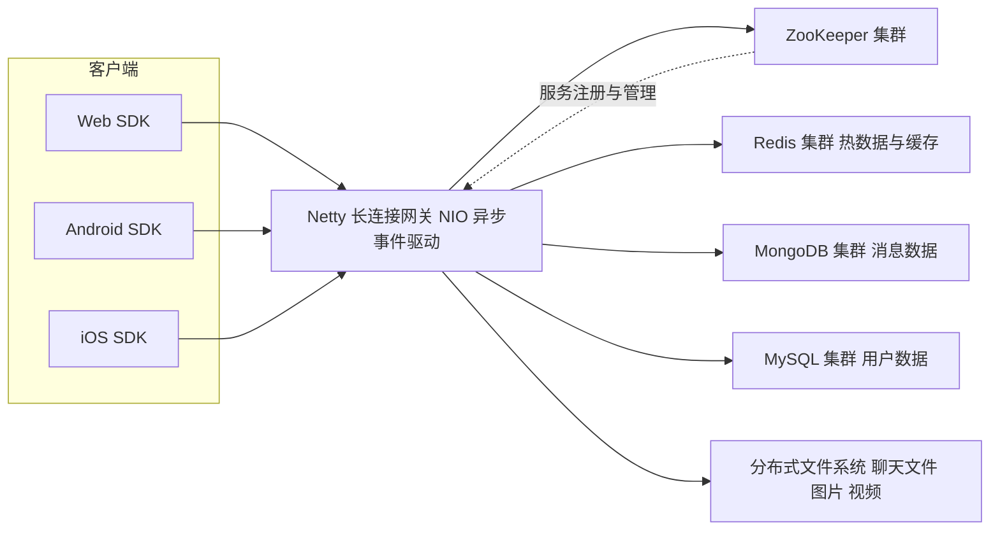

# 即时通信的技术方案：自研千万级架构与对接第三方之间的选择

真要给一款产品配上自己的即时通信能力，难度不在「能发一条消息」，而在并发、流量、负载与容灾。连接数等于在线用户数，消息要求秒级送达，任何一台机器都可能挂掉，这些约束叠加起来，就是 IM 服务端与普通业务接口的分水岭。这一篇把挑战拆开，看两套主流方案各自的形态与取舍，以及探花交友为什么选了对接第三方。

## 先给结论

- 高并发 IM 要额外考虑五件事：并发支撑、流量、负载、服务器与容灾，具体功能实现反而是相对简单的部分。
- 方案一是自主实现，从设计到架构再到代码全由自己承担，可支撑千万级并发，代表技术栈是 Netty + WebSocket + RocketMQ + MongoDB + Redis + ZooKeeper + MySQL。
- 方案二是对接第三方 IM 云服务，环信、网易、容联云通信等都是可选平台，按对方 API 对接即可，简单快速。
- 选型逻辑：中大型项目追求可控性与定制能力，选自研；中小型项目追求成本与周期，选第三方。
- 探花交友属于中小型项目，采用方案二对接环信，把工程量集中在业务功能上。

## 一、IM 服务端的门槛：HTTP 模型补不上的几块

**第一，海量长连接带来的并发压力。** 普通接口的连接毫秒级用完即走，单机靠线程池就能应付；IM 的连接要长住，在线多少用户就有多少条连接，单机维护上万条长连接就到了传统阻塞 IO 的极限，必须换 IO 多路复用，这就是后面 Netty 登场的原因。

**第二，连接保活。** 移动网络下的 NAT 网关与防火墙会回收「看起来空闲」的连接，客户端需要按固定间隔发心跳包维持链路，服务端借心跳判断在线状态，超时未报就标记离线。

**第三，离线消息。** 接收方不在线时消息不能丢，要先落存储，待其上线再投递，还要有送达确认与去重，保证消息不丢不重。

**第四，群聊路由。** 一条群消息要投递给群内所有人，常见做法分写扩散与读扩散：前者为每个成员写一条副本，读得快写得多；后者成员各自来拉，写得快读得慢。群规模不同，取舍不同。

**第五，流量、负载与容灾。** 长连接集群要能水平扩容，节点挂掉要能摘除，故障要能切换，这些是 IM 平台从第一天就要设计进去的东西。

课程讲到五类挑战为止，上面的拆解把每类挑战背后的工程动因补齐，属于通用原理的整理。

## 二、方案一：自研一套千万级 IM 的样子

自主实现的路径是从设计、架构到代码全部自己承担。课程给出了一张可支撑千万级并发的参考架构：



关键路径是：各端 SDK 与 Netty 网关建立长连接，网关把自身注册到 ZooKeeper，由注册中心管理服务节点；登录注册、聊天记录这类辅助服务单独开发；存储按数据形态分家，消息进 MongoDB，用户数据进 MySQL，热数据与缓存进 Redis，聊天产生的文件、图片、视频进分布式文件系统。存储层全部集群化，网络层靠 Netty 扛连接，节点管理交给 ZooKeeper，这就是千万级并发的骨架。

Netty 在这套架构里是承重墙。它是一个异步事件驱动的 NIO 网络框架，用少量线程管理大量长连接，一个最小可用的服务端骨架长这样：

```java
// Netty 长连接网关骨架（示例，按主流写法补全）
EventLoopGroup boss = new NioEventLoopGroup(1);
EventLoopGroup worker = new NioEventLoopGroup();
try {
    ServerBootstrap b = new ServerBootstrap();
    b.group(boss, worker)
     .channel(NioServerSocketChannel.class)
     .childHandler(new ChannelInitializer<SocketChannel>() {
         @Override
         protected void initChannel(SocketChannel ch) {
             ch.pipeline().addLast(new IdleStateHandler(60, 0, 0));
             ch.pipeline().addLast(new HeartbeatHandler());   // 心跳保活
             ch.pipeline().addLast(new ChatMessageHandler()); // 消息路由
         }
     });
    ChannelFuture f = b.bind(8888).sync();
    f.channel().closeFuture().sync();
} finally {
    boss.shutdownGracefully();
    worker.shutdownGracefully();
}
```

骨架本身不长，真正的工程量在消息协议、心跳策略、路由转发、消息落库与集群扩容这些环节，方案一的「贵」就贵在这些看不见的地方。

## 三、方案二与选择逻辑

对接第三方是把长连接、推送、离线消息这些底层能力全部托管给专业平台，自己只按对方提供的 API 对接，可选的平台不止环信一家，网易、容联云通信等都在其列。两套方案放在一起对比：

```text
方案一 自主实现：Netty + WebSocket + RocketMQ + MongoDB + Redis + ZooKeeper + MySQL
方案二 对接第三方：REST API 对接 + 客户端 SDK，消息链路由平台托管
```

| 维度 | 方案一 自主实现 | 方案二 对接第三方 |
|---|---|---|
| 成本 | 人力物力投入大 | 低，按量付费 |
| 周期 | 开发周期长 | 快速集成，专注业务 |
| 可控性 | 强，可深度优化与定制 | 弱，定制与底层优化受限 |

选择建议与项目量级挂钩：中大型企业的核心业务对可控性要求高，值得自研，想要深度定制、底层优化都有空间；中小型项目用方案二就够，把省下来的资源投到业务差异上。探花交友量级属于中小型，选方案二对接环信，这也是 day05 后续全部编码的前提。如果未来产品规模上来要走自研，架构图就是上一节那张，随时可以按图起工。

## 常见误区

- **用 HTTP 轮询假装即时通信。** 错例：客户端每两秒拉一次新消息，并发与延迟都失控。正解：IM 的本质是服务端主动推，轮询只能做弱实时场景，真正的聊天要走长连接或托管给 IM 平台。
- **以为对接第三方后消息数据就不用管了。** 错例：聊天记录只存在平台侧，自有系统无留存。正解：平台负责送达，业务侧的聊天记录留存、审计与漫游策略仍要自己设计，用户体系集成时就要把数据归属想清楚。
- **把方案一的存储选型当成随意搭配。** 错例：消息也存 MySQL，量大后单表撑不住。正解：消息数据写多读多、体量大且按会话查询，文档模型更合适；用户数据强一致诉求高，放 MySQL；按数据形态分库是架构成立的前提。
- **把方案一想象成高不可攀。** 错例：认为聊天功能必须自研才专业。正解：自研与托管是成本与可控性的权衡，中小型项目选托管不是妥协，而是把资源集中到业务差异上的正确决策。

## 面试可能被问到的问题

1. 面试官追问：「为什么 IM 服务端普遍用 Netty？」
   答：IM 的连接数等于在线用户数，传统阻塞 IO 一个连接一个线程，几千条连接就把线程资源耗尽。Netty 基于 NIO 的异步事件驱动模型，用少量线程通过 IO 多路复用管理海量长连接，还提供了编解码、心跳、粘包拆包等开箱即用的组件，是长连接网关的事实标准。
2. 面试官追问：「心跳机制是干什么的，不做会怎样？」
   答：客户端定期发心跳包维持链路，一是防止 NAT 网关和防火墙回收空闲连接，二是让服务端及时感知掉线。不做的话，手机切网后服务端还认为用户在线，消息会推送到一条已经死掉的连接上，接收方实际收不到，在线状态也会长期不准。
3. 面试官追问：「离线消息要考虑哪些问题？」
   答：三点，不丢、不重、及时。接收方离线时消息先落存储并标记未投递，上线后拉取并确认，确认后才算送达；投递要有幂等与去重，防止重发造成重复消息；拉取要按会话与时间有序，保证体验。这些是消息系统的底线能力。
4. 面试官追问：「你们项目为什么对接环信而不是自研？」
   答：项目是中小型量级，自研千万级 IM 需要长连接网关、注册中心与多套存储集群，人力成本和周期都不划算；对接第三方按 API 集成，长连接、推送、离线消息由平台托管，团队精力放在用户体系集成与业务功能上。可控性上的损失用抽象层弥补，把 IM 能力收敛在自己的接口后面。
5. 面试官追问：「如果让你自研一套 IM，架构会怎么搭？」
   答：接入层用 Netty 做长连接网关，多节点部署并注册到 ZooKeeper 做服务发现与动态摘除；消息数据进 MongoDB 集群，用户数据进 MySQL，热数据与在线状态进 Redis，文件进分布式文件系统；服务间解耦用 RocketMQ 削峰；各端提供统一 SDK。这个分层即课程参考架构，扩展点在消息路由与群聊的读写扩散策略上。

## 配套资料

- 目标：`materials/code/07/day05 探花交友-实现消息功能/day05/学习目标.md`，即时通信技术方案的学习目标条目出处。
- 说明：day05 资料包未含工程源码，架构图按课程画面线整理，Netty 骨架为按主流写法补全的示例；探花交友实际采用方案二对接环信，方案一代码未在项目中落地。
