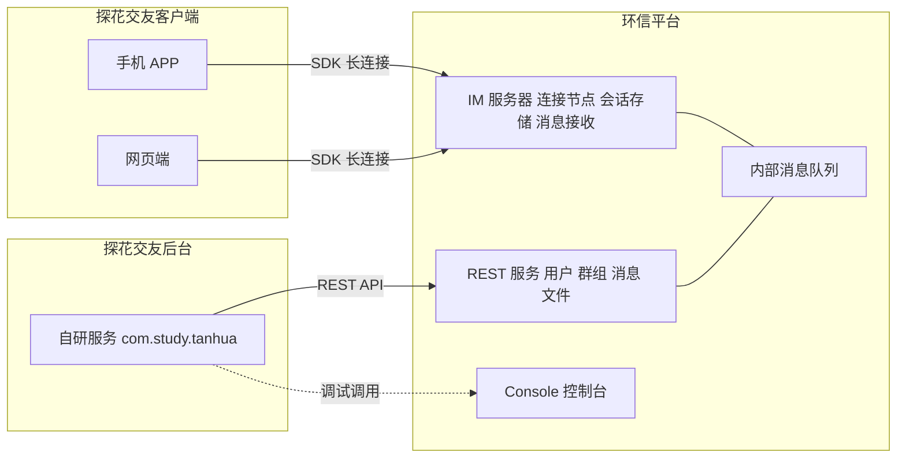

# 对接环信：第三方 IM 平台的能力面、架构与开通流程

技术方案定成对接第三方之后，第一件事是认识被对接的对象。环信是国内做即时通信云服务的厂商，官网用一句话描述自己：稳定健壮、消息必达、亿级并发的即时通讯云。这一篇过它的产品能力、平台架构与集成方式，再走一遍注册建应用的开通流程，把后续编码要用的参数备齐。

## 先给结论

- 环信不只做 IM，产品线还包括客服、云视频、机器人，本项目的集成对象是其中的即时通讯云。
- IM 核心能力四件套：全类型消息、万人群聊互动、实时音视频、推送服务；智能反垃圾与敏感词过滤、实时消息回调、多终端同步、消息漫游属于增值能力。
- 与环信的对接面有两条：客户端集成走 SDK，服务端集成走 REST API；探花交友的重心在服务端，用于用户体系集成与消息管理。
- 使用前要注册账号并创建应用，注册模式选授权注册比开放注册安全，本项目选授权注册。
- 100 个以内注册用户免费，超出后走企业版，按当月第三高日活跃数计费；AppKey 等参数创建完成即可查看，是后续所有 REST 调用的路由基础。

## 一、环信是谁：一家 IM 云服务商的能力面

官网地址是 `www.easemob.com`，进入后能看到产品矩阵：即时通讯云是主营，旁边还有客服、云视频、机器人等产品线。IM 场景的解决方案覆盖语音连麦聊天室、私密社交、群聊、视频会议、企业门户、智能硬件等，社交类 App 的诉求基本都能对上号。

IM 的核心功能是四件套：全类型消息（文本、语音、图片、自定义消息等）、万人群聊互动、实时音视频、推送服务。围绕核心还有一批增值能力，与本项目相关的主要是这些：

```text
核心能力   全类型消息 / 万人群聊互动 / 实时音视频 / 推送服务
增值能力   智能反垃圾与敏感词过滤 / 实时消息回调 / 多终端设备同步 / 消息漫游
基础设施   全球多节点部署，按地域就近接入
```

对探花交友来说，四件套里的全类型消息与推送服务直接对应聊天功能，群聊与音视频暂时用不到，但能力面摆在那里，业务扩展时不必换平台。

## 二、平台架构：客户端与服务端两条对接面

环信开发文档里的平台架构可以浓缩成一张图：



图上有两条对接面，正好对应两类集成工作。

**客户端集成。** 手机 APP 与网页通过环信的 SDK 建立长连接，负责消息的发送与接收，SDK 能力覆盖消息收发、好友管理、群组管理等。这部分属于 APP 端团队的工作，本项目不涉及客户端编码，前端团队按 Android SDK 文档接入即可。

**服务端集成。** 自研后台通过 REST API 与环信的 REST 服务交互，可用接口覆盖用户数据、群组、消息、文件等；环信的 Console 控制台也能直接调接口，调试阶段很好用。探花交友在服务端主要用两块能力：用户体系集成与消息发送，聊天记录查询可能也会用到，其余接口暂不涉及。

集成的重心为什么压在服务端？因为账号注册的入口要握在自己手里：自有用户什么时候创建环信账号、按什么规则映射，都由后台决定，这正是 day05「独立实现环信的用户体系集成」这条目标的含义。

## 三、开通流程：注册、建应用、记参数

使用环信的第一步是在官网注册账号并登录，进入 Console 控制台创建应用。创建表单里有四项内容：

```text
应用名称 APP name    自定义，如 tanhua
AppKey               系统自动生成，格式为 orgname#appname
产品名称与描述       按项目填写
注册模式             开放注册 / 授权注册，本项目选授权注册
```

**注册模式的选择值得展开。** 开放注册允许终端用户自行在环信侧注册 IM 账号；授权注册把注册权收到服务端，用户注册必须由后台携带管理员凭证调用 REST API 完成。探花交友选授权注册，理由是安全：IM 账号的产生被收拢在服务端，与自有账号体系绑定，外部无法直接造出 IM 账号冒充用户。

创建完成后，应用详情页能看到后续开发要用的全部参数（以下为打码示例）：

```text
OrgName         example-org
AppName         tanhua
AppKey          example-appkey
Client ID       example-client-id
Client Secret   example-client-secret
```

其中 AppKey 是应用在环信侧的唯一标识，REST 调用的 URL 里都要带上它；Client ID 与 Client Secret 是换取管理员 token 的凭证，管理员 token 是调用全部 REST API 的通行证，这两把钥匙只应存在于服务端配置里。凭这套参数，服务端获取管理员 token 的调用形如：

```bash
# 获取管理员 token（预览示例，按本课写法补全，域名以实际分配为准）
curl -X POST "https://a1.example.com/example-org/tanhua/token" \
  -H "Content-Type: application/json" \
  -d '{"grant_type": "client_credentials",
       "client_id": "example-client-id",
       "client_secret": "example-client-secret"}'
```

token 拿到之后，注册环信用户、发消息、查聊天记录都是同样的 REST 套路，后续环节会逐一实现。

## 四、计费口径与接入提醒

免费额度按注册用户数划线：100 个以内用户免费，超出后需要企业版。企业版按「当月第三高日活跃数」计费，把一个月里日活最高的两天刨掉，第三天的日活落在哪个价格档就按哪档收费。这个口径对突发流量友好，短暂的高峰不会把整月账单顶上去，对中小团队是能承受的价格。

接入方式上留一个工程提醒：第三方 API 不宜散落在业务代码里。按前面的架构图，环信的 REST 调用应收敛在服务端一个独立的网关层或工具层，接口按自家语义定义，将来若更换 IM 平台，改动面只有这一层。

## 常见误区

- **注册模式随手选了开放注册。** 错例：图省事开放注册，任何人都能在环信侧注册同名 IM 账号，冒充他人收发消息。正解：生产项目选授权注册，注册权收进服务端，账号映射可控。
- **把 AppKey 当成密钥。** 错例：认为泄露 AppKey 就等于泄露了系统。正解：AppKey 是应用标识，是 REST URL 的组成部分；真正的凭证是 Client ID 与 Client Secret，只放服务端，前端与客户端都不应持有。
- **把控制台当生产工具。** 错例：日常运营都在 Console 里手工注册用户、发消息。正解：Console 用于调试与验证，生产链路的用户注册与消息发送必须走服务端 REST API，纳入代码与审计。
- **以为免费额度是 100 并发。** 错例：按在线人数理解额度，上线后用户量破百就慌。正解：额度按注册用户数划线，计费按日活档位，两个口径都与并发无关。

## 面试可能被问到的问题

1. 面试官追问：「为什么选环信？选型时比较过哪些维度？」
   答：可选的第三方 IM 平台有环信、网易、容联云通信等，比较维度主要是能力覆盖（消息类型、群聊、音视频、推送）、文档与 SDK 成熟度、计费口径与稳定性。环信的即时通讯云提供全类型消息与推送，授权注册与服务端 REST 满足用户体系集成的诉求，亿级并发的稳定性描述对中小项目足够。
2. 面试官追问：「客户端集成和服务端集成各做什么，为什么你们只做服务端？」
   答：客户端集成是 APP 通过 SDK 建长连接收发消息，由移动端团队负责；服务端集成是通过 REST API 管理用户、群组、消息与文件。本项目的客户端由 APP 端接入，服务端承担用户体系集成与消息管理，因为账号注册权与凭证必须握在服务端，这是安全边界。
3. 面试官追问：「授权注册和开放注册差在哪？」
   答：开放注册允许终端用户直接在环信侧注册 IM 账号，账号入口不受控；授权注册要求注册动作由服务端携带管理员凭证发起，IM 账号只能随自有账号体系同步产生。后者把身份映射与防冒名的口子都收到服务端，安全性明显更好。
4. 面试官追问：「管理员 token 怎么管理？」
   答：token 用 Client ID 与 Client Secret 向环信换取，有效期有限，到期要重新获取。服务端要做缓存与过期刷新，避免每次调用都换 token；凭证只放在服务端配置里，不进代码库，也不下发到客户端。
5. 面试官追问：「第三方 IM 的依赖风险怎么控制？」
   答：把环信调用收敛在独立的网关层，业务代码只依赖自家定义的消息接口；好友关系、聊天记录的业务留存等关键数据在自有库中保留。更换平台时改动面收敛在网关层，不会牵连整个消息模块。

## 配套资料

- 目标：`materials/code/07/day05 探花交友-实现消息功能/day05/学习目标.md`，环信用户体系集成的目标条目出处。
- 原型：`materials/code/07/day01 探花交友-项目搭建以及登录完善个人信息/day01/资料/探花交友移动端原型V1.2/消息.html`，聊天与通知的页面形态出处。
- 说明：环信控制台操作与官网页面无课程源码对应，参数清单为打码示例；token 调用为按本课写法补全的预览，完整实现在后续环节展开。
