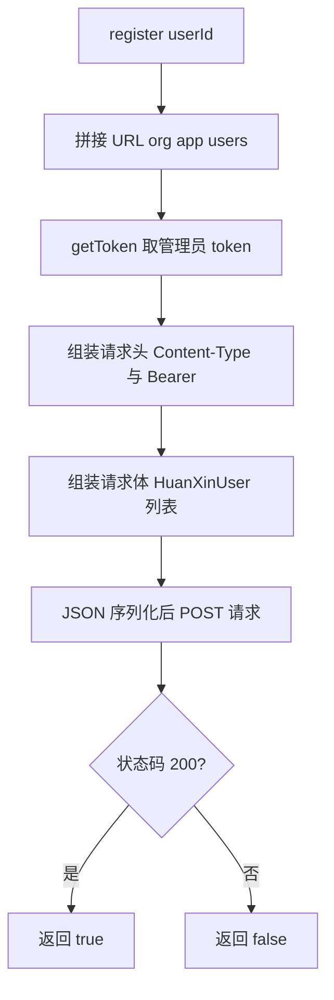

# 注册环信用户：授权注册接口、登录链路挂载与全链路验证

> 🔒 安全提示：文中示例的口令/密钥均为课程教学环境演示口径，生产环境的安全要求见《安全与合规须知》。

管理员 token 就位之后，用户体系集成的第一个实质动作是把平台用户登记到环信。探花交友的用户落在自己的 `tb_user` 表里，环信侧对此一无所知，聊天通道要用起来，两侧的账号必须一一建起来。注册模式此前已定为授权注册，这个登记动作只能由服务端携带 token 发起，客户端与浏览器都无权直接在环信造账号。这一节把注册实现成服务方法，挂进 SSO 的登录注册链路，再从发送验证码一路测到环信控制台的用户列表。

## 先给结论

- 注册环信用户的接口是 `POST /{org_name}/{app_name}/users`，请求体是用户对象数组，单个注册与批量注册共用同一个地址。
- 授权注册必须携带两个请求头：`Content-Type: application/json` 与 `Authorization: Bearer <token>`，缺 token 直接被拒。
- 映射规则沿用既定口径：环信用户名取平台用户 id 的字符串形式，密码按固定盐值做 MD5 生成，规则全工程只此一份。
- 挂载点在 SSO 的登录逻辑：手机号未注册则插入新用户，拿到 id 之后立刻调用注册方法，平台账号与环信账号在同一个流程里同步产生。
- REST 返回 200 即注册成功；课程实现按 boolean 收敛，生产视角还要补上「用户已存在视为幂等成功」与失败重试。

## 一、接口契约：一个地址包办单个与批量注册

环信开发文档的用户管理章节里，注册相关的接口按能力逐条列出：

```text
注册单个用户        /{org_name}/{app_name}/users
批量注册用户        /{org_name}/{app_name}/users
设置用户属性        /{org_name}/{app_name}/users/{username}
设置用户禁用状态    /{org_name}/{app_name}/users/{username}
```

注册单个用户与批量注册用户写的是同一个地址，差别只在请求体：放一个用户对象就是单个注册，放数组就是批量注册。后面的属性、禁用等操作则以 `users/{username}` 定位到具体用户。探花交友选的是授权注册，调用前必须持有一个有效的管理员 token，开放注册模式虽然免 token，但账号入口不受控，前面已经明确不用。

请求体里的用户对象只需两个必填字段，`username` 与 `password`，昵称等字段可选：

```json
[
  {
    "username": "102",
    "password": "md5 生成的托管密码"
  }
]
```

注册成功时环信按原样回显用户对象数组，字段包括 `uuid`、`type`、`created`、`modified`、`activated`、`username` 等，工程实现里不需要逐个消费这些字段，状态码就够用了。用 curl 表达整个请求：

```bash
curl -X POST "http://a1.easemob.com/example-org/tanhua/users" \
  -H "Content-Type: application/json" \
  -H "Authorization: Bearer example-admin-token" \
  -d '[{"username": "102", "password": "example-md5-password"}]'
```

## 二、编码实现：HuanXinService.register

与环信的全部交互收敛到一个 `HuanXinService` 里，注册方法是它的第一个方法。先看流程全貌：



完整实现如下：

```java
package com.study.tanhua.sso.service;

import com.fasterxml.jackson.databind.ObjectMapper;
import com.study.tanhua.sso.config.HuanXinConfig;
import org.apache.commons.codec.digest.DigestUtils;
import org.springframework.beans.factory.annotation.Autowired;
import org.springframework.http.HttpEntity;
import org.springframework.http.HttpHeaders;
import org.springframework.http.ResponseEntity;
import org.springframework.stereotype.Service;
import org.springframework.web.client.RestTemplate;

import java.util.ArrayList;
import java.util.List;

@Service
public class HuanXinService {

    private static final ObjectMapper MAPPER = new ObjectMapper();

    @Autowired
    private HuanXinConfig huanXinConfig;

    @Autowired
    private RestTemplate restTemplate;

    @Autowired
    private HuanXinTokenService huanXinTokenService;

    /**
     * 注册环信用户
     * @param userId 平台自己的用户 id
     */
    public boolean register(Long userId) {
        // 地址与取 token 只差最后一段，users 替换 token
        String url = this.huanXinConfig.getUrl()
                + this.huanXinConfig.getOrgName() + "/"
                + this.huanXinConfig.getAppName() + "/users";

        String token = this.huanXinTokenService.getToken();

        // 请求头信息：内容类型与认证
        HttpHeaders httpHeaders = new HttpHeaders();
        httpHeaders.add("Content-Type", "application/json");
        httpHeaders.add("Authorization", "Bearer " + token);

        // 请求体：username 用平台用户 id，密码按固定规则生成
        List<HuanXinUser> huanXinUsers = new ArrayList<>();
        huanXinUsers.add(new HuanXinUser(userId.toString(),
                DigestUtils.md5Hex(userId + "_tanhua")));

        try {
            // 请求体序列化为 JSON 字符串，与请求头一起装进 HttpEntity
            HttpEntity<String> httpEntity =
                    new HttpEntity<>(MAPPER.writeValueAsString(huanXinUsers), httpHeaders);
            // 发起请求，返回状态码是否为 200
            ResponseEntity<String> responseEntity =
                    this.restTemplate.postForEntity(url, httpEntity, String.class);
            return responseEntity.getStatusCodeValue() == 200;
        } catch (Exception e) {
            e.printStackTrace();
        }
        return false;
    }
}
```

配套的用户对象只有两个字段，与上一节概念篇里环信 ID 的数据结构完全对应：

```java
@Data
public class HuanXinUser {

    // 环信 ID，即 IM 用户名，在 AppKey 范围内唯一
    private String username;

    // 用户登录环信使用的密码
    private String password;
}
```

几个实现细节值得停下来看。**URL 的拼接与取 token 同构。** 配置里的 `url` 尾部自带斜杠，后面续 `orgName`、`appName`，最后一段由 `/token` 换成 `/users`，斜杠多一个少一个都会 404。**token 复用缓存。** `getToken()` 内部先查 Redis，注册链路在这里不需要关心 token 从哪来，也不担心触发取 token 的频率限制。**`Bearer` 前缀必须带。** `Authorization` 头的值是 `Bearer ` 加 token，单词与空格都不能省，环信靠它识别凭证类型，漏掉前缀会被当作无凭证拒绝。**请求体走数组形态。** 单个注册与批量注册共用地址，将来要把历史存量用户批量补注册到环信，把列表装满一次性提交即可，代码结构不用动。**密码规则固定。** `md5Hex(userId + "_tanhua")` 是托管密码的生成规则，用户不知道也不需要知道，这个表达式后面还会在凭证下发的接口里出现一次，两处必须一字不差。

## 三、挂进登录链路：注册平台账号的同时注册环信账号

注册环信用户的触发时机不是另开一个入口，而是嵌进既有的验证码登录逻辑。`UserService.login` 里，手机号查不到用户就走注册分支：

```java
public String login(String mobile, String code) {
    // 校验验证码（略）：从 Redis 取出 CHECK_CODE_ + mobile 比对
    Boolean isNew = false; // 默认已注册
    QueryWrapper<User> queryWrapper = new QueryWrapper<>();
    queryWrapper.eq("mobile", mobile);
    User user = this.userMapper.selectOne(queryWrapper);
    if (null == user) {
        // 该手机号未注册，进行注册操作
        user = new User();
        user.setMobile(mobile);
        // 默认密码
        user.setPassword(DigestUtils.md5Hex("123456"));
        this.userMapper.insert(user);
        isNew = true;
        // 注册用户到环信平台
        this.huanXinService.register(user.getId());
    }

    Map<String, Object> claims = new HashMap<>();
    claims.put("mobile", mobile);
    claims.put("id", user.getId());
    // 生成 token
    String token = Jwts.builder()
            .setClaims(claims)
            .signWith(SignatureAlgorithm.HS256, secret)
            .compact();
    // 省略后续封装返回
}
```

调用点放在 `insert` 之后不是随手一放：环信用户名要用平台用户 id 拼出来，MyBatis-Plus 的 `insert` 会把数据库生成的主键回填到实体上，`register(user.getId())` 才拿得到值。顺序颠倒一次，环信侧就会多出一个用户名为 `null` 的脏用户。

## 四、测试验证：从验证码到控制台的两条路径

单测路径直接调方法，debug 观察：

```java
@SpringBootTest
@RunWith(SpringRunner.class)
public class TestHuanXinService {

    @Autowired
    private HuanXinService huanXinService;

    @Test
    public void testRegister() {
        boolean register = this.huanXinService.register(100L);
        System.out.println(register);
    }
}
```

断点里依次确认：拼出的 URL 三段完整、`getToken()` 返回非空、两个请求头就位、请求体是包含一个对象的 JSON 数组、响应状态码 200。随后刷新环信控制台的 IM 用户列表，用户 `100` 出现，控制台里还能对它做修改信息、查看好友与黑名单、重置密码、发送 REST 消息等操作，说明这个用户在环信侧已经是可用的完整账号。第一次执行明显偏慢，那一次请求里包含了取 token 的远程调用，属于预期行为。

全链路路径更贴近真实场景：REST 客户端把请求发往 Nginx 入口，由它转发到 SSO 服务。发送验证码、提交手机号与验证码登录，断点停在 `register(user.getId())`，数据库 `tb_user` 里多出 id 为 `102` 的新用户，登录返回自家 token；再刷新环信控制台，用户 `102` 同样在列。平台账号与环信账号由同一次登录动作同步产生，用户体系集成的主链路就此打通。

## 五、失败重试与幂等：生产视角的补强

课程实现把结果收敛成 boolean，非 200 与异常统一返回 false，测试与教学足够用。放到生产环境，这一段还要补两种情况，以下口径按主流写法给出。

**失败重试。** 注册失败最常见的原因是网络抖动与 token 恰好失效。处理方式：先重试一次注册；若响应是 401，说明 Redis 里的管理员 token 已失效，删掉缓存键重新 `getToken()` 后再试一次，仍然失败才放弃并记录告警。登录主流程不必因环信注册失败而失败，token 照常颁发，但要留下待补偿的痕迹。

**幂等处理。** 重复注册同一个 username，环信返回 400，错误体里给出类似 `duplicate_unique_property` 的唯一约束冲突信息。对这类响应应视为「用户已存在」，按成功处理，而不是当成失败去反复重试。上面的实现只看状态码，重试时会把这个情况误判为持续失败，改进方向是解析错误体，把「已存在」与「参数错误」分开。再加上一条对账兜底：定期用环信的用户查询接口核对两侧用户集合，缺谁补谁，下一篇的查询接口正好承担这个角色。

## 常见误区

- **密码规则两处不一致。** 错例：注册时用 `userId + "_tanhua"`，下发凭证时写成别的盐值，APP 拿着凭证登录环信始终密码错误。正解：生成规则抽成公共工具方法，注册与下发引用同一份代码。
- **在 insert 之前调用注册。** 错例：`register(user.getId())` 提前，id 还是 null，环信侧注册出用户名为 `null` 的账号。正解：放在 `insert` 之后，确保主键已回填。
- **`Authorization` 头漏掉 `Bearer` 前缀。** 错例：只拼 token 值，环信返回 401，误以为 token 没取到。正解：按 `Bearer ` 加 token 的格式拼，联调时打印请求头核对。
- **把 400 一律当注册失败。** 错例：重复注册触发唯一约束冲突后无限重试。正解：解析错误体，`duplicate_unique_property` 类响应视为已存在，按幂等成功处理。

## 面试可能被问到的问题

1. 面试官追问：「为什么用户注册平台账号时必须同步注册环信用户？」
   答：聊天功能依赖环信的长连接通道，而环信只认自己体系里的用户。探花交友选了授权注册模式，注册权收在服务端，用户落库之后立刻以平台用户 id 为环信用户名调用注册接口，两侧账号一一对应。不同步注册，用户第一次进聊天页就会因为环信侧没有账号而不可用。
2. 面试官追问：「环信的用户名和密码是怎么定的，为什么用户不需要知道？」
   答：用户名取平台用户 id 的字符串，天然满足环信对用户名的字符与唯一性限制；密码是注册时按固定盐值 MD5 生成的托管密码。两者都由服务端掌握并按需下发给 APP，用户全程无感知。这样映射零成本，凭证不暴露给用户也避免用户在环信侧自行登录绕开平台。
3. 面试官追问：「注册环信用户失败了怎么处理？」
   答：网络抖动做有限次重试，遇到 401 先删 token 缓存重新获取再重试；重复注册返回的唯一约束冲突按幂等成功处理。注册失败不影响登录主流程，但要记录待补偿标记，靠定期对账把漏注册的用户补齐。
4. 面试官追问：「注册接口的请求体为什么设计成数组？」
   答：环信把单个注册与批量注册做在同一个地址上，请求体是用户对象数组。当前业务每次只注册一个，放一个元素的数组即可；将来要把存量用户批量迁移或补注册，同一个方法改一下入参就能复用，不必再写一套批量逻辑。
5. 面试官追问：「为什么注册动作放在 SSO 的登录链路里，而不是让客户端调环信 SDK 自行注册？」
   答：授权注册模式下客户端没有注册权，也没有管理员凭证，把凭证下发到端上等于把整个应用的管理权交出去。注册入口收在服务端，账号产生的时机与平台注册严格同步，映射规则、失败处理、审计日志都集中在一处，安全与可维护性都在服务端闭环。

## 配套资料

- 学习目标：`materials/code/07/day05 探花交友-实现消息功能/day05/学习目标.md`，「独立实现环信的用户体系集成」为本日目标，注册环信用户是其中的核心一步。
- 原型：`materials/code/07/day01 探花交友-项目搭建以及登录完善个人信息/day01/资料/探花交友移动端原型V1.2/消息.html`，消息模块的页面形态出处。
- 说明：day05 资料包仅含学习目标，无工程源码，正文代码按课程画面与讲解逐段整理补全，包名统一改写为 `com.study.tanhua` 系；重试与幂等一节为按主流写法补全的工程口径；测试涉及的手机号等敏感信息已打码。
