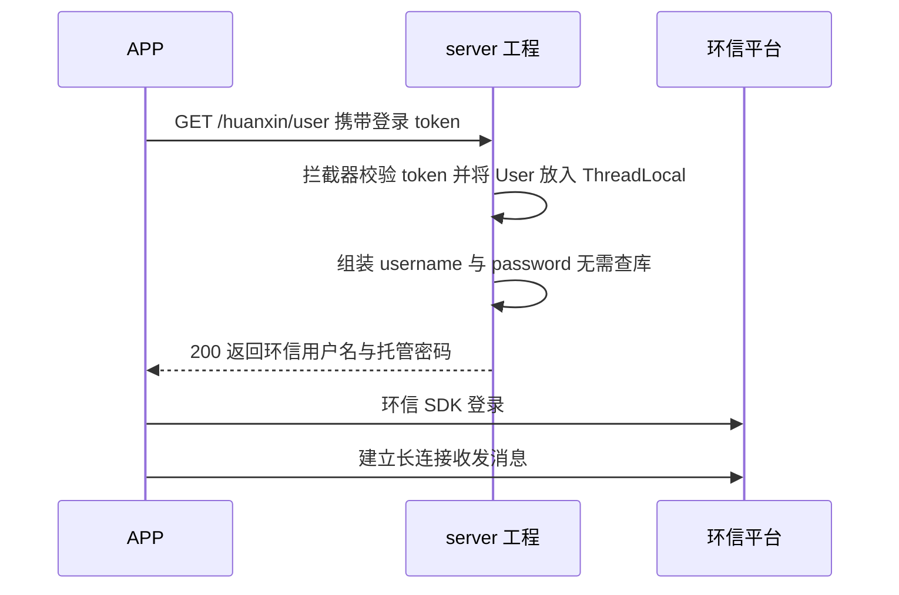

# 查询环信用户信息：给 APP 下发 IM 凭证与两侧用户对账

> 🔒 安全提示：文中示例的口令/密钥均为课程教学环境演示口径，生产环境的安全要求见《安全与合规须知》。

注册链路打通之后，环信侧已经有了与平台一一对应的用户，还剩最后一环没有闭合：登录环信 SDK 需要用户名和密码，而这两样凭证只存在于服务端的生成规则里，APP 端一无所知。要让 APP 自己建立环信长连接、收发消息，服务端必须提供一个查询接口，把当前登录用户的环信凭证按需下发。这个接口是用户体系集成的出口，也是后面所有聊天功能的地基。

## 先给结论

- 凭证下发接口定为 `GET /huanxin/user`，返回 `username` 与 `password` 两个字段，实现在 server 工程的 `HuanXinController`。
- 当前用户从 ThreadLocal 取：登录校验环节解析 token 后把 `User` 放进 ThreadLocal，控制器一行 `UserThreadLocal.get()` 拿到，无需任何入参。
- 返回值的生成规则必须与注册侧完全一致：`username` 为平台用户 id 字符串，`password` 为 `md5Hex(userId + "_tanhua")`，两侧规则一致是这套设计的命门。
- 接口零数据库查询，凭证全部能从用户 id 推导出来，直接组装返回。
- server 工程依赖 SSO 的 dubbo 服务，启动顺序是 ZooKeeper、SSO 提供方、server；验证时先登录拿 token，再携带 token 调本接口。

## 一、为什么要下发凭证：环信登录的入口在 APP

环信的聊天长连接由 APP 通过环信 SDK 建立，SDK 登录要传用户名与密码。这两个值有一个约定好的来源：用户名是平台用户 id 的字符串，密码是注册环信用户时按固定规则生成的托管密码。它们都由服务端掌握，APP 里没有，所以接口契约在原型的接口文档里定为：

```text
接口名称    环信用户信息
请求路径    GET /huanxin/user
返回字段    username  环信用户名
            password  环信密码
```

一次完整调用的时序如下：



关键路径在第二与第三个箭头：token 校验由统一的拦截器完成，凭证组装靠内存里的用户对象直接推导，整个过程没有一次远程调用，也没有一次数据库访问。

## 二、编码实现：HuanXinController

接口写在 server 工程的控制器层：

```java
package com.study.tanhua.server.controller;

import com.study.tanhua.server.pojo.User;
import com.study.tanhua.server.vo.HuanXinUser;
import org.apache.commons.codec.digest.DigestUtils;
import org.springframework.http.ResponseEntity;
import org.springframework.web.bind.annotation.GetMapping;
import org.springframework.web.bind.annotation.RequestMapping;
import org.springframework.web.bind.annotation.RestController;

@RestController
@RequestMapping("huanxin")
public class HuanXinController {

    /**
     * 查询当前登录用户的环信用户信息（用户名与密码）
     */
    @GetMapping("user")
    public ResponseEntity<HuanXinUser> queryUser() {
        HuanXinUser huanXinUser = new HuanXinUser();
        User user = UserThreadLocal.get();
        huanXinUser.setUsername(user.getId().toString());
        huanXinUser.setPassword(DigestUtils.md5Hex(user.getId() + "_tanhua"));
        return ResponseEntity.ok(huanXinUser);
    }
}
```

返回对象与 SSO 工程注册时用的是同一份结构：

```java
@Data
public class HuanXinUser {

    // 环信用户名，即平台用户 id 的字符串
    private String username;

    // 环信密码，注册时按固定规则生成的托管密码
    private String password;
}
```

三个实现要点展开说。**`UserThreadLocal` 是既有的统一登录方案的产物。** 请求进入 server 工程时，拦截器解析请求头里的 JWT，还原出用户对象放进 ThreadLocal，请求链路上的控制器随时可以取到当前用户。`queryUser` 不接收任何参数，当前用户身份由 token 决定，这在结构上杜绝了越权枚举他人凭证的可能。**密码表达式与注册侧一字不差。** `DigestUtils.md5Hex(user.getId() + "_tanhua")` 与 SSO 工程 `HuanXinService.register` 里的写法完全相同，这两处一旦不一致，APP 拿到的凭证就是无效的。更稳的做法是把环信用户名与密码的生成规则抽成公共工具类，让注册与下发引用同一份代码，编译期就锁死一致性。**零查询是特性而非偷懒。** 用户名是 id 转字符串，密码是 id 加盐做 MD5，两个值都是 id 的纯函数，接口自然不需要任何 IO，响应延迟基本只剩网络开销。

## 三、测试验证：登录、下发、SDK 登录三步走

server 工程依赖 SSO 对外提供的 dubbo 服务，测试前的启动顺序要遵守：ZooKeeper 注册中心先起，SSO 工程作为 dubbo 提供方注册服务，server 工程再启动并消费服务，课程环境是 dubbo 2.6.4 加 ZooKeeper 3.4.13。

验证从登录开始。REST 客户端把请求发往 Nginx 入口，先请求发送验证码，再提交手机号与验证码完成登录，拿到平台颁发的 token。随后携带 token 请求凭证接口：

```bash
curl "http://example-tanhua-server.com/huanxin/user" \
  -H "Authorization: example-jwt-token"
```

返回内容与预期一致：

```json
{
  "username": "102",
  "password": "md5 生成的托管密码，此处打码"
}
```

用户名正是登录用户的 id `102`，密码是与注册侧规则一致的 MD5 值。这个接口交给 APP 后，APP 用拿到的凭证调用环信 Android SDK 的登录方法，长连接建立即可收发消息，用户对整个凭证获取与登录过程完全无感知。

## 四、环信侧的用户查询与两侧对账

服务端向 APP 下发凭证查的是自己内存里的规则，有时还需要查环信侧的用户数据本身，典型场景是对账：核对平台 `tb_user` 与环信侧的用户集合是否一致，找出漏注册或多余的账号。按环信公开接口的口径，这类查询有两个入口（以下为按主流写法补全的示例）：

```bash
# 查询单个环信用户，username 即环信用户名
curl "http://a1.easemob.com/example-org/tanhua/users/102" \
  -H "Authorization: Bearer example-admin-token"

# 分页获取全部环信用户，limit 控制每页条数，翻页用响应里的 cursor 续传
curl "http://a1.easemob.com/example-org/tanhua/users?limit=100" \
  -H "Authorization: Bearer example-admin-token"
```

查单用户按 `users/{username}` 定位，用户不存在时环信返回 404，对账逻辑里要把 404 解释为「环信侧缺失该账号」而不是当作异常抛出。查全部用户是分页接口，`limit` 设置每页条数，响应携带 `cursor` 游标，把它拼到下一次请求里即可翻页，直到取完为止。对账的实现思路很直接：分页拉全环信用户名集合，与平台用户 id 集合做差集，缺的补注册，多的告警排查。注册篇提到的幂等补注册，正好由这套差集结果驱动。

安全边界也要交代清楚。凭证接口必须挂在统一登录校验之后，未登录请求拿不到 ThreadLocal 里的用户对象，接口无法响应；接口只返回当前登录人自己的凭证，不提供任何按 id 查他人的入口；托管密码虽然不是用户的平台密码，同样属于敏感数据，生产链路走 HTTPS 传输，日志里不打印明文。

## 常见误区

- **下发规则与注册规则不一致。** 错例：server 侧盐值或拼接方式与 SSO 注册处不同，凭证下发正常但 SDK 登录永远失败。正解：规则抽成公共工具类，两侧引用同一份代码。
- **接口暴露成无鉴权。** 错例：图省事在测试时跳过登录校验，任何人不带 token 都能拿凭证。正解：接口依赖统一的 token 拦截器，当前用户身份只能来自 token 解析结果。
- **提供按参数查任意用户凭证的能力。** 错例：接口设计成 `GET /huanxin/user/{userId}`，遍历 id 就能拿全站 IM 凭证。正解：只查当前登录人，越权面在接口形状上就封死。
- **把环信查询的 404 当异常。** 错例：对账脚本遇到 404 直接中断。正解：404 是「环信侧无此用户」的正常表达，正是要找出来的漏注册账号。
- **以为查环信信息就要调环信 REST。** 错例：下发凭证接口里先远程取一次环信用户数据再返回。正解：凭证是平台 id 的纯函数，本地推导即可，远程查询只用于对账类需求。

## 面试可能被问到的问题

1. 面试官追问：「APP 是怎么拿到环信登录凭证的？」
   答：服务端提供 `GET /huanxin/user` 接口，APP 登录平台后携带 token 调用，接口从 ThreadLocal 取当前用户，用既定规则生成环信用户名与托管密码返回。APP 拿到凭证后调用环信 SDK 登录，长连接建立后即可收发消息，用户全程无感知。
2. 面试官追问：「这个接口为什么不需要查数据库？」
   答：环信用户名是平台用户 id 的字符串形式，托管密码是 id 加固定盐值做 MD5 的结果，两个值都是用户 id 的纯函数。注册时按这个规则生成，查询时按同样规则现场推导，天然一致，也省掉了所有 IO。
3. 面试官追问：「凭证接口怎么防止越权？」
   答：第一道防线是接口形状，不接收用户 id 参数，只返回当前登录人的凭证；第二道是统一登录校验，身份来自 token 解析后放入 ThreadLocal 的用户对象，伪造不了。两道加起来，按 id 枚举他人凭证的路径在结构上不存在。
4. 面试官追问：「平台用户和环信用户怎么对账？」
   答：用环信的分页查询接口拉取全部环信用户名集合，`limit` 加 `cursor` 翻页取完，与平台用户 id 集合做差集。环信侧缺的账号说明注册失败或漏注册，触发补注册并按幂等口径处理；平台侧多出的异常账号则告警排查。对账任务定期跑，作为同步链路的兜底。
5. 面试官追问：「如果环信密码规则需要更换，怎么平滑迁移？」
   答：环信提供重置密码的管理接口，迁移时先把生成规则切换到新版本，对存量用户分批调用重置接口把密码刷成新规则的值，再做对账确认。下发接口始终返回当前规则算出的值，APP 侧不需要任何改动，窗口期内的少量登录失败靠重试吸收。
6. 面试官追问：「server 工程为什么要等 dubbo 服务就位才能启动？」
   答：server 是业务消费方，用户校验、消息等功能依赖 SSO 工程通过 dubbo 注册的接口实现，注册中心是 ZooKeeper。启动顺序颠倒会导致服务引用失败，课程环境里先起 ZooKeeper 与 SSO 提供方，再起 server，这个顺序也反映了项目里提供方与消费方的依赖方向。

## 配套资料

- 学习目标：`materials/code/07/day05 探花交友-实现消息功能/day05/学习目标.md`，「独立实现环信的用户体系集成」为本日目标，凭证查询接口是其收尾环节。
- 原型：`materials/code/07/day01 探花交友-项目搭建以及登录完善个人信息/day01/资料/探花交友移动端原型V1.2/消息.html`，消息模块的页面形态出处。
- 说明：day05 资料包仅含学习目标，无工程源码，正文代码按课程画面与讲解逐段整理补全，包名统一改写为 `com.study.tanhua` 系；环信侧查询与对账一节为按环信公开接口口径补全的示例；token 与密码等敏感值已打码。
