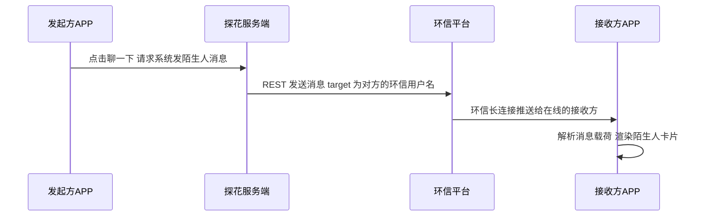

# 给环信客户端发一条消息：消息体结构与陌生人卡片的全链路验证

> 🔒 安全提示：文中示例的口令/密钥均为课程教学环境演示口径，生产环境的安全要求见《安全与合规须知》。

管理员 token、注册用户、凭证下发三步就位之后，环信侧的账号体系已经与平台一一对应。但集成不能只停在接口能通：APP 拿凭证登录环信之后，有没有真的建立长连接、能不能收到消息，要有一条真实消息从服务端飞过去才算数。业务上最典型的触发场景是「聊一下」：用户在别人的动态或资料页点下这个按钮，系统代他向对方发出一条陌生人消息，对方的 APP 里弹出一张带「聊一下」「算了吧」按钮的卡片。聊天页面尚未开发，课程用手动方式模拟系统发送，通道验证的目标不变。

## 先给结论

- 给指定用户发消息走环信 REST：`POST /{org_name}/{app_name}/messages/users`，`target` 数组指定环信用户名，管理员 token 鉴权。
- 陌生人消息的业务载荷是一段 JSON 文本，包含操作人 userId、昵称、问题与答案，APP 按约定解析后渲染卡片。
- 环信控制台用户列表里的「发送消息」与 REST 调用效果一致，页面未开发前用它当测试替身最直接。
- APP 收到这条消息即证明三件事：下发凭证有效、环信长连接已建立、消息通道可用，用户体系集成至此闭环。
- 后续「聊一下」按钮的服务端实现，就是把这一步的手动发送换成正式的 REST 调用。

## 一、业务场景：这条消息由系统代发

「聊一下」是探花交友的破冰动作。看到一位陌生人的动态或资料后点击「聊一下」，按产品设定系统会替用户向对方发一条陌生人消息：内容是一段带着问题与答案的自我介绍，对方可以选择回应成为好友，也可以忽略。这条消息不走用户之间的 IM 会话，因为双方还不是好友，发送方是系统，落点是对方 APP 的消息模块。

消息链路用一张时序图表达：



图的第二段是本课要验证的核心：服务端向环信发一条 REST 消息，环信经长连接推给接收方。此刻「聊一下」的页面与接口都还没实现，于是第一段被砍掉，直接以服务端身份手动发送，用最小代价先证明第二段通道是通的。

## 二、消息怎么发：REST 契约与业务载荷

环信发送单聊消息的 REST 契约如下（接口口径按环信公开文档整理）：

```text
POST /{org_name}/{app_name}/messages/users
请求头       Content-Type: application/json
             Authorization: Bearer <管理员token>
target_type  发送目标类型，users 表示单聊
target       环信用户名数组，可一次发给多人
from         发送方环信用户名，缺省为管理员账号
msg          消息正文，type 取 txt 时 msg 字段为文本内容
ext          扩展字段，随消息原样透传给接收方
```

陌生人卡片要展示的不是一个句子，而是一组结构化数据：谁发来的（userId 与昵称）、问题是什么、答案是哪句。课程把这些打包成一段 JSON 文本作为消息正文发出（字段名按画面与讲解整理，属示例口径）：

```json
{
  "userId": "101",
  "nickname": "example-nickname",
  "question": "很高兴认识你，愿意交个朋友吗？",
  "answer": "愿意"
}
```

APP 端与后端约定：收到 txt 消息先尝试按 JSON 解析，解析成功就渲染陌生人卡片，失败就按普通文本展示。这个约定让一条消息同时容纳两种形态，页面改造期间的历史消息也不会渲染异常。若走 REST 发送，这段载荷也可以放进 `ext` 扩展字段，正文只留一句提示语，信封与业务数据分离，是更规范的工程做法。

curl 形态的完整请求如下，接收方的环信用户名就是平台用户 id 的字符串：

```bash
curl -X POST "http://a1.easemob.com/example-org/tanhua/messages/users" \
  -H "Content-Type: application/json" \
  -H "Authorization: Bearer example-admin-token" \
  -d '{"target_type": "users", "target": ["102"], "from": "101", "msg": {"type": "txt", "msg": "陌生人消息载荷"}}'
```

鉴权复用管理员 token 的既有成果：`Authorization` 头里的 token 由 `HuanXinTokenService.getToken()` 从 Redis 缓存取出。将来正式实现「聊一下」时，服务端的发送动作就是一个携带该 token 的 REST 调用，与注册环信用户同属一类服务端动作，账号体系与消息体系共用同一套凭证底座。

## 三、通道验证：从装 APK 到收到卡片

测试前的检查有两项。服务侧确认 SSO 工程配置里的环信 AppKey 与自己注册的应用一致，配置文件在 SSO 的 resources 目录下，具体值属敏感信息此处打码；模拟器侧把课程提供的调试版 APK 拖进 Genymotion 安装，启动后用既定测试手机号（打码）加固定验证码登录，课程环境的验证码为 123456。登录成功进入消息模块，此时页面空空如也，列表接口尚未实现，环信是否登录成功也无从看出，这正是本课要消灭的盲区。

发送走环信控制台。打开管理后台的 IM 用户列表，找到用户 `102`，点「发送消息」，把上面的 JSON 载荷粘进输入框点击发送，控制台立即返回成功。稍等片刻，模拟器的消息模块弹出一条新消息，展开正是预期中的卡片：发送者用户名、头像、问题、答案依次排开，底部两个按钮，点「聊一下」成为好友，点「算了吧」什么都不做。

收到这条消息的瞬间，前几步的成果同时得到验证：APP 用 `/huanxin/user` 下发的凭证登录环信成功，凭证生成规则两侧一致；环信长连接已建立，SDK 在后台持续在线；消息通道可用，服务端随时可以把系统消息准确投递给指定用户。用户体系集成的最后一环就此闭合，后面添加联系人、聊天页面的实现全部站在这条通道上。

## 常见误区

- **收不到消息先怀疑发送端。** 错例：控制台返回成功但 APP 没反应，反复重发并逐字检查载荷。正解：先确认 APP 是否真的登录环信成功，凭证规则、AppKey 配置两侧是否一致，长连接在不在。
- **把业务载荷当纯文本。** 错例：APP 把 JSON 字符串原样渲染成消息气泡。正解：按约定先解析再渲染卡片，解析失败兜底展示原文。
- **target 用错身份。** 错例：发送时填了自造账号而不是环信用户名，消息投给不存在的人。正解：target 必须是环信用户名，本项目即平台用户 id 的字符串，两侧映射规则保持一致。
- **每次发送都重新取 token。** 错例：正式实现里调一次发送就请求一次 token，触发环信的频率限制。正解：复用 Redis 缓存的管理员 token，遇到 401 删缓存重取。
- **载荷越塞越多。** 错例：把完整用户资料整包塞进消息正文。正解：只传渲染必需的字段，大字段给 id 让端上回查，控制单条消息体积。

## 面试可能被问到的问题

1. 面试官追问：「系统给指定用户发一条 IM 消息，具体怎么实现？」
   答：调环信 REST 的发送消息接口，地址 `/{org_name}/{app_name}/messages/users`，请求头带管理员 token，`target` 数组填接收方的环信用户名，业务数据放在消息正文或 `ext` 扩展字段。发送方是系统身份，与管理员注册用户属于同一类服务端动作。
2. 面试官追问：「为什么把消息通道托管给环信，而不是自己维护长连接？」
   答：长连接要处理移动网络切换、心跳保活、离线消息、多端同步、投递可靠性等一整套问题，自研成本高且难做稳。环信作为 IM 服务商把这些做成托管能力，业务方只在关键节点调 REST 接口，把资源留给业务本身。
3. 面试官追问：「消息里的自定义业务载荷怎么设计比较合理？」
   答：分层设计，信封字段用环信标准结构，业务数据放 `ext` 或约定的 JSON 正文，只传渲染必需的 id 与轻量字段，头像昵称可以让端上拿 id 回查。要预留版本信息，载荷结构升级时老版本 APP 也能安全降级成普通文本展示。
4. 面试官追问：「控制台发送消息和 REST 发送有什么区别？」
   答：链路与投递效果一致，差别在发送身份与触发方式：控制台是管理员在后台手动操作，REST 是服务端代码按业务逻辑自动触发。开发期用控制台当测试替身，上线时把同样的载荷换成 REST 调用，两者还能互相验证。
5. 面试官追问：「怎么证明 APP 与环信的长连接真的建立了？」
   答：最直接的证据是 APP 能实时收到下发的消息，收到即说明登录成功且连接存活。辅助手段包括环信后台的用户在线状态与 SDK 的连接状态回调。这条验证的价值在于把凭证、登录、推送三段链路一次串起来测了。

## 配套资料

- 学习目标：`materials/code/07/day05 探花交友-实现消息功能/day05/学习目标.md`，「独立实现环信的用户体系集成」为本日目标，发送消息验证是其收尾环节。
- 原型：`materials/code/07/day01 探花交友-项目搭建以及登录完善个人信息/day01/资料/探花交友移动端原型V1.2/消息.html`，消息模块与陌生人卡片的页面形态出处。
- 说明：day05 资料包仅含学习目标，无工程源码，正文接口契约与消息载荷按课程画面与讲解整理补全并已注明示例口径；AppKey、手机号、token 等敏感值已打码。
