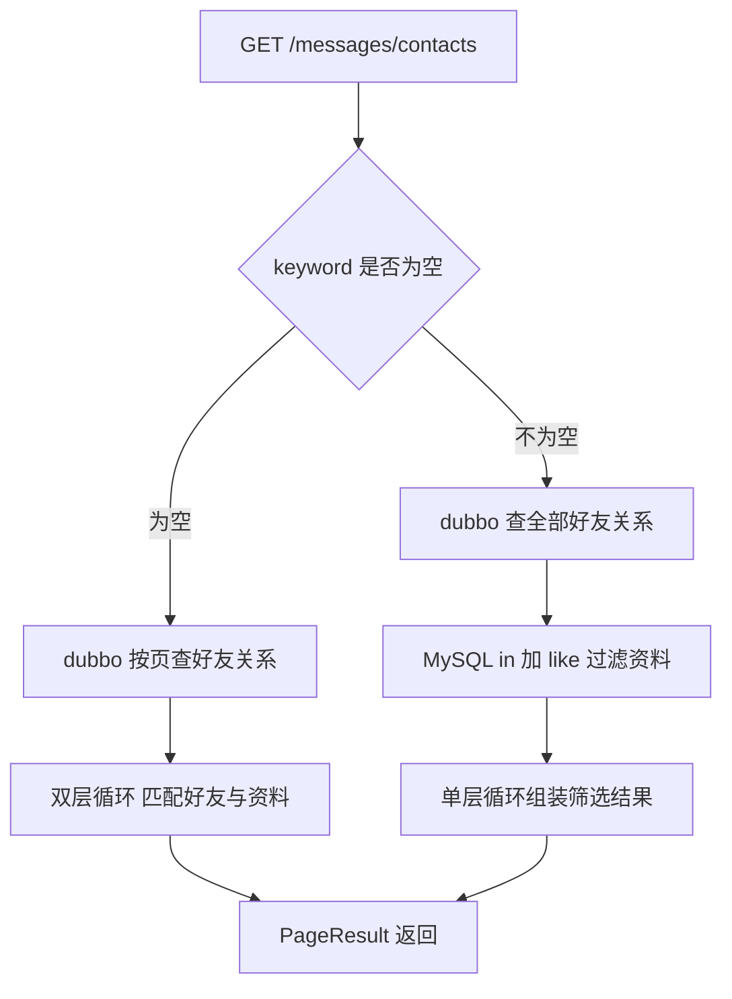

# 联系人列表：跨 MongoDB 与 MySQL 的好友分页与关键字搜索

消息模块的第二块拼图是联系人列表：左侧一列好友，支持按昵称搜索，点击任一人进入聊天。接口本身不复杂，难在数据分布：好友关系存在 MongoDB，昵称存在 MySQL，分页与搜索没法在同一处完成，取数被拆成两条路径。这一课把两条路径都走通，顺带看清课程用 MySQL 的 like 查询顶替全文检索的取舍。

## 先给结论

- 接口契约 `GET /messages/contacts`，参数 `page`、`pageSize`、`keyword`，返回统一 `PageResult`，元素为 `Contacts`。
- dubbo 的 UsersApi 补两个方法：`queryUsersList` 按页取好友关系，`queryAllUsersList` 取全部好友关系，关键字搜索必须用后者。
- 根因在昵称：MongoDB 的关系集合里没有昵称字段，模糊匹配只能去 MySQL 的用户资料表做，分页与搜索无法一步完成。
- 两条装配路径：无关键字走 Mongo 分页加双层循环匹配，有关键字走全量好友加 MySQL 过滤加单层循环组装。
- 课程未集成全文检索，用 like 查询实现搜索；生产项目应在 Elasticsearch 这类搜索引擎上做昵称检索。

## 一、接口契约与数据分布

mock 契约先立好，路径、参数与返回结构按原型接口文档整理：

```text
接口名称    联系人列表
请求路径    GET /messages/contacts
请求参数    page      当前页码
            pageSize  页大小
            keyword   搜索关键字，可空
返回        分页结构，items 为联系人数组
```

元素对象按契约字段新建 `Contacts`，落在 server 工程的 vo 包里：

```java
@Data
public class Contacts {

    //关系 id，契约里非必填，本接口不赋值
    private String id;
    //好友的用户 id
    private String userId;
    private String nickname;
    //性别，取 man 或 woman
    private String gender;
    private String avatar;
    private Integer age;
    //城市，只保留市一级，如 上海
    private String city;
}
```

接口要横跨的两个数据源分工明确：好友关系（谁和谁是好友）在 MongoDB 的关系集合，`Users` 对象持有 `userId` 与 `friendId`，day03 查询好友动态时已经在消费它；用户资料（昵称、头像、年龄、城市）在 MySQL 的 `tb_user_info` 表，对应 `user_id`、`nick_name`、`sex`、`age`、`city` 字段。搜索难点的根子就在这：MongoDB 的关系集合不存昵称，按昵称过滤不能塞进 Mongo 的分页查询里，必须先拿到好友的 id 集合，再到 MySQL 用 `in` 加 `like` 一次筛完。两条取数路径由此而来：



## 二、dubbo 侧：一个接口补两个方法

在既有的 UsersApi 里定义两个方法：

```java
/**
 * 查询用户的所有好友关系（关键字搜索场景使用）
 */
List<Users> queryAllUsersList(Long userId);

/**
 * 分页查询用户的好友关系
 */
PageInfo<Users> queryUsersList(Long userId, Integer page, Integer pageSize);
```

实现都很薄，差别只在分页与排序：

```java
@Override
public List<Users> queryAllUsersList(Long userId) {
    Query query = Query.query(Criteria.where("userId").is(userId));
    return this.mongoTemplate.find(query, Users.class);
}

@Override
public PageInfo<Users> queryUsersList(Long userId, Integer page, Integer pageSize) {
    //最新添加的好友排最前，页码从 1 转成 0 基
    PageRequest pageRequest = PageRequest.of(page - 1, pageSize,
            Sort.by(Sort.Order.desc("created")));
    Query query = Query.query(Criteria.where("userId").is(userId));
    query.with(pageRequest);
    List<Users> usersList = this.mongoTemplate.find(query, Users.class);
    PageInfo<Users> pageInfo = new PageInfo<>();
    pageInfo.setTotal(0);
    pageInfo.setPageSize(pageSize);
    pageInfo.setPageNum(page);
    pageInfo.setRecords(usersList);
    return pageInfo;
}
```

排序方向是产品语义：联系人列表让最近添加的好友排前面，`created` 倒序。返回 `PageInfo` 而不是裸 List，是让消费方一次拿到页码、页大小与数据集，`total` 置 0 沿用项目口径，端上靠上拉翻页，不依赖总数。

## 三、接口服务装配：两条路径一个出口

装配逻辑全部落在 server 工程的 IMService 里，先看主干：

```java
public PageResult queryContactsList(Integer page, Integer pageSize, String keyword) {
    PageResult pageResult = new PageResult();
    pageResult.setPage(page);
    pageResult.setPageSize(pageSize);
    pageResult.setPages(0);
    pageResult.setCounts(0);

    User user = UserThreadLocal.get();
    List<Users> usersList;
    if (StringUtils.isNotEmpty(keyword)) {
        //关键字搜索：先取全部好友，昵称过滤只能去 MySQL 做
        usersList = this.usersApi.queryAllUsersList(user.getId());
    } else {
        PageInfo<Users> pageInfo = this.usersApi.queryUsersList(user.getId(), page, pageSize);
        usersList = pageInfo.getRecords();
    }

    //收集好友 id
    List<Long> fUserIds = new ArrayList<>();
    for (Users users : usersList) {
        fUserIds.add(users.getFriendId());
    }

    //批量查资料，关键字时追加昵称模糊匹配
    QueryWrapper<UserInfo> queryWrapper = new QueryWrapper<>();
    queryWrapper.in("user_id", fUserIds);
    if (StringUtils.isNotEmpty(keyword)) {
        queryWrapper.like("nick_name", keyword);
    }
    List<UserInfo> userInfoList = this.userInfoService.queryUserInfoList(queryWrapper);

    List<Contacts> contactsList = new ArrayList<>();
    if (StringUtils.isEmpty(keyword)) {
        //无关键字：以分页后的好友关系为外层，保住 Mongo 的排序语义
        for (Users users : usersList) {
            for (UserInfo userInfo : userInfoList) {
                if (users.getFriendId().longValue() == userInfo.getUserId().longValue()) {
                    contactsList.add(buildContacts(userInfo));
                    break;
                }
            }
        }
    } else {
        //有关键字：资料列表已是筛选结果，单层循环直接组装
        for (UserInfo userInfo : userInfoList) {
            contactsList.add(buildContacts(userInfo));
        }
    }
    pageResult.setItems(contactsList);
    return pageResult;
}

private Contacts buildContacts(UserInfo userInfo) {
    Contacts contacts = new Contacts();
    //城市形如 上海-静安，端上只展示市一级
    contacts.setCity(StringUtils.substringBefore(userInfo.getCity(), "-"));
    contacts.setUserId(userInfo.getUserId().toString());
    contacts.setNickname(userInfo.getNickName());
    contacts.setGender(userInfo.getSex().name().toLowerCase());
    contacts.setAvatar(userInfo.getLogo());
    contacts.setAge(userInfo.getAge());
    return contacts;
}
```

几处细节值得停一下。**两条路径的遍历顺序不是随手写的。** 有关键字时资料列表已经是筛选后的结果，先遍历它，避免对着全量好友列表空转；无关键字时外层必须是分页后的好友关系，否则 Mongo 里定好的最新好友在前就被打乱。**字段翻译各有讲究。** 城市用 `StringUtils.substringBefore` 截掉横杠后的区县；性别由枚举名转小写，对齐契约的 `man` 与 `woman`；`userId` 转字符串，长整型直接给端上会丢精度。**`in` 查询一次取全页资料**，SQL 从每条好友一次收敛到每页一次，N+1 在写代码时就摁住。

控制器按契约接参，keyword 可空：

```java
/**
 * 查询联系人列表
 */
@GetMapping("contacts")
public ResponseEntity<PageResult> queryContactsList(
        @RequestParam(value = "page", defaultValue = "1") Integer page,
        @RequestParam(value = "pageSize", defaultValue = "10") Integer pageSize,
        @RequestParam(value = "keyword", required = false) String keyword) {
    PageResult pageResult = this.imService.queryContactsList(page, pageSize, keyword);
    return ResponseEntity.ok(pageResult);
}
```

## 四、测试：接口与端上联动

REST 客户端先测接口。用既定测试手机号（打码）加固定验证码登录拿 token，携带 token 发 `GET /messages/contacts`，第一轮返回的记录里 age 字段是空的，查资料发现用户 `100` 的年龄本就未填，属于造数遗漏，补上年龄再查，结构完整。第二轮把 keyword 传「波」，返回只剩一条，昵称里带这个字的好友被精确筛出，关键字路径也通了。

端上联动交给模拟器。登录后进消息模块点联系人，列表正常呈现；输入关键字搜索（APP 端当时有偶发无响应的小问题，接口侧已验证可用）；点击任一联系人进入聊天页发消息，能发能收。接口两条路径与端上三个动作对应关系清晰：列表页吃分页路径，搜索框吃关键字路径，聊天页复用环信通道。

## 常见误区

- **关键字场景仍走分页方法。** 错例：keyword 有值也调 `queryUsersList`，命中的好友可能不在当前页，结果残缺。正解：关键字走 `queryAllUsersList` 全量取关系，过滤交给 MySQL。
- **Long 比较用 `==`。** 错例：`users.getFriendId() == userInfo.getUserId()`，数值超出缓存范围时是不同对象，恒为不等，资料填不上。正解：`longValue()` 后比较基本类型。
- **城市原样返回。** 错例：列表里显示「上海-静安」。正解：`substringBefore` 截取横杠前，只给市一级。
- **排序方向写成正序。** 错例：`Sort.Order.asc("created")`，联系人顺序与添加时间对不上。正解：倒序，最新好友在前。
- **关键字分支先遍历全量好友。** 错例：外层还是 usersList，内层匹配筛选结果，白扫一遍。正解：先遍历筛选后的资料列表，它是真正要返回的数据。

## 面试可能被问到的问题

1. 面试官追问：「联系人列表为什么要跨 MongoDB 和 MySQL 两个数据源？」
   答：好友关系在 MongoDB 的关系集合，展示用的昵称头像在 MySQL 的用户资料表，两个数据源各管一摊。分页时 Mongo 出关系、MySQL 补资料；搜索时因为 Mongo 里没有昵称，必须把关系层放大到全量，由 MySQL 的 in 加 like 完成筛选。数据分布决定了查询形状。
2. 面试官追问：「按昵称搜索为什么不在 MongoDB 里做模糊查询？」
   答：昵称根本不在关系集合里，Mongo 无从搜起；把昵称冗余进关系表可以解决，但好友改昵称要双向同步，一致性成本高。课程选择查询时到 MySQL 过滤，生产上更优解是把昵称同步进 Elasticsearch，用搜索引擎做前缀与分词匹配。
3. 面试官追问：「生产上这个联系人搜索应该怎么做？」
   答：用 Elasticsearch 建联系人索引，字段含用户 id 与昵称，好友关系变化时同步写入，搜索走 ES 的 match 或 prefix 查询，分页与高亮都有现成能力。MySQL 的 like 在数据量大会全表扫描，最多当兜底。
4. 面试官追问：「双层循环匹配怎么优化？」
   答：先把资料列表按 userId 转成 Map，遍历好友关系时一次 get 命中，复杂度从两列表规模的乘积降到相加。当前每页十条的量级双层循环够用，Map 方案是规模化后的标准演进。
5. 面试官追问：「PageInfo 的 total 为什么置 0，端上怎么翻页？」
   答：精确总数要对集合再发一次 count，而端上的交互是上拉加载下一页，页码递增即可翻页，不消费总数。省掉一次查询换取同样的体验，口径与好友动态等列表一致，写进 PageInfo 的使用约定。

## 配套资料

- 学习目标：`materials/code/07/day05 探花交友-实现消息功能/day05/学习目标.md`，「独立实现添加联系人」「独立实现联系人列表」为本日目标，本课覆盖列表的编码与测试。
- 原型：`materials/code/07/day01 探花交友-项目搭建以及登录完善个人信息/day01/资料/探花交友移动端原型V1.2/消息.html`，联系人列表与搜索入口的页面形态出处。
- 数据库：`materials/code/07/day01 探花交友-项目搭建以及登录完善个人信息/day01/代码/mytanhua.sql`，`tb_user_info` 表的 `user_id`、`nick_name`、`sex`、`age`、`city` 字段，是资料批量查询与 like 过滤的依据。
- 说明：day05 资料包仅含学习目标，无工程源码，正文代码按课程画面与讲解逐段整理补全，包名统一改写为 `com.study.tanhua` 系；测试手机号已打码。
