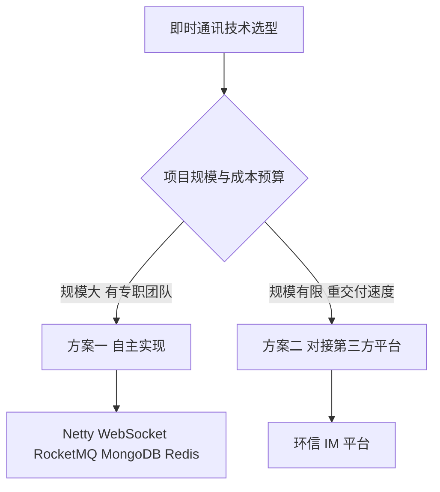
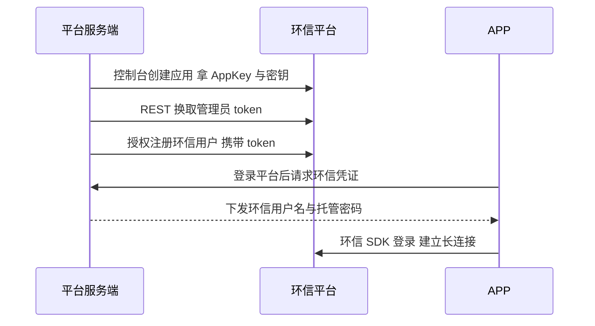
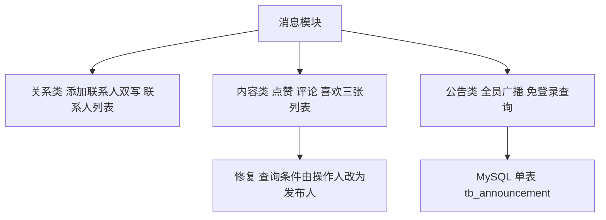

# day05 复盘：从 IM 选型到环信落地，消息模块全线打通

day05 是这个阶段里密度极高的一天：前半程在决策，即时通讯到底自研还是对接第三方；后半程在落地，环信用户体系集成、添加联系人、三类操作列表、公告列表接连收口，中途还揪出并修掉一个查询方向反了的 bug。复盘这一天，比代码更值得带走的是那条决策链，以及「平台用户体系与第三方 IM 用户体系如何咬合」的完整心智图。

## 先给结论

- 即时通讯两条路线：自主实现与对接第三方平台，选型变量是项目规模与成本控制；探花交友选了后者，平台为环信。
- 环信集成主线四步走通：控制台创建应用拿 AppKey 与密钥，REST API 换取管理员 token，授权注册环信用户，查询并下发凭证让 APP 完成 SDK 登录。
- 环信注册分开放注册与授权注册，区别在是否携带管理员 token，生产口径一律授权注册。
- 添加联系人是双写动作：好友关系既写平台 MongoDB，又注册到环信，缺任何一边聊天都起不来。
- 点赞、评论、喜欢三个列表的口径是「别人对我的操作」，为此补齐发布人字段并修正查询条件；公告是全员数据，存 MySQL 且免登录可查。

## 一、选型复盘：自研与第三方之间怎么称重

即时通讯的实现方案在课程里被摆成两盘棋。自主实现的技术栈拉出来是一整排组件：Netty 做长连接网关，WebSocket 定通信协议，RocketMQ 扛消息削峰，MongoDB 存消息正文，Redis 管在线状态，ZooKeeper 做协调，MySQL 承担业务数据。这套组合意味着一支专职团队与常年累月的运维投入。对接第三方平台则把这些全部换成一次集成，长连接、消息投递、离线推送都由平台承担。



决策的天平上真正有分量的是两个砝码。一是规模，自研的长连接集群要应对海量并发与高可用，小团队养不起；二是成本，第三方平台按 DAU 阶梯计费，用户量小的阶段费用可控，但阶梯顶部的价格并不低，业务涨到一定体量后自研反而划算。探花交友作为业务型项目，交付效率优先，选方案二。这个选择过程本身比结论更有复用价值：先列全两条路的构成，再拿规模与成本称重，结论自然浮出来。

## 二、环信集成主线：从 AppKey 到 SDK 登录

对接的第一步发生在环信控制台：创建应用，拿到 AppKey 与两个密钥。AppKey 的结构是组织名加应用名，后续所有 REST 调用的 URL 都由它拼出来。密钥用于换取管理员 token，请求与响应的骨架如下（密钥打码）：

```json
{
  "grant_type": "client_credentials",
  "client_id": "打码",
  "client_secret": "打码"
}
```

管理员 token 是后续一切 REST 操作的通行证，注册用户、查询用户、管理关系全靠它，而且它有有效期，工程化落地要做缓存与到期重取。环信用户注册有两种姿势：开放注册不需要 token，任何人都能调；授权注册必须携带管理员 token。课程明确推荐授权注册，注册入口被服务端握住，用户创建才是受控行为。

注册这步完成后用户体系集成还差最后一环：APP 端登录环信 SDK 需要用户名与密码，服务端提供查询接口，把按既定规则生成的环信凭证下发给当前登录用户。整条主线串起来：



验证环节用控制台直接给客户端发了一条消息：APP 收到后点击「聊一下」，双方即结为好友，这个交互顺势引出添加联系人的实现。添加联系人是全日最典型的双写场景：好友关系一边写进平台 MongoDB 的关系集合，另一边通过环信 API 把好友关系注册到环信平台，两边一致两个人才能聊天，环信侧没有这层关系，消息就发不出去。联系人列表接口随后补齐，消息页的关系类功能闭环。

## 三、消息业务层收口：三类列表、一次修复与全员公告

内容类消息有三张列表：点赞、评论、喜欢。它们的存储共用一份评论集合，按类型字段区分，查询口径统一为「别人对我发布内容的操作」。实现过程中暴露出查询方向反了的 bug：文档里只有操作人没有发布人，查询条件挂错了主语。修复动作是给评论对象补发布人字段，保存时回查内容数据写入，再把查询条件换成发布人；回归测试用多账号在多端把操作重新造了一遍，页面数据与数据库文档双重核对通过。公告列表是全员广播，落 MySQL 单表，接口免登录放行，逻辑独立，收口轻松。



三个类别对回 App 的消息页就一目了然：关系类数据来自平台数据库与环信两个源头，内容类数据来自评论集合按类型切分，公告类数据来自 MySQL 单表。来源不同、形态不同，接口与存储选型却各自贴着数据的本性走，这是本模块设计上最值得沉淀的一点。

## 四、遗留问题与下一步

几处边界要在复盘里挂账。聊天消息本身的收发由 APP 通过环信 Android SDK 直连完成，服务端不参与消息转发，后端的工作边界是关系与凭证，这条边界划清后职责不会互相渗透。管理员 token 有有效期，课程演示按需获取，工程化落地要加缓存与续期，401 时重取重试。发送验证码一类的能力与 IM 无关，属于平台自己的通道，不必混进消息模块的讨论。

消息模块收官，下一步转向推荐系统。探花交友的推荐计算技术选型是 Spark 加 MLlib，day06 将用一天做 Spark 快速入门，为推荐算法的落地铺路，数据侧的旅程从消息页切换到计算引擎。

## 常见误区

- **对接了环信就以为好友关系自动同步。** 错例：只在平台数据库里写好友关系，环信侧不注册，两个人在平台是好友却聊不起来。正解：添加联系人必须双写，平台侧管业务展示，环信侧管消息收发。
- **管理员 token 当成永久凭证。** 错例：启动时取一次 token 塞进静态变量，过期后所有 REST 调用集体 401。正解：token 带有效期，缓存并按剩余时长提前续期，401 时重取重试。
- **用开放注册图省事。** 错例：生产环境开着无鉴权的注册接口，任何人都能在环信侧创建账号。正解：一律授权注册，注册动作只由平台服务端携带管理员 token 发起。
- **三类列表只测正向数据。** 错例：用同一个账号又发动态又点赞，列表看起来有数据就通过。正解：必须多账号多端制造操作，验证列表语义确实是「别人对我的操作」。

## 面试可能被问到的问题

1. 面试官追问：「IM 为什么选第三方平台而不是自研？」
   答：决策变量是项目规模与成本。自研要维护 Netty 长连接网关、消息队列、消息存储与在线状态一整条链路，需要专职团队；第三方平台把长连接与投递托管出去，集成成本低、上线快，按 DAU 计费的模式在小体量阶段更经济。业务型项目优先交付效率选第三方，IM 成为核心竞争力的产品才值得自研。
2. 面试官追问：「平台用户体系和环信用户体系怎么打通？」
   答：以平台用户 id 为锚点，环信用户名直接取平台 id 的字符串，密码按固定规则生成；平台用户注册成功后同步授权注册环信用户，APP 登录平台后向服务端请求凭证接口拿环信用户名密码，再完成 SDK 登录。两侧靠生成规则的一致性绑定，不需要额外映射表。
3. 面试官追问：「开放注册和授权注册的区别，为什么推荐后者？」
   答：区别在注册请求是否携带管理员 token。开放注册无鉴权，任何拿到应用标识的人都能创建环信用户；授权注册必须先持有管理员 token 才能调注册接口。推荐后者是因为它把注册入口收进服务端，用户创建成为受控行为，杜绝外部批量刷号。
4. 面试官追问：「添加联系人为什么要双写？」
   答：平台数据库的好友关系服务于业务功能，联系人列表、动态可见范围都查它；环信侧的好友关系服务于消息收发，环信不认识的关系发不了消息。一边管展示一边管通道，职责不同，缺一边都会出现「看着是好友却聊不了」或「聊得了却没有好友列表」的怪相。
5. 面试官追问：「点赞评论喜欢列表的数据模型怎么设计？」
   答：三类操作共用一份评论集合，类型字段区分点赞、评论、喜欢，文档里同时记操作人与发布人。查询口径是别人对我发布内容的操作，条件挂发布人加类型；操作人字段用于反查我给谁点过赞。一份集合覆盖三张列表，是读路径主导的设计。
6. 面试官追问：「管理员 token 的有效期怎么管理？」
   答：换取 token 时响应里带过期时长，工程里缓存 token 并按剩余有效期提前刷新，请求遇 401 时强制重取再重试一次。密钥放配置中心不进代码库，日志不打 token 明文。

## 配套资料

- 学习目标：`materials/code/07/day05 探花交友-实现消息功能/day05/学习目标.md`，本日全部目标项的清单，复盘按它逐条对账。
- 说明：day05 资料包仅含学习目标，无工程源码与讲义文件；复盘涉及的集成步骤、接口与配置均按课程画面与讲解整理，密钥与 token 已打码，包名统一改写为 `com.study.tanhua` 系。
