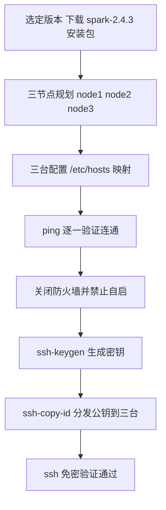

# 搭 Spark 集群前的准备清单：定版本、配映射、关防火墙、通免密

> 🔒 安全提示：文中示例的口令/密钥均为课程教学环境演示口径，生产环境的安全要求见《安全与合规须知》。

概念课结束后就要动手装机。Spark 集群可以在 Windows 上运行，也可以在 Linux 上运行，实际部署基本都选 Linux，因为项目最终发布就在 Linux 上，课程也全程按 Linux 环境讲解，版本是 CentOS 6.5，三台虚拟机组一个最小集群。装机本身只有几条命令，真正决定成败的是装机前的四件准备工作：版本与包选对、节点映射配全、防火墙关干净、免密登录打通，任何一件漏了，后面的部署都会以奇怪的方式失败。

## 先给结论

- 版本组合：Spark 2.4.3 加 Hadoop 2.7 及以上，下载包类型选 Pre-built for Apache Hadoop 2.7 and later，得到 `spark-2.4.3-bin-hadoop2.7.tgz`。
- 集群三节点：node1、node2、node3，IP 为 192.168.31.82、192.168.31.83、192.168.31.84，三台部署路径保持一致。
- JDK 1.8 要提前就位；Scala 不必单独安装，Spark 2.4.3 自带对应版本的 Scala 运行库。
- 准备工作四步：三台配 hosts 映射并逐个 ping 通、关防火墙并禁开机自启、配免密登录、创建安装目录。
- CentOS 6.5 的防火墙是 iptables 命令族，与 CentOS 7 的 firewalld 不是一套命令，不能混用。

## 一、版本怎么选：下载页上的三连选择

下载地址是 `spark.apache.org/downloads.html`，页面上依次做三个选择，课程环境的选择原样如下：

```text
1. Choose a Spark release:  2.4.3 (May 07 2019)
2. Choose a package type:   Pre-built for Apache Hadoop 2.7 and later
3. Download Spark:          spark-2.4.3-bin-hadoop2.7.tgz
```

三个选择各有一层含义。2.4.3 是课程制作时的最新发布版，发布于 2019 年 5 月 7 日；包类型 Pre-built for Apache Hadoop 2.7 and later 表示官方预编译、适配 Hadoop 2.7 及以上版本，免去本地编译的麻烦；文件名里的 `bin-hadoop2.7` 就是这层适配关系的体现。工程里引依赖时对应这套 Maven 坐标：

```text
groupId:    org.apache.spark
artifactId: spark-core_2.11
version:    2.4.3
```

`artifactId` 里的 2.11 是 Scala 版本后缀，说明这一版 Spark 基于 Scala 2.11 构建，机器上不需要单独安装 Scala，运行库已经打进发行包里。Spark 跑在 JVM 上，JDK 才是硬前提，课程环境的 JDK 1.8 已提前装好，路径 `/usr/local/src/java/jdk1.8.0_141`，动手前用 `java -version` 复核一遍即可。版本紧跟课程还有一个原因：Spark 大版本之间配置文件名与行为有差异，比如 3.0 起 `slaves` 文件改名为 `workers`，学习环境跟课程版本走，报错时才好对照排查。

## 二、三节点规划与 hosts 映射

课程准备了三台 Linux 虚拟机，规划如下：

| 机器地址 | 节点名称 | 部署路径 |
|---|---|---|
| 192.168.31.82 | node1 | /usr/local/src |
| 192.168.31.83 | node2 | /usr/local/src |
| 192.168.31.84 | node3 | /usr/local/src |

三台机器的部署路径必须完全一致，后面 scp 分发、脚本按主机名找目录都依赖这个约定。每台机器都打开 `/etc/hosts`，把三个节点的映射全部补上：

```bash
vim /etc/hosts
# 三台机器都追加以下映射，node1 可再写一个 node01 别名，两种名字都能解析
192.168.31.82 node1 node01
192.168.31.83 node2 node02
192.168.31.84 node3 node03
```

映射的意义在于：集群配置里写的全是主机名而不是 IP，将来换网段只需要改 hosts，不用动集群配置。三台都配完，用 `ping` 逐个验证，课程画面里的验收标准是 `ping node1`、`ping node2`、`ping node3` 全部返回 0% packet loss，本机名字也要能 ping 通，因为每台机器同样会以主机名访问自己。

## 三、关闭防火墙并禁止开机自启

集群进程之间要开大量端口通信，防火墙不放行就是各种莫名的连接超时，学习环境直接关闭最省事：

```bash
# 关闭防火墙
service iptables stop
# 禁止开机启动
chkconfig iptables off
```

两条命令缺一不可：`service iptables stop` 只让防火墙立即停，机器一重启它又回来了；`chkconfig iptables off` 把自启也关掉，下次开机才不会再被挡。CentOS 6.5 用的是 iptables 这套命令；CentOS 7 起换成 `systemctl stop firewalld` 与 `systemctl disable firewalld`，两代系统命令不同，照抄教程报错先核对系统版本。

## 四、配置免密登录

Spark 的启动脚本要从主节点远程登录到清单里的每台机器拉起进程，登录必须免密，否则集群根本起不来。配置从 node1 出发：

```bash
# 生成密钥，一路回车
ssh-keygen
# 把公钥分发到三台机器，包括本机
ssh-copy-id node1
ssh-copy-id node2
ssh-copy-id node3
```

`ssh-keygen` 一路回车，密钥落在 `/root/.ssh/` 下；`ssh-copy-id` 首次连接会提示确认主机指纹，输入 yes，再输入对方 root 用户的密码，课程环境密码是 123456。三台都拷完，用 `ssh node2` 验证，能直接进入不再要密码才算通。之前课程如果已经配过免密，逐台 ssh 验证一下就行，不必重配。

整条准备链的先后关系如下，做完即可进入安装环节：



图里的顺序不能乱：映射没通就配免密，`ssh-copy-id node2` 会因为解析不了主机名而失败；防火墙没关，免密看似配好、实际连接偶发被拒。按图从上往下走完，四件事全部闭环。

## 常见误区

- **hosts 只在主节点配。** 错例：只在 node1 写了映射。正解：三台都要配全三行，节点之间会按主机名互访，Worker 节点解析不了同伴一样会出问题。
- **只 stop 不 chkconfig。** 错例：关了防火墙没禁自启，重启机器后集群端口又被挡。正解：两条命令一起执行，重启后 `service iptables status` 复核一次。
- **免密漏了本机。** 错例：`ssh-copy-id node1` 觉得多余就跳过。正解：node1 上的启动脚本也会登录本机拉起进程，公钥必须分发给包括自己在内的三台。
- **密码输错反复重装。** 错例：`ssh-copy-id` 密码敲错就以为密钥坏了。正解：直接重跑该条命令再输一次即可，已生成的密钥不受影响。

## 面试可能被问到的问题

1. 面试官追问：「搭建 Spark 集群前要做哪些准备？」
   答：版本与安装包选定，Spark 2.4.3 配 Hadoop 2.7 及以上；三节点规划并保持部署路径一致；每台机器配全 hosts 映射并 ping 通；关闭防火墙并禁止开机自启；配置免密登录且公钥要覆盖本机；JDK 1.8 就位，Scala 由 Spark 发行包自带。
2. 面试官追问：「为什么集群搭建要配 SSH 免密登录？」
   答：集群的启停脚本要从主节点远程登录到各从节点拉起或停止进程，免密才能让这个过程自动完成。人工逐台起进程既慢又容易漏，免密是集群自动化运维的基础设施。
3. 面试官追问：「spark-core_2.11 里的 2.11 是什么意思？」
   答：是该发行包构建所用的 Scala 版本号后缀。Spark 本体用 Scala 实现，二进制包里已包含对应 Scala 运行库，机器上无需单独安装 Scala；引 Maven 依赖时后缀要与 Spark 版本匹配。
4. 面试官追问：「CentOS 6 和 7 关防火墙的命令有什么区别？」
   答：CentOS 6 用 iptables 命令族，`service iptables stop` 关闭、`chkconfig iptables off` 禁自启；CentOS 7 换成 firewalld，用 `systemctl stop firewalld` 与 `systemctl disable firewalld`。两套命令不可混用，先确认系统版本再操作。

## 配套资料

- 学习目标：`materials/code/07/day06 探花交友-Spark快速入门/day06/学习目标.md`，day06 全部目标清单，「独立搭建 Spark 的集群」对应准备工作与实施部署两个环节。
- 说明：day06 资料包仅含学习目标清单，无工程源码与讲义文本；下载页信息、节点规划表、hosts 与防火墙、免密命令出自课程画面与讲解；部署路径在课程画面基础上统一为中性路径 `/usr/local/src`。
