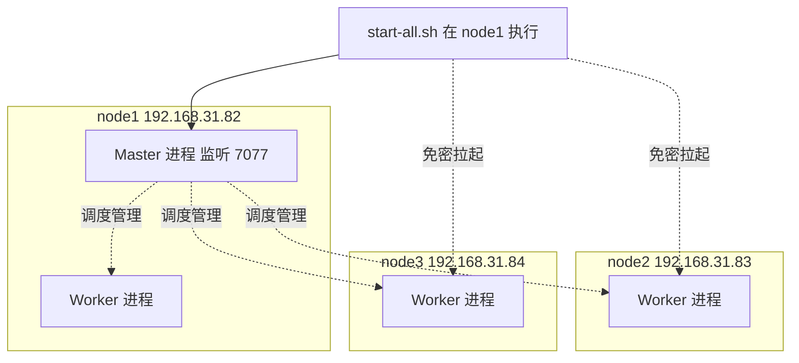

# Spark 集群部署实操：两个配置文件、一次分发、一键拉起

准备清单齐了之后，真正的安装反而简单：创建目录解压、改 conf 下两个文件、分发到另外两台、一条命令启动、网页上确认。全程没有编译，难点不在操作量，而在知道每个配置项为什么这么写，以及启动失败时知道往哪查。这篇把五步走完，以 node1 上的 Web UI 页面出现三个 Worker 为验收终点。

## 先给结论

- 安装五步：创建目录并解压、重命名并修改 `spark-env.sh`、重命名 `slaves` 写入节点清单、scp 分发到另外两台、执行 `start-all.sh`。
- `spark-env.sh` 三个关键项：`JAVA_HOME`、`SPARK_MASTER_HOST=node1`、`SPARK_MASTER_PORT=7077`，7077 是 Master 的默认 RPC 端口。
- `slaves` 文件决定 Worker 拉起在哪几台，写入 node1、node2、node3 意味着主节点 node1 也兼任 Worker。
- 启动后用 `jps` 验证：node1 上 Master 与 Worker 各一个，node2、node3 上各只有一个 Worker。
- 浏览器访问 `node1:8080`，Alive Workers 显示 3、总核数为 6、三台状态 ALIVE，即为部署成功。

## 一、创建目录、上传解压

三台机器都要有安装目录，然后只在 node1 上传包、解压、改名：

```bash
# 创建安装目录，3 台机器都要创建
mkdir -p /usr/local/src
# 上传 spark-2.4.3-bin-hadoop2.7.tgz 到该目录后，在 node1 上解压
cd /usr/local/src
tar -xvf spark-2.4.3-bin-hadoop2.7.tgz
mv spark-2.4.3-bin-hadoop2.7 spark
```

解压出的目录改名为 `spark`，好处是后续所有配置、环境变量里引用的路径都不带版本号，集群脚本找路径的写法保持稳定。上传解压的间隙顺手把三台机器的时间对齐，课程画面里就是用 ntp 方式更新了一次系统时间，三台都执行，时间不同步会让日志排查时对不上点：

```bash
# 三台机器对时，NTP 服务器按所在网络选择
ntpdate pool.ntp.org
```

解压完先认一眼目录结构：`bin` 是客户端命令，`sbin` 是集群启停脚本，`conf` 放全部配置文件，后面两步都在 `conf` 里做。

## 二、conf 下改两个文件

进入 `conf` 目录，两个文件都带着 `.template` 后缀，Spark 不会读模板文件，必须先重命名：

```bash
cd /usr/local/src/spark/conf
mv spark-env.sh.template spark-env.sh
mv slaves.template slaves
```

`spark-env.sh` 是 Spark 的环境配置文件，在顶部插入三项：

```bash
export JAVA_HOME=/usr/local/src/java/jdk1.8.0_141 #jdk地址
export SPARK_MASTER_HOST=node1 #指定master的主机名
export SPARK_MASTER_PORT=7077 #master的端口
```

逐项看含义。`JAVA_HOME` 告诉 Spark 用哪个 JDK，路径按自己机器的实际地址写；`SPARK_MASTER_HOST` 声明 Master 进程起在哪台主机，课程定在 node1；`SPARK_MASTER_PORT` 是 Master 对外服务的端口，7077 是默认值，写出来图个显式，谁读配置都能一眼看到集群的入口在哪。

`slaves` 是 Worker 节点清单，打开后把三台主机名都写进去：

```bash
# slaves 文件内容
node1
node2
node3
```

这份清单决定 `start` 脚本去哪几台机器拉 Worker。把 node1 也写进去，等于让主节点自己兼任一个 Worker，三节点的小集群通常这么用，机器不闲着。注意 Spark 2.4.3 用的是 `slaves` 这个文件名，Spark 3.0 起才改叫 `workers`，别把 Hadoop 3 或新版 Spark 的习惯带进来。

## 三、分发与环境变量

配置只在 node1 上改了一份，用 scp 把整个安装目录分到另外两台，免密在这一步兑现价值：

```bash
scp -r /usr/local/src/spark node2:/usr/local/src
scp -r /usr/local/src/spark node3:/usr/local/src
```

两台拷完，三台的目录结构与配置内容完全一致，这正是部署路径必须统一的回报：一条命令拷完即生效。随后给三台机器都追加 Spark 的环境变量，编辑 `/etc/profile`，在已有的 JDK 配置段后面补两行：

```bash
export SPARK_HOME=/usr/local/src/spark
export PATH=$SPARK_HOME/bin:$SPARK_HOME/sbin:$PATH
```

追加完执行 `source /etc/profile` 让变量立即生效，三台机器各自都要做，环境变量是每台机器自己的事。

## 四、启动与验证

启动脚本在 `sbin` 目录里，`start-master.sh` 单起主节点，`start-slaves.sh` 单起全部从节点，`start-all.sh` 一次全起，课程直接用最省事的那个：

```bash
cd /usr/local/src/spark/sbin
./start-all.sh
```

这条命令做了两件事：在 node1 本机拉起 Master，再按 `slaves` 清单免密 ssh 到 node1、node2、node3 各拉起一个 Worker。集群结构如下图：



图里 node1 同时容纳 Master 与 Worker 两个进程，node2、node3 各只有 Worker，这是小集群的常态。用 `jps` 逐台核验：node1 应看到 Master 与 Worker 两个进程，node2、node3 各只有一个 Worker，少一个就要回到 `slaves` 与免密上找原因。

网页验证走 Master 的 Web UI，默认端口 8080。Windows 本机先把主机名映射配好，课程用的是 SwitchHosts 工具管理映射，直接编辑本机 hosts 文件效果等价。浏览器访问 `http://node1:8080`，部署成功的页面特征很明确：Alive Workers 为 3，正在使用的核心总数为 6，即三台 Worker 上报的核数之和，内存总量为三台 Worker 上报之和；下方 Workers 列表列出 192.168.31.82、83、84 三台，状态全部 ALIVE；再往下 Running Applications 暂时为空，因为还没有应用提交上来。这一页全绿，集群就算立住了，下一篇开始往上面跑第一个程序。

## 常见误区

- **`start-all.sh` 敲成了 Hadoop 的那个。** 错例：PATH 里同时有 Hadoop 与 Spark 的 sbin，敲 `start-all.sh` 起的却是 Hadoop 集群。正解：用绝对路径 `/usr/local/src/spark/sbin/start-all.sh`，或确认 Spark 的 sbin 排在 PATH 前面。
- **模板文件没改名就改内容。** 错例：直接编辑 `slaves.template`，启动后只有 Master 没有 Worker。正解：Spark 只读改名后的 `spark-env.sh` 与 `slaves`，`.template` 后缀必须先去掉。
- **7077 与 8080 混用。** 错例：浏览器里访问 `node1:7077` 想看监控页。正解：7077 是 Master 的 RPC 端口，供提交应用与 Worker 注册使用；Web UI 是 8080，两个端口各司其职。
- **环境变量只在一台生效。** 错例：只在 node1 上 source 了 profile。正解：三台都要追加并 source，否则在其他节点上敲 Spark 命令会提示找不到。

## 面试可能被问到的问题

1. 面试官追问：「Spark Standalone 集群里有哪些角色？」
   答：集群侧是 Master 与 Worker，Master 负责资源管理与调度，Worker 负责在所在机器上拉起并管理计算进程；应用侧还有 Driver 与 Executor，分别负责应用的主控与执行，角色的详细分工在后面的课程里展开。
2. 面试官追问：「spark-env.sh 里至少要配什么？」
   答：Standalone 模式下核心三项：`JAVA_HOME` 指向 JDK；`SPARK_MASTER_HOST` 指定 Master 所在主机；`SPARK_MASTER_PORT` 指定 Master 端口，默认 7077。此外按需可配 Worker 的核数与内存。
3. 面试官追问：「slaves 文件的作用是什么？写了 node1 有什么含义？」
   答：它是 Worker 节点清单，start 脚本按它免密登录各机器拉起 Worker。写入 node1 表示主节点同时兼任 Worker，小集群让机器不闲置；生产环境通常把 Master 独立出来，不与 Worker 混部。
4. 面试官追问：「start-all.sh 执行后怎么确认部署成功？」
   答：两层验证。进程层用 jps，node1 上有 Master 与 Worker，其余节点各有 Worker；页面层访问 Master 的 8080 端口，Alive Workers 等于 3、Workers 全部 ALIVE 即部署成功。
5. 面试官追问：「为什么配置改完要用 scp 分发？」
   答：集群的行为依赖三台机器上的配置完全一致，`slaves` 不一致会导致 Worker 清单对不上，`spark-env.sh` 不一致会导致 Master 地址在部分节点上解析错误。统一在主节点改、整目录分发，是保证一致性的最简做法。

## 配套资料

- 学习目标：`materials/code/07/day06 探花交友-Spark快速入门/day06/学习目标.md`，day06 全部目标清单，「独立搭建 Spark 的集群」对应上述实施部署环节。
- 说明：day06 资料包仅含学习目标清单，无工程源码与讲义文本；`spark-env.sh` 三项配置、模板重命名、`start-all.sh` 启动方式与 Web UI 验证要点出自课程画面与讲解；安装目录在课程画面基础上取中性路径 `/usr/local/src`，ntp 对时与 SPARK_HOME 环境变量按课程讲解与同一格式补全。
