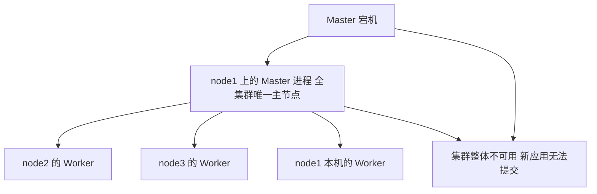
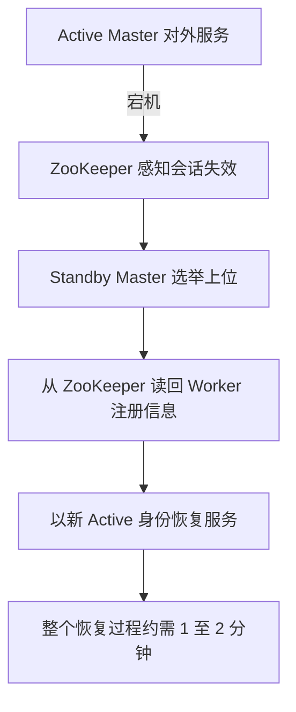

# Spark HA 方案怎么选：单点故障、文件系统恢复与 ZooKeeper 选举

Spark Standalone 集群搭完之后做例行检查，三台机器上 `jps` 一敲就会发现一个让人不安的事实：只有一个 Master 进程，孤零零地跑在其中一台机器上。整个集群接收应用、分配资源的能力全压在这个进程身上，它一旦宕机，剩下的 Worker 再多也是群龙无首。这就是 Master 单点故障，也是 HA 高可用集群要解决的问题。这一篇先把官方给出的两种方案讲透，动手搭建留到下一篇。

## 先给结论

- Standalone 是 Master-Slave 主从架构，Master 是唯一的资源调度入口，单点故障是架构自带的，必须靠 HA 方案补齐。
- 官方提供两种 HA 方案：基于文件系统的单点恢复，用于开发与测试环境；基于 ZooKeeper 的选举，用于生产环境。
- 文件系统方案本质是「可恢复」而不是「高可用」：元数据落在 Master 本机文件，故障后要人工重启才能恢复，恢复期间集群不可用。
- ZooKeeper 方案才是真正的「高可用」：多个 Master 连接同一个 ZooKeeper 实例，一个 Active 对外服务，其余 Standby 热备，现任 Master 故障后自动选举切主，恢复约需 1～2 分钟。
- 选型不必纠结，生产环境直接采用 ZooKeeper 方案。

## 一、单点故障藏在架构里

Standalone 的组成是典型的 Master-Slave 模式。Master 是主节点，负责接收应用提交、管理 Worker、分配资源；Worker 是从节点，驻守在每台机器上，负责汇报可用资源、按指令拉起执行进程。分工本身没有问题，问题出在数量上：标准部署里 Master 只有一个。

用进程清单看得更直观：

```bash
# node1 上：Master 与 Worker 同机，全集群唯一的 Master
2608 Master
2831 Worker
# node2、node3 上：只有 Worker，没有 Master
2455 Worker
```

一旦 node1 宕机，集群立刻退化成一群没有主的从节点：新应用没有提交入口，资源分配没人执行，集群整体不可用。下面的图把故障传导路径画了出来：



图里的关键是最后一条链路：Master 宕机并不影响 Worker 进程本身存活，但失去主节点的集群等于失去了调度中枢，所以故障要按「集群整体不可用」来对待，而不是「坏了一台机器」。

## 二、方案一：基于文件系统的单点恢复

**思路是把 Master 的元数据先落到磁盘。** Spark 提供目录保存 Application 与 Worker 的注册信息到文件中；Master 发生故障后启用新的 Master 进程，根据之前保存的 Application 信息与 Worker 信息恢复集群状态，让 Master 回到故障前的样子，以此保障 Master 的高可用。

配置上对应恢复模式 `spark.deploy.recoveryMode`，它有三种取值：

```properties
# Master 恢复模式的三种取值，生产环境选 ZooKeeper
spark.deploy.recoveryMode=ZooKeeper   # 选举式高可用
spark.deploy.recoveryMode=FileSystem  # 基于文件系统恢复，开发与测试用
spark.deploy.recoveryMode=NONE        # 默认值，不做高可用
```

文件系统方案的问题就写在「本地」两个字里：

**第一，恢复依赖人工介入。** 文件不会自己把 Master 拉起来，宕机后要先发现故障、再手动重启 Master 进程，这中间集群一直处于不可用状态。测试环境无所谓，生产环境的停机时间没人愿意背。

**第二，元数据与 Master 同生共死。** 恢复依据存放在 Master 所在机器的磁盘上，机器级故障（磁盘损坏、机器回收）会连恢复依据一起带走。

所以这种方案的定位很明确：开发环境、测试环境，图个恢复方便，不追求持续可用。

## 三、方案二：基于 ZooKeeper 的选举

**思路从「存好状态等人来」换成「备胎随时顶上」。** 把 Spark 集群部署到同一个 ZooKeeper 实例上并启动多个 Master，利用 ZooKeeper 提供的选举和状态保存两个能力：一个 Master 被选举成活着的 Active Master 对外服务，其余 Master 处于 Standby 状态热备待命；Worker 的注册信息保存在 ZooKeeper 的目录里，不再依赖某一台机器的本地磁盘。

切换是全自动的。下面的图描述了现任 Master 死去之后的完整恢复链路：



关键在第三、四步：新 Master 不需要等 Worker 重新注册，直接从 ZooKeeper 读回旧 Master 的状态再恢复服务，这正是状态保存能力的价值；1～2 分钟的恢复窗口是切主的固定成本，应用侧要预留重试机制。

两种方案放在一起对比：

| 维度 | 文件系统方案 | ZooKeeper 方案 |
|---|---|---|
| 恢复方式 | 人工重启 Master 后读本地文件 | 自动选举切主 |
| 恢复期间 | 集群不可用，等人处理 | 短暂窗口后自动恢复 |
| 元数据存放 | Master 本机文件 | ZooKeeper 中保存 |
| 故障切换 | 需要人介入 | 全自动，约 1～2 分钟 |
| 适用环境 | 开发、测试 | 生产 |

## 常见误区

- **把文件系统方案当成真高可用。** 错例：配置 `FileSystem` 恢复模式后以为集群能自动切换。正解：它只是把恢复数据存好，切换仍需人工重启 Master，恢复期间集群不可用，生产环境必须用 ZooKeeper 方案。
- **以为多个 Master 同时干活。** 错例：起三个 Master 后认为调度吞吐变成三倍。正解：同一时刻只有一个 Active 对外服务，其余 Standby 只热备不出力，多 Master 买到的是可用性，不是吞吐。
- **以为切主对应用完全无感。** 错例：Master 一挂立刻重试提交，报错后束手无策。正解：选举与状态恢复约需 1～2 分钟，窗口期内提交必然失败，客户端要配置多个 Master 地址或重试，等新 Active 上线后再成功。
- **只给 Spark 做 HA，忘了 ZooKeeper 自身也是单点。** 错例：演示环境用单节点 ZooKeeper，原样搬进生产。正解：ZooKeeper 方案的前提是选举服务本身可靠，生产应部署 ZooKeeper 集群，否则 ZooKeeper 一挂照样全瘫。

## 面试可能被问到的问题

1. 面试官追问：「Spark Standalone 为什么会有单点故障？」
   答：Standalone 采用 Master-Slave 架构，标准部署只起一个 Master 进程，应用接收与资源分配全部经过它。Worker 与应用的注册、调度都依赖这个唯一入口，Master 宕机后新应用无法提交、资源无法分配，集群整体不可用，所以必须用 HA 方案补齐。
2. 面试官追问：「基于文件系统和基于 ZooKeeper 的 HA 有什么区别？」
   答：文件系统方案把 Application 与 Worker 注册信息写到 Master 本机文件，故障后靠人工重启新 Master 读文件恢复，只适合开发测试环境；ZooKeeper 方案部署多个 Master，利用 ZooKeeper 的选举与状态保存能力，Active 故障后 Standby 自动上位并从 ZooKeeper 读回状态，恢复窗口约 1～2 分钟，适合生产环境。
3. 面试官追问：「Standby Master 转正后，Worker 需要重新注册吗？」
   答：不需要。Worker 的注册信息一直保存在 ZooKeeper 里，新 Active 通过选举产生后直接读取这些信息恢复集群状态，Worker 基本无感知，这也是方案里状态保存能力的核心价值。
4. 面试官追问：「恢复要 1～2 分钟，这段时间提交的应用怎么办？」
   答：窗口期内没有 Active Master，提交必然失败。应用侧应配置重试，或同时提供多个 Master 地址让客户端轮询换连，等新 Master 上线后提交即可成功；对时效敏感的链路要把这个窗口纳入业务容错预算。
5. 面试官追问：「spark.deploy.recoveryMode 有哪几种取值？」
   答：三种。ZooKeeper 表示基于 ZooKeeper 选举恢复，生产推荐；FileSystem 表示基于文件系统恢复，开发与测试环境使用；NONE 是默认值，表示不做恢复，对应没有高可用能力的单 Master 集群。

## 配套资料

- 学习目标：`materials/code/07/day06 探花交友-Spark快速入门/day06/学习目标.md`，其中「独立搭建 Spark 的 HA 集群」一条对应本课与后续动手搭建课的内容。
- 说明：day06 资料包仅含学习目标，无工程源码与讲义文件；两种 HA 方案的机制、参数名与恢复流程按课程画面与讲解整理，配置写法为按本课写法补全。
