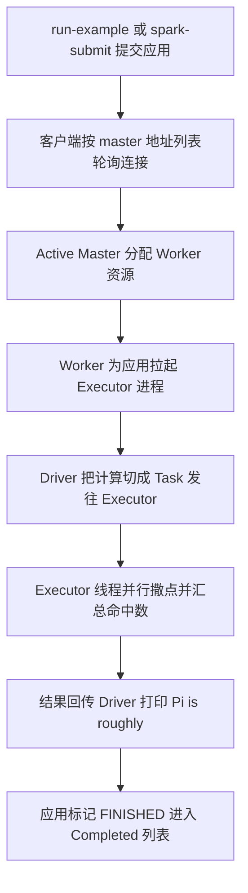

# 跑通第一个 Spark 程序：用蒙特卡洛法算圆周率

集群立起来之后，第一次提交往往带着一连串疑问：`run-example` 是个什么脚本，为什么它不算写代码？普通模式一条命令，HA 模式却要在 `--master` 后面拖一串地址？同样的程序两次跑出的 π 值尾数还不一样，到底哪个是准的？这一篇用 Spark 自带的圆周率示例把这些问题一次说清，顺带把 day06 的环境体验收个尾。

## 先给结论

- Spark 自带 examples 示例，`./run-example SparkPi 10` 一条命令即可完成第一次提交，不需要编写任何代码。
- SparkPi 用蒙特卡洛法估算 π：向单位正方形撒随机点，落入四分之一圆的比例乘以 4 就是 π 的近似值；参数 10 是采样倍数，值越大结果越准、耗时越长。
- 不带 `--master` 的普通模式是本地单进程计算，没有走集群；HA 模式必须给 `--master` 一个 Master 地址列表，客户端会轮询重试，第一个连不上自动换下一台。
- 监控看 Master 的 8080 页面：应用清单、Worker 资源、每个应用的 Executor 汇总都能在这里核对。
- 至此环境体验闭环：单机模式、HA 集群模式、Web UI 监控三样都过了手。

## 一、bin 目录与普通模式提交

Spark 安装目录的 `bin` 子目录下集中了所有客户端脚本，除了 `run-example`，还有 `spark-submit`、`spark-shell`、`pyspark` 等。第一次体验用内置示例最省事：

```bash
# 进入 bin 目录，直接运行内置示例
cd $SPARK_HOME/bin
# SparkPi 是示例名，10 是采样倍数
./run-example SparkPi 10
```

执行结束在终端末尾打印结果：

```text
Pi is roughly 3.1400995524752623
```

课程运行得到的 3.140099 与真实 π 的差距停在千分位，这正是蒙特卡洛估计在该采样规模下的正常精度。普通模式指的是本地计算：整个应用在提交机器的单个进程里完成，不向集群申请资源，Worker 与 Master 都没有参与。

`run-example` 本质是内置示例的快捷入口，等价于用 `spark-submit` 提交自带的示例 jar，等价的主流写法是：

```bash
./spark-submit \
  --class org.apache.spark.examples.SparkPi \
  --master local[*] \
  $SPARK_HOME/examples/jars/spark-examples_2.11-2.4.3.jar 10
```

`--class` 指定示例主类，`--master local[*]` 表示本地模式，最后一个参数传给示例本身。后面真正提交到集群，走的也是同一条 `spark-submit` 通道。

## 二、蒙特卡洛法与 SparkPi 代码逐行

算法思想很朴素：在边长为 2 的正方形内随机撒点，正方形的内切单位圆面积是 π，正方形面积是 4，落入圆内的点占比就逼近 π 除以 4，乘 4 还原出 π。撒的点越多，估得越准。SparkPi 的实现逻辑按 Spark 2.4.3 官方示例整理如下：

```scala
object SparkPi {
  def main(args: Array[String]): Unit = {
    // 创建 SparkSession，应用名 Spark Pi
    val spark = SparkSession.builder.appName("Spark Pi").getOrCreate()
    // 第一个命令行参数是采样倍数，未传时默认 2
    val slices = if (args.length > 0) args(0).toInt else 2
    // 总采样点数 = 10 万 x 采样倍数，做溢出保护
    val n = math.min(100000L * slices, Int.MaxValue).toInt
    // 把 1 到 n 的序列切成分区，slices 即并行度
    val count = spark.sparkContext.parallelize(1 until n, slices).map { i =>
      // 在 [-1,1] x [-1,1] 的正方形内随机取一点
      val x = random * 2 - 1
      val y = random * 2 - 1
      // 落入单位圆记 1，否则记 0
      if (x*x + y*y <= 1) 1 else 0
    }.reduce(_ + _)   // 汇总所有分区的命中数
    // 命中占比约等于 pi/4，乘 4 还原
    println(s"Pi is roughly ${4.0 * count / (n - 1)}")
    spark.stop()
  }
}
```

对着代码串一遍执行链路：`parallelize` 把百万级点序列切成 `slices` 个分区，分区数就是并行度，落到 Executor 上对应多个 Task 并行撒点；`map` 只做一次判断，`reduce` 把各分区的命中数相加；Driver 拿到总数后乘 4 除以点数，打印近似值。参数 10 意味着 10 万乘 10 约一百万个采样点，想更准就调大这个值，代价是采样与计算时间同比例增加。

## 三、HA 模式提交：给 --master 一个地址列表

集群模式下 Active Master 会随故障切换漂移，客户端就不能把提交地址写死在一个节点上。HA 模式的提交命令给 `--master` 一个列表：

```bash
./run-example --master spark://node1:7077,node2:7077,node3:7077 SparkPi 10
```

Spark 会按列表轮询：第一个地址连不上，自动换第二个、第三个继续尝试，直到连上当前 Active。课程运行结果为 3.143395，与普通模式的 3.140099 只有尾数差异，两者都是对的，随机算法本身就有波动，尾数不同反而说明真的在集群上并行撒了点。这次应用真正注册进了 Spark 集群，Worker 分配资源、拉起 Executor、并行执行 Task 的完整链路都走了一遍。



这张图把提交到出结果的整条链路串了起来：前三步是资源线，由 Master 与 Worker 完成；后三步是计算线，由 Driver 与 Executor 完成，与角色分工完全对应。

## 四、Web UI 观察

提交后的观察点在 Master 的 8080 页面。Workers 表格里三个 Worker 全部 ALIVE，各挂 2 个核与约 2.7 GB 内存；Completed Applications 表里出现 Name 为 Spark Pi、State 为 FINISHED、Duration 约 3 秒的记录。点进应用详情还能看到 Executor 汇总：每个 Executor 占 2 核、1024 MB 内存，应用结束后状态变为 EXITED，运行中被清理的则标 KILLED，一起归入 Removed Executors 区块。列表里出现多条 Spark Pi 记录不是异常，此前测试提交过的历史应用会一直留在 Completed 列表里，按提交时间能区分出每次运行。

到这里，day06 的前半程闭环：环境搭建、HA 集群、角色分工、第一个程序都已过手，搭好的集群就是后续单词统计练习与推荐算法的算力底座。

## 常见误区

- **以为不带 `--master` 也是集群计算。** 错例：普通模式跑完看到结果，认定集群已经验证通过。正解：不带 `--master` 是本地单进程计算，只有指定 `spark://` 开头的地址列表，应用才会真正提交进集群。
- **把参数 10 当成保留小数位。** 错例：想要更准就把 10 改成 6，以为精度会变高。正解：10 是采样倍数，控制撒点总量与并行度，精度随点数增加而提高，数值本身与小数位无关。
- **两次结果不一样就以为算错。** 错例：3.140099 与 3.143395 对不上，怀疑程序有 bug。正解：蒙特卡洛法靠随机撒点估计，结果天然带波动，两者都在 3.14 附近即为正常，采样越多波动越小。
- **HA 提交只写一个 Master 地址。** 错例：`--master spark://node1:7077`，node1 一挂提交就报连接失败。正解：HA 环境下 Active 会漂移，地址列表要覆盖全部 Master 节点，让客户端具备轮询换连的能力。

## 面试可能被问到的问题

1. 面试官追问：「run-example 和 spark-submit 是什么关系？」
   答：run-example 是 Spark 自带示例的快捷脚本，内部等价于用 spark-submit 提交 examples 目录下的示例 jar。生产提交一律走 spark-submit，指定主类、master 地址与应用 jar；run-example 只用来体验和学习内置示例。
2. 面试官追问：「SparkPi 是怎么算圆周率的？」
   答：蒙特卡洛法。在边长为 2 的正方形内随机撒点，落点坐标满足横纵平方和小于等于 1 的算命中，命中占比约等于单位圆面积比正方形面积，即 π/4，乘 4 得到 π 的估计。采样点越多估计越准，Spark 里用 parallelize 切分区、map 判点、reduce 汇总，天然并行。
3. 面试官追问：「SparkPi 后面那个数字参数是什么含义？」
   答：采样倍数。总采样点数约等于 10 万乘以这个倍数，同时它作为分区数决定并行度。倍数越大采样越多、估计越准，但计算时间线性增长，缺省值为 2。
4. 面试官追问：「HA 集群下提交应用，为什么 --master 要给地址列表？」
   答：因为 Active Master 会随故障切换漂移。只写一个地址时，该节点宕机客户端就连不上主，提交失败；给出全部 Master 地址列表后，客户端按顺序轮询，连不上自动换下一台，直到找到当前 Active，提交成功率不依赖某个固定节点。
5. 面试官追问：「在 Web UI 上如何确认一个应用真的在集群上跑过？」
   答：看 Master 8080 页面的 Completed Applications 列表，应用名为 Spark Pi、状态 FINISHED、有提交时间与耗时记录；点进详情核对 Executor 汇总的核数与内存占用。本地模式跑的应用不会出现在集群 Master 的应用列表里，这是区分两种模式最直接的证据。

## 配套资料

- 学习目标：`materials/code/07/day06 探花交友-Spark快速入门/day06/学习目标.md`，其中「独立完成圆周率计算的运行」一条对应本课的验收目标。
- 说明：day06 资料包仅含学习目标，无工程源码与讲义文件；提交命令与运行结果按课程画面还原，SparkPi 代码为按 Spark 2.4.3 官方示例整理的等价实现，spark-submit 写法为按本课写法补全。
