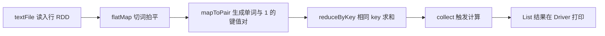
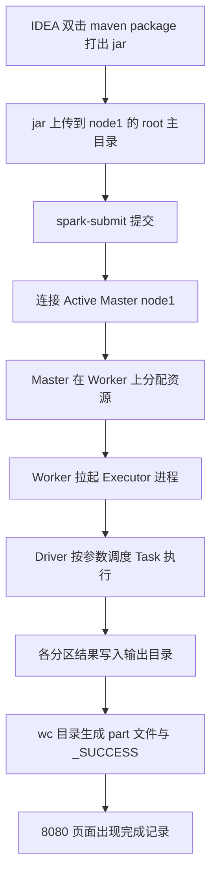

# 编写 Spark 应用全流程：WordCount 从本地跑通到集群提交

## 先给结论

- 一个 Maven 工程走完 Spark 应用的全生命周期：IDEA 本地跑通 WordCount、lambda 与链式两级简化、打包后 spark-submit 提交集群验证。
- 依赖只一个 `spark-core_2.11`（版本 2.4.3，Scala 后缀与集群发行版对齐）；程序入口两件套 `SparkConf` 与 `JavaSparkContext`，所有算子经上下文发起，用完 `stop()` 释放资源。
- `local[*]` 是本地模式且线程数等于本机 CPU 核数，`local[2]` 固定两个线程；本地跑的 wordcount 与集群无关。
- WordCount 四算子：`flatMap` 按空格切词、`mapToPair` 生成键值对、`reduceByKey` 相同 key 求和、`collect` 触发计算收结果；转换算子懒执行，动作算子才触发计算。
- 优化不触碰算子语义：三处匿名实现类换 lambda、中间变量内联成链式，Spark 生成的执行计划不变，变短的只是样板代码；`Tuple2` 取值用 `_1()`、`_2()` 方法。
- 打包前两处调整：Spark 依赖 scope 改成 `provided`，集群自带运行 jar 不必打进包；代码注释掉 `setMaster`，输入输出路径改 `args` 参数，一个 jar 吃任何数据。
- 提交命令三段式：spark-submit 选项在前，主类与 jar 居中，应用参数在后；HA 集群建议给完整 Master 地址列表，比只写当前主节点更能扛故障切换。
- 成功的三重凭证：输出目录的 `_SUCCESS` 文件、part 文件内容正确、8080 页面 Completed 列表出现应用名的 FINISHED 记录。

## 第1部分：用 Java 编写第一个 Spark 应用：IDEA 里跑通 WordCount

`spark-shell` 即写即得，但命令行里的一切都留不下来，逻辑稍复杂就得整段重敲；真实项目的 Spark 应用要进工程、进版本管理、可打包提交。官方推荐的语言是 Scala，而 Spark 同样提供了完整的 Java API，Java 技术栈照样能写。从零建一个 Maven 工程，把单词统计用 Java 完整实现并跑通，顺带把 `SparkConf`、`JavaSparkContext` 和四个核心算子的类型变化看明白。

### 一、建 Maven 工程并导入依赖

IDEA 里 Create New Project 选 Maven，示例工程 groupId 用 `com.study.tanhua`，artifactId 用 `my-spark-test`，创建完成后打开 pom 的自动导入开关，再补 Spark 依赖与编译插件：

```xml
<dependencies>
    <dependency>
        <groupId>org.apache.spark</groupId>
        <artifactId>spark-core_2.11</artifactId>
        <version>2.4.3</version>
    </dependency>
</dependencies>

<build>
    <plugins>
        <!-- java 编译插件 -->
        <plugin>
            <groupId>org.apache.maven.plugins</groupId>
            <artifactId>maven-compiler-plugin</artifactId>
            <version>3.8.1</version>
            <configuration>
                <target>1.8</target>
                <encoding>UTF-8</encoding>
            </configuration>
        </plugin>
    </plugins>
</build>
```

坐标末尾的 `_2.11` 是 Scala 版本后缀，选择依据是目标集群的构建版本：课堂集群 Spark 2.4.3 默认 Scala 2.11 构建，本地依赖就要用 `spark-core_2.11`，两边不一致运行期可能出现类不兼容。编译插件把目标定在 JDK 1.8 并强制 UTF-8 编码，避免中文注释在编译期报错。

测试数据与命令行体验时同款：Windows 下放到 `F:\code\word.txt`，内容同样是 hello 出现 4 次、其余单词各 1 次的四行文本。

### 二、入口两件套：SparkConf 与 JavaSparkContext

在 `com.study.tanhua.spark` 包下新建 `WordCountApp`，先把骨架立起来：

```java
package com.study.tanhua.spark;

import org.apache.spark.SparkConf;
import org.apache.spark.api.java.JavaSparkContext;

public class WordCountApp {
    public static void main(String[] args) {
        // 设置 spark 的配置信息
        SparkConf sparkConf = new SparkConf()
                .setAppName("WordCountApp")
                .setMaster("local[*]");
        // 创建 spark 上下文对象，它是程序的入口，所有操作都通过它来执行
        JavaSparkContext jsc = new JavaSparkContext(sparkConf);

        // 业务逻辑写在这里

        // 关闭上下文，释放资源
        jsc.stop();
    }
}
```

`SparkConf` 是配置载体：`setAppName` 给应用起名，之后会显示在 Master 8080 页面的应用列表里；`setMaster` 指定运行模式。`local[*]` 与 `local[2]` 的区别在并行度：前者读取当前机器的 CPU 核数，一核一个线程，把 CPU 用满；后者固定两个线程执行。调试时想模拟受限资源就用固定线程数，正式本地压测用 `local[*]`。

`JavaSparkContext` 是上下文对象，理解成通往 Spark 执行环境的入口即可，`textFile` 等一切算子都从它发起；用完调用 `jsc.stop()` 释放资源，这是初学者最容易漏的收尾步骤。

### 三、四个算子串起 WordCount

补全业务代码，先按匿名内部类写法完整呈现：

```java
package com.study.tanhua.spark;

import org.apache.spark.SparkConf;
import org.apache.spark.api.java.JavaPairRDD;
import org.apache.spark.api.java.JavaRDD;
import org.apache.spark.api.java.JavaSparkContext;
import org.apache.spark.api.java.function.FlatMapFunction;
import org.apache.spark.api.java.function.Function2;
import org.apache.spark.api.java.function.PairFunction;
import scala.Tuple2;

import java.util.Arrays;
import java.util.Iterator;
import java.util.List;

public class WordCountApp {
    public static void main(String[] args) {
        SparkConf sparkConf = new SparkConf()
                .setAppName("WordCountApp")
                .setMaster("local[*]");
        JavaSparkContext jsc = new JavaSparkContext(sparkConf);

        // 读取文件
        JavaRDD<String> linesJavaRDD = jsc.textFile("F://code//word.txt");
        // 按空格切分，一行拆成多个单词
        JavaRDD<String> flatMapRdd = linesJavaRDD.flatMap(new FlatMapFunction<String, String>() {
            @Override
            public Iterator<String> call(String s) throws Exception {
                String[] ss = s.split(" ");
                return Arrays.asList(ss).iterator();
            }
        });
        // 每个单词记 1，形成 key 为单词、value 为计数的键值对
        JavaPairRDD<String, Integer> mapToPairRdd = flatMapRdd.mapToPair(new PairFunction<String, String, Integer>() {
            @Override
            public Tuple2<String, Integer> call(String s) throws Exception {
                return new Tuple2<>(s, 1);
            }
        });
        // 相同单词的计数相加
        JavaPairRDD<String, Integer> reduceByKeyRdd = mapToPairRdd.reduceByKey(new Function2<Integer, Integer, Integer>() {
            @Override
            public Integer call(Integer v1, Integer v2) throws Exception {
                return v1 + v2;
            }
        });
        // collect 触发计算，结果拉回 Driver 遍历打印
        List<Tuple2<String, Integer>> list = reduceByKeyRdd.collect();
        for (Tuple2<String, Integer> obj : list) {
            System.out.println(obj._1() + " 出现的次数为：" + obj._2());
        }

        jsc.stop();
    }
}
```

执行链路逐段对应：`textFile` 读文件得到 `JavaRDD`，每个元素是一行文本；`flatMap` 的回调里按空格 `split` 出单词数组，返回值要求是 `Iterator`，所以用 `Arrays.asList(ss).iterator()` 把数组转成迭代器，一行文本就此拍平成多个单词；`mapToPair` 把每个单词包成 `Tuple2<String, Integer>`，RDD 类型随之升级为 `JavaPairRDD`，这正是后续按键聚合的前提；`reduceByKey` 把相同单词的计数两两相加；`collect` 是动作算子，触发计算并把结果收成 `List` 回到 Driver 端循环打印。

数据流一张图看全：



前三步都只是登记转换逻辑，`collect` 出现才真正执行，与 spark-shell 里的行为一致。运行程序，控制台输出 hello 出现 4 次、其余各 1 次，日志末尾还能看到 `Job 0 finished: collect at WordCountApp.java:50, took 0.956583 s`，说明这次运行提交并完成了一个 Job。

### 四、转换与动作的分界

flatMap、mapToPair、reduceByKey 属于转换算子，只把处理逻辑登记成一条血缘链，期间一个 Job 都没有提交；collect 一出现，Spark 才沿血缘链生成 Stage 与 Task 去执行。分清这条界线，调试时就能区分「代码逻辑写错」与「结果还没触发计算」两类问题，也能解释为什么删掉 collect 之后程序瞬间跑完却什么都算不出来。

## 第2部分：把 Java 版 WordCount 改出 Scala 味：lambda 与链式两级简化

匿名内部类版本能跑通，但一个 flatMap 回调就要七行样板，new 与 @Override 把真正的统计逻辑埋在中间。JDK 8 的 lambda 表达式恰好为这种场景而生：接口只要一个抽象方法，匿名类就能压成一个表达式。Spark 的 FlatMapFunction、PairFunction、Function2 全是单抽象方法接口，改造几乎零成本，改完的代码与 Scala 版本只差语法糖的距离。

### 一、第一级简化：lambda 替换匿名实现类

复制出 `WordCountApp2`，应用名同步改成 WordCountApp2，方便在 8080 页面区分两次运行，改动集中在三处回调与结果遍历：

```java
package com.study.tanhua.spark;

import org.apache.spark.SparkConf;
import org.apache.spark.api.java.JavaPairRDD;
import org.apache.spark.api.java.JavaRDD;
import org.apache.spark.api.java.JavaSparkContext;
import scala.Tuple2;

import java.util.Arrays;
import java.util.List;

public class WordCountApp2 {
    public static void main(String[] args) {
        // 设置 spark 的配置信息
        SparkConf sparkConf = new SparkConf()
                .setAppName("WordCountApp2")
                .setMaster("local[*]");
        JavaSparkContext jsc = new JavaSparkContext(sparkConf);

        // 读取文件
        JavaRDD<String> linesJavaRDD = jsc.textFile("F://code//word.txt");
        // 按空格切分，一行拆成多个单词
        JavaRDD<String> flatMapRdd = linesJavaRDD.flatMap(s -> {
            String[] ss = s.split(" ");
            return Arrays.asList(ss).iterator();
        });
        // 每个单词记 1，形成键值对
        JavaPairRDD<String, Integer> mapToPairRdd =
                flatMapRdd.mapToPair(s -> new Tuple2<>(s, 1));
        // 相同单词的计数相加
        JavaPairRDD<String, Integer> reduceByKeyRdd =
                mapToPairRdd.reduceByKey((v1, v2) -> v1 + v2);
        // collect 触发计算，forEach 遍历打印
        List<Tuple2<String, Integer>> list = reduceByKeyRdd.collect();
        list.forEach(obj -> System.out.println(obj._1() + " 出现的次数为：" + obj._2()));

        jsc.stop();
    }
}
```

替换能成立的共同前提，是 FlatMapFunction、PairFunction、Function2 三个接口都只有一个抽象方法：flatMap 的多行逻辑保留大括号写法，mapToPair 与 reduceByKey 是单行表达式，连 return 都省了；遍历从 for 循环换成 `list.forEach(obj -> ...)`，`Tuple2` 的单词与次数分别经 `_1()`、`_2()` 取出。重新执行，结果与展开版逐行一致。

三条 lambda 各管一件事：`s -> ...` 里的 s 是一行文本，切词逻辑与展开版完全相同；`s -> new Tuple2<>(s, 1)` 里的 s 已经是单词，打上计数 1；`(v1, v2) -> v1 + v2` 里的 v1、v2 是同一个单词相邻两次聚合的计数值，两两相加直到归一。参数名可以自取，Spark 只认接口签名。样板消失之后，剩下的每一行都是数据变换本身，代码反而更贴近业务语义，这正是函数式写法在计算框架里流行的原因。

### 二、第二级简化：中间变量内联成链式

flatMapRdd、mapToPairRdd、reduceByKeyRdd 这批中间变量只给下一步当入参，没有复用价值，全部内联就得到链式写法：

```java
// 单词计数的逻辑处理：链式调用一步到底
List<Tuple2<String, Integer>> list = linesJavaRDD
        .flatMap(s -> {
            String[] ss = s.split(" ");
            return Arrays.asList(ss).iterator();
        })
        .mapToPair(s -> new Tuple2<>(s, 1))
        .reduceByKey((v1, v2) -> v1 + v2)
        .collect();

list.forEach(obj -> System.out.println(obj._1() + " 出现的次数为：" + obj._2()));
```

从 `textFile` 开始一路点到底，与 spark-shell 里那行 Scala 命令形态一致；差距只剩语法糖，Scala 的下划线占位符比 Java 的 lambda 更短，但 Java 版的统计逻辑已经一眼见底。课堂讲义给出的最终代码就是这个链式形态，也是期望读者最终能写出的样子。

重构路径与结果如图：


三个版本是同一条算子链的三种排版：类型变化与逻辑完全相同，Spark 构建的执行计划没有差别，跑出来的都是 hello 4 次、其余各 1 次。执行规则也没有被改动：转换算子仍然只是登记血缘，collect 仍然是唯一的动作算子，运行期 Job、Stage、Task 的划分与展开版一模一样，4040 页面上看到的执行细节完全相同。

### 三、两种写法怎么选

链式版胜在紧凑，调试上有一点取舍：中间变量便于在断点处观察每个 RDD 的内容，排查数据问题时把链子临时拆开更顺手，成熟的折中是日常写链式、排查时拆开。初期写不出链式版完全正常，先把展开版写对，理解每一层的类型变化，再按固定套路收敛：lambda 化去掉样板，内联去掉中间变量。

团队协作里还有一个现实因素：lambda 与链式要求读者熟悉 JDK 8 函数式写法与 Spark 的类型体系，接手人背景不同时，保留展开版反而利于交接。两种形态没有绝对优劣，同一工程里保持一种风格统一即可，反复横跳才是真正的可读性问题。

## 第3部分：从 IDEA 到 Spark 集群：WordCount 打包提交与结果验证

本地模式跑通的程序离真实使用还差一段：打成 jar、提交到集群、在正确的位置核对结果。这一步会集中暴露一批新问题，依赖要不要打进包、代码里写死的 master 与文件路径怎么处理、提交命令的参数顺序、输出目录里多出来的文件是什么，逐个拆解。

### 一、打包前的两处调整

pom 里给 Spark 依赖补 scope：

```xml
<dependencies>
    <dependency>
        <groupId>org.apache.spark</groupId>
        <artifactId>spark-core_2.11</artifactId>
        <version>2.4.3</version>
        <scope>provided</scope>
    </dependency>
</dependencies>
```

provided 表示编译期可见、打包期不携带。Spark 安装目录里已经带着全套运行 jar，任务提交后 Executor 用的就是集群自己的版本；本地依赖再打进去，两份 Spark 类库挤在同一个 classpath 上，轻则 jar 体积暴涨，重则类冲突报错。

代码层面复制出 `WordCountApp3`，三处调整一次到位：

```java
package com.study.tanhua.spark;

import org.apache.spark.SparkConf;
import org.apache.spark.api.java.JavaPairRDD;
import org.apache.spark.api.java.JavaRDD;
import org.apache.spark.api.java.JavaSparkContext;
import scala.Tuple2;

import java.util.Arrays;

public class WordCountApp3 {
    public static void main(String[] args) {
        // 设置 spark 的配置信息，master 由提交命令的 --master 参数指定
        SparkConf sparkConf = new SparkConf()
                .setAppName("WordCountApp3");
        JavaSparkContext jsc = new JavaSparkContext(sparkConf);

        // 输入路径来自第一个参数，不再写死
        JavaRDD<String> linesJavaRDD = jsc.textFile(args[0]);
        // 按空格切分，一行拆成多个单词
        JavaRDD<String> flatMapRdd = linesJavaRDD.flatMap(s -> {
            String[] ss = s.split(" ");
            return Arrays.asList(ss).iterator();
        });
        // 每个单词记 1，形成键值对
        JavaPairRDD<String, Integer> mapToPairRdd =
                flatMapRdd.mapToPair(s -> new Tuple2<>(s, 1));
        // 相同单词的计数相加
        JavaPairRDD<String, Integer> reduceByKeyRdd =
                mapToPairRdd.reduceByKey((v1, v2) -> v1 + v2);

        // 保存结果到第二个参数指定的目录
        reduceByKeyRdd.saveAsTextFile(args[1]);

        jsc.stop();
    }
}
```

三处调整各有理由。去掉 `setMaster`：SparkConf 里直接设置的属性优先级最高，会盖住提交命令的 `--master`，留着它，提交时指定什么地址都被这句覆盖，集群模式形同虚设。路径参数化：Linux 与 Windows 的路径写法不同，写死在源码里，换一个文件就得改代码重新编译打包；main 方法的 `args` 参数天然适合干这件事，`args[0]` 收输入路径。动作算子换掉 `collect`：集群运行的结果不该打印在控制台，`saveAsTextFile(args[1])` 把各分区结果写到输出目录。运行这个类至少要传两个参数，输入文件与输出目录。

### 二、打包与上传

IDEA 右侧 Maven 面板展开 Lifecycle，双击 package，构建完成后 jar 落在 target 目录，名为 `my-spark-test-1.0-SNAPSHOT.jar`，provided 的依赖不会出现在包里。通过终端的 rz 命令把 jar 上传到 node1（192.168.31.82）的 root 主目录。

提交前到 Master 的 8080 页面看一眼当前 Active Master：此刻 node1 是主节点，node2 与 node3 处于备用状态。HA 集群的 Active 会随故障切换漂移，稳妥写法是把三个地址都挂到 `--master` 后面让客户端轮询，课堂演示取当前主节点地址。

### 三、spark-submit 提交与结果核对

进入 Spark 安装目录的 bin 子目录执行提交：

```bash
cd $SPARK_HOME/bin
./spark-submit \
  --master spark://node1:7077 \
  --class com.study.tanhua.spark.WordCountApp3 \
  /root/my-spark-test-1.0-SNAPSHOT.jar \
  /root/word.txt /root/wc
```

命令按三段记：第一段是 spark-submit 自己的选项，`--master` 指定集群地址，`--class` 指定主类的全限定名；第二段是 jar 的全路径；第三段是传给 main 方法的应用参数，`args[0]` 输入、`args[1]` 输出，与 jar 之间以及参数彼此之间用空格分隔。任务跑完核对结果：

```bash
cd /root/wc
cat part-00000 part-00001
```

输出目录结构与命令行落盘时一致：`_SUCCESS` 声明计算成功，两个 part 文件里的计数汇总后正是 hello 4 次、其余各 1 次。打开 8080 页面，Completed Applications 列表新增一条 Name 为 WordCountApp3 的记录，`setAppName` 设置的名字在这里生效，这条 FINISHED 记录连同 Executor 占用的核数与内存，就是应用确实在集群上运行过的凭证。

从打包到出结果的全链路：



前四步解决「东西送过去」，中间两步解决「资源给到位」，后四步是计算与验收，任何一环断了，后面全部无声无息，排查时按图从提交日志往回找。

### 四、常见报错速查

- **`ArrayIndexOutOfBoundsException: 1`**：main 里取 `args[1]` 而提交时只传了一个参数，输入与输出两个路径必须成对给齐。
- **输出目录报 `FileAlreadyExistsException`**：`saveAsTextFile` 不覆盖已有目录，重跑前先删除输出目录或换新目录名。
- **`ClassNotFoundException`**：`--class` 的全限定名拼错，或 jar 没有上传成功，逐一核对类名与 jar 路径。
- **提交后长时间卡在连接**：`--master` 指向 Standby 节点或地址写错，HA 环境改成完整列表 `spark://node1:7077,node2:7077,node3:7077`。

## 常见误区

- **把 local[*] 当成集群运行。** 错例：IDEA 本地跑出结果，就认为集群链路已经验证。正解：`local[*]` 是本地多线程模拟并行，不经过 Master 与 Worker，验证集群要把 jar 提交上去跑。

- **在 JavaRDD 上直接调 reduceByKey。** 错例：flatMap 之后想省掉 mapToPair 直接聚合，编译报错找不到方法。正解：`reduceByKey` 定义在 `JavaPairRDD` 上，先 `mapToPair` 把 RDD 升级成键值对形态。

- **flatMap 回调里直接 return 数组。** 错例：`return s.split(" ");` 类型不匹配编译不过。正解：回调要求返回 `Iterator`，写成 `Arrays.asList(ss).iterator()`。

- **忘记 jsc.stop()。** 错例：程序跑完控制台安静了，进程却迟迟不退出。正解：main 方法结尾调用 `jsc.stop()` 释放上下文资源。

- **以为换 lambda 能提速。** 错例：对比两版耗时，得出「优化后更快」的结论。正解：执行计划相同，性能一样，这次优化的收益在可读性与代码量，不在运行效率。

- **把 `_1`、`_2` 当字段访问。** 错例：`obj._1` 编译不过。正解：`Tuple2` 经方法取值，写 `obj._1()`、`obj._2()`。

- **在 RDD 上直接 foreach 打印。** 错例：`reduceByKeyRdd.foreach(obj -> System.out.println(obj))`，看似比 collect 后再打印省一步。正解：foreach 的函数在 Executor 端逐元素执行，集群模式下打印内容留在计算节点的日志里，Driver 控制台看不到；要把结果拿到 Driver 处理，先 collect 成 List 再 forEach。

- **以为代码里 setMaster 与 --master 同时生效。** 错例：本地版代码不改直接提交，发现应用怎么都在本地跑。正解：SparkConf 直接设置的属性优先级最高，提交前必须去掉 setMaster。

- **把应用参数写成 `--input` 这样的自定义选项。** 错例：spark-submit 不认识这种横线选项，直接报错退出。正解：应用自己的参数不加横线，直接跟在 jar 路径后面，用空格分隔、按位置接收。

- **把 provided 理解成可以删掉依赖。** 正解：依赖必须保留，编译期要用它的类；provided 只改变打包行为，删掉依赖工程连编译都过不了。

## 面试可能被问到的问题

1. 面试官追问：「local、local[*]、local[2] 有什么区别？」
   答：local 只用一个线程执行；local[*] 让线程数等于机器 CPU 核数，把 CPU 用满；local[2] 固定两个线程。三者都是本地模式，应用不进集群，区别只在并行度。

2. 面试官追问：「JavaSparkContext 在应用里扮演什么角色？」
   答：Spark 应用的上下文入口，持有配置与连接信息，textFile、parallelize 等算子都由它发起，同时负责向集群或本地执行环境申请资源并调度计算，结束时调用 stop 释放资源。

3. 面试官追问：「flatMap 和 map 的区别是什么？」
   答：map 对每个元素做一对一转换，输出元素数不变；flatMap 先做转换再把结果拍平，一个元素可以展开成零到多个元素。本例中一行文本经 flatMap 展开成多个单词，map 只适合行到行的转换。

4. 面试官追问：「为什么 reduceByKey 之前要先 mapToPair？」
   答：reduceByKey 是按键聚合的算子，要求 RDD 具备键值对形态。Java API 里它定义在 JavaPairRDD 上，普通 JavaRDD 没有这个方法，mapToPair 把每个元素包装成 Tuple2 并把 RDD 升级为 JavaPairRDD，之后才能按 key 聚合。

5. 面试官追问：「transformation 和 action 的区别，各举一个例子？」
   答：transformation 只定义转换逻辑并登记血缘，不触发计算，如 map、reduceByKey；action 触发实际计算并返回结果或落盘，如 collect、saveAsTextFile。一个 action 对应提交一个 Job。

6. 面试官追问：「代码重构之后，运行结果和性能会有变化吗？」
   答：都不变。lambda 与链式只是 Java 语法的改写，算子链与参数完全一致，Spark 构建的 DAG 与执行计划相同，结果一致、耗时持平。重构的价值在可读性与维护成本。

7. 面试官追问：「Java 的 lambda 能替换 Spark API 里所有匿名类吗？」
   答：凡是单抽象方法接口都可以，Spark 的 FlatMapFunction、PairFunction、Function2 均符合。含多个抽象方法的接口无法用 lambda 表达，只能保留匿名类或改用其他写法。

8. 面试官追问：「mapToPair 和 map 的区别是什么？」
   答：两者都能生成键值对，但 map 返回普通 JavaRDD，mapToPair 返回 JavaPairRDD。reduceByKey 等 key 族算子定义在 JavaPairRDD 上，后续要做按键聚合就走 mapToPair。

9. 面试官追问：「链式调用写在一行，执行顺序是怎样的？」
   答：源码顺序即血缘构建顺序，textFile 在前、reduceByKey 在后；但执行时机与写法无关，出现 action 时 Spark 才按血缘从后往前划分 Stage 再执行。写法只影响代码形态，不影响执行模型。

10. 面试官追问：「Java 版与 Scala 版 Spark 代码的主要差距在哪？」
   答：API 能力等价，差距在语法糖：Scala 有下划线占位符与更强的类型推断，一行更短；Java 需要显式写出 lambda 的参数与方法调用。工程选型更多看团队技术栈，而不是语言本身的表达力。

11. 面试官追问：「SparkConf 里 setMaster 和 spark-submit 的 --master 谁的优先级高？」
   答：代码里直接 set 的属性优先级最高，会覆盖提交命令的参数。生产实践是代码里不写死 master，统一由提交命令或配置决定，同一个 jar 才能灵活切换本地与集群。

12. 面试官追问：「scope provided 在 Spark 应用打包时起什么作用？」
   答：让 Spark 依赖只参与编译、不进入应用 jar。集群已经提供运行时类库，打进包会造成两份类库并存，轻则包体积膨胀，重则类冲突；provided 把编译与打包的诉求分开。

13. 面试官追问：「spark-submit 的参数顺序怎么记？」
   答：三段式，spark-submit 的选项如 --master、--class 在前，应用 jar 路径居中，传给 main 方法的参数在 jar 之后按位置排列。横线开头的是 spark-submit 认识的选项，不带横线的属于应用自己。

14. 面试官追问：「如何确认一个应用在集群上运行成功？」
   答：三个位置交叉验证，输出目录存在 _SUCCESS 且 part 文件内容正确，8080 页面 Completed 列表出现该应用名的 FINISHED 记录，提交进程无异常日志退出。

15. 面试官追问：「saveAsTextFile 的输出为什么是目录而不是单个文件？」
   答：结果按分区落盘，一个分区写一个 part 文件，目录里的文件数就是输出分区数，配合 _SUCCESS 标识完整性。分布式计算天然并行产出，消费方自行汇总或用存储层合并读取。

16. 面试官追问：「HA 集群下 --master 应该怎么写？」
   答：写全部 Master 节点的地址列表，如 spark://node1:7077,node2:7077,node3:7077，客户端按列表轮询，连不上自动换下一台，提交不再依赖某个固定节点存活。

## 配套资料

- 学习目标：`materials/code/07/day06 探花交友-Spark快速入门/day06/学习目标.md`，其中「独立完成单词统计的入门案例」一条对应这里的验收目标。

- 说明：day06 资料包仅含学习目标，无工程源码与讲义文件；工程创建步骤与代码按课程画面整理成可编译的完整实现，包名按 `com.study.tanhua` 规范改写，测试文件与运行日志按本课写法补全。

- 说明：day06 资料包仅含学习目标，讲义文件不在资料包内；两级简化代码为按课程画面整理的可编译实现，包名按 `com.study.tanhua` 规范改写。

- 说明：day06 资料包仅含学习目标，无工程源码与讲义文件；pom 修改、代码调整与提交命令按课程画面整理，包名按 `com.study.tanhua` 规范改写，路径示例统一取 root 主目录，常见报错与处理方式为按本课写法补全。
