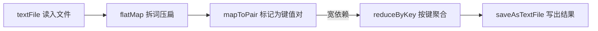
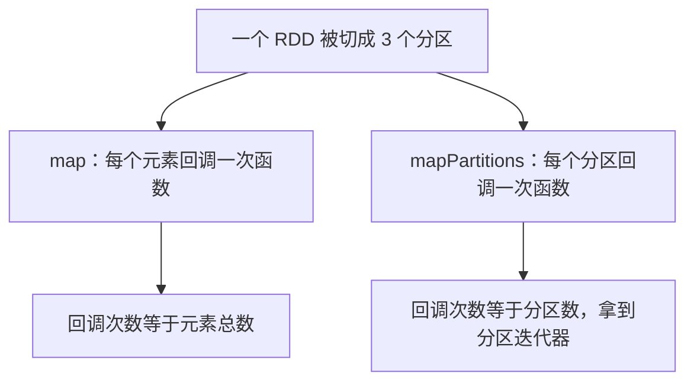
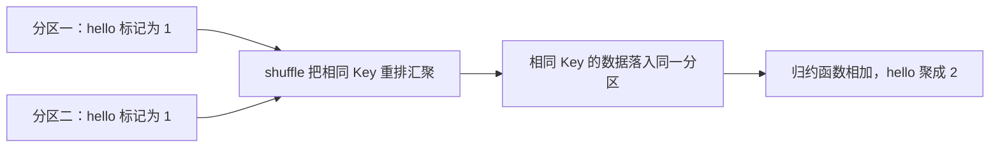
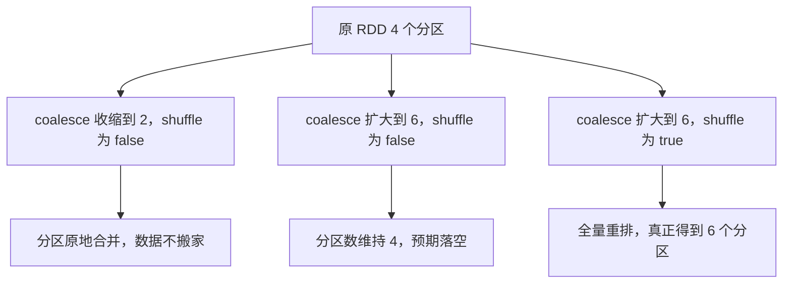

# 弹性分布式数据集RDD之实战笔记：RDD 概述与 map、reduceByKey、coalesce 算子详解

## 先给结论

RDD 是 Spark 的地基：弹性分布式数据集把数据切成带分区的不可变集合，靠血缘依赖容错，靠转换算子加工数据。全系列四讲从概念讲到三类算子，构成 day06 算子主线。
概念讲清三件事：RDD 在程序里的位置、三个单词拆开的定义、它为解决 MapReduce 磁盘之痛而生，以及分区与依赖这两块内部骨架。算子部分三讲递进：map、filter、flatMap、mapPartitions 与 mapToPair 五个转换算子一对一或一对多地变数据；reduceByKey 按 Key 聚合，第一次正面撞上 shuffle，并与 groupByKey 对比出取舍；coalesce 收缩分区省开销，扩大分区必须开 shuffle，最后与 repartition 对齐关系。
统一的学习方法是先数分区再动手：每个算子的效果都用分区数与输出内容对照验证。
四讲依次是：
- RDD 概述：从单词统计看位置、定义由来与分区依赖骨架。
- 转换算子五连：map、filter、flatMap、mapPartitions 与 mapToPair，共用一套测试骨架。
- reduceByKey：按 Key 归约、shuffle 的代价与 groupByKey 对比。
- coalesce 重分区：收缩原地合并、扩大必开 shuffle 与 repartition 的关系。

## 第1部分：RDD 概述：弹性分布式数据集为什么是 Spark 的地基

写完单词统计再回头看代码，会发现一个规律：从 `textFile` 读文件开始，flatMap 拆词、mapToPair 标记单词、reduceByKey 汇总计数，每一步返回值的类型都带着 RDD 三个字母。这串对象到底是什么？为什么整个 Spark 编程几乎都在围绕它转？概念只停留在「一个分布式集合」这种一句话解释，后面遇到分区、报错、调优问题时会明显底气不足，值得把名字里的每个单词、它出现的原因和内部的骨架逐一过一遍。

### 从单词统计看 RDD 在程序里的位置

以最常见的单词统计为例，整条链路上每个中间变量都是 RDD：

```java
package com.study.tanhua.spark;

public class WordCountApp {
    public static void main(String[] args) {
        // Spark 配置
        SparkConf sparkConf = new SparkConf().setAppName("WordCountApp");
        // 上下文对象，程序的入口
        JavaSparkContext jac = new JavaSparkContext(sparkConf);
        // 读取文件，得到第一个 RDD
        JavaRDD<String> fileRdd = jac.textFile(args[0]);
        // 按空格拆分压扁，得到第二个 RDD
        JavaRDD<String> flatMapRdd = fileRdd.flatMap(
                s -> Arrays.asList(s.split(" ")).iterator());
        // 每个单词标记为单词与 1 组成的键值对，得到第三个 RDD
        JavaPairRDD<String, Integer> mapToPairRdd = flatMapRdd.mapToPair(
                s -> new Tuple2<>(s, 1));
        // 相同单词的计数相加，得到第四个 RDD
        JavaPairRDD<String, Integer> reduceByKeyRdd =
                mapToPairRdd.reduceByKey((v1, v2) -> v1 + v2);
        // 保存结果到指定目录
        reduceByKeyRdd.saveAsTextFile(args[1]);
        // 释放资源
        jac.stop();
    }
}
```

四个中间变量 `fileRdd`、`flatMapRdd`、`mapToPairRdd`、`reduceByKeyRdd` 全是 RDD。每个算子都吃进一个 RDD、吐出一个新 RDD，前后用依赖关系串成一条链，Driver 端拿着这条链才知道完整的数据从哪来、经过哪些处理、最后去哪。下面这张图就是这条链的样子：



链上前三段处理在各自分区内就能完成，到 reduceByKey 这一步要把相同单词从不同分区拉到一起，是整条链唯一的宽依赖点，也是代价所在。

### 三个单词拆开，RDD 的定义就齐了

**Dataset，它首先是数据集。** 用于存放数据，这是它的本职。与 Java 集合的区别在于，它装的是散在不同节点上的数据，操作它却像操作一个本地大集合，Spark 负责把处理逻辑分发到数据所在的机器。

**Distributed，数据是分布式的。** RDD 里的数据分散存储在集群多个节点上，天然支持分布式计算。一份大文件读进来后按分区散在各个 Executor 上，谁存着数据谁就近计算，而不是把数据搬到一台机器上集中处理。

**Resilient，这是「弹性」的来源。** 数据可以存储在内存中，也可以存储在磁盘中，内存充足就驻留内存，内存紧张就落盘，可进可退就是弹性。弹性还有另一层含义：RDD 出错后可以沿依赖关系重新计算恢复，自动容错由此而来。

按定义，RDD 代表一个不可变、可分区、元素可并行计算的集合。不可变指 RDD 一旦生成不会原地修改，每次转换都产出新 RDD；可分区指数据被切成多个分区，分区是并行计算的最小调度单位；这两个性质合起来，才让「出错重算」成为可行策略。

缓存能力也值得单独说：RDD 允许在执行多个查询时把数据显式缓存进内存，后续查询直接重用缓存结果。迭代式场景里同一份数据要被反复用到，缓存一次就省掉一轮重复计算，查询速度提升非常明显。

### RDD 为什么会出现：MapReduce 的磁盘之痛

MapReduce 并非没有优点，自动容错、负载均衡、可扩展性都成立，问题出在计算模型本身。MapReduce 采用非循环的数据流模型，作业与作业之间只能靠磁盘文件衔接，涉及迭代计算时每轮都要把中间结果写盘、下一轮再读出来，磁盘 IO 反复发生，效率被 IO 拖垮。

RDD 正是冲着这个缺点抽象出来的解决方案：一种具备容错机制的特殊集合，可以分布在集群节点上，以函数式编程的方式操作集合，中间结果尽量留在内存里流转，需要跨轮重用的数据可以缓存，避免重复计算。对照单词统计的代码能直接感受到这一点：读文件得到的 RDD 之后连续做了拆词、标记、聚合多次转换，全程只有最终写出才落盘，中间数据在内存与分区之间流转。

### 分区与依赖：RDD 内部的骨架

按 RDD 抽象类的源码口径（课程讲义未展开，此处按 Spark 源码注释补充整理），每个具体 RDD 都要交代五件事：

```scala
// RDD 抽象类要求实现类提供的五个核心要素
def compute(split: Partition, context: TaskContext) // 1. 每个分区的计算函数
val partitions: Array[Partition]                    // 2. 分区列表，并行度的依据
val dependencies: Seq[Dependency[_]]                // 3. 依赖列表，血统链的来源
val partitioner: Option[Partitioner]                // 4. 可选的分区器，键值对 RDD 才有
val preferredLocations: Seq[String]                 // 5. 位置优先列表，数据在哪优先在哪算
```

分区列表决定了这份 RDD 能被切成多少份并行处理；依赖列表记录它由哪些父 RDD 经过什么算子得到，容错重算全靠这条血统链；位置优先让调度尽量把 Task 发到数据所在节点，这就是「位置感知调度」的落地。

依赖关系只有两种形态：父 RDD 的每个分区至多被子 RDD 的一个分区用到，就是窄依赖，map、filter 都属于这类；只要存在一个父分区被多个子分区用到，就是宽依赖，reduceByKey 这类按 Key 汇聚的算子必然产生宽依赖。宽窄依赖的划分直接决定任务怎么分阶段调度，相关细节在任务调度部分展开。
## 第2部分：RDD 转换算子五连：map、filter、flatMap、mapPartitions 与 mapToPair 逐个吃透

RDD 的概念讲得再多，不动手调几个算子等于没入门。真到写代码时，新的困惑马上就来：map 和 mapPartitions 只差一个后缀，到底差在哪？明明有 map 了，为什么 Java 里还要单独设计一个 mapToPair？flatMap 拍扁拍掉的又是什么？这五个转换算子是 Spark 数据处理的地基，单词统计的每一步也都由它们承担。以下在同一个测试工程里把五个算子逐个跑通，每个都从语义定义、代码实现、运行输出、与相邻算子的差异四个角度说透，合并成一篇方便对照。

### 统一的测试骨架：一次搭好，五个算子复用

五个算子的演示共用同一个测试工程与测试类。工程是普通 Maven 项目，依赖 Spark 核心与 JUnit，坐标按本课集群版本 Spark 2.4.3 对齐：

```xml
<dependencies>
    <dependency>
        <groupId>org.apache.spark</groupId>
        <artifactId>spark-core_2.11</artifactId>
        <version>2.4.3</version>
        <scope>compile</scope>
    </dependency>
    <dependency>
        <groupId>junit</groupId>
        <artifactId>junit</artifactId>
        <version>4.12</version>
        <scope>test</scope>
    </dependency>
</dependencies>
```

测试类放在 `com.study.tanhua.spark` 包下，每个算子对应一个 testXxx 命名的测试方法，方法内的套路完全一致：建配置、建上下文、用 `parallelize` 造一个测试 RDD、套算子、collect 收回来打印、停掉上下文。map 的完整写法如下，后面几个算子只替换中间的处理段：

```java
package com.study.tanhua.spark;

public class RddOperation {
    @Test
    public void testMap() {
        SparkConf sparkConf = new SparkConf()
                .setAppName("RddOperation")
                .setMaster("local[*]");   // 本地模式，线程数取本机核数
        JavaSparkContext jsc = new JavaSparkContext(sparkConf);
        // 生成一个测试 rdd 数据集
        JavaRDD<Integer> rdd1 = jsc.parallelize(Arrays.asList(1, 2, 3, 4, 5));
        // 将 rdd1 中每一个元素都乘以 2，生成新的 rdd
        JavaRDD<Integer> rdd2 = rdd1.map(v1 -> v1 * 2);
        // 收集数据到 Driver 端
        List<Integer> list = rdd2.collect();
        list.forEach(integer -> System.out.println(integer));
        jsc.stop();
    }
}
```

`setMaster("local[*]")` 表示本地模式，演示阶段不必提交集群；`parallelize` 把本地集合变成分布式数据集，是造测试数据最省事的入口。运行输出为 2、4、6、8、10，正好是每个元素乘 2 之后的结果。

几个工程细节提前交代。每个测试方法相互独立，运行任何一个都会新建一套 SparkConf 与 JavaSparkContext，方法结束调用 `jsc.stop()` 释放资源，互不干扰。`collect` 是行动算子，它把分布式 RDD 的数据收回到 Driver 端变成本地 List，演示阶段用它打印结果最直观；数据量大的真实场景里 collect 会把 Driver 内存打爆，结果应该用写出类算子落盘。这套骨架同样适用于集群模式，把 master 换成集群地址后，计算模型完全一致，只是 Task 分发到了各节点的 Executor 上。

### map：一对一映射

map 的定义很干净：对 RDD 中的每个元素都执行一个指定的函数来产生一个新的 RDD，任何原 RDD 中的元素在新 RDD 中都有且只有一个元素与之对应。「一对一」是它的身份证：进来 5 个元素，出去还是 5 个元素，值可能变，个数不会变。函数的入参 `v1` 就是每一个元素本身，返回什么，新 RDD 里对应位置就是什么。

第一次按匿名内部类写法实现时，程序直接抛异常：

```text
org.apache.spark.SparkException: Task not serializable
```

原因出在序列化环节。算子函数不是在 Driver 上执行的，它会被序列化后发送到 Executor 所在节点执行。匿名内部类默认持有外部测试类对象的引用，而测试类没有实现 Serializable，序列化链条一断，Task 就发不出去。解法都围绕「让函数可序列化」展开，课程给出两种方案。

方案一，写一个独立的实现类，实现 Spark 的 Function 接口并声明序列化 ID：

```java
public class MyFunction implements Function<Integer, Integer> {
    private static final long serialVersionUID = 1L;

    @Override
    public Integer call(Integer v1) throws Exception {
        return v1 * 2;
    }
}

// 测试方法里直接 new 出来使用
JavaRDD<Integer> rdd2 = rdd1.map(new MyFunction());
```

方案二，改用 lambda 表达式：

```java
JavaRDD<Integer> rdd2 = rdd1.map(v1 -> v1 * 2);
```

两种方案运行结果完全一致，lambda 一行顶十行。编写 Spark 应用时应尽可能使用 lambda 实现算子函数，这也是后续代码的统一风格。

map 还有两个值得记住的特质。其一，它可以改变元素类型：输入是 Integer，函数里返回 `String.valueOf(v1)`，新 RDD 就是 `JavaRDD<String>`，泛型跟着函数走，链路上每一步的类型由上一个算子的返回值决定。其二，map 是窄依赖，处理发生在每个分区内、每个元素只属于一个分区，分区数经过 map 不变，Task 数也不变，性能模型非常可控。算子函数必须保持无副作用：不要在函数里修改外部集合或计数器，它会在集群各分区上各自执行，Driver 端感知不到这些修改。

### filter：一对一过滤

filter 保持着一对一的骨架，只是函数返回值变成了布尔值：对 RDD 中的每个元素都执行一个指定的函数来过滤产生一个新的 RDD。条件为真的元素保留，为假的元素被丢弃；每个元素要么由它自己顶替进入新 RDD，要么不出现在新 RDD 里，不会一变多。

```java
@Test
public void testFilter() {
    SparkConf sparkConf = new SparkConf()
            .setAppName("RddOperation")
            .setMaster("local[*]");
    JavaSparkContext jsc = new JavaSparkContext(sparkConf);
    JavaRDD<Integer> rdd1 = jsc.parallelize(Arrays.asList(1, 2, 3, 4, 5));
    // 过滤数据，用大于 2 的数据组成一个新的 rdd
    JavaRDD<Integer> rdd2 = rdd1.filter(v1 -> v1 > 2);
    // 收集数据
    List<Integer> list = rdd2.collect();
    list.forEach(integer -> System.out.println(integer));
    jsc.stop();
}
```

运行输出 3、4、5。与 map 对照着记：map 改值不丢数，filter 丢数不改值。两者都是窄依赖，数据留在各自分区内处理，不需要跨分区搬运。

filter 的使用价值在数据清洗上：脏数据剔除、条件筛选、异常值丢弃，本质上都是同一类布尔判定，可以类比 SQL 里的 WHERE 子句。使用中有两点经验。一是条件函数要写纯判定，不要在函数里做 IO 或修改外部状态，它与 map 的函数一样在集群各分区上执行。二是多个过滤条件串联时，把筛除率高的条件放在前面，让后续算子处理更少的数据；例如先过滤掉绝大多数无效记录再做格式解析，比先解析再过滤省得多。链路上每个 filter 都是一个独立的转换步骤，不会把两个条件合并执行，顺序即代价。

### flatMap：一对多拍扁

flatMap 和 map 非常相似，区别就一句话：map 的每个元素处理之后只能生成一个元素，而 flatMap 的每个元素可以生成多个元素来构建新的 RDD。「拍扁」指的是把每个元素产出的集合拆开、平铺进新 RDD，而不是把集合整体作为一个元素放进去。

```java
@Test
public void testFlatMap() {
    SparkConf sparkConf = new SparkConf()
            .setAppName("RddOperation")
            .setMaster("local[*]");
    JavaSparkContext jsc = new JavaSparkContext(sparkConf);
    // 生成 RDD
    JavaRDD<String> rdd = jsc.parallelize(Arrays.asList("hello world", "hello spark"));
    // 按空格分割拍扁
    JavaRDD<String> rdd2 = rdd.flatMap(s -> Arrays.asList(s.split(" ")).iterator());
    // 收集数据
    List<String> list = rdd2.collect();
    for (String o : list) {
        System.out.println(o);
    }
}
```

输入只有两条数据，都是带空格的句子。flatMap 对每个句子做 `split`，拿到的是单词数组，再把数组拆开平铺。运行输出 hello、world、hello、spark 四个单词，两个元素变成了四个元素，这就是一对多。单词统计里拆词的那一拍用的正是这个算子，每个句子被拆成若干单词后参与后续计数。

拿 map 做同样的拆词实验能把差异看得更清楚：如果写成 `rdd.map(s -> s.split(" "))`，输出的 RDD 类型是元素为数组的 RDD，collect 回来是两个数组对象，单词仍然被装在数组壳子里；flatMap 则直接把数组壳子拆掉，单词平铺到最外层。一句话概括：map 后接一层「拆集合」就等价于 flatMap，Scala 的 flatMap 就是 map 与 flatten 两个动作的合成。另外注意产出的数量是零到多个，函数返回空集合时该元素不会在新 RDD 里出现，这个性质有时被用来同时完成「转换加过滤」。

### mapPartitions：以分区为单位批量处理

mapPartitions 是 map 的一种变种。map 的输入函数应用于 RDD 中的每一个元素，mapPartitions 的输入函数应用于每一个分区，把分区中的内容作为一个整体来处理。两者差别用一张图对照最直观：



10 个数据按 3 个分区存储时，map 要回调 10 次，mapPartitions 只回调 3 次，每次拿到一个分区里的全部数据：

```java
@Test
public void testMapPartitions() {
    SparkConf sparkConf = new SparkConf()
            .setAppName("RddOperation")
            .setMaster("local[1]");
    JavaSparkContext jsc = new JavaSparkContext(sparkConf);
    // 1 到 10 共 10 个数据，按 3 个分区存储
    JavaRDD<Integer> rdd = jsc.parallelize(Arrays.asList(1, 2, 3, 4, 5, 6, 7, 8, 9, 10), 3);
    // 分区级操作：一个分区拿到一个迭代器
    JavaRDD<Integer> rdd2 = rdd.mapPartitions(integerIterator -> {
        List<Integer> result = new ArrayList<>();
        while (integerIterator.hasNext()) {
            Integer i = integerIterator.next();
            result.add(i);
        }
        System.out.println("分区数据：" + result);
        return result.iterator();
    });
    List<Integer> list = rdd2.collect();
    list.forEach(integer -> System.out.println(integer));
}
```

运行时控制台按分区打印出三行，本课环境下的划分依次是 `分区数据：[1, 2, 3]`、`分区数据：[7, 8, 9, 10]`、`分区数据：[4, 5, 6]`，三个分区分别持有 3 条、4 条、3 条数据。数据落到哪个分区由 Spark 自己决定，不必与元素的书写顺序连续对应；真正要看的是每个分区整批出现在同一次回调里，证明处理单位确实是分区而不是元素，三个分区对应三个 Task 并行执行。master 写成 `local[1]` 是有意为之：线程数固定为 1，分区回调在单线程里串行进行，控制台输出不交错，观察分区行为更直观。

既然有了 map，为什么还需要 mapPartitions？假设一个需求：把 RDD 里的数据逐条写入数据库。按元素处理意味着每个元素都要建立一次连接、执行一次写入，10 个数据就要建 10 次连接；按分区处理则一个分区只建一次连接，整批写完再收尾。两种做法的执行效率显然不在一个量级，需要与外部系统打交道时，mapPartitions 是更合适的选择。按主流写法补一个分区级批量写库的骨架示例：

```java
// 按分区批量写库的示意骨架，按本课写法补全
JavaRDD<Integer> saved = rdd.mapPartitions(integerIterator -> {
    // 一个分区只建立一次连接
    Connection conn = DriverManager.getConnection(url, user, password);
    List<Integer> result = new ArrayList<>();
    while (integerIterator.hasNext()) {
        Integer i = integerIterator.next();
        // 同一连接内批量写入
        result.add(i);
    }
    conn.close();
    return result.iterator();
});
```

与 map 逐元素各建一次连接相比，连接建立、事务提交、网络往返的次数都被压缩到分区粒度，数据量越大差距越明显。

代价也要看清：函数收到的是整个分区的迭代器，分区数据会一次性经过函数体；返回值也必须是一个新的迭代器，把处理结果吐回去交给新 RDD，丢掉返回值新 RDD 就是空的。分区特别大时，整批数据驻留内存要留意内存压力。

### mapToPair：把普通 RDD 升级成键值对 RDD

mapToPair 对 RDD 中的每个元素执行一个函数调用，把原来 T 类型的元素经过转换变成一个 K-V 类型的键值对，得到 JavaPairRDD。它解决的是一个类型问题：大量聚合类算子要求 RDD 的元素是键值对，普通 RDD 挂不上这些能力，mapToPair 就是升级入口。

单词统计里标记计数的环节用的就是它，每个单词转成单词与 1 组成的键值对：

```java
@Test
public void testMapToPair() {
    SparkConf sparkConf = new SparkConf()
            .setAppName("RddOperation")
            .setMaster("local[*]");
    JavaSparkContext jsc = new JavaSparkContext(sparkConf);
    // 生成 RDD
    JavaRDD<String> rdd = jsc.parallelize(Arrays.asList("hello world", "hello spark"));
    // 按空格分割
    JavaRDD<String> rdd1 = rdd.flatMap(s -> Arrays.asList(s.split(" ")).iterator());
    // 把每一个单词的出现次数标记为 1
    JavaPairRDD<String, Integer> rdd2 = rdd1.mapToPair(s -> new Tuple2<>(s, 1));
    // 收集数据
    List<Tuple2<String, Integer>> list = rdd2.collect();
    for (Tuple2<String, Integer> o : list) {
        System.out.println(o);
    }
}
```

运行输出 `(hello,1)`、`(world,1)`、`(hello,1)`、`(spark,1)`，每个单词都带上了初始化计数 1。后续要做单词统计，只需按 Key 合并、把相同单词后面的 value 相加即可。

Tuple2 是键值对在 Spark 里的载体，构造时按位置传入 K 与 V 两个值，取用时 Key 在前、Value 在后，Scala 里用 `_1`、`_2` 访问两个字段，Java 里用 `v._1()`、`v._2()`。Tuple2 不可变，想改值就构造新元组，与 RDD 的不可变语义一致。

map 与 mapToPair 的差异值得一说。map 也可以返回 Tuple2，得到的是元素为键值对的普通 RDD；但在 Java API 里，reduceByKey、join 这类 Pair 算子挂在 JavaPairRDD 上，普通 RDD 调不到。想让链路直接接上聚合能力，就得经 mapToPair 拿到 JavaPairRDD。键值对 RDD 除了类型升级，还多了一层分区器概念：数据可以按 Key 的哈希分布在各分区，相同 Key 天然有汇聚的依据，按键聚合、按 Key 排序这些能力都建立在这层结构上。Scala 中没有 mapToPair 这个独立算子，map 直接返回键值对即可，这是两个 API 体系的一个差异点。

### 五个算子连起来看

| 算子 | 输入输出关系 | 返回类型 | 典型场景 |
|---|---|---|---|
| map | 一对一，改值 | JavaRDD | 元素级变换，如数值运算 |
| filter | 一对一，可丢弃 | JavaRDD | 按条件筛数据 |
| flatMap | 一对多 | JavaRDD | 拆词、展开嵌套集合 |
| mapPartitions | 分区级批量 | JavaRDD | 批量写库，减少连接开销 |
| mapToPair | 一对一，元素变键值对 | JavaPairRDD | 聚合前的 KV 化 |

从数据流的视角串一遍：flatMap 负责拆词，mapToPair 负责把单词 KV 化，再往后接按键聚合就能完成单词统计；filter 常插在链路中间做数据清洗；mapPartitions 在需要与外部存储批量交互时替换 map。转换算子只搭链不执行，collect 才触发计算并取回结果，这条执行模型贯穿所有 Spark 程序。

选型时可以按三个问题依次自问。第一问要改什么：只改值用 map，要筛掉数据用 filter，一条变多条用 flatMap。第二问跟谁打交道：与外部系统交互就按分区走 mapPartitions，把连接与提交摊薄。第三问下游要什么：下游接聚合类算子就先 mapToPair 把 RDD 升级成键值对形态。三个问题答完，链路里每个位置该放哪个算子基本就定了。

这五个算子还有一个共同点：全部是窄依赖。数据不跨分区流动，每个分区可以独立算完自己的部分，Task 数与分区数保持一致；某个分区算挂了，重算也只针对那一个分区，代价可控。把「窄依赖、懒执行、分区粒度」这三个关键词带在身上，五个算子的行为模型就都装进同一个框架里了。
## 第3部分：reduceByKey：按 Key 聚合的第一课，也是 shuffle 的入口

拆词、标记计数都做完之后，单词统计还差临门一脚：hello 出现在两条数据里各记了一次 1，怎么把它们加成 2？reduceByKey 就是干这件事的算子。它的名字把语义说得明明白白，reduce 加 by key，按 Key 归约。同时它也是初学者第一次真正与 shuffle 打照面的地方，聚合背后发生了什么、代价付在哪里、为什么有更优的兄弟算子，这一篇把它讲清楚。

### 语义：相同 Key 的 Value 做归约

reduceByKey 的定义一句话说完：对元素为 KV 的 RDD 中 Key 相同的元素的 Value 进行 reduce，Key 相同的多个元素的值被 reduce 为一个值，然后与原 RDD 中的 Key 组成一个新的 KV 对。reduce 指传入一个两两合并的函数，参数 v1 与 v2 是同一个 Key 的两个待合并值，返回合并结果，Spark 反复套用这个函数直到该 Key 只剩一个值。

```java
@Test
public void testReduceByKey() {
    SparkConf sparkConf = new SparkConf()
            .setAppName("RddOperation")
            .setMaster("local[1]");
    JavaSparkContext jsc = new JavaSparkContext(sparkConf);
    // 生成 RDD
    JavaRDD<String> rdd = jsc.parallelize(Arrays.asList("hello world", "hello spark"));
    // 按空格分割
    JavaRDD<String> rdd1 = rdd.flatMap(s -> Arrays.asList(s.split(" ")).iterator());
    // 把每一个单词的出现次数标记为 1
    JavaPairRDD<String, Integer> rdd2 = rdd1.mapToPair(s -> new Tuple2<>(s, 1));
    // Key 相同的元素，Value 相加
    JavaPairRDD<String, Integer> rdd3 = rdd2.reduceByKey((v1, v2) -> v1 + v2);
    // 收集数据
    List<Tuple2<String, Integer>> list = rdd3.collect();
    for (Tuple2<String, Integer> o : list) {
        System.out.println(o);
    }
}
```

标记计数之后数据里有两个 hello、一个 world、一个 spark；reduceByKey 把相同 Key 的值逐对相加，hello 聚成 2，world 与 spark 保持 1。输出形如 `(hello,2)`、`(world,1)`、`(spark,1)`，各条目的先后顺序不保证与输入一致，聚合本身不承诺顺序。

### shuffle：相同 Key 相聚的代价

标记计数得到的数据按分区散着存，两个 hello 很可能不在同一个分区里。reduceByKey 要工作，就必须把所有相同 Key 的元素先汇聚到同一个分区，再交给归约函数两两相加。跨分区、跨节点的数据重组就是 shuffle。课程在这段只讲到「按相同 Key 分组再聚合」，shuffle 的机制细节按主流口径补充一层。



shuffle 不是免费的：上游要把数据按规则写出，数据走网络传输，下游再读入归并，是分布式计算里最贵的环节之一。reduceByKey 在这一点上做了关键优化：每个分区先在本地把相同 Key 的值预先合并一遍，也就是本地预聚合，跨分区传输的已经是缩小后的数据。单词统计的例子数据量小看不出差距，放到上亿条记录的日志统计场景，预聚合能把传输量压缩一到几个数量级。

### 与 groupByKey 的对比

同样面向 KV 数据，groupByKey 只按 Key 分组、不聚合，相同 Key 的所有 Value 被原样收集成一个集合：

```java
// groupByKey 只分组不聚合，Value 聚成集合
JavaPairRDD<String, Iterable<Integer>> grouped = rdd2.groupByKey();
// hello 对应的集合是 [1, 1]，求和要留到后续操作自己做
```

两者的差异落在传输量与计算时机上。groupByKey 把每个 Key 的全量 Value 原样搬过 shuffle，hello 出现十万次就搬十万条记录，聚合压力与内存压力全部后置到接收端；reduceByKey 在发送端就完成一轮合并，跨分区传输的是预聚合结果。求和、最值、计数这类满足结合律的聚合，reduceByKey 是默认选择。只有确实需要拿到完整 Value 集合的场景，比如统计中位数、保留明细列表，才让 groupByKey 上场。
## 第4部分：coalesce 重分区：收缩分区省开销，扩大分区必须开 shuffle

分区数在 RDD 创建那一刻就定下来了，但合适的分区数会随数据量与算力变化：过滤完只剩零星数据，原有一堆分区每个只摊到几条记录，调度开销比计算本身还贵，落盘还容易产生一堆小文件；反过来数据量翻了几倍，分区数太少又跑不满集群。RDD 的分区并不是钉死的，coalesce 提供重分区能力，把分区数调成当前场景需要的值。它是 day06 算子主线的收尾，也是理解分区粒度的最后一块拼图。

### 先把分区数量出来

```java
@Test
public void testCoalesce() {
    SparkConf sparkConf = new SparkConf()
            .setAppName("RddOperation")
            .setMaster("local[*]");
    JavaSparkContext jsc = new JavaSparkContext(sparkConf);
    // 不指定分区数，拿到默认分区
    JavaRDD<Integer> rdd = jsc.parallelize(Arrays.asList(1, 2, 3, 4, 5, 6, 7, 8, 9, 10));
    System.out.println(rdd.getNumPartitions()); // 4
}
```

`parallelize` 没有传分区数时走默认并行度，本课环境下拿到 4 个分区，与 `local[*]` 的可用核数挂钩。`getNumPartitions` 随时可查当前分区数，调整前后各打一次，重分区是否生效一目了然。1 到 10 共 10 个数据按 4 个分区存储，后续实验都基于这个初始状态。

### 收缩分区：shuffle=false 的原地合并

把 4 个分区合成 2 个：

```java
// 重分区，shuffle 表示是否重排数据
JavaRDD<Integer> rdd2 = rdd.coalesce(2, false);
System.out.println(rdd2.getNumPartitions()); // 2
// 收集数据
List<Integer> list = rdd2.collect();
for (Integer o : list) {
    System.out.println(o);
}
```

运行先打印 4 再打印 2，重分区生效。shuffle=false 走的是原地合并：原来 4 个分区各持有自己那份数据，现在把其中两个分区的数据收归到另外两个分区名下，数据本身没有跨节点搬运，Task 数从 4 降到 2，数据一个不丢。合并式重分区不触发 shuffle 的读写开销，这是收缩场景首选它的原因。

### 扩大分区：不开 shuffle 就白调

把实验反着做，从 4 个分区扩到 6 个，先传 false 再传 true：

```java
// 目标分区数大于原有分区数，shuffle=false 时分区数不变
JavaRDD<Integer> rdd3 = rdd.coalesce(6, false);
System.out.println(rdd3.getNumPartitions()); // 仍然是 4
// shuffle=true 才真正扩到 6 个分区
JavaRDD<Integer> rdd4 = rdd.coalesce(6, true);
System.out.println(rdd4.getNumPartitions()); // 6
```

false 的结果仍是 4，true 才打印 6。原因出在「合并不出新城」：shuffle=false 只允许把现有分区合并持有，4 个分区无论怎么归并，都不可能凭空拆出第 5 份独立数据；要产生更多分区，只能把全量数据打乱重排、重新分配到 6 个分区里，这正是 shuffle 的活。一句话记住：coalesce 不开 shuffle 只能向下收缩，向上扩张必须付 shuffle 的代价。



这张图把三种走向放在了一起：只有带 shuffle 的路径才能真正改变分区格局，false 路径要么原地合并、要么纹丝不动。

### 与 repartition 的关系

Spark 还提供一个 repartition 算子，语义上等价于 `coalesce(n, true)`：目标分区数变大时它天然要开 shuffle，写法上也省掉了参数。选型规则因此可以收敛成两条：收缩分区用 coalesce 默认的 false 路径，省掉不必要的 shuffle；扩大分区或需要把数据彻底打散重排时用 repartition。常见的落地场景是过滤类算子之后数据量骤减，用 coalesce 把零碎分区合并起来，避免下游产生大量小任务与小文件；数据倾斜严重时则用 repartition 全量重排，把数据重新摊开。

### day06 算子主线收官

到这里 day06 的 RDD 算子主线走完：概述认清了 RDD 是什么，map、filter、flatMap、mapPartitions、mapToPair 五个转换算子覆盖元素级与分区级处理，reduceByKey 把链路接进按键聚合，coalesce 收拾分区这个贯穿始终的粒度参数。RDD 还有两条主线没有展开：依赖关系如何决定阶段划分、任务调度如何把执行图拆成 Task 发往集群，这些内容承接 day06 后续的调度篇章。
## 常见误区

- **把 RDD 当成可修改的集合。** 错例：拿到 RDD 后想直接改某个元素的值再继续用。正解：RDD 不可变，只能通过转换算子产出新 RDD，旧 RDD 原样保留，这也是容错重算的前提。
- **认为 RDD 的数据一直在磁盘上。** 错例：看它底层读的是磁盘文件，就认定每步计算都要走磁盘。正解：RDD 数据可内存可磁盘，转换的中间结果在内存流转，显式缓存后多次查询直接读内存。
- **把 RDD 等同于本地集合。** 错例：用本地 List 的思维去想象 RDD 的遍历与修改。正解：RDD 是横跨多个节点的分布式数据集，操作发生在各个分区内，元素并不在同一台机器上。
- **指望数据自动留在内存。** 错例：以为不调缓存 API，多次使用同一 RDD 也不会重复计算。正解：缓存是显式能力，要主动调用缓存类算子；否则同一 RDD 每次行动都会沿血统链重算。
- **匿名内部类直接传给算子。** 错例：`rdd1.map(new Function<Integer, Integer>() {...})` 运行即抛 Task not serializable。正解：改用 lambda，或写实现了 Serializable 并声明 serialVersionUID 的独立实现类。
- **以为 filter 不改变元素个数。** 错例：看到定义里「有且只有一个元素与之对应」，就认为 5 个进 5 个出。正解：filter 的对应关系是保留或丢弃，不满足条件的元素不会进入新 RDD，个数只减不增。
- **mapPartitions 忘记返回迭代器。** 错例：函数体里处理完数据直接结束，新 RDD 收集不到数据。正解：函数返回值必须是处理后的 Iterator，例如 `return result.iterator()`；同时避免把超大分区的数据无限制堆进局部集合，警惕内存溢出。
- **split 写成空字符串。** 错例：`s.split("")` 想按空格拆词，结果每个字符都被拆开。正解：按空格分割应写 `s.split(" ")`，split 的参数是正则表达式。
- **用 map 返回 Tuple2 后直接调 reduceByKey。** 错例：编译期就发现调不到 Pair 算子。正解：Java API 里先经 mapToPair 得到 JavaPairRDD，再接按键聚合类算子。
- **把 reduceByKey 理解成 groupByKey 再求和的等价物。** 错例：认为它也是先把全量数据分组、再在最后一步相加。正解：reduceByKey 分区内先预聚合、跨分区再归约，传输的是压缩后的数据，这正是它比 groupByKey 快的原因。
- **在归约函数里写副作用。** 错例：在 `(v1, v2) -> v1 + v2` 里同时打印日志或修改外部计数器。正解：归约函数在集群各分区上执行多次，次数与顺序都不保证，副作用结果不可信，函数应保持纯计算。
- **求和类需求用 groupByKey。** 错例：先 groupByKey 再对 Iterable 逐个求和，数据量大时传输与内存双重吃紧。正解：可结合可交换的聚合一律优先 reduceByKey。
- **指望聚合结果有序。** 错例：输出顺序与预期不一致就怀疑聚合算错。正解：聚合不保证顺序，需要对 Key 排序时接 sortByKey 或收集后自行排序。
- **扩大分区忘了开 shuffle。** 错例：coalesce(6, false) 之后发现 getNumPartitions 还是 4，以为方法失效。正解：目标分区数大于原分区数必须传 shuffle=true，false 只做原地合并，拆不出更多分区。
- **收缩分区也开 shuffle。** 错例：为了「让数据更均匀」把合并操作加上 true。正解：收缩走 false 原地合并即可，开 shuffle 白付一轮全量重排的传输与落盘代价。
- **把 coalesce 当成数据均衡工具。** 错例：认为调完分区数后各分区数据量自动均分。正解：false 只合并持有权不重排数据，各分区数据量可能悬殊；要均分需 shuffle=true 或 repartition。
- **把分区数与并行度划等号。** 错例：分区调大就觉得集群吞吐必然提升。正解：分区数只是并行度的上限来源之一，实际并行还受可用核数与 Executor 资源约束，盲目扩分区只会增加调度负担。

## 面试可能被问到的问题

1. 面试官追问：「RDD 是什么？名字里的三个词分别怎么理解？」
   答：RDD 全称 Resilient Distributed Dataset，弹性分布式数据集，是 Spark 最基本的数据抽象，代表一个不可变、可分区、可并行计算的集合。Dataset 指存放数据的集合；Distributed 指数据分布式存储、可分布式计算；Resilient 指数据可存内存也可存磁盘，且出错可沿依赖重算恢复，弹性与容错都体现在这里。

2. 面试官追问：「为什么有了 MapReduce 还要设计 RDD？」
   答：MapReduce 有自动容错、负载均衡、可扩展的优点，但采用非循环数据流模型，作业之间靠磁盘文件衔接，迭代计算中大量中间结果反复读写磁盘，效率低。RDD 让数据尽量在内存流转并支持缓存重用，专治迭代场景的磁盘 IO 问题。

3. 面试官追问：「RDD 有哪些核心特性？」
   答：外部特性是自动容错、位置感知调度、可伸缩性；内部由五个要素支撑：分区列表、每个分区的计算函数、依赖列表、可选的键值对分区器、可选的数据位置优先列表。

4. 面试官追问：「窄依赖和宽依赖的区别是什么？」
   答：父 RDD 的每个分区至多被子 RDD 的一个分区依赖就是窄依赖，如 map、filter；只要存在一个父分区被多个子分区依赖就是宽依赖，如 reduceByKey。窄依赖不跨分区传输数据，宽依赖伴随 shuffle。

5. 面试官追问：「RDD 为什么设计成不可变？」
   答：不可变让转换链天然构成一条可追溯的血统，任何分区损坏都能沿依赖重算恢复，不需要额外的副本同步逻辑；同时多个任务并发读同一个 RDD 不存在加锁与一致性问题，共享更简单。

6. 面试官追问：「map 和 mapPartitions 的区别是什么？什么场景选后者？」
   答：map 的函数作用于每个元素，元素有多少次就回调多少次；mapPartitions 的函数作用于每个分区，一次拿到整个分区的迭代器。当处理逻辑需要与外部系统交互，例如逐条写数据库时，按分区批量化能把 N 次连接压缩成每分区一次，效率高得多。代价是分区数据一次性经过函数体，分区过大时要防内存溢出。

7. 面试官追问：「Task not serializable 是什么原因，怎么解决？」
   答：算子函数要被序列化后发往 Executor 执行，匿名内部类持有外部对象引用而外部类未实现 Serializable 时序列化失败。两种解法：把函数抽成独立的实现类并声明 serialVersionUID，或改用 lambda 表达式，后者是更推荐的主流写法。

8. 面试官追问：「map 和 flatMap 的区别？」
   答：map 的每个元素处理后只产出一个元素，输出个数与输入相同；flatMap 的每个元素可以产出零到多个元素，并把产出平铺进新 RDD。典型例子是把句子按空格拆成单词，一条数据变多条。

9. 面试官追问：「Java 里已经有 map 了，为什么还要 mapToPair？」
   答：按键聚合类算子挂在 JavaPairRDD 上，普通 RDD 调不到。map 返回 Tuple2 得到的仍是普通 RDD，mapToPair 返回 JavaPairRDD，是 Java API 里接入聚合能力的前置转换。Scala 的 map 直接返回键值对即可，没有这个独立算子。

10. 面试官追问：「filter 之后元素数量会变吗？」
   答：可能变少。filter 对每个元素执行布尔函数，为真的保留、为假的丢弃，每个元素在新 RDD 中要么对应它自己要么不出现，不会一变多，但总数只减不增。

11. 面试官追问：「为什么说转换算子不触发计算？」
   答：map、filter 这些转换只构建 RDD 之间的依赖链，代码执行到这里不会真正跑数据；只有 collect、saveAsTextFile 这类行动算子才触发作业执行，把结果收集回 Driver 或写出。懒执行让 Spark 能先看到完整链路再做调度优化。

12. 面试官追问：「reduceByKey 为什么比 groupByKey 快？」
   答：reduceByKey 在每个分区先做本地预聚合，跨分区传输的是合并后的数据，网络传输量小；groupByKey 把相同 Key 的全量 Value 原样搬过 shuffle，聚合全部放在接收端，传输量大、接收端内存压力也大。求和类聚合应首选 reduceByKey。

13. 面试官追问：「什么是 shuffle？为什么 reduceByKey 会触发它？」
   答：shuffle 是跨分区、跨节点的数据重组过程，上游按规则写出数据，下游按相同规则拉取，相同 Key 借此汇聚到同一分区。reduceByKey 按键聚合，而相同 Key 的元素可能散在任何分区里，必须经过 shuffle 才能相聚。

14. 面试官追问：「单词统计的完整链路里每个算子扮演什么角色？」
   答：textFile 读入文件得到行 RDD；flatMap 按空格把行拆成单词，一对多拍扁；mapToPair 把每个单词转成单词与 1 的键值对，完成 KV 化；reduceByKey 把相同单词的计数相加得到词频；saveAsTextFile 写出结果。

15. 面试官追问：「reduce 函数的两个参数分别是什么含义？」
   答：v1 与 v2 是同一个 Key 的两个待合并 Value。归约两两进行，可能发生在分区内的预聚合阶段，也可能发生在跨分区归约阶段，函数只负责把两个值合成一个，与发生在哪个阶段无关。

16. 面试官追问：「什么情况下必须用 groupByKey 而不能用 reduceByKey？」
   答：需要拿到某个 Key 的完整 Value 集合时，例如计算中位数、保留某 Key 的全部明细，无法在传输前把多个值合并成单值，只能 groupByKey 分组后处理。凡是能归约成单值的聚合都应优先 reduceByKey。

17. 面试官追问：「coalesce 和 repartition 有什么区别？」
   答：repartition 等价于 coalesce(n, true)，一定走 shuffle，能扩也能缩并会重排数据；coalesce 默认 shuffle=false，只做原地合并，收缩时开销小，扩分区必须显式传 true。收缩场景首选 coalesce，扩大或需要打散重排时用 repartition。

18. 面试官追问：「为什么 coalesce 扩大分区必须 shuffle=true？」
   答：shuffle=false 的实现只能把现有分区合并持有，数据不搬家，4 个分区怎么合也变不出第 5 份独立数据；要产生更多分区必须把数据打乱重新分配，这只有 shuffle 能做到。

19. 面试官追问：「coalesce(shuffle=false) 是窄依赖还是宽依赖？」
   答：窄依赖。它只做分区合并，子分区由确定的几个父分区原地合并而来，数据不跨分区流动；开了 shuffle 的重分区才是宽依赖。

20. 面试官追问：「什么场景下会主动收缩分区？」
   答：典型是大量过滤或聚合之后数据量骤减，原分区数相对数据量过多，每个 Task 只处理很少的数据，调度开销占比高，用 coalesce 合并分区能减少 Task 数与输出小文件。

21. 面试官追问：「默认分区数是怎么来的？」
   答：parallelize 不指定分区数时取默认并行度，local 模式下与可用核数相关；读外部存储时一般与数据块数相关。分区数是并行计算的基本单位，getNumPartitions 可随时查看。

## 配套资料

- 学习目标：`materials/code/07/day06 探花交友-Spark快速入门/day06/学习目标.md`，其中「掌握 RDD 弹性分布式数据集」一条对应本课的学习目标。
- 说明：day06 资料包仅含学习目标文件，无工程源码与讲义；单词统计示例按课程画面整理，包名统一为 `com.study.tanhua.spark`，泛型与分割正则等细节按主流写法修正；五大要素为按 RDD 抽象类源码注释补充的内容。
- 学习目标：`materials/code/07/day06 探花交友-Spark快速入门/day06/学习目标.md`，其中「掌握 RDD 的常用的算子操作」一条对应本课的学习目标。
- 说明：day06 资料包仅含学习目标文件，无工程源码；测试类与 pom 依赖为按本课写法补全，包名统一为 `com.study.tanhua.spark`，依赖版本与本课集群的 Spark 2.4.3 对齐，泛型与分割正则等细节按主流写法修正。
- 学习目标：`materials/code/07/day06 探花交友-Spark快速入门/day06/学习目标.md`，其中「掌握 RDD 的常用的算子操作」一条覆盖按键聚合类算子。
- 说明：day06 资料包仅含学习目标文件，无工程源码；测试方法按课程画面整理，包名统一为 `com.study.tanhua.spark`，泛型与分割正则按主流写法修正；shuffle 机制与 groupByKey 对比为按主流口径补充的内容。
- 学习目标：`materials/code/07/day06 探花交友-Spark快速入门/day06/学习目标.md`，其中「掌握 RDD 的常用的算子操作」一条覆盖重分区类算子。
- 说明：day06 资料包仅含学习目标文件，无工程源码；测试方法按课程画面整理，包名统一为 `com.study.tanhua.spark`；repartition 等价关系与依赖归属为按主流口径补充的内容。
