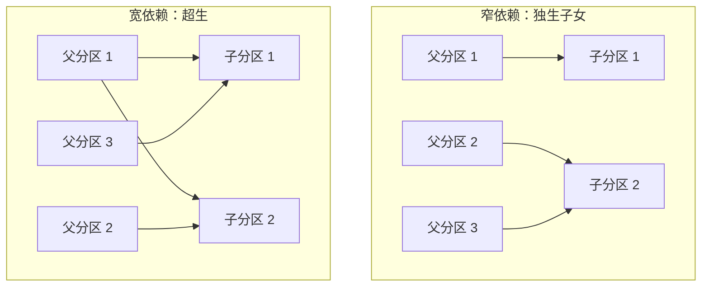
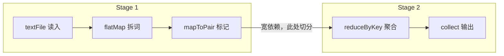
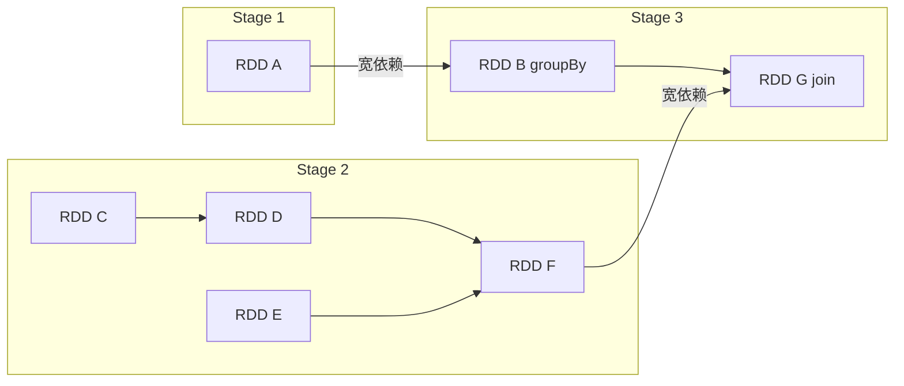
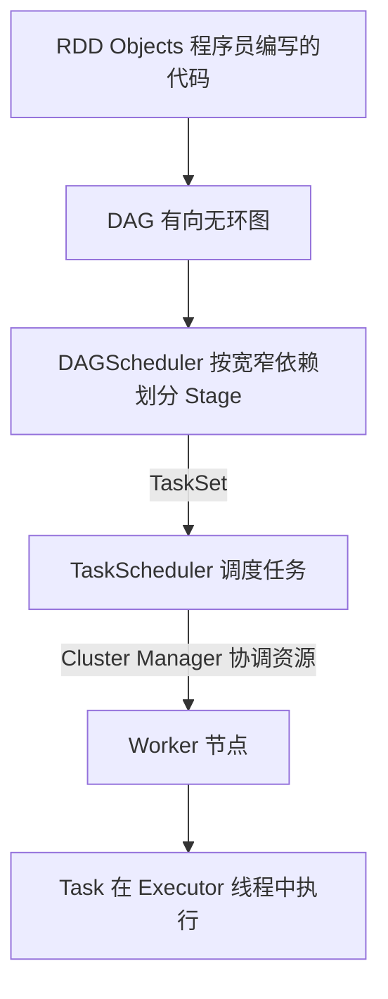

# Spark 任务调度之原理合辑：RDD 依赖关系、DAG 划分 Stage 与调度流程

## 先给结论

- 三篇内容串起 Spark 任务调度的原理主线：RDD 的宽窄依赖与血统、DAG 与 Stage 划分、从一行 action 代码到 Worker 节点干活的调度流程。
- 依赖只有两种：窄依赖每个父分区至多被一个子分区使用（map、filter、union），宽依赖多个子分区共享同一父分区（groupByKey 这类按 Key 汇聚的算子）。
- 判断宽窄只看「一个父分区被几个子分区使用」，与父 RDD 的个数无关：两个父 RDD 合成一个子 RDD 的 union 依然是窄依赖。
- Lineage 血统把创建 RDD 的一系列转换记录下来，部分分区数据丢失不靠备份，沿血统重新运算即可恢复。
- DAG 是原始 RDD 经一系列转换形成的有向无环图；窄依赖的转换在一个 Stage 内完成，宽依赖因 shuffle 存在必须切出新 Stage。
- 读 Stage 图的技巧是从最终 RDD 反着往回读，逐边判断宽窄，宽依赖处就是切分点。
- 调度分工：DAGScheduler 管逻辑层按依赖切 Stage，TaskScheduler 管物理层把 TaskSet 里的 Task 分发到 Executor，Worker 节点真正干活，中间数据经 BlockManager 本地缓存读写。
- 四级粒度贯穿全链路：一个 Application 因多次 action 触发产生多个 Job，一个 Job 按宽依赖切成多个 Stage，一个 Stage 按分区数生成一批 Task。

## 第1部分：RDD 的依赖关系：窄依赖、宽依赖与血统 Lineage

代码里把 map、filter、reduceByKey 一路串下来，程序能跑，结果也对，但 Spark 内部到底怎么理解这串 RDD 之间的关系？哪些步骤能在各自分区内一口气算完，哪些步骤必须把散在各地的数据搬到一起再算？这些问题的答案都写在 RDD 的依赖关系里。它是任务调度的第一块基石：后续的 Stage 划分与 shuffle 边界，全部从宽窄依赖推导而来。

### 窄依赖：父分区至多被一个子分区使用

**窄依赖的定义只需要盯住一个父分区。** 每一个父 RDD 的 Partition 最多被子 RDD 的一个 Partition 使用，也就是一个「父亲」至多被一个「孩子」使用，所以课程里形象地把窄依赖比喻成独生子女。图上表现为父分区到子分区的箭头一对一发出，一条箭头指向唯一的孩子。map、filter、flatMap、mapPartitions 这类算子天然如此：map 对每个元素做转换、flatMap 拆词压扁、filter 只丢弃部分元素、mapToPair 给元素配上 Key，元素都不跨分区流动，父分区到子分区始终一对一。用单词统计的开头几步验证：

```java
package com.study.tanhua.spark;

import org.apache.spark.SparkConf;
import org.apache.spark.api.java.JavaRDD;
import org.apache.spark.api.java.JavaSparkContext;
import scala.Tuple2;

import java.util.Arrays;

public class DependencyDemo {
    public static void main(String[] args) {
        SparkConf conf = new SparkConf().setAppName("DependencyDemo").setMaster("local[*]");
        JavaSparkContext jsc = new JavaSparkContext(conf);
        JavaRDD<String> lines = jsc.textFile(args[0]);
        // 窄依赖：flatMap 在各分区内逐行拆词，父分区一对一映射到子分区
        JavaRDD<String> words = lines.flatMap(line -> Arrays.asList(line.split(" ")).iterator());
        // 窄依赖：filter 只丢弃空串，留下的元素分区归属不变
        JavaRDD<String> filtered = words.filter(word -> !word.isEmpty());
        // 宽依赖：reduceByKey 要把各分区里相同单词汇到同一分区，父分区被多个子分区依赖
        filtered.mapToPair(word -> new Tuple2<>(word, 1))
                .reduceByKey(Integer::sum)
                .collect()
                .forEach(System.out::println);
        jsc.stop();
    }
}
```

**容易误判的是两个父 RDD 合成一个子 RDD 的场景。** 把两份 RDD union 起来，子 RDD 的每个分区由两个父分区拼成，第一眼看去像「多对一」，有人会当成宽依赖。对照定义就会发现它仍是窄依赖：判断的是父分区被几个子分区使用，而不是子分区有几个父亲。左边的父分区只被这一个子分区使用，右边的父分区同样只被这一个子分区使用，谁也没有被多个孩子共享：

```java
JavaRDD<Integer> rdd1 = jsc.parallelize(Arrays.asList(1, 2, 3), 2);
JavaRDD<Integer> rdd2 = jsc.parallelize(Arrays.asList(4, 5, 6), 2);
// 每个父分区只被一个子分区使用，union 之后仍是窄依赖
JavaRDD<Integer> unionRdd = rdd1.union(rdd2);
System.out.println(unionRdd.getNumPartitions()); // 4，两个父 RDD 的分区原样并排
```

### 宽依赖：一个父分区被多个子分区共享

宽依赖的定义反过来：多个子 RDD 的 Partition 会依赖同一个父 RDD 的 Partition，同一个父亲被一群孩子共享，课程里比喻成超生。groupByKey 是最典型的例子：按 Key 分组意味着同一个 Key 可能散落在所有分区里，每个分区的数据都可能流向任意一个下游分组，父分区的数据被多个子分区瓜分。join 也按同样的道理判断：两个输入没有按相同的分区器预先分好区时，相同 Key 必须跨分区汇合，属于宽依赖；如果两个输入已经按相同的分区器分好区（co-partitioned），相同 Key 本来就在对应的分区对里，不需要搬数据，按窄依赖对待。课程 PPT 把 join 的两种情形都画在宽依赖一侧，先按画面记住 groupByKey 与 join 是宽依赖的典型代表即可，面试时能补上「join 宽窄取决于输入是否已共同分区」这一层，反而是加分项。

按 Key 汇聚之外，重分区类算子的归属也值得对齐：coalesce 不开 shuffle 的原地合并属于窄依赖，repartition 这类全量重排则属于宽依赖。宽依赖还有一个绕不开的副作用：shuffle。父分区的数据要重新分配给多个子分区，必然伴随跨分区的数据搬运，这也是宽依赖与窄依赖在性能上的分水岭，具体代价在讲 Stage 划分时展开。

### 血统 Lineage：丢了分区不备份，沿链重算恢复

**Lineage 解决的是容错从哪来。** RDD 只支持粗粒度转换，即只记录单个块上执行的单个操作，转换本身是确定性的。把创建 RDD 的一系列 Lineage 记录下来，就得到了完整的出身链：这份 RDD 由哪些父 RDD、经过什么算子得到。Lineage 里记录的是元数据信息与转换行为，不是数据副本，占用的存储极小。

它的价值在分区丢失时兑现。某个分区的数据因为节点故障丢掉了，不需要整份重算，也不需要提前做多副本备份，只要沿着血统找到这个分区依赖的父分区链，把链上的转换重新执行一遍，丢失的分区就还原了。这正呼应了 RDD 概述里说的「弹性」：可进可退的存储策略，加上可重算的血统，共同构成自动容错。窄依赖在这一层还有个附带优势：重算时只需要恢复丢掉的那几个分区，父 RDD 里无关的分区不用动；宽依赖则可能牵连更大范围的父分区重算，这是宽依赖代价的又一处体现。



左图里每个父分区至多发出一条指向子分区的线，哪怕 B2 认了两个父亲，窄依赖的性质不变；右图里 C1 被 D1、D2 两个子分区共享，构成典型的超生结构，这种被共享的父分区正是 shuffle 发生的地方。

## 第2部分：DAG 有向无环图：宽依赖在哪里，Stage 就在哪里切开

把依赖分成窄与宽只是手段，Spark 真正用它做的事，是把一整条 RDD 转换链切成一个个 Stage 交给调度器执行，切分产物就是 DAG。理解了 DAG 的形成与 Stage 划分规则，提交应用之后「先算哪段、后算哪段、谁必须等谁」就有了明确答案，看 Spark 界面上的 Stage 列表也不再是黑盒。

### DAG 是什么，从代码里怎么长出来

DAG 的三个词可以拆开读：Directed 有方向，箭头从父 RDD 指向子 RDD；Acyclic 无环，RDD 不可变，每次转换都生成新 RDD，链只会向前生长，不可能回头形成环；Graph 图，整条链上所有 RDD 与依赖连成的整体结构。程序员只负责调用转换算子，action 触发时 Driver 把这条链整理成 DAG：

```java
package com.study.tanhua.spark;

import org.apache.spark.SparkConf;
import org.apache.spark.api.java.JavaPairRDD;
import org.apache.spark.api.java.JavaRDD;
import org.apache.spark.api.java.JavaSparkContext;
import scala.Tuple2;

import java.util.Arrays;

public class DagDemo {
    public static void main(String[] args) {
        SparkConf conf = new SparkConf().setAppName("DagDemo").setMaster("local[*]");
        JavaSparkContext jsc = new JavaSparkContext(conf);
        // 从读文件到聚合的一条转换链，action 触发后整条链就是一个 DAG
        JavaRDD<String> lines = jsc.textFile(args[0]);
        JavaRDD<String> words = lines.flatMap(line -> Arrays.asList(line.split(" ")).iterator());
        JavaPairRDD<String, Integer> pairs = words.mapToPair(word -> new Tuple2<>(word, 1));
        // reduceByKey 是宽依赖，它前后的算子被切在不同的 Stage 里
        JavaPairRDD<String, Integer> counts = pairs.reduceByKey(Integer::sum);
        System.out.println(counts.collect());
        jsc.stop();
    }
}
```

textFile、flatMap、mapToPair 一路窄依赖，到 reduceByKey 出现第一个宽依赖点，DAG 在这里天然分成两段。

### 划分 Stage 的两条原则

**窄依赖合并进同一个 Stage。** 窄依赖下父分区与子分区一对一，分区内的数据转换不需要等别的分区出数据，可以流水线式一气呵成，放进同一个 Stage 里完成。

**宽依赖切开成新 Stage。** 宽依赖伴随 shuffle，数据要从上游分区重新分配到下游分区。上游 Stage 没有全部算完，下游就拿不到完整的数据去做重排，所以宽依赖的位置必须是 Stage 边界：先把父 RDD 所在 Stage 整体执行完，再启动下游的新 Stage。拿单词统计对照：flatMap、filter、mapToPair 三个窄依赖打包在一个 Stage 里，reduceByKey 因为要把相同单词从各分区拉到一起，必须另起一个 Stage 等待上游产出。



图里 Stage 1 内部的三步在各自分区内就能连着做完，跨过宽依赖那条边，Stage 2 必须等 Stage 1 全部完成才启动。

Stage 的切分同时决定了代价的分布：Stage 内部的窄依赖一路流水线执行，数据不搬家、不落盘；每跨越一次宽依赖，就多一轮 shuffle 的写盘与拉取。同一条链 Stage 数越多，shuffle 次数就越多，写代码时把能合并的窄依赖放在一起，本身就是一种优化。

### 经典官方图逐边推演

课程给出的经典官方图里，每个大框是一个 RDD，大框内的小框是分区，虚线框圈出的范围就是一个 Stage。整条链的 RDD 从 A 到 G，顺读容易晕，正确读法是从最终的 G 反着往回推每一条边的依赖类型：

- G 与 B 之间是窄依赖，两个操作放进同一个 Stage，也就是图最外层的 Stage 3；
- G 与 F 之间是宽依赖，此处切开；
- B 与 A 之间是宽依赖，A 的分区被多个子分区使用，属于「超生」，A 单独成为一个 Stage 1；
- F 与 D、F 与 E、D 与 C 之间都是窄依赖，C、D、E、F 一起放进 Stage 2。

于是整条 A 到 G 的转换链被划分成三个 Stage：Stage 1 只含 A，Stage 2 含 C、D、E、F，Stage 3 含 B 与 G。两个宽依赖切出三次边界，RDD 之间的宽窄依赖就是划分 Stage 的依据。



图里 A 单独成 Stage 1，因为它的输出要被 shuffle 重新分配给 B；C、D、E、F 四个 RDD 全靠窄依赖相连，打包进 Stage 2 流水线执行；B 与 G 窄依赖相连共享 Stage 3，F 到 G 的宽依赖负责最后一段切分。

## 第3部分：Spark 任务调度流程：从一行 action 到 Worker 节点干活

依赖关系分了类，DAG 也切成了 Stage，万事俱备，剩下的问题是：应用提交到集群之后，这套结构由谁来解析、谁把任务真正送到节点上跑？这就是任务调度流程要回答的内容。把这条链路弄清楚，后面看 Spark 界面上的 Job、Stage、Task 三层结构时，每一层都能对应得上，报错时也能立刻判断问题出在逻辑划分还是物理执行。

### 调度的起点：代码变成 DAG

应用以 RDD Objects 的形态存在，也就是程序员写下的那些转换与行动代码。代码本身不执行计算，转换算子只搭出依赖链，action 触发时 Driver 把整条链整理成 DAG。一个典型应用的结构如下：

```java
package com.study.tanhua.spark;

import org.apache.spark.SparkConf;
import org.apache.spark.api.java.JavaPairRDD;
import org.apache.spark.api.java.JavaRDD;
import org.apache.spark.api.java.JavaSparkContext;
import scala.Tuple2;

import java.util.Arrays;

public class ScheduleDemo {
    public static void main(String[] args) {
        SparkConf conf = new SparkConf().setAppName("ScheduleDemo").setMaster("local[*]");
        JavaSparkContext jsc = new JavaSparkContext(conf);
        JavaRDD<String> lines = jsc.textFile(args[0]);
        // 转换算子只构建依赖链，不触发计算
        JavaPairRDD<String, Integer> counts = lines
                .flatMap(line -> Arrays.asList(line.split(" ")).iterator())
                .mapToPair(word -> new Tuple2<>(word, 1))
                .reduceByKey(Integer::sum);
        // action 触发 Job，DAGScheduler 开始解析这条链
        long total = counts.count();
        System.out.println("单词种数：" + total);
        jsc.stop();
    }
}
```

提交到集群走 spark-submit，master 指向 HA 集群的三个 Master 节点：

```bash
# 提交应用到集群，文件路径为示例占位
spark-submit \
  --class com.study.tanhua.spark.ScheduleDemo \
  --master spark://node1:7077,node2:7077,node3:7077 \
  my-spark-test-1.0-SNAPSHOT.jar /export/data/word.txt
```

### DAGScheduler 与 TaskScheduler 的分工

**DAGScheduler 干逻辑层的活。** 它接收 DAG，按宽窄依赖把 DAG 划分成 Stage：遇到窄依赖就把转换加入当前 Stage，遇到宽依赖就完成一次 Stage 切分。划分完成后，它对每一个 Stage 生成一个 TaskSet，也就是这个 Stage 对应的一批任务列表，随后把 TaskSet 交给 TaskScheduler。

**TaskScheduler 干物理层的活。** 它不关心 DAG 长什么样，只负责把 TaskSet 里的每一个 Task 调度执行：借助 Cluster Manager 协调资源，把任务分发到集群的 Worker 节点上，跟踪执行状态，失败时按策略重试。



图里这条链自上而下正好对应从逻辑到物理：代码与 DAG 是逻辑形态，DAGScheduler 切 Stage 产出 TaskSet，TaskScheduler 借助 Cluster Manager 协调资源，把 Task 送进 Worker 节点的 Executor 里跑，计算真正发生的位置是 Worker 上的 Executor。TaskSet 里的每个 Task 对应一个分区的计算，同一个 Stage 内的 Task 之间互不依赖，可以同时发往不同节点，并行的粗细完全由分区数说了算。

### Application、Job、Stage、Task 的层级关系

这四个粒度自上而下嵌套。Application 对应一次 spark-submit 提交，从启动到 stop 结束；Application 里每个 action 算子（collect、count、saveAsTextFile 这类）触发一个 Job，转换算子再多也不会单独成 Job；Job 内部由 DAGScheduler 按宽依赖切成多个 Stage；Stage 内部按分区数生成 Task，分区数就是该 Stage 的 Task 数，之前用 getNumPartitions 查到的值在这里直接兑现成并行任务数。

shuffle 在这条链上还有一个关键作用：它把 Stage 之间的执行顺序钉死。上游 Stage 的所有 Task 全部完成后，shuffle 产出的数据才齐，下游 Stage 的 Task 才能启动拉取。所以观察一个 Job 的执行进度，宽依赖的位置就是观察点，上游 Stage 的完成度决定了下游能否开始。

**Stage 还有两种形态值得分清。** 按 Spark 源码的口径（课程画面未展开，此处按主流写法补充），一个 Job 的最后一个 Stage 叫 ResultStage，负责产出最终结果；它之前的所有 Stage 叫 ShuffleMapStage，负责把数据按分区器重新分布好，供下游拉取。拿上面的单词统计对照：textFile 到 mapToPair 组成 ShuffleMapStage，reduceByKey 连同 count 组成 ResultStage，两个 Stage 前后接力，中间隔着一次 shuffle。触发 Job 的 action 所在 RDD 就是切分终点，DAGScheduler 从这里反向遍历依赖，窄依赖合并进当前 Stage，遇到宽依赖就回退一层生成新 Stage，直到回溯到最初读入的 RDD。

## 常见误区

- **数父 RDD 的个数来判断宽窄。** 错例：union 把两个父 RDD 合成一个子 RDD，看到「二对一」就判成宽依赖。正解：判断标准是父分区被几个子分区使用，union 的每个父分区仍只被一个子分区使用，属窄依赖。
- **看算子名字贴标签。** 错例：认为所有 join 都是宽依赖。正解：未共同分区的 join 是宽依赖，输入已按相同分区器分好区的 join 不需要 shuffle；groupByKey 则永远是宽依赖。
- **把 Lineage 当成数据备份。** 错例：以为血统里存着数据副本，分区丢了直接取。正解：Lineage 只记录元数据与转换行为，恢复靠沿链重算，不是取备份。
- **认为宽窄依赖只是概念分类。** 错例：背完定义就放下，不关心它与性能的关系。正解：窄依赖的转换可以流水线式在同一个 Stage 内算完，宽依赖必然伴随 shuffle 的搬运与落盘，直接决定 Stage 怎么切、作业跑多快。
- **把 Stage 数当成宽依赖数。** 错例：看到两个宽依赖就以为只切出两个 Stage。正解：宽依赖只是切分点，Stage 数等于切分后的段数，示例链两个宽依赖对应三个 Stage。
- **顺着读 DAG 找边界。** 错例：从入口 A 一路往后看，越看越乱。正解：从最终 RDD 反向往回读，逐边判断宽窄，宽依赖处切开，思路立刻清晰。
- **以为 Stage 划分在写代码时就定死了。** 错例：写完代码就开始数 Stage。正解：写代码只产生 RDD 转换链，Stage 划分由 DAGScheduler 在 action 触发后解析 DAG 时完成，规则只有宽窄依赖一条。
- **忽略 Stage 之间的等待关系。** 错例：以为所有 Stage 同时开跑。正解：存在 shuffle 依赖时，下游 Stage 必须等上游 Stage 全部完成才能启动。
- **认为 TaskScheduler 负责切 Stage。** 错例：把划分 Stage 的工作安到 TaskScheduler 头上。正解：切 Stage、生成 TaskSet 是 DAGScheduler 的职责，TaskScheduler 只管把 TaskSet 里的任务调度执行。
- **把 Worker 等同于 Executor。** 错例：认为 Worker 进程自己完成计算。正解：Worker 是节点上的常驻进程，负责启动并管理 Executor，真正执行 Task 的是 Executor 里的线程。
- **以为每个算子都是一个 Job。** 错例：链上写了五六个转换，就觉得会产生五六个 Job。正解：只有 action 算子触发 Job，转换算子只是往 DAG 上加边。
- **认为 Stage 越多跑得越快。** 错例：为了并行度把链切得很碎。正解：每多一个 Stage 就多一次 shuffle 的搬运与落盘，Stage 数由宽依赖决定，窄依赖应留在同一个 Stage 里流水线完成。

## 面试可能被问到的问题

1. 面试官追问：「窄依赖和宽依赖的定义分别是什么？」
   答：窄依赖指每一个父 RDD 的 Partition 最多被子 RDD 的一个 Partition 使用；宽依赖指多个子 RDD 的 Partition 会依赖同一个父 RDD 的 Partition。前者比喻成独生子女，后者比喻成超生。

2. 面试官追问：「union 连接两个父 RDD，为什么还是窄依赖？」
   答：宽窄看的是父分区被几个子分区使用，而不是子分区有几个父分区。union 之后每个父分区都只被一个子分区使用，没有共享，所以是窄依赖。

3. 面试官追问：「哪些算子是宽依赖？为什么？」
   答：groupByKey、reduceByKey 这类按 Key 汇聚的算子，以及输入未共同分区的 join。同一个 Key 的数据散在不同分区，必须跨分区重新分配才能汇到一起，父分区被多个子分区共享，伴随 shuffle。

4. 面试官追问：「Lineage 是什么，起什么作用？」
   答：Lineage 即血统，记录创建 RDD 的一系列转换以及元数据信息。RDD 支持粗粒度转换，分区数据丢失时沿血统重新运算即可恢复，这是 RDD 自动容错的实现方式。

5. 面试官追问：「宽窄依赖对调度有什么影响？」
   答：窄依赖的分区转换可以在同一个 Stage 内流水线完成；宽依赖因为 shuffle 必须等父 RDD 全部处理完才能开始，会成为 Stage 的切分边界，任务调度流程正是按它划分阶段的。

6. 面试官追问：「什么是 DAG？」
   答：DAG 全称 Directed Acyclic Graph，有向无环图。原始的 RDD 通过一系列转换就形成了 DAG，顶点是 RDD，边是依赖关系，方向沿转换向前，且因 RDD 不可变而不会成环。

7. 面试官追问：「DAG 是怎么划分成 Stage 的？」
   答：依据 RDD 之间的依赖关系。对于窄依赖，partition 的转换处理在一个 Stage 中完成；对于宽依赖，由于 shuffle 的存在，要划分为新的 Stage，等父 RDD 处理完成后再继续。

8. 面试官追问：「为什么宽依赖必须切出新 Stage？」
   答：宽依赖要把数据跨分区重新分配，属于 shuffle 操作，下游必须等父 RDD 所在 Stage 全部算完拿到完整数据才能开始重排，因此宽依赖天然是 Stage 边界。

9. 面试官追问：「一条转换链里有 N 个宽依赖，会有几个 Stage？」
   答：N 个宽依赖形成 N 个切分点，把链切成 N+1 段，共 N+1 个 Stage；每个 Stage 内部全是窄依赖，可以流水线执行。

10. 面试官追问：「Stage 内部为什么能流水线执行？」
   答：Stage 内部相邻 RDD 之间都是窄依赖，分区一对一，每个分区的计算可以在一个 Task 里连续完成，不需要等其他分区的数据，也不需要中途落盘。

11. 面试官追问：「简述 Spark 的任务调度流程。」
   答：RDD Objects 通过转换形成 DAG，DAGScheduler 按依赖关系划分 Stage，遇到窄依赖加入本 Stage，遇到宽依赖切出新 Stage；每个 Stage 生成一个 TaskSet 交给 TaskScheduler，TaskScheduler 把 Task 分发到 Worker 节点上的 Executor 执行。

12. 面试官追问：「DAGScheduler 和 TaskScheduler 的分工是什么？」
   答：DAGScheduler 面向逻辑层，负责解析 DAG、按宽窄依赖划分 Stage、为每个 Stage 生成 TaskSet；TaskScheduler 面向物理层，负责把 TaskSet 中的每个 Task 分配到 Executor 上执行并跟踪状态。

13. 面试官追问：「Application、Job、Stage、Task 是什么关系？」
   答：一次提交对应一个 Application；每个 action 算子触发一个 Job；一个 Job 按宽依赖切成多个 Stage；一个 Stage 按分区数生成一批 Task，分区数即 Task 数，四级自上而下嵌套。

14. 面试官追问：「为什么下游 Stage 要等上游 Stage 全部完成？」
   答：下游 Stage 的输入依赖上游 Stage 的 shuffle 产出，上游只要有一个分区没算完，重排的数据就不完整，所以存在宽依赖边时 Stage 之间有先后顺序。

15. 面试官追问：「Task 数由什么决定？」
   答：由 Stage 最后一个 RDD 的分区数决定，每个分区对应一个 Task；调整分区数就是调整这一层的并行度，实际并发还与核数、Executor 资源共同相关。

## 配套资料

- 学习目标：`materials/code/07/day06 探花交友-Spark快速入门/day06/学习目标.md`，其中「掌握 RDD 的依赖关系」一条对应本课目标。
- 说明：day06 资料包仅含学习目标文件，无工程源码；示例按课程画面与主流写法补全，包名统一为 `com.study.tanhua.spark`；join 在输入已共同分区时按窄依赖对待的口径为按 Spark 论文补充的内容。
- 学习目标：`materials/code/07/day06 探花交友-Spark快速入门/day06/学习目标.md`，其中「掌握 Spark 的任务调度流程」一条覆盖 DAG 与 Stage 划分。
- 说明：day06 资料包仅含学习目标文件，无工程源码；示例按课程画面与主流写法补全，包名统一为 `com.study.tanhua.spark`。
- 学习目标：`materials/code/07/day06 探花交友-Spark快速入门/day06/学习目标.md`，其中「掌握 Spark 的任务调度流程」一条对应本课目标。
- 说明：day06 资料包仅含学习目标文件，无工程源码；示例与提交命令按课程画面与主流写法补全，包名统一为 `com.study.tanhua.spark`，jar 名沿用本课打包产物，文件路径为示例占位。
