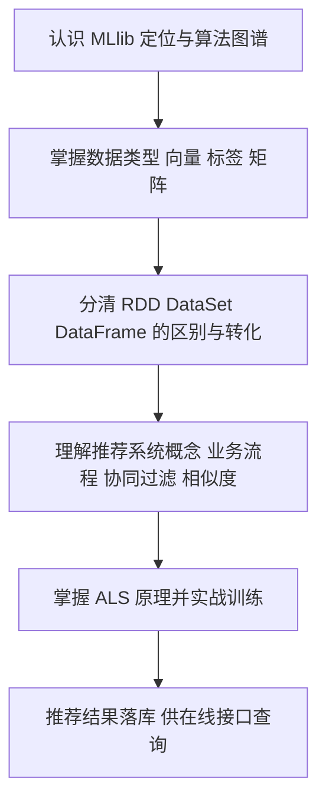

# 推荐算法日规划：MLlib 数据类型、ALS 原理与推荐落库

Spark 的集群与 RDD 在前一天已经铺完，推荐系统的重计算段从此刻起正式开工。day07 的定位是一门快而全的 MLlib 快速入门：既要把机器学习库的底座讲清楚，也要把协同过滤、相似度、交替最小二乘法一路推到动手实战。对习惯写业务代码的 Java 工程师来说，这一天的名词密度明显升高，先看清路线再进细节，学起来会稳很多。

## 先给结论

- 本日主线一句话：用 Spark 的机器学习库 MLlib 把探花交友的推荐计算跑通，算法落点是交替最小二乘法（ALS）。
- 目标分两档：「了解」类覆盖 MLlib 定位、支持的数据类型、推荐系统概念与业务流程、协同过滤与相似度算法；「掌握」类覆盖 RDD、DataSet、DataFrame 的区别与转化，以及 ALS 的原理与实战。
- 数据类型是全日的暗线：向量、向量标签、矩阵是所有算法的输入形态，这一关过不了，后面的 ALS 实战只能照抄代码。
- 推荐结果最终要落库，在线接口只查表返回，与前一日确立的离线计算分工完全一致。
- 资料包提供了本日学习目标清单与 ml-100k 电影评分数据集，后者将在 ALS 实战中充当评分矩阵的数据底座。

## 一、这一天要解决什么问题

探花交友的推荐页依赖一张预先算好的推荐表，这张表由离线段的推荐算法产出。算法从哪里来？答案就是 MLlib。它是 Spark 在机器学习方向的官方库，分类、回归、聚类、协同过滤这些通用算法开箱即用，而且天生长在分布式计算框架上，全量用户行为数据喂得进去。选型在项目立项时已经定了，剩下的任务是把「库」变成「业务」：把用户的偏好数据整理成算法认识的形态，交给推荐算法训练，再把结果写回数据库。

把这条链路拆开，正好对应本日的学习模块。链路里的每个环节都需要具体的技术点支撑，缺一环推荐就落不了地：



这张图就是本日的推进顺序：前半段打地基，搞清 MLlib 是什么、数据长什么样、两套 API 怎么分；后半段进业务，理解推荐系统的流程与算法思想；收口在 ALS 实战与结果落库。图中每一步都依赖前一步，数据类型尤其关键，它是算法与业务数据之间的翻译层。

## 二、目标清单与技术点映射

资料包里的学习目标原文如下，共十二条：

```text
- 了解什么是Spark MLlib
- 了解Spark MLlib所支持的数据类型
- 掌握RDD、DataSet、Dataframe区别及转化
- 了解什么是推荐系统
- 了解推荐系统的业务流程
- 掌握基于用户的协同过滤算法
- 掌握基于商品的协同过滤算法
- 了解用户偏好数据的收集
- 了解相似度算法
- 了解交替最小二乘法的原理
- 掌握ALS的实战
- 掌握ALS的实战优化改进
```

逐条配上技术点与检验动作，学习时就有抓手。数据类型一条对应向量集、向量标签、本地矩阵与分布式矩阵四块内容，检验标准是能徒手构造密集与稀疏两种向量并按下标取值；RDD、DataSet、DataFrame 一条对应两套 API 的分界与互转，检验标准是能说清 spark.mllib 与 spark.ml 各自的载体；协同过滤两条对应基于用户与基于商品两种推荐思想的推演，检验标准是能在评分矩阵上手工算出推荐结论；相似度一条对应余弦相似度这类度量工具，检验标准是能讲清它出现在协同过滤的哪一步；交替最小二乘法两条对应原理推演与编码实战，检验标准是能把一份原始评分数据训练成推荐结果。措辞里「了解」与「掌握」的分层与前一日一致：概念面可以广而浅，转化规则与 ALS 必须落到能写、能调的程度。

预告一下数据类型的形态，后面整日都在跟它打交道：

```java
import org.apache.spark.mllib.linalg.Vector;
import org.apache.spark.mllib.linalg.Vectors;

//向量是 MLlib 世界的原子：一行用户特征或一份评分，都是这样一个对象
Vector dense = Vectors.dense(9, 5, 2, 7);
```

## 三、数据与资料盘点

本日资料包不重但指向明确。学习目标清单如上；数据集目录 ml-100k 是推荐系统领域沿用多年的电影评分数据集，内容是用户对电影的评分记录，恰好构成「用户-物品」评分矩阵，ALS 实战会直接使用它；目录里附带的 `mku.sh` 是数据集自带的脚本，作用是把全量评分切分成训练集与测试集，对应实战优化环节里的效果验证。

推荐计算的结果最终写进数据库的推荐表，App 端推荐页只做查询。这层分工在选型时已定，本日全部产出都服务于离线段：算法跑得动、结果算得出、数据落得下。

## 常见误区

- **把 MLlib 等同于推荐系统。** 错例：以为引入 MLlib 依赖就有了推荐功能。正解：MLlib 只是算法库，偏好数据收集、格式转换、结果落库这些业务工程都要自己搭，库只负责中间那段计算。
- **跳过数据类型直接背 ALS 参数。** 错例：照抄训练代码能跑，换一份数据就不知道怎么构造输入。正解：先练熟向量与矩阵的构造和取值，输入形态清楚了，参数才有调整的着力点。
- **忽略 RDD、DataSet、DataFrame 这条目标。** 错例：只关心算法，文档里 spark.ml 与 spark.mllib 两套 import 混用，编译报错一头雾水。正解：两套 API 的载体差异正是这条目标要解决的问题。
- **认为 MLlib 的算法都为推荐服务。** 错例：在库里找推荐相关内容，就以为整个库都是推荐工具。正解：分类、回归、聚类、降维都占相当比重，推荐模块在 MLlib 中只有 ALS，按需取用即可。

## 面试可能被问到的问题

1. 面试官追问：「你们项目的推荐系统是怎么落地的？」
   答：分离线与在线两段。离线段用 Spark 加 MLlib，对全量用户行为构造评分矩阵，用 ALS 训练出推荐结果写入推荐表；在线段只查询推荐表返回给 App。计算与服务解耦，算法重算不影响线上接口。
2. 面试官追问：「ALS 是什么算法？」
   答：交替最小二乘法，是一种基于矩阵分解的隐语义推荐方法。它把用户-物品评分矩阵近似拆成用户隐因子矩阵与物品隐因子矩阵的乘积，训练时交替固定一侧、用最小二乘求解另一侧，迭代到评分误差收敛。
3. 面试官追问：「协同过滤与 ALS 是什么关系？」
   答：协同过滤是推荐的思想，指利用群体的历史行为给个体做推荐，可分为基于用户与基于商品两条路径；ALS 是这一思想的一种矩阵分解实现，MLlib 的推荐模块只提供了 ALS，所以工程上用它落地协同过滤。
4. 面试官追问：「为什么推荐系统要先学 MLlib 的数据类型？」
   答：算法的输入是向量与矩阵，不是业务表。用户特征要转成向量，带分类标记的数据要包成 LabeledPoint，全量评分要装进分布式矩阵。类型关不过，数据进不了算法，后面一切无从谈起。
5. 面试官追问：「RDD、DataSet、DataFrame 的关系是什么？」
   答：RDD 是最底层的分布式数据集抽象；DataFrame 带结构化 Schema，有列名与优化器；DataSet 结合了两者，编译期类型安全。MLlib 的新版 API 建立在 DataFrame 之上，旧版建立在 RDD 之上，两套包的取舍与这层差异直接相关。

## 配套资料

- 学习目标：`materials/code/07/day07 探花交友-SparkMLlib推荐系统快速入门/day07/学习目标.md`，本日十二条目标的原文清单，与小节二的映射一一对应。
- 数据集：`materials/code/07/day07 探花交友-SparkMLlib推荐系统快速入门/day07/资料/ml-100k/`，经典电影评分数据集，ALS 实战的数据底座，目录内 `mku.sh` 为数据切分脚本。
- 说明：day07 资料包仅含学习目标与 ml-100k 数据集，无工程源码，示例代码为按本课写法补全的预告片段。
