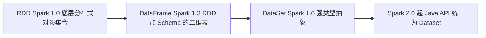

# Spark 三代数据抽象：RDD、DataSet、DataFrame 的区别与互转

写惯了 RDD 算子，一打开 Spark SQL 相关代码就会撞上一堆新面孔：入口从 JavaSparkContext 换成了 SparkSession，数据类型冒出了 Dataset<Row>，转换还要调 createDataFrame。三代抽象摆在同一个工程里，什么场合用哪个、彼此怎么转，是写 Spark 程序绕不开的问题。沿着 Spark 的版本演进把三者关系理清，再用一个完整的 Java 示例走一遍从文本文件到二维表的全过程，最后对齐 MLlib 的两套 API，这条线走完，选型与转化就都不再是障碍。

## 先给结论

- Spark 的数据抽象按版本演进：1.0 只有 RDD；1.3 加入 DataFrame；1.6 加入 DataSet；2.0 起 Java API 中 DataFrame 与 DataSet 统一为 DataSet，DataFrame 就是 Dataset<Row>。
- DataFrame 可以看成 RDD 加 Schema，形态上是一张二维表；它的短板是编译器不对表中字段做类型检查，列名写错、类型不匹配都要拖到运行期才暴露。
- DataSet 是 Spark 最新的数据抽象，包含 DataFrame 的全部优化机制，再以样例类（Java 里是 POJO）为 Schema 提供强类型，错误编译期就能拦住；Spark 的演进方向就是以 DataSet 为主，逐步弱化 RDD 与 DataFrame。
- 互转三件套：RDD 进 Dataset 用 createDataFrame（Java）或 toDF（Scala）；DataFrame 升级为 Dataset 用 as；Dataset 退回 RDD 用 javaRDD()。
- MLlib 有两套并行 API：spark.mllib 吃 RDD，spark.ml 吃 Dataset，选哪套决定了上层用什么数据抽象，互转能力因此成为基本功。

## 一、三代抽象是怎么长出来的

Spark 的数据抽象不是一次性设计完成的，而是随版本一节一节长出来的。RDD 是 Spark 最核心的概念，早期所有程序都建立在它之上；随着使用需求的升级，新 API 陆续出现，但每一次出现都不是把旧的推倒重来，而是对旧抽象做升级。DataFrame 出现在 Spark 1.3，位置比 RDD 更高级，RDD 则退到偏底层的角色；到 Spark 1.6 又出现了 DataSet，对 DataFrame 再做一次升级。进入 2.x 之后，Java API 中 DataFrame 与 DataSet 已经统一：写 Java 代码拿到的是 Dataset，DataFrame 只是 Dataset<Row> 这个形态的叫法。RDD 依然可用，前面 MLlib 各课的向量与矩阵代码就全部写在 RDD 之上。

演进脉络如图：



图中箭头是升级关系而不是替换关系。三套抽象在 2.x 里同时可用，分工不同：偏底层的逐元素加工交给 RDD，表式分析交给 DataFrame，需要类型安全的业务建模交给 DataSet。工程里三者经常同时出现，这也是为什么互转 API 必须练熟。

## 二、DataFrame 与 DataSet 各自补上了什么

**DataFrame 是 RDD 加 Schema。** 可以把它当成一张二维表：数据按行组织，列名与列类型由 Schema 描述。Schema 的价值在于 Spark 能看懂数据结构，从而做面向表的优化。它的劣势也写在定义里：编译器不对表格中的字段做类型检查，一切检查都发生在运行期。`select(col("nmae"))` 这种列名手误，编译毫无反应，任务提交跑起来才抛异常。

**DataSet 是最新的抽象，也代表着方向。** 它包含 DataFrame 所有的优化机制，在此之上提供了以样例类为 Schema 的强类型：每个 Dataset 绑定一个具体类型，字段访问、字段类型在编译期就能检查。Spark 的发展会逐步把 DataSet 作为主要的数据抽象，弱化 RDD 与 DataFrame，当前版本里这已经成为现实。

三种抽象放到一张表里对比：

| 维度 | RDD | DataFrame | DataSet |
| --- | --- | --- | --- |
| 数据形态 | 分布式对象集合 | RDD 加 Schema，二维表 | 强类型分布式集合 |
| Schema | 无 | 有，字段编译期不检查 | 有，由样例类或 POJO 定义 |
| 错误暴露时机 | 编译期（对象类型） | 运行期 | 编译期 |
| 优化机制 | 无表级优化 | Catalyst 等表级优化 | 继承 DataFrame 的全部优化 |
| Java 中的写法 | JavaRDD | Dataset | Dataset |
| 适用场景 | 底层算子加工、MLlib RDD 系 | 交互式表分析 | 业务建模、类型敏感链路 |

从表里能看出清晰的接力关系：RDD 保证灵活与底层控制，DataFrame 用 Schema 换来优化，DataSet 再用强类型把安全补回来。越往上抽象层级越高，离 SQL 越近；越往下控制力越强，离分布式内存越近。

## 三、动手：从文本文件到一张二维表

转换示例选最朴素的数据。先定义 Student 类，三个属性 id、name、age，类型分别取 Long、String、Integer，实现 Serializable 以便在集群上传输；类放在工程的 test 目录下做验证，包名统一为 `com.study.tanhua.spark`：

```java
import java.io.Serializable;

public class Student implements Serializable {
    private Long id;
    private String name;
    private Integer age;

    public Long getId() { return id; }
    public void setId(Long id) { this.id = id; }
    public String getName() { return name; }
    public void setName(String name) { this.name = name; }
    public Integer getAge() { return age; }
    public void setAge(Integer age) { this.age = age; }
}
```

数据文件 `users.txt` 每行一条记录，逗号分隔三列，依次是 id、姓名、年龄：

```text
1,张三,20
2,李四,25
3,王五,28
4,赵六,30
```

入口有个明显变化：这里不再创建 JavaSparkContext，而是直接使用 SparkSession，它取代了之前的 JavaSparkContext，读文件、建表、执行结构化操作都从这个入口走。完整测试方法如下：

```java
import org.apache.spark.api.java.JavaRDD;
import org.apache.spark.sql.Dataset;
import org.apache.spark.sql.Row;
import org.apache.spark.sql.SparkSession;
import org.junit.Test;
import static org.apache.spark.sql.functions.col;

@Test //测试 RDD、DataSet、DataFrame 的区别及转化
public void testDataSet() {
    //SparkSession 取代之前的 JavaSparkContext
    SparkSession sparkSession = SparkSession.builder()
            .master("local[*]")
            .appName("tanhua-mllib")
            .getOrCreate();
    //读取文本文件，得到 JavaRDD[String]
    JavaRDD<String> rdd1 = sparkSession.read()
            .textFile("F:\\code\\files\\users.txt").javaRDD();
    //每一行文本构造成一个 Student 对象
    JavaRDD<Student> rdd2 = rdd1.map(v -> {
        String[] ss = v.split(",");
        Student student = new Student();
        student.setId(Long.valueOf(ss[0]));
        student.setName(ss[1]);
        student.setAge(Integer.valueOf(ss[2]));
        return student;
    });
    //传入 RDD 与类信息，得到 Dataset
    Dataset<Row> dataSet = sparkSession.createDataFrame(rdd2, Student.class);
    dataSet.show();
    //只显示 id 与 name 两列
    dataSet.select(col("id"), col("name")).show();
    //按 id 倒序排序后再显示
    dataSet.select(col("id"), col("name"))
            .orderBy(dataSet.col("id").desc()).show();
}
```

`show()` 打印出一张真正的二维表：

```text
+---+----+---+
| id|name|age|
+---+----+---+
|  1|  张三| 20|
|  2|  李四| 25|
|  3|  王五| 28|
|  4|  赵六| 30|
+---+----+---+
```

这段代码藏着三个关键点。其一，createDataFrame 接收一个 RDD 和一个 Class，通过反射读取 Student 的字段生成 Schema，返回值类型是 Dataset<Row>，这正是 Java 中 DataFrame 的真身。其二，拿到 Dataset 之后，show、select、orderBy 这组 API 比 RDD 算子明显更高级：select 按列名挑列，orderBy 配合 `col("id").desc()` 做倒序，一行代码完成筛选与排序，不需要自己写比较器。其三，textFile 读出的每行是字符串，split 出的数组顺序必须与文件列顺序一一对应：id 用 Long.valueOf 转换，age 用 Integer.valueOf 转换，name 本身就是字符串不必转；顺序错位或类型给错，异常同样出现在运行期，这与 DataFrame 运行期检查的定位正好互相印证。

## 四、互转路径：一张表记全

三种抽象的常见互转方向与写法：

| 转化方向 | Java 写法 | Scala 写法 |
| --- | --- | --- |
| RDD 转 DataFrame | sparkSession.createDataFrame(rdd, Student.class) | rdd.toDF() |
| DataFrame 转 DataSet | dataSet.as(Encoders.bean(Student.class)) | df.as[Student] |
| DataSet 转 RDD | dataSet.javaRDD() | ds.rdd |

as 的语义值得单独说一句：它把无类型的 Row 升级成带类型的 Dataset，升级之后 map、filter 的 lambda 里操作的就是 Student 对象而不是 Row，编译器从此接手字段检查。javaRDD() 则是反向动作，把 Dataset 降回 RDD，让建立在 RDD 之上的向量、矩阵代码可以无缝衔接。

Scala 的写法更短（Student 为 case class）：

```scala
val ds: Dataset[Student] = df.as[Student] //DataFrame 转 DataSet
val df2: DataFrame = ds.toDF()           //DataSet 转 DataFrame
val rdd: RDD[Student] = ds.rdd           //DataSet 转 RDD
```

两条方向记住一个原则就够了：往上走（RDD 到 DataFrame 到 DataSet）是加 Schema、加类型，Spark 承担更多；往下走是卸掉 Schema 与类型，回到逐元素控制。

## 五、与 MLlib 两套 API 的对应

MLlib 从 Spark 2.0 起并存两套 API，选哪套决定了上层用什么数据抽象。spark.mllib 是基于 RDD 的原始实现，包名以 org.apache.spark.mllib 开头，本地向量、分布式矩阵以及后续实战用的 ALS 都住在这里，输入输出全是 RDD，官方已把它置于维护状态，只修问题不再加新算法。spark.ml 是基于 DataFrame 的新体系，包名以 org.apache.spark.ml 开头，用 Pipeline 把特征处理、模型训练、预测串成流水线，吃的是 Dataset。

对应到互转链路：业务数据从文本或消息队列读进来先是 RDD，createDataFrame 把它抬升为 Dataset，即可送进 spark.ml 的 Pipeline；反过来 spark.mllib 的算法产出 RDD 结果，javaRDD() 把 Dataset 降回去衔接。探花交友的推荐模块按课程路线走 RDD 系，先把数据形态与转化链路练熟，后面无论切到哪套 API，这条链都是同一套。

## 常见误区

- **在 Java API 里找 DataFrame 类。** 错例：写 import org.apache.spark.sql.DataFrame，编译器提示找不到符号。正解：2.0 起 Java API 中 DataFrame 与 DataSet 统一，DataFrame 就是 Dataset<Row>，没有独立的 DataFrame 类。
- **以为有 Schema 就有编译期检查。** 错例：`select(col("nmae"))` 列名拼错，编译照常通过，运行期才抛异常。正解：DataFrame 的字段检查发生在运行期；需要编译期保障时用 as 加 Encoder 升级成强类型 Dataset。
- **把 Dataset 当 JavaRDD 继续用算子思维。** 错例：在 Dataset 上写 map 直接塞 lambda，编译报错要求提供 Encoder。正解：Dataset 的 map 需要 Encoder 指定序列化方式，如 Encoders.bean(Student.class)；纯算子加工仍走 javaRDD() 转 RDD 再做。
- **两套 MLlib API 的类型混用。** 错例：把 org.apache.spark.ml.linalg.Vector 传给 spark.mllib 的算法。正解：mllib 算法只认 org.apache.spark.mllib 下的向量与矩阵类型，两套体系的类型不能直接混传，切换时要在数据形态层做转换。

## 面试可能被问到的问题

1. 面试官追问：「RDD、DataFrame、DataSet 三者的区别是什么？」
   答：RDD 是偏底层的分布式对象集合，无 Schema，编译期类型安全但没有表级优化；DataFrame 是 RDD 加 Schema 的二维表，能享受 Catalyst 等表级优化，但字段类型编译期不检查，错误在运行期暴露；DataSet 是最新抽象，包含 DataFrame 的全部优化机制并以样例类为 Schema 提供强类型，兼顾优化与编译期检查。
2. 面试官追问：「有了 RDD 为什么还要引入 DataFrame 和 DataSet？」
   答：RDD 的算子是对象级的，Spark 看不懂内部结构，做不了列剪裁这类表级优化；DataFrame 加上 Schema 后 Spark 能理解数据结构，执行前做整体优化；DataSet 再叠加编译期类型检查，弥补 DataFrame 运行期才能发现错误的短板。
3. 面试官追问：「Java API 里 DataFrame 和 DataSet 是怎么统一的？」
   答：Spark 2.0 起 Java 中不再有独立的 DataFrame 类，DataFrame 就是 Dataset<Row>。createDataFrame(rdd, Class) 返回 Dataset<Row>，Row 是无类型的行；需要具体类型时用 as 加 Encoder 升级成 Dataset<Student> 这样的强类型集合。
4. 面试官追问：「RDD 转 Dataset、Dataset 转回 RDD 分别用什么方法？」
   答：Java 里 RDD 转 Dataset 用 sparkSession.createDataFrame(rdd, Student.class)，需要类型再 as；DataFrame 升级 Dataset 用 as(Encoders.bean(Student.class))；Dataset 退回 RDD 用 javaRDD()。Scala 侧对应 rdd.toDF()、df.as[Student]、ds.rdd，写法更短。
5. 面试官追问：「spark.mllib 和 spark.ml 两套 API 怎么选？」
   答：mllib 基于 RDD，已进入维护状态，只修问题不加新算法；ml 基于 DataFrame，是官方主推并持续演进的体系。存量 RDD 代码与 RDD 系实战用 mllib 没有问题，新项目优先 ml；两套类型不通用，切换要在数据形态层做转换。
6. 面试官追问：「DataSet 的类型安全体现在哪里，举个例子？」
   答：Dataset<T> 绑定具体类型，map、filter 的 lambda 里拿到的是 T 对象，字段名与类型错误编译期就报错；DataFrame 的 Row 无类型，列名错误只能等运行期抛异常，比如 `select(col("nmae"))` 编译通过、执行失败。

## 配套资料

- 学习目标：`materials/code/07/day07 探花交友-SparkMLlib推荐系统快速入门/day07/学习目标.md`，其中「掌握 RDD、DataSet、Dataframe 区别及转化」对应本课内容。
- 说明：day07 资料包无本课源码，Student 类与转化测试示例为按本课画面与主流写法补全，users.txt 为示例数据文件。
