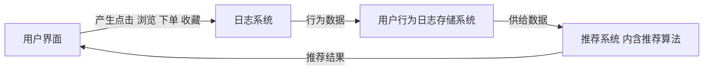
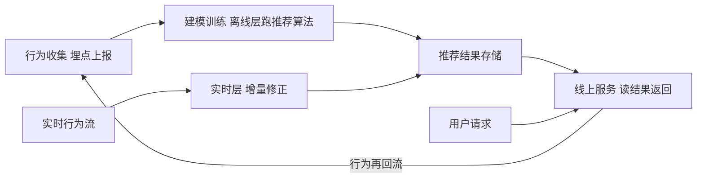

# 推荐系统业务流程：从行为收集到线上服务的推荐闭环

上一节说了推荐系统是什么，这一节回答它怎么运转。一个常见的学习卡点是：推荐算法讲了这么多，数据从哪来、算完放哪、线上怎么用，没有一张完整的图。本课把推荐系统的业务流程拆开：行为数据怎么收集、推荐算法怎么参与、结果怎么到用户面前，以及这套流程在工程上通常分成哪几段来落地。

## 先给结论

- 推荐系统是一张闭环网：收集用户行为数据，交给推荐算法计算，结果由前台展现，用户看到推荐后又产生新行为，回流进入下一轮循环，推荐因此越来越准。
- 一套推荐能力由三部分组成：基础数据、推荐算法、前台展示，缺一不可。
- 基础数据的维度很宽：访问、浏览、下单、收藏、历史订单信息、评价信息，全都算。
- 工程上把闭环拆成四段来落地：行为收集、建模训练、推荐结果存储、线上服务读取；离线层负责重计算，实时层负责增量修正。
- 做推荐系统需要四类知识储备：业务知识、网站架构与运营、机器学习算法与数学建模、大数据计算平台。

## 一、全景闭环：数据怎么转起来

推荐系统的整体业务流程可以画成一张闭环图：



这张图的读法顺着箭头走一圈：用户在界面上发生点击、浏览、下单、收藏，这些行为被日志系统记录并存入行为日志存储系统；推荐系统从存储系统取数据，用内部的推荐算法算出推荐结果，交给用户界面展现；用户看到推荐后产生新的行为，又从界面的箭头开始新的一轮。循环转得越久，积累的数据越多，推荐结果就越准确。这套流程的本质是一个飞轮：推荐带动行为，行为反哺推荐。

对照这张图，探花交友的对应关系一目了然：用户界面就是 App 的首页与佳人卡片，行为日志是浏览主页、点赞、打招呼这些动作的记录，推荐系统就是后续要搭建的 Spark 推荐计算部分，算出的今日佳人再回到首页展现。

## 二、三要素：基础数据、推荐算法、前台展示

推荐系统一般需要的历史数据由三部分组成，构成一条完整的链路。

**第一，基础数据。** 包括的维度很多：用户的访问、浏览、下单、收藏，用户的历史订单信息，评价信息等。它是推荐的燃料，覆盖的行为维度越全，对兴趣的刻画越细。值得注意的是这些数据几乎都是隐式行为，用户很少显式打分，浏览、停留这些无声的动作恰恰是最大宗的数据来源。

**第二，推荐算法。** 根据不同的推荐需求编写不同的算法，组成推荐模型。比如猜你喜欢用行为相似度，好友推荐可能叠加距离与年龄条件，同一个系统里往往多路算法并行，各出一份候选再合并排序。

**第三，前台展示。** 前端系统负责两件事：把推荐结果以合适的形式展现出来，以及继续收集用户的行为信息，把新数据交回推荐系统用于下一轮推荐。展示层不只是渲染，它同时是数据回收的入口。

三要素串起来就是流程总结里的三步：用户行为数据收集、推荐算法的编写、用户界面的展现。

## 三、工程落地：四段链路与离线实时分层

课程讲的是业务流程，落到工程实现时，通常把闭环拆成四段：行为收集、建模训练、推荐结果存储、线上服务。整体链路与分层如图：



离线层与实时层的分工是这张图的关键。离线层定时批量跑推荐算法（协同过滤、矩阵分解这类重计算），每天或每小时产出一次全量推荐结果；实时层盯住最近的行为流，对刚刚发生强烈兴趣的用户做增量修正，避免今天上午刚浏览过的内容下午还推不出来。两层的结果统一写入推荐结果存储，线上服务只做一件事：请求到达时按用户主键读取预计算好的结果返回，秒级响应，绝不在请求线程里跑重算法。

存储侧的设计随之确定：推荐结果是按用户维度组织、读多写少的热点数据。一张示例结果表结构如下（示例为按主流工程写法补全）：

```sql
CREATE TABLE recommend_result (
    user_id        BIGINT  COMMENT '被推荐的用户',
    target_user_id BIGINT  COMMENT '推荐给他的对象',
    score          DOUBLE  COMMENT '推荐得分，按得分降序取用',
    recommend_date DATE    COMMENT '推荐结果所属日期',
    PRIMARY KEY (user_id, recommend_date)
) COMMENT '推荐结果表，离线任务按日期滚动写入';
```

线上读取的骨架相应地非常薄，示意如下（示例伪代码）：

```java
//线上服务：读取当日预计算好的推荐列表
public List<Long> todayBest(Long userId) {
    String key = "recommend:" + userId + ":" + LocalDate.now();
    //直接取得分最高的前十个结果，线上不做重计算
    return redisTemplate.opsForZSet().reverseRange(key, 0, 9)
            .stream().map(Long::valueOf).collect(Collectors.toList());
}
```

四段链路各司其职：收集段保证数据不断流，训练段保证模型跟得上兴趣变化，存储段保证线上读得起，服务段保证响应够快。任何一段卡住，用户看到的推荐要么过时、要么超时。

## 四、开发推荐系统需要哪几类知识

课程给了一份知识清单，逐条展开。

**业务知识。** 推荐什么、推荐给谁、什么算一次好的推荐，由业务定义。电子商务推荐的是商品，交友业务推荐的是人，探花交友属于后者，业务规则决定了数据怎么标注、结果怎么评价。

**网站架构与运营知识。** 推荐系统上线后必须能检验准确度，这依赖网站的架构能力与运营指标：点击率、转化率这些数字是评价推荐效果的依据，不懂数据怎么产生就无从评估。

**机器学习算法与数学建模知识。** 协同过滤、相似度计算、矩阵分解这些算法是推荐的核心引擎，背后的数学建模是理解与改进算法的钥匙。

**大数据计算平台知识。** 用户行为数据的规模决定了计算必须放在分布式平台上完成，Spark 正是本系列选定的计算平台，前面各课的 RDD、MLlib 基础都是为在这里跑推荐算法做准备。

这四类知识会在后续课程里逐个展开：算法从协同过滤讲起，平台从 Spark 讲起，业务与架构则贯穿探花交友的推荐功能实现。

## 常见误区

- **把推荐当成线上实时计算。** 错例：用户请求来了再现场跑算法算推荐，接口超时、资源打满。正解：重计算放在离线层预计算，线上只读取结果，实时层只做增量修正。
- **只收集显式评分，忽略隐式行为。** 错例：等用户打分再建模型，数据稀疏到无法训练。正解：浏览、点击、停留、收藏都是兴趣信号，隐式行为才是最大宗的数据来源。
- **推荐结果一算定终身。** 错例：模型训练一次，结果表永不更新，用户兴趣变了推荐原地踏步。正解：必须闭环，前台行为回流，模型定期重训，结果按日期滚动写入。
- **忽视推荐结果存储的设计。** 错例：把推荐结果和业务明细混存，线上查询慢、键难维护。正解：推荐结果是读多写少的热点数据，按用户与日期组织键结构，得分预排序，线上按主键直取。

## 面试可能被问到的问题

1. 面试官追问：「描述一下推荐系统的业务流程？」
   答：收集用户的行为数据，如点击、浏览、下单、收藏，交给推荐系统中的推荐算法计算，结果交给前台展现；用户使用过程中又产生新的行为数据回流到推荐系统，形成闭环。循环往复，数据越积越多，推荐结果越来越准。
2. 面试官追问：「推荐系统由哪几部分组成，基础数据包括哪些？」
   答：基础数据、推荐算法、前台展示三部分。基础数据维度很宽，包括访问、浏览、下单、收藏、历史订单信息、评价信息等；推荐算法按不同的推荐需求编写并组成推荐模型；前台负责结果展现，同时回收新的用户行为数据。
3. 面试官追问：「离线层和实时层怎么分工？」
   答：离线层定时批量跑重计算算法，产出全量推荐结果；实时层消费最近的行为流，对兴趣发生明显变化的用户做增量修正；两层结果统一写入推荐结果存储，线上服务读取预计算结果响应请求，兼顾准确性与时效性。
4. 面试官追问：「为什么推荐结果要预计算并存储，而不是请求时实时算？」
   答：推荐算法涉及全量行为数据的两两比较与矩阵运算，计算量大，放到请求链路里无法满足秒级响应；预计算把成本转移到离线时段，线上退化为一次按主键的读取，稳定性与响应时间都可控。
5. 面试官追问：「做推荐系统需要哪些知识储备？」
   答：四类。业务知识，如电商或交友业务的推荐规则；网站架构与运营知识，用于检验推荐的准确度；机器学习算法与数学建模知识，是推荐的核心引擎；大数据计算平台知识，支撑海量行为数据上的分布式计算。

## 配套资料

- 学习目标：`materials/code/07/day07 探花交友-SparkMLlib推荐系统快速入门/day07/学习目标.md`，其中「了解推荐系统的业务流程」对应本课内容。
- 说明：day07 资料包无本课源码，四段链路拆分、结果表 SQL 与线上读取伪代码为按本课写法与主流工程实践补全，闭环架构图按课程画面整理。
