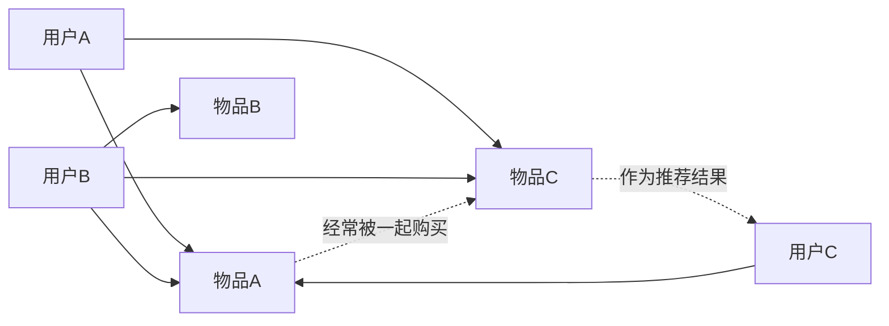

# 基于商品的协同过滤 ItemCF：从「一起被买走」到推荐列表

做推荐时最直觉的思路是找相似的人：先算出和目标用户口味相近的一群人，再把这群人喜欢的东西搬过来。这个思路在社交产品里成立，放到电商场景就会撞上规模墙：用户数以千万计，两两计算用户相似度的成本压不住。换个视角看，商品的数量通常远小于用户的数量，把「找相似的人」换成「找相似的物」，问题立刻轻下来。

这一课讲基于商品的协同过滤 ItemCF：它的推荐思想是什么，物品之间的「相似」由什么定义，拿到相似度之后怎么生成推荐列表，以及和基于用户的推荐相比各自适合什么场景。

## 先给结论

- ItemCF 的核心思想一句话：给用户推荐与他喜欢的物品相似的其他物品。
- 这里的相似不由商品内容决定，而由行为决定：两件物品经常被同一批用户共同偏好，就判定它们相似。
- 计算上，把所有用户对某个物品的偏好组成一个向量，物品相似度就是向量之间的计算。
- 结合用户的历史偏好与物品相似度，可以预测用户对尚未接触物品的兴趣，按得分产出推荐列表。
- UserCF 找相似的人，ItemCF 找相似的物；怎么选取决于业务场景，实际系统更常把两者混合使用。

## 一、思想：经常被一起购买的物品就是相似物品

用课程里的例子走一遍。用户 A 购买了物品 A 和物品 C；用户 B 把物品 A、物品 B、物品 C 都买了；用户 C 只购买了物品 A。把购买关系画出来：



这张图讲的是购买关系如何支撑一次 ItemCF 推荐。物品 A 与物品 C 被用户 A、用户 B 反复一起购买，这种共现模式说明两件物品比较相似；用户 C 只买过物品 A，而 A 又与 C 相似，于是把物品 C 推荐给用户 C。

与基于用户的推荐对照着看，差别一下子就清楚了：基于用户的推荐要找出相似的用户，ItemCF 计算邻居时采用的不再是人，而是物品本身。判断依据依然来自用户对商品的喜好，只是视角从人切换到了物。

## 二、计算视角：从偏好向量到推荐列表

把上面的直觉翻译成计算步骤。**第一，构建偏好向量。** 对某一件物品来说，把所有用户对它的偏好取出来排成一个向量，第 i 个分量就是用户 i 对该物品的偏好值，买过记 1，评分就取评分值。**第二，计算物品相似度。** 两件物品的相似度就是两个偏好向量的相似程度：向量越接近，说明喜欢这两件物品的越是同一批人。**第三，预测并生成列表。** 依据用户的历史偏好，结合物品相似度，预测该用户对还没有产生偏好记录的物品的兴趣，按得分从高到低排序，就得到可以推荐的物品列表。

用一句话概括这套逻辑：根据所有用户的历史偏好，喜欢物品 A 的用户大都也喜欢物品 C，所以 A 与 C 相似；用户 C 喜欢 A，推断他多半也会喜欢 C，把 C 推荐给他。

## 三、动手算一遍：共现统计与打分

课程资料包没有本课源码，下面的示例按本课思路与主流写法补全。输入是最常见的「用户、物品、偏好」三元组，形态与资料包里 ml-100k 评分数据同构：

```text
u1 i1 1
u1 i3 1
u2 i1 1
u2 i2 1
u2 i3 1
u3 i1 1
```

i1 对应例子中的物品 A，i3 对应物品 C，u3 对应用户 C。对每位用户偏好过的物品做两两组合，统计物品对的共现次数，共现越多物品越相似；然后给目标用户没有接触过的物品打分，得分来自他历史物品与候选物品的相似度之和：

```java
package com.study.tanhua.spark.itemcf;

import java.util.*;

/**
 * ItemCF 最小示例，示例为按本课写法补全
 * 输入格式：用户 物品 偏好
 */
public class ItemCfDemo {

    public static void main(String[] args) {
        List<String> rows = Arrays.asList(
                "u1 i1 1", "u1 i3 1", "u2 i1 1", "u2 i2 1", "u2 i3 1", "u3 i1 1");
        //用户偏好过的物品：用户 -> 物品集合
        Map<String, Set<String>> userItems = new LinkedHashMap<>();
        for (String row : rows) {
            String[] ss = row.split(" ");
            userItems.computeIfAbsent(ss[0], k -> new HashSet<>()).add(ss[1]);
        }
        //共现统计：物品对 -> 被同一用户共同偏好的次数
        Map<String, Integer> co = new HashMap<>();
        for (Set<String> items : userItems.values()) {
            List<String> list = new ArrayList<>(items);
            for (int a = 0; a < list.size(); a++) {
                for (int b = a + 1; b < list.size(); b++) {
                    String i = list.get(a), j = list.get(b);
                    String key = i.compareTo(j) < 0 ? i + "|" + j : j + "|" + i;
                    co.merge(key, 1, Integer::sum);
                }
            }
        }
        //打分：u3 的历史物品是 i1，i1 与 i3 共现 2 次，与 i2 共现 1 次
        //候选物品不能出现在用户历史里，已偏好过的物品要过滤掉
        String target = "u3";
        Set<String> history = userItems.get(target);
        Map<String, Double> score = new HashMap<>();
        for (Map.Entry<String, Integer> e : co.entrySet()) {
            String[] pair = e.getKey().split("\\|");
            for (String h : history) {
                String cand = pair[0].equals(h) ? pair[1]
                        : pair[1].equals(h) ? pair[0] : null;
                if (cand != null && !history.contains(cand)) {
                    score.merge(cand, (double) e.getValue(), Double::sum);
                }
            }
        }
        System.out.println(score); //i3 得 2.0 最高，i2 得 1.0，推荐 i3
    }
}
```

运行结果把课程例子的结论复现了一遍：i1 与 i3 共现 2 次（用户 u1、u2 都同时偏好过它们），i1 与 i2 只共现 1 次，所以给 u3 推荐得分最高的 i3。真实工程里共现数还会做归一化（比如除以两件物品各自被偏好次数的乘积开根），或直接用余弦相似度替代简单计数，但骨架不变：先对物算相似，再对用户打分。

## 四、怎么选：基于用户还是基于商品

两种协同过滤摆在面前，选择标准是什么？课程给出的答案是看场景，核心是算谁的相似度更便宜、更有解释力：

| 对比维度 | 基于用户的推荐 UserCF | 基于商品的推荐 ItemCF |
| --- | --- | --- |
| 计算邻居的对象 | 相似的用户 | 相似的物品 |
| 推荐的解释 | 和你兴趣相似的人也喜欢它 | 喜欢这件商品的人也喜欢那件 |
| 适合场景 | 社交类产品，要计算人与人之间的关系 | 电商类产品，用户数远大于商品数 |
| 成本关键点 | 用户规模大时相似度矩阵难以承受 | 物品数量通常可控，计算成本更低 |

社交产品是 UserCF 的主场。像微信、QQ 这类应用，登录之后提示「可能认识的人」，本质是在计算人与人之间的关系，自然要基于用户做推荐。电商项目则是 ItemCF 的主场：用户数量远大于商品数量，基于商品的推荐在复杂度与成本上都更低，也更合理。

实际系统往往并不单一使用某一种推荐，而是把基于用户的推荐与基于商品的推荐混合到一起，也就是混合推荐。选哪一种与要实现的业务强相关，得结合应用场景仔细分析，才能选出更合适的方法。

落到探花交友这类社交产品上，被推荐的对象是「人」，基于用户的推荐思路更贴合；但如果把每位用户的资料、兴趣标签与行为画像当作他的「物品描述」，ItemCF 也能派上用场：常被同一批用户浏览、点赞的两个画像互为相似项，可以出现在彼此的推荐位。分界不在产品形态，而在相似度算在用户之间还是物品之间。

## 常见误区

- **把 ItemCF 的相似当成内容相似。** 错例：认为手机 A 与手机 B 外观接近才会互推。正解：ItemCF 的相似来自行为共现，两件内容毫无关联的商品只要常被同一批人偏好，就会被判定相似。
- **把用户已经偏好过的物品再推一遍。** 错例：推荐列表里出现用户刚买过的商品。正解：打分阶段要过滤用户历史物品，示例代码里 `!history.contains(cand)` 就是在做这件事。
- **认为 ItemCF 一定省成本。** 错例：商品数同样上千万的平台直接照搬。正解：省成本的前提是物品数显著小于用户数，反过来时应该重新评估基于用户的方案。
- **忽视新物品的冷启动。** 错例：新上架商品没有共现记录，ItemCF 永远推不出它。正解：新品用内容相似度、热门榜单、运营位兜底，行为积累起来后再并入协同过滤。

## 面试可能被问到的问题

1. 面试官追问：「ItemCF 的核心思想是什么，和 UserCF 的差别在哪？」
   答：ItemCF 给用户推荐与他喜欢的物品相似的其他物品，相似由共同偏好行为定义；UserCF 先找相似的用户，再搬运他们的偏好。差别在计算邻居的对象，一个对物算相似，一个对人算相似。
2. 面试官追问：「ItemCF 怎么计算物品之间的相似度？」
   答：把所有用户对某物品的偏好组成一个向量，物品相似度就是两个偏好向量的相似程度，常用共现统计加归一化或余弦相似度实现，本质是回答「喜欢物品 A 的用户是否也喜欢物品 C」。
3. 面试官追问：「电商场景为什么更常用 ItemCF？」
   答：电商用户数远大于商品数，UserCF 要维护海量用户两两相似度，成本高且难以实时更新；ItemCF 只在物品维度算相似度，矩阵规模小得多，还能给出「买了 A 的人也买了 C」这类直观解释。
4. 面试官追问：「社交产品为什么倾向 UserCF？」
   答：社交产品的核心是人与人之间的关系，例如登录后推荐可能认识的人，需要计算用户之间的相似度；ItemCF 推的是相似物品，解决不了「该认识谁」的问题。
5. 面试官追问：「生产系统只用一种协同过滤吗？」
   答：很少。更常见的是混合推荐，把 UserCF 与 ItemCF 的结果按场景融合，再配合热门与运营策略兜底冷启动；选哪一种或怎么混，取决于对业务场景的分析。

## 配套资料

- 学习目标：`materials/code/07/day07 探花交友-SparkMLlib推荐系统快速入门/day07/学习目标.md`，其中「掌握基于商品的协同过滤算法」对应本课内容。
- 评分数据集：`materials/code/07/day07 探花交友-SparkMLlib推荐系统快速入门/day07/资料/ml-100k/`，课程提供的 MovieLens ml-100k 评分数据，本课示例的三元组输入与它同构，后续 ALS 实战也会用到。
- 说明：day07 资料包无本课源码，共现统计与打分示例为按本课画面与主流写法补全。
