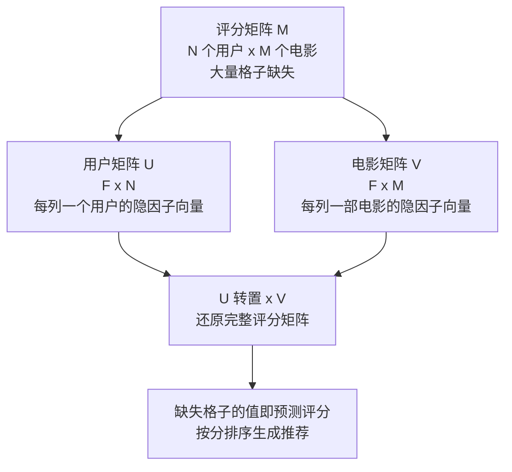
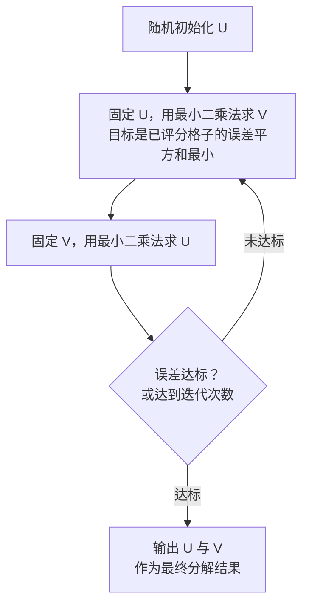

# ALS 原理：把评分矩阵拆成用户矩阵与物品矩阵，交替逼近

上一课的结论是最小二乘法靠「误差平方和最小」找最佳函数。ALS 把同样的思想搬到了一张大表上：用户对商品的评分矩阵。这张表大而稀疏，绝大多数格子是空的，逐格补全几乎不可能。ALS 的解法是不补表，而是把表拆成两个小表，用交替求解逼近原表。这一课把这个过程讲透。

## 先给结论

- ALS 的核心动作是矩阵分解：把 N 行 M 列的用户-商品评分矩阵 M，分解成一个 F 行 N 列的用户矩阵 U 与一个 F 行 M 列的电影矩阵 V，两者相乘（严格说是 U 的转置乘 V）还原出 M，课程材料简记为 M = U × V。
- F 对应 F 个隐含语义因子，是把用户口味压缩后的抽象维度，不是人工标注的标签，而是模型从评分数据里自动学出来的。
- 「交替」的含义：先固定 U 求出 V，再固定 V 求出 U，如此往复，每一轮都让误差进一步缩小。
- 误差达到设定的阈值条件，或达到迭代次数上限时停止迭代，此时的 U 与 V 就是最终结果。
- 拿到 U、V 后，两矩阵相乘即可预测任意用户对任意商品的评分，按预测分排序就得到推荐列表。

## 一、评分矩阵与矩阵分解

用课程 PPT 的例子看这张表。用户与电影组成的评分矩阵 M（N 行用户，M 列电影）长这样：

```text
评分矩阵 Rating Matrix (N x M)：
          电影1  电影2  电影3
用户1       5      3      5
用户2       4      2      1
用户3       0      3      3
```

矩阵里的 0 表示该用户没有给这部电影打过分，是缺失值而不是差评。真实业务里这张表极其稀疏：几千个用户对几千部电影，每人只评过几十部，空格子占绝大多数。

ALS 不去逐个猜测空格子，而是假设整张表背后藏着一个低秩结构：每个用户的口味可以压缩成 F 个数字，每部电影的属性也可以压缩成 F 个数字，用户评分近似等于这两组数字的匹配程度。写成矩阵语言就是：

```text
用户矩阵 U (F x N)：              电影矩阵 V (F x M)：
        用户1  用户2  用户3              电影1  电影2  电影3
f1        1    -4      1      f1       -1      0     -2
f2       -2     0     -3      f2        4     -4      1
f3        0    -5      1      f3        0      2      2

分解关系：M ≈ U 的转置 × V       （课程材料简记为 M = U × V）
```

f1、f2、f3 这三行就是三个隐因子。打个比方，f1 可以理解为「偏爱大场面动作片的程度」，f2 是「偏爱文艺慢节奏的程度」，但要注意这些维度并没有人工含义，是算法从评分数据里自动学出来的抽象坐标，所以叫隐含语义因子。F 通常远小于用户数与电影数，两个小矩阵的参数量比原矩阵少得多，这正是 ALS 既省存储又能泛化的原因：一部从没被这位用户看过的电影，只要它学到了隐因子向量，就能和用户向量算出匹配分。



这张图讲的是分解的两端：评分矩阵被拆成用户、电影两个隐因子矩阵，反过来两矩阵相乘又能把整张表还原出来，原来缺失的格子带上的是预测值。

## 二、什么叫交替：固定一方求另一方

分解听上去是鸡生蛋蛋生鸡：要求 U 得先有 V，要求 V 得先有 U。ALS 用「交替」破局：先固定 U 求出 V，因为评分矩阵 M 是固定已知的，所以 V 一定能解出来；再固定 V 求出 U。如此一直交替计算误差值，直到满足停止条件。



这张图讲的是 ALS 的迭代主循环：从随机初始化出发，固定一方解另一方，误差达标或次数用尽即停。

为什么固定一方就能解另一方？固定 U 之后，问题变成：已知每个用户的隐因子向量与全部已观测评分，求每部电影的隐因子向量，让已知格子上「U 的转置 × V」与真实评分的平方和误差最小。这正是一个标准的最小二乘问题，正是上一课那套「误差平方和最小」的功夫，而且每个用户、每部电影的向量可以独立求解，互不纠缠，天然适合并行计算，这也是 ALS 在 Spark 上跑得快的原因之一。

```text
一轮交替里发生的两件事：
1. 固定 U：对每部电影 m，求 V 使 Σ( U列u · V列m - 真实评分 )² 最小，得到新的 V
2. 固定 V：对每个用户 u，求 U 使 Σ( U列u · V列m - 真实评分 )² 最小，得到新的 U
```

如此反复，误差值一轮比一轮小，最终逼近一个稳定解。

## 三、停止条件与最终结果

迭代不能无限跑下去，课程给出的停止条件有两个，满足其一即可：误差值达到设定的阈值条件，说明精度已经够用；或迭代次数达到上限，说明再跑下去收益有限。停下来的那一刻，手里的 U 与 V 就是求得的最终分解结果。

拿到结果后的使用方式非常直接：想预测用户 u 对电影 m 的评分，就把 u 的隐因子向量与 m 的隐因子向量做点积；想给 u 推荐电影，就对 u 没评过的所有电影各算一遍预测分，按分数从高到低取前若干个。原始矩阵里空着的格子，就这样被两个小矩阵「商量」出了取值。

到这里，名字里的每个词都有了着落：最小二乘法是每一次固定一方求解时用的数学工具，交替是两个矩阵轮流解的迭代方式，合起来就是交替最小二乘法。原理层面 ALS 已经完整，下一课进入工程视角，看 Spark MLlib 中使用 ALS 做推荐的完整流程。

## 常见误区

- **把隐因子当成人工标注的标签。** 错例：以为要先给电影打上动作、喜剧等标签才能分解。正解：隐因子是算法自动学出来的抽象维度，与人工标签无关；人工标签可以做辅助特征，但不是 ALS 的必需品。
- **认为 U × V 能精确还原原矩阵。** 错例：拿分解结果与原矩阵逐格对比，发现对不上就说模型错了。正解：分解是近似，追求的是已评分格子的误差平方和最小，未评分格子的值只是预测值。
- **把矩阵里的 0 当成 0 分差评。** 错例：以为示例矩阵里用户 3 讨厌电影 1。正解：0 表示没有评分记录，是缺失值，建模时按未观测处理，不参与误差计算。
- **认为迭代次数越多结果越好。** 错例：把迭代次数拉到几百次。正解：误差收敛后继续迭代收益极小，还可能把噪声也学进去；Spark 里用 iterations 参数控制上限，取值要靠离线评估实测。

## 面试可能被问到的问题

1. 面试官追问：「ALS 的核心思想是什么？」
   答：把用户-商品评分矩阵分解为用户隐因子矩阵与商品隐因子矩阵的乘积，交替固定一方、用最小二乘法求解另一方，不断减小已评分格子的误差平方和，最终用两个小矩阵预测未评分格子的分数，形成推荐。
2. 面试官追问：「什么是隐含语义因子？」
   答：评分背后隐藏的抽象兴趣维度，比如对动作片、文艺片的偏好强度。它不是人工定义的字段，而是模型从评分数据中自动学出来的，每个用户与每件商品各有一组 F 维的隐因子向量，评分近似等于两组向量的匹配程度。
3. 面试官追问：「交替求解为什么行得通？固定 U 之后凭什么能求出 V？」
   答：固定 U 后，问题退化为标准的最小二乘回归，已知评分与用户向量，求每件商品的隐因子向量使平方和误差最小，有成熟解法；解出 V 后同理再解 U，交替推进，误差持续下降。
4. 面试官追问：「ALS 训练完成之后怎么给用户做推荐？」
   答：拿用户的隐因子向量与候选商品的隐因子向量做点积得到预测评分，过滤掉用户已有过行为的商品，按预测分排序取 Top-N 输出；Spark MLlib 里这一步由训练产物 MatrixFactorizationModel 的预测与推荐方法直接完成。
5. 面试官追问：「ALS 的迭代什么时候停下来？」
   答：两个条件满足其一即停，误差降到设定的阈值以内，或迭代次数达到上限。生产上通常两者配合，先用次数上限兜底，再用阈值控制精度。

## 配套资料

- 学习目标：`materials/code/07/day07 探花交友-SparkMLlib推荐系统快速入门/day07/学习目标.md`，其中「了解交替最小二乘法的原理」与本课对应。
- 说明：本课为 PPT 原理讲解，资料包无配套源码；矩阵示例数据抄自课程画面，建模代码示例为按本课写法补全，在 ALS 实战篇给出。
