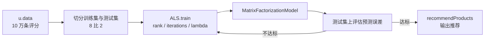

# ALS 实战第一步：吃透 ml-100k 数据集，再用 ALS.train 完成建模

原理与流程都备齐了，进入实战。实战的第一件事不是写代码，而是把数据看明白：数据长什么样、有哪些字段、哪些字段参与建模、哪些字段留着做解释。数据这一关过了，建模只是几行调用。这一课把 MovieLens ml-100k 数据集逐文件拆开，再对着 MLlib 的 ALS.train 方法把建模参数一个个讲透。

## 先给结论

- 实战数据是推荐领域最经典的 MovieLens ml-100k 数据集：943 个用户、1682 部电影、10 万条评分，随课程资料包的 day07 资料目录下发。
- 核心文件是 u.data，每行四列：用户 ID、电影 ID、评分（1 到 5 的整数）、时间戳，制表符分隔；建模只吃前三列，时间戳留给分析与切分。
- 辅助文件各司其职：u.user 用户画像、u.item 电影档案、u.info 规模统计、u.genre 流派表、u.occupation 职业表、README 全量说明。
- 建模调用 MLlib 的 ALS.train，输入是 RDD[Rating] 三元组，关键参数 rank（隐因子数，10 到 20 之间）、iterations（迭代次数，10 次左右）、lambda（正则化参数，0.01），返回 MatrixFactorizationModel。
- 建模前要切分训练与测试数据，训练后用测试数据评估；参数最优值因环境而异，必须实测调整。

## 一、数据集在哪：ml-100k 目录全貌

课程从网上下载了这套经典的用户、电影与评分数据，随资料包下发，位于 day07 资料目录的 ml-100k 子目录中。打开 README 先看这份数据的出身：MovieLens 数据集由 MovieLens 项目组长期维护，README 的 CITATION 部分给出了学术出处，Harper 与 Konstan 2015 年发表在 ACM TiiS 上的论文记录了数据集的历史与背景。用别人的数据做实验，先读 README 是好习惯，格式、规模、字段含义、引用方式全在里面。

ml-100k 目录里的文件清单与用途：

| 文件 | 内容 | 建模角色 |
| --- | --- | --- |
| u.data | 全部评分记录，四列 | 核心输入，建模只用它 |
| u.info | 数据规模统计 | 了解数据量 |
| u.item | 电影档案 | 结果解释，把 ID 翻译成片名 |
| u.user | 用户画像 | 用户分析、冷启动扩展 |
| u.genre | 流派编号表 | 与 u.item 的流派列对应 |
| u.occupation | 职业列表 | 与 u.user 的职业列对应 |
| README | 数据集说明与引用信息 | 使用前必读 |
| mku.sh | 切分 u.data 生成 u1.base 等子集的脚本 | 训练测试切分 |

打开 u.info 看一眼统计：

```text
943 users
1682 items
100000 ratings
```

943 个用户、1682 部电影、10 万条评分，这就是全部家底。README 还交代了一条隐含信息：每个用户至少评过 20 部电影，这保证了每个用户都有可学习的口味信号，没有一个用户是完全空白的。

## 二、核心数据 u.data：四列格式逐列拆解

推荐真正吃进去的只有 u.data。打开文件，每行一条评分，长这样（节选自课程画面）：

```text
196	242	3	881250949
186	302	3	891717742
244	51	2	800606923
298	346	4	884397596
253	451	2	891628467
6	86	5	883603013
```

四列含义对照 README 的字段说明：

| 列序 | 字段 | 含义 | 取值说明 |
| --- | --- | --- | --- |
| 1 | user id | 用户 ID | 1 到 943，连续编号 |
| 2 | item id | 电影 ID | 1 到 1682，连续编号 |
| 3 | rating | 评分 | 1 到 5 的整数，5 为最高 |
| 4 | timestamp | 评分时间戳 | Unix 秒级时间戳 |

以第一行为例：用户 196 给电影 242 打了 3 分，评分发生在时间戳 881250949 对应的时刻。时间戳是 Unix 秒级时间戳，即从 1970 年 1 月 1 日起累计的秒数，这批数据采集于 1997 年到 1998 年之间，官方 README 有明确说明。

顺手算一笔账就能看清这份数据的真实面目：943 个用户乘 1682 部电影，理论上有 158 万多个格子，实际只有 10 万个格子有评分，填充率约 6.3%，剩下的 94% 全是空白。这就是推荐系统绕不开的稀疏性问题，也是 ALS 选择「分解矩阵」而不是「补全矩阵」的根本原因：挨个猜 148 万个空格毫无章法，学出两组隐因子向量再用乘积回填，才是有规律的解法。

四列各有一段讲究。

**用户 ID 与电影 ID。** 两列 ID 都是整数且连续编号，不需要再做字符串映射。MLlib 的 Rating 类型要求用户与物品用 Int 表示，这份数据天生满足，直接可用；换到自己的业务数据时要先做 ID 到整数的映射，这一步在探花交友的项目里同样躲不掉。

**评分列。** 整数 1 到 5，属于显式反馈：用户主动表达了喜好程度。显式评分是 ALS 显式反馈模式的标准输入，模型输出的也是这个尺度的连续分数，可能是 3.7 这样带小数的预测值，取整或排序后就是推荐依据。

**时间戳列。** 建模输入里没有它的位置，但它不是废料。同一用户不同时期的评分口味可能变化，按时间切分训练与测试数据（早发生的训练、晚发生的验证）更贴近线上「用过去预测未来」的真实场景；不做时间切分时随机切分也可以，MovieLens 官方还提供了按固定行数切分的脚本。两种切分思路在第六节都会看到。

## 三、辅助文件：u.user 与 u.item

评分之外的两个文件不参与建模，却决定了推荐结果能不能「说人话」。

u.user 是用户画像，竖线分隔五列：user id、age、gender、occupation、zip code。节选前几行：

```text
1|24|M|technician|85711
2|53|F|other|34043
3|23|M|writer|32067
4|24|M|technician|43537
5|33|M|other|15213
6|42|M|executive|98101
7|57|M|administrator|91344
8|25|M|student|10062
```

用户 1 是 24 岁的男性技术员，邮编 85711；用户 8 是 25 岁的男学生。年龄、性别、职业、地域，这些字段是做用户分群、冷启动与结果分析的原料，比如可以验证模型给不同职业人群的推荐是否有系统差异。

u.item 是电影档案，包含电影 ID、片名、上映日期、IMDb 链接以及 19 个流派标记列（是否动作片、是否喜剧等布尔位），流派编号的含义由 u.genre 给出，职业编号的含义由 u.occupation 给出。模型输出的是电影 ID，向用户展示时必须靠 u.item 把 ID 翻译成片名，否则推荐列表就是一堆数字。

这批辅助数据在探花交友里有直接的对应物：用户资料里的年龄、性别、地域、职业，正是后续推荐功能用得上的画像维度。课程在这里举的需求例子也很直白：给张三这个用户推荐 5 到 10 部电影，就要找到与张三相似的用户，再做推荐。ALS 的做法是用隐因子向量替我们完成「找相似」这一步，而喂给它的燃料，就是 u.data 里的评分数据。

数据选择上还有一条值得记住的原则：建模输入只取最必要的 u.data，画像与档案先放在一边。这不是浪费，而是把问题切干净，矩阵分解只需要「谁对谁打了几分」这一个事实，画像信息一旦混进训练输入，问题的性质就从矩阵分解变成了特征回归，反而复杂化。辅助文件的正确用法是在训练之外发挥价值：解释结果、分析人群、支撑冷启动。

## 四、从四列到 RDD[Rating]：把数据装进 MLlib 的接口

MLlib 是基于 RDD 的那一套机器学习 API（与基于 DataFrame 的 ml 库是并存的两套 API，本课用 mllib 包），它为推荐定义了 Rating 类型，构造是三元组：`case class Rating(user: Int, product: Int, rating: Double)`。

u.data 的四列转三元组，就是取前三列、暂不用时间戳。读取与转换的完整过程（资料包无本课 Java 源码，示例为按本课写法补全，Spark 2.4.3）：

```java
package com.study.tanhua.spark.als;

import org.apache.spark.SparkConf;
import org.apache.spark.api.java.JavaRDD;
import org.apache.spark.api.java.JavaSparkContext;
import org.apache.spark.mllib.recommendation.Rating;

/**
 * 读取 ml-100k 的 u.data 并转为 RDD[Rating]
 */
public class LoadRatings {

    public static JavaRDD<Rating> load(JavaSparkContext sc, String path) {
        return sc.textFile(path)
                .filter(line -> !line.isEmpty())
                .map(line -> line.split("\t"))
                .map(a -> new Rating(
                        Integer.parseInt(a[0]),    //用户 ID
                        Integer.parseInt(a[1]),    //电影 ID
                        Double.parseDouble(a[2])   //评分
                ));                                //时间戳列暂不使用
    }

    public static void main(String[] args) {
        SparkConf conf = new SparkConf().setAppName("TanhuaAlsDemo").setMaster("local[*]");
        JavaSparkContext sc = new JavaSparkContext(conf);
        JavaRDD<Rating> ratings = load(sc, "data/ml-100k/u.data");
        System.out.println("评分条数：" + ratings.count());
        sc.stop();
    }
}
```

跑起来打印 100000，说明数据已经按 MLlib 的口味装好了。类型要在入口处对齐：mllib 的 Rating 只认 Int 的用户与物品 ID、Double 的评分，u.data 天然满足，业务数据要先转换。

路径上还有个容易踩的小坑：课程资料目录名里带中文与空格，Spark 读文件时直接拼进路径偶尔会出问题。实验时建议把 ml-100k 整个目录拷贝到一个不含空格与中文的纯英文路径下再读取，代码里的路径保持简洁；正式工程里数据一般落在 HDFS，天然规避了这类问题。

## 五、数据建模：ALS.train 的参数逐个讲透

MLlib 已经把交替最小二乘的训练过程封装好，只需调用 ALS.train。课程讲义给出的方法定义如下：

```scala
def train(
    ratings: RDD[Rating], //需要训练的样本集
    rank: Int,            //模型中隐因子数，一般设定在 10 到 20 之间
    iterations: Int,      //算法迭代次数，一般 10 次左右
    lambda: Double,       //ALS 中的正则化参数，一般设置为 0.01
    blocks: Int,          //计算的分块数，-1 为自动配置
    alpha: Double,        //用于控制每次迭代拟合修正的幅度
    seed: Long            //随机数种子
): MatrixFactorizationModel
```

七个参数逐个过。

**ratings，训练样本集。** 就是上一节产出的 RDD[Rating]，每个元素是用户、电影、评分三元组，等价于评分矩阵里所有已填的格子。整个矩阵分解的原料全在这里。

**rank，隐因子数。** 对应原理篇里 F 行隐因子：每个用户、每部电影被压缩成 rank 维向量。rank 越大表达能力越强，但参数量上升、更容易过拟合；rank 太小又装不下口味差异。课程经验值是 10 到 20 之间，讲师口播提到 8 到 20 也常见，具体取值要靠自己的数据实测。

**iterations，最大迭代次数。** 原理篇说过 ALS 是交替求解，这个参数限制交替的最大轮数。设置 10 次左右即可，课程特别提醒：每个人的运行环境与数据不同，最合适的次数也不同，有人 8 次就收敛，有人 15 次才合适，这个值必须测试得出，不能照抄。

**lambda，正则化参数。** 在误差最小化的目标上叠加对隐因子取值的惩罚，防止模型把训练数据里的噪声也学进去，一般取 0.01。它同样需要调优：验证误差高而训练误差低时考虑调大，欠拟合时考虑调小。

**blocks，分块数。** 把数据与计算分块并行，-1 是默认值，表示自动配置。分块是 ALS 能在集群上高效并行计算的基础，保持默认即可。

**alpha，修正幅度。** 用于控制每次迭代拟合修正的幅度，通常保持默认不做调整；它主要在隐式反馈场景（只有行为没有评分）发挥作用，本课是显式评分，不动它。

**seed，随机数种子。** 控制矩阵分解初始矩阵的随机性，默认即可；固定 seed 可以让训练结果可复现，方便横向对比不同参数的效果。

参数之间还讲究一个调优顺序：先固定 iterations 与 lambda，单独扫一遍 rank，找到误差的低谷区间；再在最好的 rank 下微调 iterations；lambda 放到最后精调。三个参数一起乱试，组合数爆炸，永远调不出结论。原理篇的对应关系也别忘了：rank 就是矩阵分解里的 F 行隐因子，iterations 就是交替求解的轮数上限，lambda 就是防止过拟合的正则项，参数不是孤立数字，每个都对应着分解行为的一部分。

调用之后返回 MatrixFactorizationModel，它内部保存的就是训练收敛后的用户隐因子矩阵与电影隐因子矩阵，predict 方法预测单点评分，recommendProducts 方法直接给用户吐推荐列表。给张三推荐 10 部电影这个需求，落到代码上就是一次 recommendProducts 调用。

## 六、切分、训练、验证：把流程闭环跑起来

流程篇说过，数据要切分，模型要验证。资料包 ml-100k 目录里的 mku.sh 正是官方干这件事的脚本：把 10 万条评分按每 2 万条一组切成 5 份，每份的 2 万条作 u1.test 到 u5.test 的测试集，其余 8 万条作对应的 u1.base 到 u5.base 训练集，合起来是标准的 5 折交叉验证，训练与测试 8 比 2；脚本还借助 allbut.pl 生成排除部分用户评分的 ua、ub 子集。5 折的意义在于排除偶然：只切一次，结果好坏可能全看运气，切 5 次轮换测试集，5 个结果的平均水平才是模型真实的水位。自己实验时，用 u1.base 与 u1.test 就能跑出最标准的结果；业务数据上则常用 randomSplit 随机切分或按时间戳切分。



这张图讲的是从数据到模型的完整通路：评分数据切分后喂给 ALS.train，产出矩阵分解模型，在测试数据上评估，达标出推荐，不达标调参重训，与流程篇的闭环完全对应。

评估用什么指标？最常用的是 RMSE，均方根误差：把测试数据上每条预测分与真实分的差平方、求平均、再开方，数值越小，模型对评分的还原越准。它的单位与评分一致，直观好解读，比如 RMSE 为 0.8，意味着预测分与真实分的典型偏差在 0.8 分量级；对 1 到 5 的评分尺度来说，这个量级已经相当可用。平方后再求均值的做法与最小二乘法一脉相承，大偏差被放大，模型糊弄不了人（本课无配套源码，训练与评估示例为按本课写法补全）：

```scala
package com.study.tanhua.spark.als

import org.apache.spark.mllib.evaluation.RegressionMetrics
import org.apache.spark.mllib.recommendation.{ALS, MatrixFactorizationModel, Rating}
import org.apache.spark.rdd.RDD

object AlsModelDemo {

  //训练：对训练集做矩阵分解
  def train(ratings: RDD[Rating], rank: Int, iterations: Int, lambda: Double) =
    ALS.train(ratings, rank, iterations, lambda)

  //评估：测试集上的 RMSE
  def rmse(model: MatrixFactorizationModel, test: RDD[Rating]): Double = {
    val pred = model.predict(test.map(r => (r.user, r.product)))
    val pairs = test.map(r => ((r.user, r.product), r.rating))
      .join(pred.map(p => ((p._1._1, p._1._2), p.rating)))  //真实分连接预测分
      .map { case (_, (truth, guess)) => (guess, truth) }
    new RegressionMetrics(pairs).rootMeanSquaredError
  }
}
```

训练、评估、调参三件事在代码里各就各位：rank 从 10 试到 20，iterations 在 8 到 15 之间试，lambda 从 0.01 上下微调，每组跑一遍 RMSE，选误差最低的参数组合，这正是流程篇调参闭环的具体执行方式。

## 七、建模思路收束

到这里，ALS 实战的准备动作全部完成：数据说明讲清了 u.data 的四列与各辅助文件的角色，数据建模讲透了 ALS.train 的七个参数与训练产物。需求场景始终是那一个：根据用户的评分数据找出相似的用户，给指定用户推荐 5 到 10 部电影。在 ALS 的语境下，「相似用户」被隐因子向量的接近程度所替代，模型替我们完成了找相似这一步。

这套思路迁移到探花交友几乎没有隔阂：把电影换成推荐候选人，把评分换成互动行为产生的偏好权重，u.data 的角色由平台埋点与行为数据接替，ALS.train 一行不用改。数据集不同、尺度不同，四列转三元组、切分、训练、评估、调参的骨架完全一致。下一课把这套流程在代码里完整跑一遍，产出真正的推荐结果，再进入探花交友推荐功能的工程化改造。

## 常见误区

- **把时间戳塞进 Rating。** 错例：以为四列数据要原样喂给模型，给 Rating 造了第四个字段。正解：mllib 的 Rating 是固定三元组，只收用户、物品、评分；时间戳用于切分或分析，不进模型输入。
- **把没有评分的位置当 0 分参与训练。** 错例：把评分矩阵补 0 后全表丢给模型。正解：u.data 只记录真实发生的评分，没有评分的位置是缺失不是 0 分，ALS 只对已观测的格子计算误差。
- **直接照抄别人的参数。** 错例：网上抄 rank 与 iterations 的组合就跑。正解：课程明确提示环境与数据不同最优值不同，rank、iterations、lambda 都要以自己的验证误差为准实测。
- **忘记切分就用全量数据训练再自评。** 错例：训练集上算出的误差极小就宣布模型可用。正解：必须留出独立测试数据评估，训练集误差只反映拟合能力，不反映泛化能力。

## 面试可能被问到的问题

1. 面试官追问：「ml-100k 数据集里最核心的文件是什么，格式怎样？」
   答：u.data。每行一条评分，制表符分隔四列：用户 ID、电影 ID、评分（1 到 5 的整数）、Unix 秒级时间戳。全量 10 万条评分，来自 943 个用户对 1682 部电影，每个用户至少评过 20 部。
2. 面试官追问：「MLlib 的 Rating 是什么结构，时间戳怎么处理？」
   答：Rating(user, product, rating) 三元组，用户与物品是 Int，评分是 Double。u.data 四列转三元组时取前三列，时间戳不进模型，可以用来按时间切分训练与测试数据。
3. 面试官追问：「ALS.train 的关键参数怎么取值？」
   答：rank 是隐因子数，经验值 10 到 20；iterations 是最大迭代次数，10 次左右；lambda 是正则化参数，一般 0.01。三者都要用自己数据的验证误差实测调优，blocks、alpha、seed 通常保持默认。
4. 面试官追问：「lambda 在 ALS 里起什么作用？」
   答：正则化参数，在最小化误差平方和的目标上叠加对隐因子取值的惩罚，限制模型复杂度，防止把训练数据的噪声学进去，也就是防止过拟合。
5. 面试官追问：「怎么判断训练出来的推荐模型好不好？」
   答：切分出独立的测试数据，把预测分与真实分对比计算 RMSE 等误差指标，误差越小说明对评分的还原越准；再用同一份测试数据横向比较不同参数组合，选出最优模型，最终结合业务效果确认。
6. 面试官追问：「ALS 训练的产物是什么，怎么用它推荐？」
   答：MatrixFactorizationModel，内部是收敛后的用户矩阵与物品矩阵。predict 预测指定用户对指定物品的评分，recommendProducts 给指定用户按预测分输出 Top-N 推荐，给用户推荐电影就是一次方法调用。

## 配套资料

- 学习目标：`materials/code/07/day07 探花交友-SparkMLlib推荐系统快速入门/day07/学习目标.md`，其中「了解交替最小二乘法的原理」「掌握 ALS 的实战」条目与本课对应。
- ml-100k 数据目录：`materials/code/07/day07 探花交友-SparkMLlib推荐系统快速入门/day07/资料/ml-100k/`，资料包内置切分脚本 mku.sh；u.data、u.user、u.item 等数据文件为 MovieLens 官方 ml-100k 数据集标准文件，实验前放入该目录即可，正文引用的数据行按课程画面抄录。
- 说明：资料包无本课 Java 与 Scala 源码，加载、训练与评估示例为按课程画面与主流写法补全。
