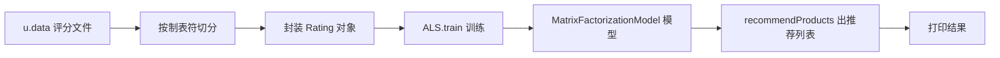

# ALS 编码实战：从 u.data 到为用户 301 推出十部电影

原理铺完，数据认过，建模思路也讲清楚了，接下来把代码真正跑起来。这一课写的是 ALS 推荐最短的一条主线：给定一个用户 ID，基于所有人对电影的评分数据，为这个用户推荐出若干部感兴趣的电影。整段代码只有几十行，却覆盖了 Spark MLlib 推荐的四个固定动作：读数据、封装 Rating、训练模型、生成推荐。四步跑通，后面的调参优化才有落点。

## 先给结论

- ALS 编码四步走：读评分文件、封装成 Rating RDD、ALS.train 训练模型、recommendProducts 输出推荐列表。
- u.data 每行四列：用户 id、电影 id、评分、时间戳，制表符分隔，构造 Rating 只取前三列。
- rank 一般取 8 到 20，迭代次数 10 次左右，课程演示用 rank = 8、iterations = 10。
- ALS 从随机矩阵开始迭代，每次运行初始值不同，推荐结果跟着变化，属正常现象。
- 测试期把日志级别设为 WARN，能压掉海量 INFO 输出，让结果看得清。

## 一、目标与四步主线

功能目标一句话：为用户 301 推荐 10 部电影。推荐依据既不是电影的内容属性，也不是用户的好友关系，而是 ml-100k 里那 10 万条「谁给哪部电影打了几分」的评分记录。整条流水线长这样：



这张图讲的是编码实战的固定次序：原始文本行先变成结构化的 Rating RDD，再喂给 ALS 训练出矩阵分解模型，模型再按用户给出带预测评分的商品序列。四个环节任何一个断掉，后面全部无法执行。

## 二、初始化环境与装载评分数据

Spark 入口三件套：SparkConf 配置应用名与运行模式，JavaSparkContext 作为环境上下文，程序结束前 stop 释放资源。课程在本地模式下演示，master 取 `local[*]`。读文件走 textFile，拿到原始行 RDD 后按制表符切分：

```java
package com.study.tanhua.spark;

import org.apache.spark.SparkConf;
import org.apache.spark.api.java.JavaRDD;
import org.apache.spark.api.java.JavaSparkContext;

public class MyRecommend {
    public static void main(String[] args) {
        //初始化运行环境
        SparkConf sparkConf = new SparkConf()
                .setAppName("MyRecommend")
                .setMaster("local[*]");
        JavaSparkContext jsc = new JavaSparkContext(sparkConf);
        jsc.setLogLevel("WARN"); //压掉 INFO 日志，方便看结果

        //读取评分文件并按制表符切分
        JavaRDD<String> sourceRDD = jsc.textFile("F:\\ml-100k\\u.data");
        JavaRDD<String[]> lineRdd = sourceRDD.map(v -> v.split("\t"));
        //后续逻辑见下文
    }
}
```

u.data 是 MovieLens ml-100k 标准数据集的核心文件，每行四列，前几行长这样：

```text
196 242 3  881250949
186 302 3  891717742
22  377 1  878887116
244 51  2  880606923
```

四列依次是用户 id、电影 id、评分、时间戳。拿第一行解读：196 号用户在 881250949 这个时间点给 242 号电影打了 3 分。数据在磁盘上按制表符分隔，代码里的 `split("\t")` 对应的就是它；文件路径以实际放置位置为准，指向课程资料里的 ml-100k 目录即可。

## 三、封装 Rating 与训练模型

Rating 是 MLlib recommendation 包里的样本类，构造参数三个：用户 id（int）、商品 id（int）、评分（double），推荐电影时商品就是电影。切分后拿到的是字符串数组，要转成数值类型再装箱：

```java
//封装 Rating：user、product、rating
JavaRDD<Rating> ratingRDD = lineRdd.map(v ->
        new Rating(Integer.valueOf(v[0]),
                Integer.valueOf(v[1]),
                Double.valueOf(v[2])));

//训练：rank = 8，迭代 10 次
MatrixFactorizationModel model = ALS.train(ratingRDD.rdd(), 8, 10);
```

两个细节值得圈出来。**第一，JavaRDD 要调 rdd() 转一手。** ALS.train 收的是 Scala 侧的 RDD 对象，Java 写法里必须显式调用 `ratingRDD.rdd()` 完成转换，这是 Java API 与 Scala API 衔接的固定动作。**第二，两个参数的重载先走通主线。** train 的完整签名还有 lambda、并行块数、隐式反馈系数、随机种子等参数，全部有默认值，入门阶段先用 rank 加迭代数的最简形式。

训练得到的 MatrixFactorizationModel 在内存里是两个矩阵：用户特征矩阵与电影特征矩阵。rank 是隐因子的个数，隐因子可以理解成把「喜欢什么」拆成若干个抽象维度，维度取 8 到 20 之间是常用区间；迭代次数 10 次左右，交替求解基本收敛。模型的预测原理很直接：用户特征向量点乘电影特征向量，得到的就是这个用户对这部电影的预测分。

## 四、recommendProducts 出结果

```java
//为用户 301 推荐 10 部电影
Rating[] products = model.recommendProducts(301, 10);
for (Rating product : products) {
    System.out.println("userId = " + product.user()
            + ", product = " + product.product());
}
jsc.stop();
```

recommendProducts 的两个参数：user 是目标用户 id，num 是要几条推荐。返回 Rating 数组，每条除 user、product 外还带预测评分 rating()，需要按分数排序展示时把它一并打印即可。课程当次运行的输出，用户 301 拿到的电影 id 依次是：

```text
userId = 301, product = 915
userId = 301, product = 933
userId = 301, product = 1106
userId = 301, product = 918
userId = 301, product = 912
userId = 301, product = 1645
userId = 301, product = 914
```

还有两个现场细节要交代。一是日志，训练过程每个分块的每轮迭代都会打 INFO，测试时不压掉，结果直接被刷走，`jsc.setLogLevel("WARN")` 就是为这个准备的。二是结果的可复现性：ALS 从随机初始化的两个矩阵出发交替求解，初始值不同、迭代落点不同，两次运行的推荐列表可能不一致，这是算法性质，不是代码有 bug；要结果可复现，得用 train 完整签名里的 seed 参数固定随机种子。

## 常见误区

- **把第 4 列时间戳当评分。** 错例：`new Rating(v[0], v[1], v[3])`，模型拿到的是一串秒数。正解：评分在第 3 列，时间戳是第 4 列；它不参与训练，优化版里才登场，用来做数据切分的 key。
- **JavaRDD 直接丢给 ALS.train。** 错例：`ALS.train(ratingRDD, 8, 10)` 编译不通过。正解：train 要 Scala 的 RDD 类型，Java 侧调用 `ratingRDD.rdd()` 转换后再传。
- **期望两次运行结果一致。** 错例：跑两遍发现推荐列表不一样，以为写错了。正解：随机初始化所致，固定 seed 才可复现；列表大体趋势稳定即可。
- **rank 与迭代数越大越好。** 错例：rank 拉到 100，训练变慢还过拟合。正解：rank 增大计算量与过拟合风险同步上涨，8 到 20 起步，精确值靠校验集评估来挑。

## 面试可能被问到的问题

1. 面试官追问：「用 ALS 做推荐，代码主流程分几步？」
   答：四步。读评分数据封装成 Rating RDD；调用 ALS.train，传入评分 RDD、rank、迭代次数，得到 MatrixFactorizationModel；用模型的 recommendProducts 对指定用户取推荐列表；遍历打印或写入存储。
2. 面试官追问：「u.data 里的数据长什么样，哪些字段进模型？」
   答：每行四列，制表符分隔，依次是用户 id、电影 id、评分、时间戳。进模型的是前三列，时间戳不参与训练，但调参阶段用它取模作为数据切分的 key。
3. 面试官追问：「rank 和迭代次数一般怎么设置？」
   答：rank 是隐因子维度，一般 8 到 20 之间起步试验；迭代次数 10 次左右 ALS 基本收敛。精确取值不能拍脑袋，要靠校验集上的 RMSE 比较得出。
4. 面试官追问：「为什么两次运行推荐结果不一样？」
   答：ALS 从随机初始化的用户与物品特征矩阵开始交替求解，初始值不同，收敛到的解不同，预测分随之浮动。固定随机种子可以复现结果。
5. 面试官追问：「recommendProducts 返回什么，怎么用？」
   答：Rating 数组，每条包含 user、product 与模型预测的评分 rating。预测分越高代表模型认为该用户越可能喜欢该物品，业务上按预测分倒序取用。

## 配套资料

- 学习目标：`materials/code/07/day07 探花交友-SparkMLlib推荐系统快速入门/day07/学习目标.md`，「掌握 ALS 的实战」即本课对应条目。
- 数据目录：`materials/code/07/day07 探花交友-SparkMLlib推荐系统快速入门/day07/资料/ml-100k/`，内含官方数据整理脚本 `mku.sh`；课程演示用的 `u.data`、`u.item` 为 MovieLens ml-100k 标准文件，放入该目录即可复现。
- 说明：day07 资料包无本课源码，MyRecommend 示例为按本课画面与主流写法补全。
