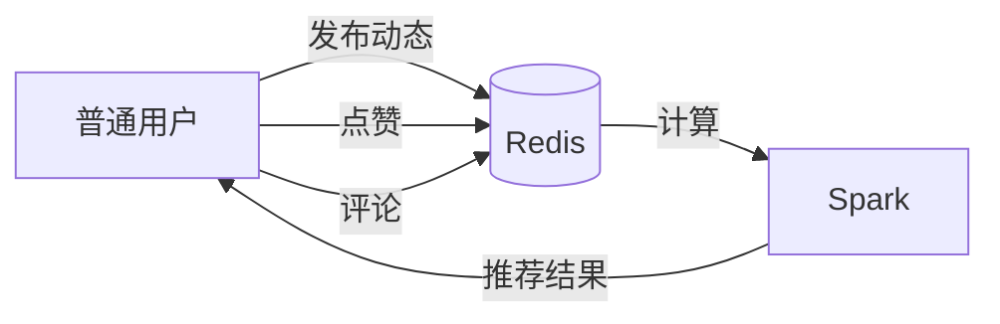

# 圈子推荐要做什么：把人人相同的列表换成为你计算的列表

圈子页顶部的「推荐」页签是 day08 之前就已经立好的位置：day03 落地读取侧时，往推荐时间线表里灌了一批测试数据，所有用户刷新看到的顺序完全一致。页签空有入口，没有灵魂。day08 的圈子推荐要补的正是这一块，让这个位置展示按用户偏好计算出来的动态列表。功能说明这节课不到两分半，回答的却是最根源的问题：系统凭什么判断一条动态值得推给谁。

## 先给结论

- 推荐页签的升级方向：从「人人相同的默认列表」换成「按推荐计算结果排列的个性化列表」。
- 推荐的依据是用户行为数据：发布、浏览、点赞、喜欢、评论，操作类型不同，含金量不同。
- 判断热门的标准朴素而有效：一条动态被点赞、被喜欢的人越多，它越热门，越值得推荐。
- 计算交给 Spark 承接（day07 已验证可行性），业务侧只负责采集行为与展示结果，不碰算法。
- 没有行为数据就没有推荐，这条铁律适用于圈子，也适用于以后任何推荐场景。

## 一、默认列表的现状：它是占位，不是推荐

先把两个页签的账摊开。好友页签走写扩散：发布动态时，动态指针投递进每个好友的时间线分表，读取时只查自己那张 `quanzi_time_line_<userId>`。推荐页签没有「投递」这个动作，day03 的做法是复用时间线结构建一张 `quanzi_time_line_recommend` 推荐表，数据用测试用例灌入，读取侧与好友页签共用同一个 Dubbo 方法，靠 `userId` 是否为空分流：

```java
@Override
public PageInfo<Publish> queryPublishList(Long userId, Integer page, Integer pageSize) {
    String tableName = "quanzi_time_line_recommend";
    if (null != userId) {
        //查询好友动态，按用户分表
        tableName = "quanzi_time_line_" + userId;
    }
    //按时间倒序分页取时间线指针，再回查发布表（day03 已实现，此处节选分支）
}
```

这条分支在设计时就留了活口：推荐表的数据由谁来写，读取侧并不关心。day03 是测试用例复制进去的假数据，day08 起换成推荐系统的真实计算结果，接口代码一行不用改。要替换的只是写入方，而这正是功能说明课定下的目标：让推荐页签的内容由推荐系统决定，每个用户看到的顺序带着自己的偏好。

## 二、热门从哪里来：行为数据是唯一凭证

推荐要回答「什么动态值得看」，答案不能靠拍脑袋，只能靠数据。课程给的标准很直接：收集用户对动态的操作，发布、浏览、点赞、喜欢、评论都算；只要某条动态点赞的人数非常多，或者喜欢的人非常多，就说明它是热门动态，值得优先推荐。操作本身不需要用户额外做什么，日常刷圈子就是在给系统投票。

把这句话画成图，就是课程 PPT 上的功能说明图：



这张图讲的是行为数据变成推荐列表的最小闭环：用户的各类操作先汇聚到一处（画面上画的是 Redis 作为汇聚点），再交给 Spark 计算，算出的推荐结果直接送回用户面前。图是示意版，数据在站点之间具体怎么流转，比如消息通道走 RocketMQ、日志落在 MongoDB，流程说明课会展开成完整版。读懂关键路径就够了：行为数据是输入，Spark 是计算引擎，推荐列表是输出，三者缺一不可。

还有一层更普遍的道理值得记下来：做圈子推荐要收集行为数据，以后做任何推荐都是同一个前提。推荐的本质是「从历史行为里学偏好」，没有操作记录，再好的算法也是无米之炊。这也是为什么功能说明课敢用两分钟讲完全部内容，方向对了，剩下的只是工程实现。

## 三、Spark 接住计算：行为分顶替星级

计算环节直接复用 day07 的成果。day07 在 ml-100k 的十万条电影评分上验证过 ALS 链路：读评分文件、封装 Rating、训练模型、按用户输出推荐列表。现在评分的来源从「观众打星」换成「用户行为」，一条动态被浏览、点赞、喜欢的记录，折算成分数后就是推荐系统眼里的 rating：

```java
//day07 的固定动作：封装 Rating，user 与 product 都要求整数
JavaRDD<Rating> ratingRDD = lineRdd.map(v ->
        new Rating(Integer.valueOf(v[0]),
                Integer.valueOf(v[1]),
                Double.valueOf(v[2])));
```

这行代码里藏着 day08 第一件要干的活：Rating 的 user 与 product 是整数类型，而动态在 MongoDB 里的主键是 ObjectId，二十四位十六进制字符串根本塞不进这个构造参数。所以给动态补一个数字 id 是推荐链路开工的前提，具体实现放在 day08 后面的小节。行为怎么折算成分数也有讲究，浏览、点赞、喜欢的权重各不相同，计分规则同样留到后面专门一节。功能说明课把这两件事点出来，节奏就顺了：先补 id，再定规则，然后打通消息与计算，最后改造查询。

## 常见误区

- **以为推荐页签就是好友动态换个排序。** 错例：把好友时间线按点赞数倒序重排，就当作推荐列表。正解：两者数据来源不同，推荐页签展示的是推荐计算结果，覆盖的是全平台动态，不限于好友圈。
- **以为热门等于发布时间最新。** 错例：列表按 `created` 倒序就是推荐。正解：默认列表才按时间倒序，推荐列表按行为分排列，一条老动态可以因为持续被喜欢而长期排在前列。
- **以为推荐计算发生在用户请求路径上。** 错例：用户刷新页面时现场调 Spark 算一把。正解：计算离线批量完成，结果预先写好，查询只读结果，接口响应才不会被拖垮。
- **以为没有行为数据就无法上线推荐。** 错例：新用户列表直接空指针。正解：行为不足时回落默认推荐数据，查询侧的兜底分支正是为冷启动准备的。

## 面试可能被问到的问题

1. 面试官追问：「推荐页签和好友页签的数据来源有什么区别？」
   答：好友页签走写扩散，发布动态时投递到每个好友的时间线分表，读取只查自己那张表；推荐页签的数据来自推荐系统的计算结果。两者数据结构同构、来源不同，day03 阶段推荐表用测试数据占位，day08 起由推荐结果接管写入。
2. 面试官追问：「判断一条动态是否值得推荐的依据是什么？」
   答：用户行为数据。发布、浏览、点赞、喜欢、评论这些操作被量化成热度分，点赞与喜欢的人数尤其有说服力，人数越多说明动态越热门，越值得进入用户的推荐列表。
3. 面试官追问：「推荐计算为什么交给 Spark 而不是业务服务？」
   答：推荐计算是离线批量型任务，数据量大、迭代耗资源，放进业务服务会拖垮线上接口。Spark 擅长批处理，且 day07 已经用 ALS 跑通了从评分到推荐列表的链路，业务侧只需要准备数据与展示结果。
4. 面试官追问：「新用户没有任何行为，推荐列表从哪里来？」
   答：推荐依赖行为数据，无数据时先回落默认推荐数据保证列表可用，随着浏览点赞逐步积累，个性化推荐结果再接管排序。查询侧先查推荐结果、未命中走默认的分支设计，就是为这个冷启动场景准备的。

## 配套资料

- 学习目标：`materials/code/07/day08 探花交友-实现推荐功能/day08/学习目标.md`，前两条即「了解圈子推荐功能」与「了解圈子推荐功能的流程」。
- ALS 链路参照：`materials/code/07/day07 探花交友-SparkMLlib推荐系统快速入门/day07/资料/ml-100k/`，day07 的评分输入数据，day08 将用行为分顶替其中的星级。
- 说明：day08 资料包仅含学习目标，无源码包；文中两段代码分别是 day03 查询分支与 day07 Rating 封装的回顾节选。
