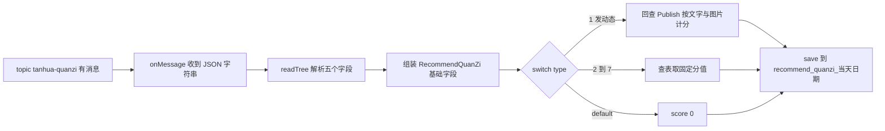

# 圈子推荐的第二段链路：消费行为消息，把动态得分落进 MongoDB

发送侧把「谁对哪条动态做了什么」广播到 topic 之后，链路的另一半是有人接住它。接收方是推荐系统，一个独立于圈子的工程：监听 `tanhua-quanzi`，解析消息，按计分规则算出得分，最后写成 MongoDB 里一行「用户、动态、得分」的评分记录。推荐侧日后所有 Spark 计算，吃的都是这张评分表。

这一段的难点不在收消息本身，而在两处设计：落库的数据结构长什么样，以及 7 种 type 的计分分支怎么组织才能和规则表一一对上。

## 先给结论

- 新建独立工程 tanhua-recommend，依赖 Spring Boot、Redis、MongoDB、RocketMQ，端口 10082，MongoDB 指向与业务同一个库，才能查到动态正文。
- 消费端实现 RocketMQListener<String>，@RocketMQMessageListener 指定 topic 与 consumerGroup，消息一到即回调 onMessage。
- 落库结构 RecommendQuanZi 的核心四字段：userId、publishId（存自增长 pid）、score、date；date 用于训练集与测试集的时间切分。
- 计分按 switch 分支：浏览 1 分、点赞 5 分、喜欢 8 分、评论 10 分、取消点赞 -5 分、取消喜欢 -8 分；发动态单独按文字长度与图片数计算；未知 type 记 0 分。
- 评分集合按天分表，名字形如 `recommend_quanzi_yyyyMMdd`，与发送端互不影响。

## 一、独立推荐工程的骨架

推荐工程与圈子业务彻底分开：圈子发版不影响它，它挂掉也不拖累圈子。工程名 tanhua-recommend，起步只需要四样东西：启动类、配置文件、日志配置和空的消息消费者。

配置里三块必须到位，RocketMQ 的 nameServer 与发送端指向同一个集群，MongoDB 指向业务库 tanhua（消费发动态消息时要回查动态正文，所以必须同库）：

```properties
spring.application.name=tanhua-recommend
server.port=10082

#rocketmq相关配置
spring.rocketmq.nameServer=192.168.31.81:9876
spring.rocketmq.producer.group=tanhua

#mongodb相关配置
spring.data.mongodb.uri=mongodb://192.168.31.81:27017/tanhua
```

启动类就是最普通的 Spring Boot 形态，不需要扫描 dubbo 包，也不需要排除数据源自动配置：

```java
@SpringBootApplication
public class RecommendApplication {

    public static void main(String[] args) {
        SpringApplication.run(RecommendApplication.class, args);
    }
}
```

一个工程复用问题需要提前处理：计分时要读动态的文字长度和图片数，也就是说要用到 Publish 实体。推荐工程不应拷贝这个类，而是通过 Maven 依赖直接复用 dubbo 服务工程里的 pojo 模块，版本对齐 1.0.0-SNAPSHOT，避免两份定义漂移。

## 二、落库的数据结构：RecommendQuanZi

推荐模型的输入，业界最标准的形态就是三元组：谁（user）、对什么（item）、给了多少分（rating）。RecommendQuanZi 就是这个三元组加一个时间戳的 MongoDB 映射：

```java
@Data
@NoArgsConstructor
@AllArgsConstructor
public class RecommendQuanZi {
    //MongoDB 主键
    private ObjectId id;
    //操作人 id
    private Long userId;
    //动态的自增长 pid，即推荐模型里的 item 标识
    private Long publishId;
    //本条行为对应的得分
    private Double score;
    //行为发生时间戳，用于按时间切分训练集与测试集
    private Long date;
}
```

字段设计有两个容易踩的细节。**第一，publishId 存的不是 ObjectId 字符串，而是自增长 pid。** 消息体里两个字段都有，落库取的是 pid 这个 Long，因为 Spark 训练时矩阵的列下标就是它，ObjectId 字符串在算法侧没有意义。**第二，date 必须保留。** 离线推荐需要拿一部分历史数据训练、拿另一部分验证效果，时间戳是切分的唯一依据，少存它，评估就无从谈起。

id 字段在写库时用 `ObjectId.get()` 生成，每条消息一行独立记录，天然是行为流水而不是累计值。

## 三、消费者：解析、计分、落库

消费者类用两个注解完成订阅：@Component 把自己交给 Spring 容器，@RocketMQMessageListener 声明监听 `tanhua-quanzi`、属于消费者组 `tanhua-quanzi-consumer`。topic 与发送端一致，消费组是这一组消费者的身份证，同组内的实例分摊消息，不同组各自独立消费。

```java
@Component
@RocketMQMessageListener(topic = "tanhua-quanzi",
        consumerGroup = "tanhua-quanzi-consumer")
public class QuanZiMsgConsumer implements RocketMQListener<String> {

    private static final Logger LOGGER = LoggerFactory.getLogger(QuanZiMsgConsumer.class);
    private static final ObjectMapper MAPPER = new ObjectMapper();

    @Autowired
    private MongoTemplate mongoTemplate;

    @Override
    public void onMessage(String msg) {
        try {
            //消息体是 JSON 字符串，readTree 解析出五个字段
            JsonNode jsonNode = MAPPER.readTree(msg);
            int type = jsonNode.get("type").asInt();
            String publishId = jsonNode.get("publishId").asText();
            Long date = jsonNode.get("date").asLong();
            Long userId = jsonNode.get("userId").asLong();
            Long pid = jsonNode.get("pid").asLong();

            RecommendQuanZi recommendQuanZi = new RecommendQuanZi();
            recommendQuanZi.setId(ObjectId.get());
            recommendQuanZi.setDate(date);
            recommendQuanZi.setUserId(userId);
            //注意：落库存的是自增长 pid
            recommendQuanZi.setPublishId(pid);

            switch (type) {
                case 1: {
                    //发动态：回查正文，按文字长度与图片数计分
                    Publish publish = this.mongoTemplate.findById(new ObjectId(publishId), Publish.class);
                    int score = 0;
                    int length = publish.getText().length();
                    if (length > 0 && length <= 50) {
                        score = 1;
                    } else if (length > 50 && length <= 100) {
                        score = 2;
                    } else {
                        score = 3;
                    }
                    if (publish.getMedias() != null) {
                        //每张图片加 1 分
                        score += publish.getMedias().size();
                    }
                    recommendQuanZi.setScore(Double.valueOf(score));
                    break;
                }
                case 2: { recommendQuanZi.setScore(1d);  break; } //浏览动态
                case 3: { recommendQuanZi.setScore(5d);  break; } //点赞
                case 4: { recommendQuanZi.setScore(8d);  break; } //喜欢
                case 5: { recommendQuanZi.setScore(10d); break; } //评论
                case 6: { recommendQuanZi.setScore(-5d); break; } //取消点赞
                case 7: { recommendQuanZi.setScore(-8d); break; } //取消喜欢
                default: { recommendQuanZi.setScore(0d); break; }
            }

            //按天分表写入
            String collectionName = "recommend_quanzi_" + new DateTime().toString("yyyyMMdd");
            this.mongoTemplate.save(recommendQuanZi, collectionName);
        } catch (Exception e) {
            LOGGER.error("消息处理失败！msg = " + msg, e);
        }
    }
}
```

处理流程浓缩成一张图，分支只出现在计分这一步：



关键路径看 case 1 与其他分支的差别：只有发动态需要回查 MongoDB 正文，因为只有它的得分由内容质量决定；2 到 7 的分值是规则表里的常量，拿到 type 就能写死。

## 四、为什么按天分表

落库时集合名不是固定的 `recommend_quanzi`，而是拼上当天日期。这样做的收益有三点。**第一，单集合不会无限膨胀。** 行为流水只增不改，按天切分后每个集合规模可控，索引也小。**第二，Spark 取数方便。** 训练时按日期范围选集合，正好对应 date 字段的切分逻辑，增量处理时只扫新的一天即可。**第三，与自增长 id 游标衔接。** 推荐侧增量同步靠动态的自增长 id 记进度，评分数据按天组织后，两边的进度线都是清晰的时间或数值刻度。

代价是查询跨天数据要遍历多个集合，但评分数据的消费者是离线批处理，不是在线接口，这个代价可以忽略。

## 常见误区

- **在 onMessage 里把异常往外抛。** 错例：JSON 解析失败直接 throw，指望 broker 重试，结果一条坏消息被反复重投，堵住整个队列。正解：解析失败 catch 住记 error 日志，坏消息直接放弃，计分允许个别丢失。
- **落库的 publishId 存成了 ObjectId 字符串。** 错例：把消息里的 publishId 字符串塞进 RecommendQuanZi。正解：存 pid 这个 Long，算法侧的 item 标识是 pid；两种 id 混存会让 Spark 侧关联动态时大面积对不上。
- **把 score 当成累计分维护。** 错例：消费时先查该用户对该动态的旧分数再加权更新。正解：每条消息插入一行新记录，累加交给离线计算；流水保留了完整的取消类负分行为，随时可重算。
- **MongoDB 指向了另一个库。** 错例：推荐工程配了独立的 database，case 1 回查 Publish 永远是 null，发动态的得分丢失。正解：与业务共用同一个 MongoDB 库，回查才有数据。

## 面试可能被问到的问题

1. 面试官追问：「@RocketMQMessageListener 里的 consumerGroup 起什么作用？」
   答：标识一组共同消费同一个 topic 的消费者实例。同组内的多台机器分摊消息，一条消息只被组内一个实例消费一次；组名变化会被 MQ 视为全新的消费组，从最新位点开始消费，可能漏掉历史消息。
2. 面试官追问：「一条消息处理失败了会发生什么？」
   答：如果 onMessage 抛出异常，RocketMQ 默认会按间隔递增重投 16 次，仍失败则进入该消费组的死信队列，等待人工处理。课程实现里 catch 掉所有异常只记日志，等于主动放弃重试，这是权衡过计分业务容忍少量丢失后的选择。
3. 面试官追问：「为什么每条消息插一行新记录，而不是更新动态的总分？」
   答：流水数据保留了行为发生的完整过程，包括取消点赞、取消喜欢这类负分记录，训练集与测试集切分、按时间加权、效果回溯都依赖流水；总分随时可以从流水聚合出来，反过来不行。
4. 面试官追问：「为什么用 readTree 手动解析，而不是把消息直接绑定成 POJO？」
   答：readTree 对消息结构变化的容忍度更高，字段增减不会直接抛异常，也方便逐字段做空值校验；消息字段目前只有五个，绑定 POJO 的收益不大，解析失败时的日志排查也更需要原始 JsonNode。
5. 面试官追问：「按天分表有什么好处，什么场景不适用？」
   答：好处是集合规模可控、离线取数与增量处理边界清晰；不适用于需要在线随机查询单条记录且经常跨天的业务，那种场景更适合单集合加时间索引。

## 配套资料

- 学习目标：`materials/code/07/day08 探花交友-实现推荐功能/day08/学习目标.md`，「独立实现圈子中接收消息」即本节对应条目。
- 说明：day08 资料包仅含学习目标，无源码包；代码为按本课画面与主流写法补全，计分规则数值沿用前面小节定下的口径。
