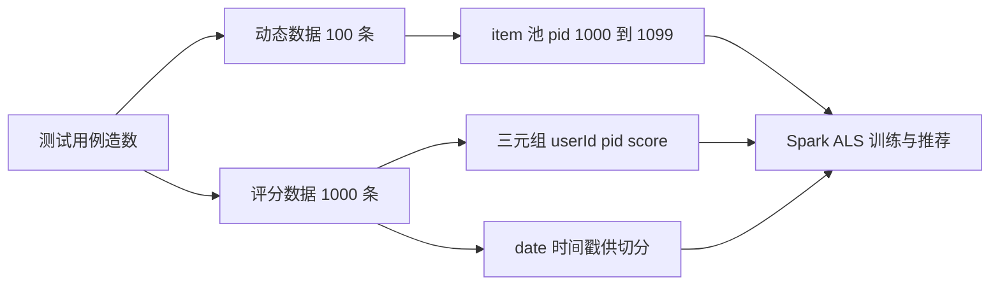

# 给 Spark ALS 喂数据：批量构造动态与评分两类测试数据

消息链路已经能把真实行为变成评分记录，但开发阶段系统里只有零星几条数据，拿这种稀疏程度去跑 ALS 矩阵分解，算出来的推荐毫无意义，甚至直接报错。训练前要先造数：模拟一批用户、一批动态和足够多的行为评分，把离线链路先用可控的数据跑通，再等真实数据积累。

造数要同时覆盖两类数据：动态数据（Publish，推荐模型里的 item 池）和评分数据（RecommendQuanZi，推荐模型里的行为记录）。两类数据的 id 必须能对上，这是本节最容易出错的衔接点。

## 先给结论

- 造数放在 dubbo 服务工程的测试用例里，直接调 QuanZiApi 与 MongoTemplate 写库。
- 动态数据 100 条：userId 随机 1 到 10，模拟 10 个用户；pid 手动指定为 1000 起连续递增，不再走自增长生成。
- 评分数据 1000 条：score 随机 0 到 15，userId 随机 1 到 10，publishId 在 1000 到 1099 之间随机，写入按天命名的集合。
- 造数期间把 savePublish 里的自增长 id 生成注释掉，跑完恢复，否则 pid 被覆盖、两套数据对不上。
- 跑测试用例前先停掉占用端口的 dubbo 服务，测试用例与提供者在同一工程，不停就端口冲突。

## 一、为什么 ALS 必须先喂够数据

ALS 的本质是把「用户乘动态」这个巨大又稀疏的评分矩阵分解成两个低秩矩阵，靠的是用户之间、动态之间的协同信号。数据太少时，矩阵里几乎没有共现关系：一个用户只对两条动态有分，模型既找不出与他口味相近的人，也学不到动态之间的相似度，分解结果等于噪声。

推荐模型的标准输入是三元组（user、item、rating），对应到本项目就是 RecommendQuanZi 里的 userId、publishId（自增长 pid）与 score，date 字段负责把数据切成训练集与测试集。造数的目标就是批量产出这种三元组，同时保证 item 池里的每个 pid 都真实存在一条动态。

造数与训练的衔接关系如下图，两类数据在「pid 对得上」这一点上汇合：



关键路径在中间汇合点：评分数据里的 publishId 必须落在动态数据实际生成的 pid 区间内，否则矩阵里出现悬空 item，训练时要么报错要么被静默丢弃。

## 二、造动态数据：手动指定 pid

测试用例写在 dubbo 服务工程的 test 目录里，循环 100 次，每次构造一个 Publish 直接保存：

```java
@Test
public void testSavePublish2() {
    for (int i = 0; i < 100; i++) {
        Publish publish = new Publish();
        //随机 1~10 号用户，模拟 10 个活跃用户共发 100 条动态
        publish.setUserId(RandomUtils.nextLong(1, 10));
        //手动指定自增长 pid：从 1000 起连续递增
        publish.setPid(1000L + i);
        publish.setLocationName("上海市");
        publish.setSeeType(1);
        publish.setText("今天天气不错~" + i);
        publish.setMedias(Arrays.asList(
                "http://example.com/images/a1.png",
                "http://example.com/images/a2.png",
                "http://example.com/images/a3.png"));
        String publishId = this.quanZiApi.savePublish(publish);
        System.out.println(publishId);
    }
}
```

`RandomUtils` 来自 commons-lang3，区间写法是左闭右开。这段代码有一个必须理解的临时改动：**正常流程下 savePublish 内部会为动态生成自增长 pid，造数时要把这段生成逻辑注释掉。** 原因是测试需要 pid 完全可控，从 1000 到 1099 连续无空洞，这样后面随机生成评分时才知道合法区间在哪。跑完造数记得把自增长逻辑恢复，否则线上写入的动态会没有 pid。

另一个工程细节：测试用例与 dubbo 服务提供者在同一个工程、用同一个端口，执行用例前必须把已启动的 dubbo 服务停掉，否则端口冲突直接启动失败。跑完后在 Mongo 客户端刷新动态集合，应看到 100 条新文档，pid 列正好是 1000 到 1099。

## 三、造评分数据：随机但要落在合法区间

评分数据用例循环 1000 次，直接用 MongoTemplate 写入按天命名的集合，与消费端的落库规则保持一致：

```java
@Test
public void testSaveRecommend() {
    for (int i = 0; i < 1000; i++) {
        RecommendQuanZi recommendQuanZi = new RecommendQuanZi();
        recommendQuanZi.setId(ObjectId.get());
        recommendQuanZi.setDate(System.currentTimeMillis());
        //得分随机 0~15 分，模拟从浏览 1 分到评论、喜欢等高分行为
        recommendQuanZi.setScore(Double.valueOf(RandomUtils.nextInt(0, 15)));
        //用户随机 1~10，与动态数据的用户池一致
        recommendQuanZi.setUserId(RandomUtils.nextLong(1, 10));
        //动态 pid 在 1000~1099 之间随机，保证能对上已造的动态
        recommendQuanZi.setPublishId(RandomUtils.nextLong(1000, 1099));
        //与消费端一致的按天命名
        this.mongoTemplate.save(recommendQuanZi, "recommend_quanzi_20191001");
    }
}
```

三个随机区间的选取都不是拍脑袋。userId 取 1 到 10，与动态数据的用户池重合，这样每个用户既有「自己发的动态」又有「对别人动态的行为」，矩阵行之间才有协同信号。publishId 取 1000 到 1099，正好覆盖造出来的动态池，不出现悬空 item。score 取 0 到 15，覆盖了计分规则里浏览 1 分到评论 10 分的量级，还留了高分行，让矩阵的取值分布更像真实行为。

执行完刷新 `recommend_quanzi_20191001` 集合，1000 条文档里 userId、publishId、score 各自随机分布，一眼看上去与真实行为流水没有区别。数据量还可以继续加大，数据越多，协同信号越强，推荐结果越准；这里 10 个用户配 1000 条评分已经足够把 ALS 的训练与推荐流程撑起来。

## 四、造数之后，离线链路还差什么

到这一步，MongoDB 里躺着结构完整的两类数据：动态池提供 item 维度，评分表提供 user 与 rating 维度。往后推进的路线已经清晰：Spark 推荐工程把评分数据装载成 Rating RDD 或 DataFrame，按 date 切出训练集与测试集，跑 ALS 训练出模型，再对每个用户取 topN 动态写入推荐结果集合。

要分清造数数据与生产数据的边界。造数解决的是「链路通不通、代码对不对」，随机分布模拟不出真实偏好，随机分数训练出的模型也不能直接上线。生产环境的评分数据只有一个来源：消息链路积累的真实行为流水。两条路径最终汇入同一张 RecommendQuanZi 结构，这正是落库结构设计的价值，Spark 侧代码对数据是造出来的还是真发出来的完全无感。

## 常见误区

- **造数时忘了注释自增长 id 生成。** 错例：publish 里手动 set 的 pid 被生成逻辑覆盖，评分数据按 1000 区间生成却查不到对应动态。正解：造数期间注释生成逻辑，pid 完全按 `1000 + i` 落库，跑完恢复。
- **评分数据的 publishId 随机范围超出动态池。** 错例：动态只造到 pid 1099，评分却随机出 1500，ALS 训练出现悬空 item。正解：item 区间由造动态数据的循环范围决定，两个用例的区间要一起核对。
- **在生产库上跑造数用例。** 错例：测试数据混进真实行为流水，推荐结果被污染且难以清理。正解：造数前确认 MongoDB 配置指向测试环境，集合名用造数当天的日期，一眼可辨。
- **把随机分数当成可上线的模型输入。** 错例：用造数数据训练出的推荐直接开放给用户。正解：造数只验证链路，上线依赖消息链路积累的真实行为，数据量不足时用默认推荐兜底。

## 面试可能被问到的问题

1. 面试官追问：「ALS 的输入数据长什么样？」
   答：三元组形式的评分数据，user id、item id、rating 各一列，对应本项目的 userId、自增长 pid 与 score，另带时间戳用于切分训练集与测试集；数据形态上是稀疏矩阵，绝大多数用户对大多数动态没有评分。
2. 面试官追问：「为什么造数时要手动指定 pid 而不走自增长？」
   答：自增长 id 只保证唯一不保证连续，测试需要 pid 的合法区间完全已知，才能让评分数据的随机 item 落在动态池内，造数期间关闭生成逻辑、按循环序号直接赋值是最可控的做法。
3. 面试官追问：「冷启动阶段没有行为数据，推荐怎么办？」
   答：短期的标准做法是默认推荐或热门动态兜底，同时用注册兴趣、位置等信息做粗排；消息链路持续积累行为后逐步切换到 ALS 结果，两者可以用灰度比例过渡。
4. 面试官追问：「date 字段在造数和训练里分别起什么作用？」
   答：造数阶段它让每条评分带上发生时间，与真实流水结构一致；训练阶段它是切分依据，按时间把数据分成训练集与测试集，避免用未来的行为预测过去造成评估失真。
5. 面试官追问：「测试数据造多少合适，有什么原则？」
   答：够把算法与链路跑通即可，重点保证 item 与 user 区间能对上、行为覆盖多种分值；量级太小协同信号不足会误判模型有问题，生产环境的精度提升靠真实数据积累而不是无脑放大随机数。

## 配套资料

- 学习目标：`materials/code/07/day08 探花交友-实现推荐功能/day08/学习目标.md`，「独立实现圈子的推荐逻辑」的前置数据准备即本节内容。
- ALS 算法背景：`materials/code/07/day07 探花交友-SparkMLlib推荐系统快速入门/`，评分矩阵与训练主线承接该节的 ALS 入门。
- 说明：day08 资料包仅含学习目标，无源码包；造数用例为按本课画面与主流写法补全，随机区间与集合命名沿用课程口径，示例图片地址以 example.com 占位。
