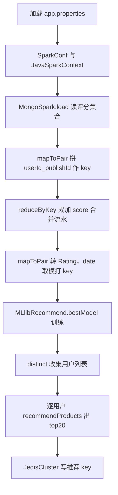

# SparkQuanZi 全流程：把评分流水炼成 Redis 里的推荐列表

工程、依赖、配置、工具类都就位了，主入口 `SparkQuanZi` 的 main 方法是这条离线链路的最后一公里，也是整条推荐链路里最长的一段代码。两个视频连起来正好是流水线的两半：前半程把 MongoDB 里的行为流水加工成 ALS 能吃的 Rating 数据并训出模型，后半程为每个用户生成推荐、把结果写进 Redis 集群。评分数据的上游是消息链路，行为消息经 recommend 工程消费后落库成按天集合，Spark 直接读落库结果而不直连消息队列，离线计算与在线消息天然解耦。这一节把 main 方法从第一行到最后一行全部写透。

## 先给结论

- main 方法一气呵成七步：加载配置、构建 SparkConf、构建 JavaSparkContext、MongoSpark.load 读评分、reduceByKey 合并行为、调 bestModel 训练、写 Redis。
- 配置通过类加载器读 `app.properties`，打包后换环境只改文件不改代码；`spark.mongodb.input.uri` 是连接器定位数据源的约定键。
- 数据清洗的核心动作：同一用户对同一动态的多次行为，按 `userId_publishId` 拼 key 后 reduceByKey 累加 score，流水收敛成矩阵。
- Rating 转换沿用 day07 口径：date 对 10 取模作 key，userId 与 publishId 收窄成 int 填进三元组。
- 推荐生成：从评分流水 distinct 出用户列表，逐用户调 `recommendProducts(userId, 20)`，预测分降序的 pid 列表写入 `QUANZI_PUBLISH_RECOMMEND_ + userId`。
- 资源用完即关：JedisCluster 与 JavaSparkContext 都要 close，长跑任务里连接泄漏是慢性病。

## 一、main 方法的全景图

先看整条流水线的骨架，代码从上到下与图从左到右一一对应：



关键路径有三次形态转换，每一步都在为下一步准备数据：MongoDB 的 Document 流水经合并收敛成「一行一个用户对一个动态的总分」，再转成 Rating 三元组并打上切分 key，模型输出后又变回「用户到 pid 列表」的业务形态落进 Redis。理解了这三次转换，后面每段代码都有坐标可挂。

## 二、加载配置与构建 Spark 上下文

main 的第一件事不是碰 Spark，而是把 `app.properties` 读进来：

```java
public class SparkQuanZi {

    public static void main(String[] args) throws Exception {
        //通过类加载器加载外部配置文件
        InputStream inputStream = SparkQuanZi.class.getClassLoader()
                .getResourceAsStream("app.properties");
        Properties properties = new Properties();
        properties.load(inputStream);
```

用 `getClassLoader().getResourceAsStream` 而不是 `new FileInputStream` 是有讲究的。**第一，路径基准不同。** 文件输入流按工作目录找文件，程序打包成 jar 后一部署就找不到；类加载器按 classpath 找资源，配置文件与 class 打包在同一个 jar 里，走到哪都能读到。**第二，职责边界。** properties.load 会抛 IOException，main 方法直接 `throws Exception` 往外抛：这是批处理任务的合理姿态，配置都读不到，后续所有步骤都没有意义，让任务带着堆栈直接失败，比静默吞掉再神秘退出好排查得多。

配置里的两个键各管一段：`spark.mongodb.input.uri` 马上就要交给 Spark 用，`redis.cluster.nodes` 留到写结果时手工解析。接下来构建 Spark 的运行参数：

```java
        //构建 Spark 配置：应用名、本地模式、MongoDB 输入源
        SparkConf sparkConf = new SparkConf()
                .setAppName("SparkQuanZi")
                .setMaster("local[*]")
                .set("spark.mongodb.input.uri",
                        properties.getProperty("spark.mongodb.input.uri"));

        //构建 Spark 上下文并加载 MongoDB 数据
        JavaSparkContext jsc = new JavaSparkContext(sparkConf);
        JavaMongoRDD<Document> rdd = MongoSpark.load(jsc);
```

SparkConf 的三项里，appName 用于在 Web UI 与日志中识别任务；`local[*]` 表示本地模式且线程数等于机器核心数，开发调试的常用姿势；`spark.mongodb.input.uri` 这一行是整个加载动作的开关，mongo-spark-connector 在 `MongoSpark.load(jsc)` 时读取这个约定键，按 URI 路径上的「库.集合」把数据定位出来。换句话说，读哪张表不写死在代码里，而是从配置注入，训练数据换一天、换一个集合，改配置就行。

load 返回的 `JavaMongoRDD<Document>` 里，每条评分记录是一个 `Document`，字段就是 tanhua-recommend 落库时的四要素：userId、publishId、score、date。习惯上先打印几条肉眼验货：

```java
//打印验证数据可读，确认后注释掉
rdd.foreach(document -> System.out.println(document.toJson()));
```

控制台里能看到 publishId 是 Long、score 是得分、date 是时间戳，说明配置、连接、集合命名三处全部对齐。验证通过后把这行注释掉，正式逻辑开始。

## 三、把行为流水洗成评分矩阵

这里必须先想清楚一个数据形态的错位。day07 的 u.data 天然干净：一个用户对一部电影只有一行评分。而圈子评分集合是行为流水，用户今天点一次赞、明天再取消又点赞，同一个用户对同一条动态可能挂了好几行。ALS 的输入约定是同一「用户、物品」对只有一条评分，所以喂模型之前要先合并。

合并分两步。**第一步，mapToPair 打上业务 key。** key 由 userId 加下划线加 publishId 拼成，同一个用户对同一条动态的所有流水必然落进同一个 key：

```java
//同一用户对同一动态会有多条行为流水，按键合并累加得分
JavaPairRDD<String, Document> pairRdd = rdd.mapToPair(document -> {
    Long userId = document.getLong("userId");
    Long publishId = document.getLong("publishId");
    //userId 加下划线拼 publishId 作为 key，同用户同动态必然同 key
    return new Tuple2<>(userId + "_" + publishId, document);
});
```

**第二步，reduceByKey 聚合。** 相同 key 的 Document 两两归并，得分累加后回写：

```java
JavaRDD<Document> values = pairRdd.reduceByKey((v1, v2) -> {
    //两条流水的得分累加，put 覆盖回第一条记录的 score 字段
    double newScore = v1.getDouble("score") + v2.getDouble("score");
    v1.put("score", newScore);
    return v1;
}).values();
```

这段代码有三个细节值得放大看。**第一，为什么选 reduceByKey 而不是 groupByKey。** reduceByKey 会在每个分区内先做一轮本地合并（map 端 combine），再对聚合结果做 shuffle，网络传输的数据量从「全部流水」降到「每个 key 一条」；groupByKey 是把同 key 的所有原始数据原样搬运之后才聚合，流水规模一大，shuffle 就是瓶颈。**第二，回写用 put 不用 set。** Document 的本质是 Map，put 的语义是覆盖旧值，累加结果直接盖掉第一条记录的 score，字段类型保持 Double 不变。**第三，返回 v1。** 归并函数拿两条记录算出新分后，把带着新分的 v1 交回去参与下一轮两两归并，多条流水最终收敛成一条，其余记录被丢弃。

`.values()` 把键值对里的 key 甩掉，只留 Document，得到 `JavaRDD<Document>`。到这里数据完成了第一次形态转换：从「一行一次行为」变成「一行一个用户对一个动态的累计分」，浏览 1 分加点赞 5 分就是 6 分，取消行为的负分也在累加中自然抵消，偏好强度被压缩成单个数值。拿一个具体场景走一遍：用户 1 先后浏览、点赞又取消了动态 1005，流水里挂着 1 分、5 分、-5 分三行，合并后只剩一行 score 为 1 的记录，语义是「兴趣尝过一口，谈不上多喜欢」，比任何单行都更贴近真实态度。

key 的格式也有选择的余地。字符串拼接是最朴素的做法，调试时一眼能读出 key 指向谁；代价是拼接本身有一点开销，而且 key 与字段在语义上分离。进阶写法可以拿二元组 `Tuple2<Long, Long>` 当 key，或者干脆转成 `(userId, publishId)` 的组合再聚合，效果等价。课程选拼接字符串，图的是直观与省事，聚合场景的 key 开销远不是瓶颈，这个取舍是合理的。

## 四、转 Rating 并训练模型

第二次形态转换是把 Document 变成 MLlib 认识的 Rating。key 的角色换人了：合并时 key 是业务键，现在换成 date 对 10 取模，供工具类内部切分数据用：

```java
//转成 Rating：date 取模作为切分 key，user、product、rating 三元组
JavaPairRDD<Long, Rating> ratings = values.mapToPair(document -> {
    Long date = document.getLong("date");
    int userId = document.getLong("userId").intValue();
    int publishId = document.getLong("publishId").intValue();
    Double score = document.getDouble("score");
    Rating rating = new Rating(userId, publishId, score);
    return new Tuple2<>(date % 10, rating);
});

//传入工具类，得到全量重训后的最优模型
MLlibRecommend mllibRecommend = new MLlibRecommend();
MatrixFactorizationModel bestModel = mllibRecommend.bestModel(ratings);
```

三个字段都要过一遍 `intValue()`，因为 MLlib 的 Rating 构造参数里 user 与 product 是 int 类型，而 MongoDB 里 userId 与自增长 pid 存的是 long。收窄意味着超过 21 亿的 id 会被截断，课程数据规模下没有风险，但这是个埋在类型转换里的隐患，数据规模上去之后要么换分布式版本的 API，要么做 id 映射压缩。date 对 10 取模打 key 的意义在抽取篇已经拆过：key 分布接近均匀，按 key 范围过滤等效随机抽样，60/20/20 的三份数据才切得稳。

`bestModel(ratings)` 一行把切分、调参、评估、全量重训全部交给上一节抽好的工具类，拿回来的 `MatrixFactorizationModel` 里装着用户与动态的隐特征向量，已经可以对任意「用户、动态」组合给出预测分。主线代码到此一共三十行出头，复杂度全被关在了两个类各自的边界里。

## 五、为每个用户生成推荐

模型有了，下半场的问题是「给谁推、推什么」。给谁推的答案藏在评分流水里：在评分数据里出现过的用户，就是当前需要推荐的用户，从最原始的 rdd 上取 userId 去重收集：

```java
//从评分流水中收集出现过的用户，去重后拉到驱动端
List<Long> userIdList = rdd.map(document -> document.getLong("userId"))
        .distinct().collect();
```

distinct 去重、collect 拉到驱动端，用户规模在百万级以下时这个列表完全可以放进内存；再往上就要用 take 分批或改用遍历分区的写法。取用户列表的位置也有说法：从原始 rdd 取还是从合并后的 values 取，得到的用户集合其实相同，因为合并只会减行不会减用户；但语义上从流水取更直白，凡是产生过任何行为的用户都该拿到一份推荐。反过来，这个列表也划出了能力的边界：从没在评分数据里出现过的用户不在此列，模型对他们无话可说，查询侧必须另想兜底，这条伏笔在下一节的查询改造里会兑现。

推什么用 `recommendProducts` 解决，先打印验证再落库：

```java
//为每个用户生成 top 20 推荐
for (Long userId : userIdList) {
    Rating[] recommendProducts = bestModel.recommendProducts(userId.intValue(), 20);
    for (Rating product : recommendProducts) {
        System.out.println(product.user() + ":" + product.product());
    }
}
```

`recommendProducts(userId, num)` 的语义值得单独说一句：它拿该用户的特征向量与所有物品的特征向量算一遍预测分，从该用户没有交互记录的动态里挑出预测分最高的 num 条，按预测分降序返回。返回值是 Rating 数组，user 字段是请求的用户、product 字段是动态的 pid、rating 字段是预测分。运行后控制台里每个用户名下挂着二十个 pid，不同用户的列表各不相同，这说明模型确实学到了用户之间的口味差异，而不是给所有人发同一份热门榜单。

## 六、推荐结果写入 Redis 集群

打印验证只能算自娱自乐，查询侧要能在线取到这份列表，落点选在 Redis 集群。连接用 JedisCluster 裸建，节点的来源是配置文件里那串逗号分隔的字符串：

```java
//连接 redis 集群，做存储
Set<HostAndPort> nodes = new HashSet<>();
String redisNodesStr = properties.getProperty("redis.cluster.nodes");
//第一层按逗号拆节点，第二层按冒号拆 host 与 port
for (String nodeStr : redisNodesStr.split(",")) {
    String[] ss = nodeStr.split(":");
    nodes.add(new HostAndPort(ss[0], Integer.valueOf(ss[1])));
}
JedisCluster jedisCluster = new JedisCluster(nodes);
```

解析逻辑是两次 split 的套娃：外层按逗号把 `192.168.31.81:6379,192.168.31.81:6380,192.168.31.81:6381` 拆成三个节点字符串，内层按冒号把每个节点拆成 host 与 port，port 转成 int 后包进 HostAndPort。HostAndPort 是 Jedis 提供的节点描述类，Set 收齐后交给 JedisCluster 构造器，客户端随即完成与集群的握手和槽位信息缓存。

然后是写库。把推荐循环从打印版升级成落库版，每个用户的 pid 收进列表，拼成逗号分隔的字符串写进各自的 key：

```java
//每个用户的推荐 pid 用逗号拼接，写入各自的 key
for (Long userId : userIdList) {
    Rating[] recommendProducts = bestModel.recommendProducts(userId.intValue(), 20);
    List<Integer> products = new ArrayList<>();
    for (Rating product : recommendProducts) {
        products.add(product.product());
    }
    String key = "QUANZI_PUBLISH_RECOMMEND_" + userId;
    jedisCluster.set(key, StringUtils.join(products, ','));
}

//用完关闭
jedisCluster.close();
jsc.close();
```

key 与 value 的设计两头都要交代。**key 按 `QUANZI_PUBLISH_RECOMMEND_ + userId` 命名**，一个用户一个 key，查询侧拿登录用户 id 拼同样的前缀一次 get 命中，Redis 集群模式下单个 key 落在一个槽位，不涉及跨节点操作；前缀风格与项目里 `TANHUA_ID_PUBLISH` 等既有 key 的大写习惯一致。**value 存逗号分隔的 pid 字符串而不是 JSON 或集合结构**，体积最小、解析就是一次 split，而且列表顺序就是 recommendProducts 的返回顺序，天然按预测分从高到低排列，查询侧照着下标切片就是分数序分页。

落库验证直接进 Redis 容器现场看：

```bash
docker exec -it redis-node01 /bin/bash
redis-cli -c
get QUANZI_PUBLISH_RECOMMEND_1
```

`get` 返回一串逗号分隔的 pid，把数字换成 2、换成 6 再查，每个用户的列表都不一样；把推荐数量从 20 改成 10 再跑一遍，列表长度跟着变。到这里，「评分流水进、推荐列表出」的完整闭环跑通，main 的最后两行 close 是收尾动作：JedisCluster 关连接，JavaSparkContext 关 Spark 运行时，谁开的谁关。

写 Redis 的位置值得停下来辨析一下：循环在 main 里执行，也就是在 Spark 的 driver 端写库，而不是在 executor 的算子里写。这么写的前提是用户列表已经 collect 到 driver，连接在 driver 建一次、循环里反复用，连接管理最简单。用户量爬升到 driver 写不过来的规模时，标准演进是把写入搬进 `foreachPartition`，在 executor 端按分区建连接批量写，要注意 JedisCluster 不可序列化、必须在每个分区内 new，不能在算子外建好再往闭包里带。课程的规模下 driver 写绰绰有余，先跑对再谈优化是批处理任务的健康节奏。

## 七、从课程 main 到生产任务的距离

课程里这个 main 是手工点 Run 触发的，生产环境要补四块。**第一，触发方式。** 手工运行换成定时调度，每天凌晨跑一次，读当天或最近几天的评分集合全量重训，行为越新推荐越跟手。**第二，运行模式。** `local[*]` 换成 spark-submit 提交到集群，数据量大了以后单机线程撑不住，机制不变，只是 master 参数与资源申请换形态。**第三，数据范围。** 目前 URI 指向单个按天集合，生产上通常按日期范围合并多天数据训练，协同信号更强，代价是单次训练耗时变长，两者是典型的离线批任务取舍。**第四，结果治理。** set 是覆盖写，新模型训完旧列表自动被顶掉；对毫无行为数据的新用户，这个流程根本不会给他们生成 key，查询侧必须有默认推荐兜底，这正是下一节查询改造要处理的问题。

## 常见误区

- **跳过合并直接把流水喂给 ALS。** 错例：Document 转 Rating 后直接训练，同一「用户、动态」多行评分触发 ALS 的唯一性约束报错，或者结果不可预期。正解：先 mapToPair 按 `userId_publishId` 打 key，reduceByKey 累加成一行再喂模型。
- **累加了分数却忘了回写。** 错例：reduceByKey 里算完 newScore 直接 `return v1`，score 还是旧值，合并了个寂寞。正解：`v1.put("score", newScore)` 覆盖旧值后再返回，多条流水才能收敛成一条带总分的记录。
- **忽视 intValue() 的截断风险。** 错例：id 超过 int 上限后静默截断，两个不同用户映射成同一个 id，推荐数据串号。正解：课程规模下可接受，规模上去前规划 id 映射或换用支持 long 的 API。
- **key 两端拼写漂移。** 错例：Spark 写 `QUANZI_PUBLISH_RECOMMEND_`，查询侧写成 `QUANZI_PUBLISH_REC_`，永远 get 不中，还误以为模型没出结果。正解：key 前缀在两端共用一处常量或一处文档约定，联调时先 redis-cli 验货再接查询。

## 面试可能被问到的问题

1. 面试官追问：「合并流水为什么用 reduceByKey 而不是 groupByKey？」
   答：reduceByKey 在每个分区内先做 map 端 combine，把同 key 的数据在本地先归并，shuffle 传输量从全部流水降到每个 key 一条；groupByKey 会把同 key 的原始数据全部搬运之后才聚合，数据量大时网络与内存都是瓶颈。聚合逻辑两者等价时，reduceByKey 是明确的优选。
2. 面试官追问：「同一用户对同一动态的多次行为，为什么累加而不是只取最新一次？」
   答：行为是偏好证据的叠加，浏览加点赞的 6 分比单独一次点赞更代表兴趣强度；取消类负分在累加中自然抵消，完整保留了「喜欢过又取消」的信息。ALS 输入要求同一用户物品对唯一，累加既满足唯一性又不丢信息，取最新会把历史证据全部扔掉。
3. 面试官追问：「date 对 10 取模作 key 起什么作用？」
   答：为训练前的数据切分服务。取模值分布接近均匀，按 key 范围过滤等效随机抽样，能把数据稳定切成 60/20/20 三份，避免按原始顺序切分时分布漂移；key 打在评分粒度上，同一用户的行为会被分散到三份数据里，评估的正是「见过部分偏好猜其余」的真实任务。
4. 面试官追问：「recommendProducts 内部在做什么？」
   答：ALS 训练完成后每个用户与每个物品都有隐特征向量，recommendProducts 拿目标用户的向量与全量物品向量算预测分，从该用户没有交互记录的物品里选出分数最高的 topN，按预测分降序返回。所以它是全量物品上的评分排序，推荐的通常是用户尚未接触过的内容。
5. 面试官追问：「推荐结果为什么用逗号分隔的字符串存，而不用 List 或 Hash？」
   答：读方只需要整串取出后按页切片，一个 get 一条命令就完成，逗号串体积最小；存 List 要 lrange 取片段，存 Hash 结构复杂但没有额外收益。另外单 key 单 string 在集群模式下落一个槽位，没有跨节点操作。若后续要做单条位置的精准更新，再考虑换结构。
6. 面试官追问：「这套离线推荐的时效性问题怎么看待？」
   答：推荐是 T+1 量级的，用户刚发生的行为要等下一轮训练才会反映到列表里。工程上的对策分三层：查询侧对无推荐用户用默认推荐兜底；训练频率按业务权衡每日或每小时；实时性要求高的场景引入流式增量更新，用最近行为对列表做轻量修正，离线全量负责长期口味。

## 配套资料

- 学习目标：`materials/code/07/day08 探花交友-实现推荐功能/day08/学习目标.md`，「独立实现圈子的推荐逻辑」的主体实现即本节 SparkQuanZi 主流程。
- 工具类与数据承接：`materials/code/07/day07 探花交友-SparkMLlib推荐系统快速入门/`，本节调用的 MLlibRecommend 抽取自该阶段实战篇的 ALS 调参代码。
- 说明：day08 资料包仅含学习目标，无源码包；SparkQuanZi 主流程代码为按本课画面与主流写法补全，key 前缀、计分口径与集合命名沿用本章既有约定，Redis 课程环境为无密码直连。
